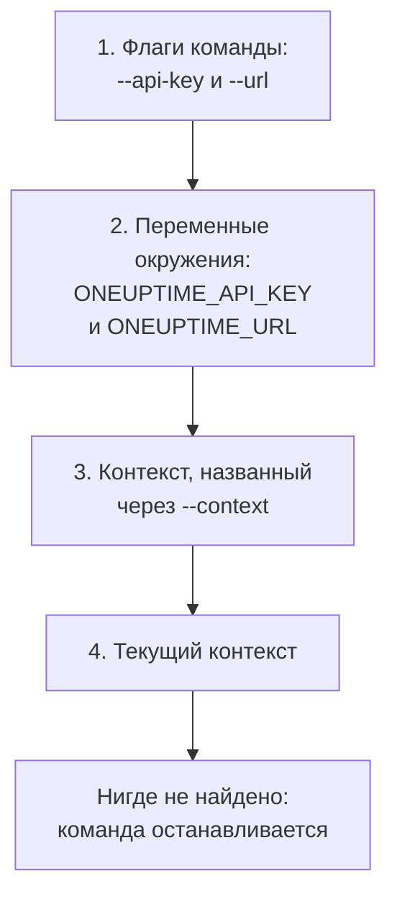

# Аутентификация

Каждый запрос, который отправляет CLI, несёт API-ключ вашего проекта. Сохраните ключи один раз командой `oneuptime login`, по контексту на каждое окружение, или передайте их команде во флагах или переменных окружения, как это делают скрипты. Эта страница показывает каждый способ и то, какой из них команда использует, когда их несколько.

:::cards
- [Вход](#вход): Сохранить API-ключ и адрес вашего OneUptime.
- [Контексты](#контексты): Сохранённый вход для каждого проекта или окружения и переключение между ними.
- [Какие учётные данные использует команда](#какие-учётные-данные-использует-команда): Сначала флаги, затем переменные окружения, затем контексты.
- [Устранение неполадок](#устранение-неполадок): Учётные данные не найдены, недействительные ключи и отказы.
:::

## Перед началом

Вам нужен API-ключ вашего проекта. Создайте его в **Настройки проекта → Расширенный → Ключи API** кнопкой **Создать: API-ключ** и дайте ему доступ, который нужен вашим командам: см. [Создайте API-ключ](/docs/api-reference/api-reference#создайте-api-ключ). Ключ делает то, что разрешают его права: ключ, которому можно только читать записи, может выводить и читать их, но не изменять.

В OneUptime Cloud API-ключи работают только пока проект на плане **Growth** или выше. Ниже него каждая команда отвечает `API error (402)` с сообщением, которое называет план, пока проект не перейдёт на план выше; тогда тот же ключ снова работает. См. [API-ключи и SCIM ниже их плана](/docs/api-reference/api-reference#api-ключи-и-scim-ниже-их-плана).

## Вход

`oneuptime login` сохраняет API-ключ и адрес вашего OneUptime как контекст и делает его текущим контекстом:

```bash
oneuptime login <api-key> <instance-url> [--context-name <name>]
```

| Аргумент или параметр | Что это |
| --- | --- |
| `<api-key>` | API-ключ вашего проекта |
| `<instance-url>` | Адрес вашего OneUptime: `https://oneuptime.com` или адрес вашего собственного сервера, например `https://oneuptime.example.com` |
| `--context-name <name>` | Имя, под которым сохраняется контекст. По умолчанию: `default` |

Например, контекст с именем `production`:

```bash
oneuptime login <api-key> https://oneuptime.com --context-name production
```

Она отвечает `Logged in successfully. Context "production" is now active.` Косая черта в конце адреса удаляется, а повторный вход под тем же именем заменяет этот контекст.

> [!NOTE]
> `login` сохраняет ключ, ничего не спрашивая у OneUptime. Запустите команду, например `oneuptime incident count`, чтобы убедиться, что ключ работает.

## Контексты

Контекст — это сохранённый вход: имя, адрес и API-ключ. Сохраните по одному для каждого проекта или окружения, затем выберите один для всех следующих команд или для одной команды.

:::steps
### Сохраните контекст для каждого окружения

```bash
oneuptime login <production-api-key> https://oneuptime.com --context-name production
oneuptime login <staging-api-key> https://oneuptime.example.com --context-name staging
```

Каждый вход делает свой контекст текущим, поэтому сейчас текущий — `staging`.

### Выведите их

```bash
oneuptime context list
```

```text
┌───┬────────────┬───────────────────────────────┐
│   │ Name       │ URL                           │
├───┼────────────┼───────────────────────────────┤
│   │ production │ https://oneuptime.com         │
├───┼────────────┼───────────────────────────────┤
│ * │ staging    │ https://oneuptime.example.com │
└───┴────────────┴───────────────────────────────┘
```

`*` отмечает текущий контекст. API-ключи никогда не выводятся.

### Переключитесь на другой контекст

```bash
oneuptime context use production
```

Она отвечает `Switched to context "production".`, и следующие команды используют его.

### Используйте контекст для одной команды

```bash
oneuptime incident list --context staging
```

Текущий контекст остаётся прежним.
:::

| Команда | Что делает |
| --- | --- |
| `oneuptime context list` | Выводит сохранённые контексты; `*` отмечает текущий. С `-o json` — `name`, `apiUrl` и `isCurrent` каждого контекста, но никогда не его ключ |
| `oneuptime context use <name>` | Делает сохранённый контекст текущим |
| `oneuptime context current` | Показывает имя, URL и API-ключ текущего контекста, скрывая в ключе всё, кроме первых четырёх и последних четырёх символов |
| `oneuptime context delete <name>` | Удаляет сохранённый контекст. Если он был текущим, текущим становится первый оставшийся контекст |

## Какие учётные данные использует команда

Команде нужны API-ключ и URL. Каждое из двух она берёт из первого из этих мест, где оно есть:



Поэтому их можно сочетать: например, API-ключ из переменной окружения с URL текущего контекста. Переменные окружения подходят для скриптов и заданий CI, у которых нет сохранённых контекстов:

:::tabs
@tab Linux
```bash
export ONEUPTIME_API_KEY=<api-key>
export ONEUPTIME_URL=https://oneuptime.com
oneuptime incident list
```
@tab macOS
```bash
export ONEUPTIME_API_KEY=<api-key>
export ONEUPTIME_URL=https://oneuptime.com
oneuptime incident list
```
@tab Windows
```powershell
$env:ONEUPTIME_API_KEY = "<api-key>"
$env:ONEUPTIME_URL = "https://oneuptime.com"
oneuptime incident list
```
:::

Флаги важнее всего остального, для одной команды:

```bash
oneuptime --api-key <api-key> --url https://oneuptime.com incident list
```

> [!WARNING]
> Ключ, переданный флагом, попадает в историю вашей оболочки, а другие пользователи машины могут увидеть его в списке процессов. На общей машине используйте вместо этого контекст или переменную окружения.

## Проверьте, что будет использовать CLI

`oneuptime whoami` показывает URL и API-ключ, которые использует следующая команда, и контекст, из которого они взяты:

```bash
oneuptime whoami
```

```text
URL:     https://oneuptime.com
API Key: 4f1c****0a13
Context: production
```

Показываются только первые четыре и последние четыре символа ключа. Строка `Context` появляется, только когда URL и ключ принадлежат самому контексту, а не заменены флагом или переменной окружения. `whoami` читает ваши настройки, не обращаясь к OneUptime: она показывает, что отправит команда, а не примет ли это OneUptime. Если ничего не сохранено и не задано, она отвечает:

```text
Not authenticated. Run `oneuptime login` to authenticate.
```

## Файл конфигурации

`oneuptime login` сохраняет контексты в `~/.oneuptime/config.json`, в вашей домашней папке (`%USERPROFILE%\.oneuptime\config.json` в Windows). CLI создаёт его так, чтобы читать и записывать его мог только ваш пользователь (режим `0600`):

```json title="~/.oneuptime/config.json"
{
  "currentContext": "production",
  "contexts": {
    "production": {
      "name": "production",
      "apiUrl": "https://oneuptime.com",
      "apiKey": "<api-key>"
    },
    "staging": {
      "name": "staging",
      "apiUrl": "https://oneuptime.example.com",
      "apiKey": "<api-key>"
    }
  }
}
```

Файл хранит API-ключи как есть: держите его вне общих папок, резервных копий и репозиториев. Чтобы выйти из одного контекста, удалите его командой `oneuptime context delete <name>`; чтобы выйти из всех, удалите файл. Ключ, который мог утечь, остаётся действительным, пока вы не удалите его в OneUptime, в **Настройки проекта → Расширенный → Ключи API**.

Форматы вывода и размеры списков здесь не сохраняются: передавайте `-o` и `--limit` каждой команде.

## Устранение неполадок

:::details Сообщение «No credentials found»
`Authentication error: No credentials found.` означает, что ни флаг, ни переменная окружения, ни сохранённый контекст не дали команде её API-ключ и URL. Запустите `oneuptime login` или задайте и `ONEUPTIME_API_KEY`, и `ONEUPTIME_URL`. Команда завершается с кодом `2`.
:::

:::details Сообщение «API error (400): Invalid API Key»
Ключ не является API-ключом OneUptime, истёк или был сброшен. Скопируйте его снова со страницы ключа в **Настройки проекта → Расширенный → Ключи API**, где в поле **Истекает** указана и его дата, и войдите снова под тем же именем контекста. Команда завершается с кодом `2`.
:::

:::details Сообщение «API error (402): API keys need the Growth plan»
В OneUptime Cloud проект находится ниже плана **Growth**, поэтому его API-ключи перестали работать. Переведите проект на план выше, и тот же ключ снова заработает: в CLI ничего менять не нужно.
:::

:::details Сообщение «API error (422): You do not have permissions»
Права ключа не покрывают то, что запрашивает команда. Дайте ключу роль или право на его странице в **Настройки проекта → Расширенный → Ключи API**: сообщение называет права, которые пропустили бы запрос.
:::

:::details Сообщение «Context "staging" does not exist»
Контекст с таким именем не сохранён. `oneuptime context list` показывает имена, которые есть.
:::

:::details whoami показывает не тот URL или ключ, что в контексте
Переменная окружения или флаг заменяет значение контекста. `env | grep ONEUPTIME` показывает заданные переменные, а `unset ONEUPTIME_API_KEY ONEUPTIME_URL` возвращает вас к вашим контекстам.
:::

:::details Запрос к адресу не проходит
`Error: Request failed to https://...` означает, что CLI не смогла достучаться до OneUptime по этому адресу. Проверьте URL командой `oneuptime whoami`: это адрес, по которому вы открываете OneUptime, с `https://`, например `https://oneuptime.com`.
:::

## Дальнейшие шаги

:::cards
- [Операции с ресурсами](/docs/cli/resource-operations): Выводить, читать, создавать, изменять, удалять и считать записи.
- [Скрипты и CI/CD](/docs/cli/scripting): Передать конвейеру его ключ в переменных окружения.
- [Справочник API OneUptime](/docs/api-reference/api-reference): Что может API-ключ и что означает каждый ответ.
:::
