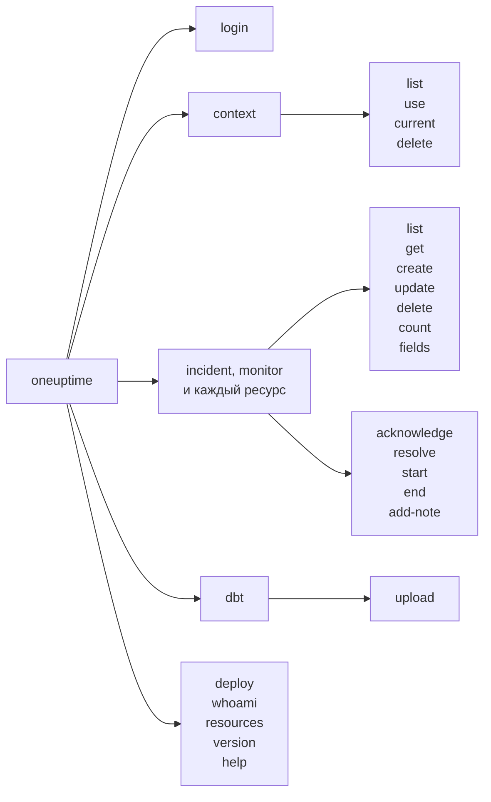

# Справочник команд

Каждая команда CLI `oneuptime` с её аргументами, параметрами и значениями по умолчанию. Добавьте `--help` к любой команде, чтобы увидеть то же самое в терминале.

:::cards
- [Глобальные параметры](#глобальные-параметры): Параметры, которые принимает каждая команда.
- [Вход и контексты](#вход-и-контексты): login и команды context.
- [Команды ресурсов](#команды-ресурсов): Операции, поля и действия каждого ресурса.
- [Другие команды](#другие-команды): deploy, dbt upload, data-checks apply, whoami, resources, version и help.
:::

## Команды



## Глобальные параметры

| Параметр | Что делает | По умолчанию |
| --- | --- | --- |
| `--api-key <key>` | API-ключ для этой команды | `ONEUPTIME_API_KEY`, затем ключ контекста |
| `--url <url>` | Адрес вашего OneUptime для этой команды | `ONEUPTIME_URL`, затем URL контекста |
| `--context <name>` | Сохранённый контекст для этой команды | Текущий контекст |
| `-o, --output <format>` | `json`, `table` или `wide` | `table` в терминале, `json` в конвейере |
| `--json` | То же, что `-o json` | |
| `--no-color` | Выводит без цветов | Цвета, если не задана `NO_COLOR` |
| `-V, --version` | Выводит версию CLI | |
| `-h, --help` | Показывает справку по команде | |

Параметры ставятся до или после команды: `oneuptime --context staging incident list` и `oneuptime incident list --context staging` делают одно и то же.

Каждая команда принимает `-o` и `--json`, поэтому таблицы ниже их не повторяют. Команда, чей ответ — предложение, например `delete`, выводит предложение, если только `-o json` или `--json` не запрашивает JSON: см. [Форматы вывода](/docs/cli/output-formats#json).

## Вход и контексты

### `oneuptime login`

Сохраняет API-ключ и адрес как контекст и делает его текущим. См. [Вход](/docs/cli/authentication#вход).

```bash
oneuptime login <api-key> <instance-url> [--context-name <name>]
```

| Аргумент или параметр | Обязателен | Что это | По умолчанию |
| --- | --- | --- | --- |
| `<api-key>` | Да | API-ключ вашего проекта | |
| `<instance-url>` | Да | Адрес вашего OneUptime, например `https://oneuptime.com` | |
| `--context-name <name>` | Нет | Имя, под которым сохраняется контекст | `default` |

### `oneuptime context list`

Выводит сохранённые контексты; `*` отмечает текущий. API-ключи никогда не выводятся: JSON даёт для каждого контекста `name`, `apiUrl` и `isCurrent`.

```bash
oneuptime context list
```

### `oneuptime context use`

Делает сохранённый контекст текущим.

```bash
oneuptime context use <name>
```

| Аргумент | Обязателен | Что это |
| --- | --- | --- |
| `<name>` | Да | Имя сохранённого контекста |

### `oneuptime context current`

Показывает имя и URL текущего контекста и его API-ключ, скрытый, кроме первых четырёх и последних четырёх символов.

```bash
oneuptime context current
```

### `oneuptime context delete`

Удаляет сохранённый контекст. Если он был текущим, текущим становится первый оставшийся контекст.

```bash
oneuptime context delete <name>
```

| Аргумент | Обязателен | Что это |
| --- | --- | --- |
| `<name>` | Да | Имя сохранённого контекста |

## Команды ресурсов

`<resource>` — это команда вида записей из таблицы раздела [Ресурсы](#ресурсы), например `incident` или `monitor`. У ресурса те операции, которые API для него принимает, у большинства все шесть, а `oneuptime <resource> --help` выводит его собственные. Примеры см. в разделе [Операции с ресурсами](/docs/cli/resource-operations).

### `oneuptime <resource> list`

Выводит записи, сначала самые новые. Метки же выводятся по названию, сначала нумерованные (`2. Team` перед `10. Owner`).

```bash
oneuptime <resource> list [--query <json>] [--limit <n>] [--skip <n>] [--sort <json>] [--fields <names>] [--all]
```

| Параметр | Что делает | По умолчанию |
| --- | --- | --- |
| `--query <json>` | Фильтр в виде JSON | Все записи, которые может читать ключ |
| `--limit <n>` | Наибольшее число возвращаемых записей, до 10 000 | `10` |
| `--skip <n>` | Сколько записей пропустить сначала | `0` |
| `--sort <json>` | Порядок в виде JSON: `{"<field>":"ASC"}` или `{"<field>":"DESC"}` | Сначала самые новые |
| `--fields <names>` | Поля для возврата через запятую; поле связанной записи — после точки, как в `currentIncidentState.name` | Все поля, которые может читать ключ |
| `--all` | Все подходящие записи, по 100 за раз, до 100 000, вместо `--limit` и `--skip`. Только записи: у телеметрии нет `--all` | |

### `oneuptime <resource> get`

Читает одну запись.

```bash
oneuptime <resource> get <id> [--fields <names>]
```

| Аргумент или параметр | Обязателен | Что это |
| --- | --- | --- |
| `<id>` | Да | ID записи, UUID |
| `--fields <names>` | Нет | Поля для возврата через запятую. По умолчанию: все поля, которые может читать ключ |

### `oneuptime <resource> create`

Создаёт запись и выводит её.

```bash
oneuptime <resource> create [--<field> <value>]... [--data <json>] [--file <path>]
```

| Параметр | Обязателен | Что это |
| --- | --- | --- |
| `--<field> <value>` | Поля, которые должно указать создание | Значение поля: `--title <text>`, `--incident-severity-id <id>`, `--labels <ids>`. `oneuptime <resource> create --help` выводит их. Только записи |
| `--data <json>` | Нет | Запись в виде JSON |
| `--file <path>` | Нет | JSON-файл с записью. Если указан вместе с `--data`, используется файл |

Флаги накладываются поверх `--data` или `--file`. У поля, которое называет человека по ID пользователя, есть и флаг, который называет его по адресу электронной почты: `--user-email` рядом с `--user-id`.

### `oneuptime <resource> update`

Изменяет указанные поля.

```bash
oneuptime <resource> update <id> [--<field> <value>]... [--data <json>] [--file <path>]
```

| Аргумент или параметр | Обязателен | Что это |
| --- | --- | --- |
| `<id>` | Да | ID записи |
| `--<field> <value>` | Нет | Изменяемое поле: `oneuptime <resource> update --help` выводит их. Только записи |
| `--data <json>` | Нет | Изменяемые поля в виде JSON |
| `--file <path>` | Нет | JSON-файл с изменяемыми полями. Если указан вместе с `--data`, используется файл |

### `oneuptime <resource> delete`

Сразу удаляет запись, ничего не спрашивая.

```bash
oneuptime <resource> delete <id> [--force]
```

| Аргумент или параметр | Обязателен | Что это |
| --- | --- | --- |
| `<id>` | Да | ID записи |
| `--force` | Нет | Принимается и ничего не меняет: `delete` никогда не просит подтверждения |

### `oneuptime <resource> count`

Считает записи и выводит число.

```bash
oneuptime <resource> count [--query <json>]
```

| Параметр | Обязателен | Что это |
| --- | --- | --- |
| `--query <json>` | Нет | Фильтр в виде JSON. Без него — все записи, которые может читать ключ |

### `oneuptime <resource> fields`

Выводит поля ресурса: для чего каждое, его тип, должно ли создание его указать, и флаг, который его задаёт. Берёт их из самой CLI, без API-ключа и без запроса.

```bash
oneuptime <resource> fields
```

### `oneuptime <resource> acknowledge`

Переводит инцидент, оповещение или эпизод одного из них в состояние «подтверждён» вашего проекта, как кнопка панели управления. Запись, уже подтверждённая или находящаяся дальше, остаётся как есть.

```bash
oneuptime <resource> acknowledge <id>
```

| Аргумент | Обязателен | Что это |
| --- | --- | --- |
| `<id>` | Да | ID записи |

### `oneuptime <resource> resolve`

Переводит инцидент, оповещение или эпизод одного из них в состояние «решён» вашего проекта.

```bash
oneuptime <resource> resolve <id>
```

| Аргумент | Обязателен | Что это |
| --- | --- | --- |
| `<id>` | Да | ID записи |

### `oneuptime <resource> start`

Переводит событие обслуживания в состояние «продолжается» вашего проекта.

```bash
oneuptime <resource> start <id>
```

| Аргумент | Обязателен | Что это |
| --- | --- | --- |
| `<id>` | Да | ID события |

### `oneuptime <resource> end`

Переводит событие обслуживания в состояние «закончено» вашего проекта.

```bash
oneuptime <resource> end <id>
```

| Аргумент | Обязателен | Что это |
| --- | --- | --- |
| `<id>` | Да | ID события |

### `oneuptime <resource> add-note`

Добавляет заметку к инциденту, оповещению, эпизоду одного из них или к событию обслуживания.

```bash
oneuptime <resource> add-note <id> --note <markdown> [--public]
```

| Аргумент или параметр | Обязателен | Что это |
| --- | --- | --- |
| `<id>` | Да | ID записи |
| `--note <markdown>` | Да | Заметка в Markdown |
| `--public` | Нет | Публикует её на страницах состояния записи, где об этом узнают её подписчики. Только инциденты, их эпизоды и плановое обслуживание |

### Ресурсы

Каждый ресурс API OneUptime — это команда с теми операциями, которые API для него принимает, с `fields` и с действиями тех записей, у которых они есть:

{{CLI_RESOURCE_COMMANDS}}

CLI выпускается вместе с OneUptime, поэтому `oneuptime resources` выводит команды той версии, которую вы установили.

### Запросы к API

Каждая операция — один запрос к API с ключом в заголовке `APIKey`. `<path>` — путь ресурса в API из `oneuptime resources`: `/incident` для `incident`, `/on-call-duty-policy` для `on-call-policy`.

| Операция | Запрос | Тело |
| --- | --- | --- |
| `list` | `POST /api/<path>/get-list` | `query`, `select`, `skip`, `limit` и `sort` |
| `get` | `POST /api/<path>/<id>/get-item` | `select` |
| `create` | `POST /api/<path>` | `{"data": ...}` |
| `update` | `PUT /api/<path>/<id>/` | `{"data": ...}` |
| `delete` | `DELETE /api/<path>/<id>/` | Нет |
| `count` | `POST /api/<path>/count` | `query` |

Действие читает состояния вашего проекта и запись, затем создаёт строку в хронологии состояний записи, как кнопка панели управления: `acknowledge` для инцидента создаёт `incident-state-timeline`. `add-note` создаёт `incident-internal-note`, а с `--public` — `incident-public-note`. Флаг почты сначала выводит участников команд проекта с этим адресом. Когда OneUptime отклоняет поле, которое ключ не может читать, список или чтение запрашивает снова без него.

## Другие команды

### `oneuptime deploy`

Записывает развёртывание или другое изменение из конвейера: оно отображается на графиках сервиса, и OneUptime AI читает его, когда расследует инцидент. Команда пишет с ключом приёма телеметрии, а не с API-ключом. См. [Развёртывания и изменения](/docs/telemetry/change-events).

```bash
oneuptime deploy [--service <name>] [--service-version <version>] [--previous-version <version>] [--commit <sha>] [--repository <url>] [--branch <name>] [--pull-request <number>] [--environment <name>] [--title <title>] [--description <text>] [--type <type>] [--time <time>] [--attribute <key=value...>] [--ingestion-key <key>]
```

| Параметр | Обязателен | Что это | По умолчанию |
| --- | --- | --- | --- |
| `--service <name>` | Нет | Сервис, который был развёрнут | Изменение для всего проекта |
| `--service-version <version>` | Нет | Развёрнутая версия | |
| `--previous-version <version>` | Нет | Версия, которую она заменила | |
| `--commit <sha>` | Нет | Развёрнутый коммит | |
| `--repository <url>` | Нет | Репозиторий, в котором находится коммит | |
| `--branch <name>` | Нет | Развёрнутая ветка | |
| `--pull-request <number>` | Нет | Развёрнутый pull request | |
| `--environment <name>` | Нет | Окружение, в которое выполнено развёртывание | |
| `--title <title>` | Нет | Заголовок изменения; обязателен для любого вида изменения, кроме развёртывания | `Deploy <version>` |
| `--description <text>` | Нет | Подробности изменения | |
| `--type <type>` | Нет | Вид изменения, например `config-change` или `rollback` | `deployment` |
| `--time <time>` | Нет | Когда оно произошло, например `2026-10-19T10:00:00Z` | Сейчас |
| `--attribute <key=value...>` | Нет | Дополнительные атрибуты в виде `key=value`, один или несколько | |
| `--ingestion-key <key>` | Нет | Ключ приёма телеметрии проекта | `ONEUPTIME_TELEMETRY_INGESTION_KEY` |

### `oneuptime dbt upload`

Отправляет артефакты проекта dbt после сборки, из CI или задания dbt Cloud, в «Наблюдаемость данных». Его модели отображаются на таблицах, которые они строят, вместе с их происхождением, его тесты отображаются рядом с проверками OneUptime и могут создавать оповещения, а каждая сборка становится запуском пайплайна проекта. Команда читает `manifest.json` и `run_results.json` из целевой папки dbt, отправляет только то, что из них читает «Наблюдаемость данных», и пишет с ключом приёма телеметрии, а не с API-ключом. Страница «Документация» раздела «Наблюдаемость данных» в вашей панели управления показывает её в задании CI.

```bash
oneuptime dbt upload [--target-path <dir>] [--manifest <file>] [--run-results <file>] [--project <name>] [--ingestion-key <key>]
```

| Параметр | Обязателен | Что это | По умолчанию |
| --- | --- | --- | --- |
| `--target-path <dir>` | Нет | Папка, в которую dbt записал свои артефакты | `target` |
| `--manifest <file>` | Нет | Отправляемый манифест | `manifest.json` в целевой папке |
| `--run-results <file>` | Нет | Отправляемые результаты запуска | `run_results.json` в целевой папке |
| `--project <name>` | Нет | Имя проекта dbt, нужно, только когда манифест не отправляется | Проект из манифеста |
| `--ingestion-key <key>` | Нет | Ключ приёма телеметрии проекта | `ONEUPTIME_TELEMETRY_INGESTION_KEY` |

### `oneuptime data-checks apply`

Приводит проверки данных проекта в соответствие с YAML-файлом, чтобы они хранились в репозитории и проходили ревью как код. Ошибка в любом месте файла ничего не применяет и завершается с ошибкой. Формат файла описан в разделе [Проверки и сверки](/docs/data-observability/checks).

```bash
oneuptime data-checks apply <file> [--dry-run] [--prune]
```

| Параметр | Обязателен | Что это | По умолчанию |
| --- | --- | --- | --- |
| `--dry-run` | Нет | Показывает, что изменилось бы, и ничего не меняет | Выключен |
| `--prune` | Нет | Удаляет проверки, созданные предыдущим применением, которых больше нет в файле | Выключен |

### `oneuptime whoami`

Показывает URL и API-ключ, которые использует следующая команда, с замаскированным ключом, и контекст, из которого они взяты. Без `--check` не обращается к OneUptime. См. [Проверьте, что будет использовать CLI](/docs/cli/authentication#проверьте-что-будет-использовать-cli).

```bash
oneuptime whoami [--check]
```

| Параметр | Обязателен | Что это |
| --- | --- | --- |
| `--check` | Нет | Спрашивает OneUptime, принимает ли он ключ, и показывает проект ключа, версию вашего OneUptime и версию CLI |

### `oneuptime resources`

Выводит каждый вид записей, для которого у CLI есть команда: его команду, названия в единственном и множественном числе, тип и путь в API, а также общее число. JSON даёт для каждого `name`, `singularName`, `pluralName`, `modelType`, `apiPath`, `operations` и `actions`.

```bash
oneuptime resources [--type <type>]
```

| Параметр | Обязателен | Что это | По умолчанию |
| --- | --- | --- | --- |
| `--type <type>` | Нет | `database` для записей, `analytics` для телеметрии | Оба |

### `oneuptime version`

Выводит версию CLI, как и `oneuptime --version`.

```bash
oneuptime version
```

### `oneuptime help`

Показывает справку по CLI или по команде.

```bash
oneuptime help [command]
```

## Переменные окружения

| Переменная | Что делает |
| --- | --- |
| `ONEUPTIME_API_KEY` | API-ключ, когда его не задаёт флаг `--api-key` |
| `ONEUPTIME_URL` | Адрес вашего OneUptime, когда его не задаёт флаг `--url` |
| `ONEUPTIME_TELEMETRY_INGESTION_KEY` | Ключ приёма телеметрии, с которым пишет `oneuptime deploy`, когда его не задаёт флаг `--ingestion-key` |
| `NO_COLOR` | Заданная с любым значением, отключает цвета |

## Файлы

| Файл | Что хранит |
| --- | --- |
| `~/.oneuptime/config.json` | Сохранённые контексты, их API-ключи и текущий контекст |

## Коды выхода

| Код | Значение |
| --- | --- |
| `0` | Получилось |
| `1` | Не получилось: OneUptime отклонил запрос, или команда была неверной |
| `2` | Нет пригодного API-ключа: не найден, недействителен или ниже своего плана |
| `3` | Не найдено: OneUptime ответил `404` |

Примеры см. в разделе [Коды выхода](/docs/cli/scripting#коды-выхода).

## Дальнейшие шаги

:::cards
- [Обзор CLI](/docs/cli/index): Установить CLI и выполнить первые команды.
- [Операции с ресурсами](/docs/cli/resource-operations): Примеры каждой операции.
- [Скрипты и CI/CD](/docs/cli/scripting): CLI в скриптах и конвейерах.
:::
