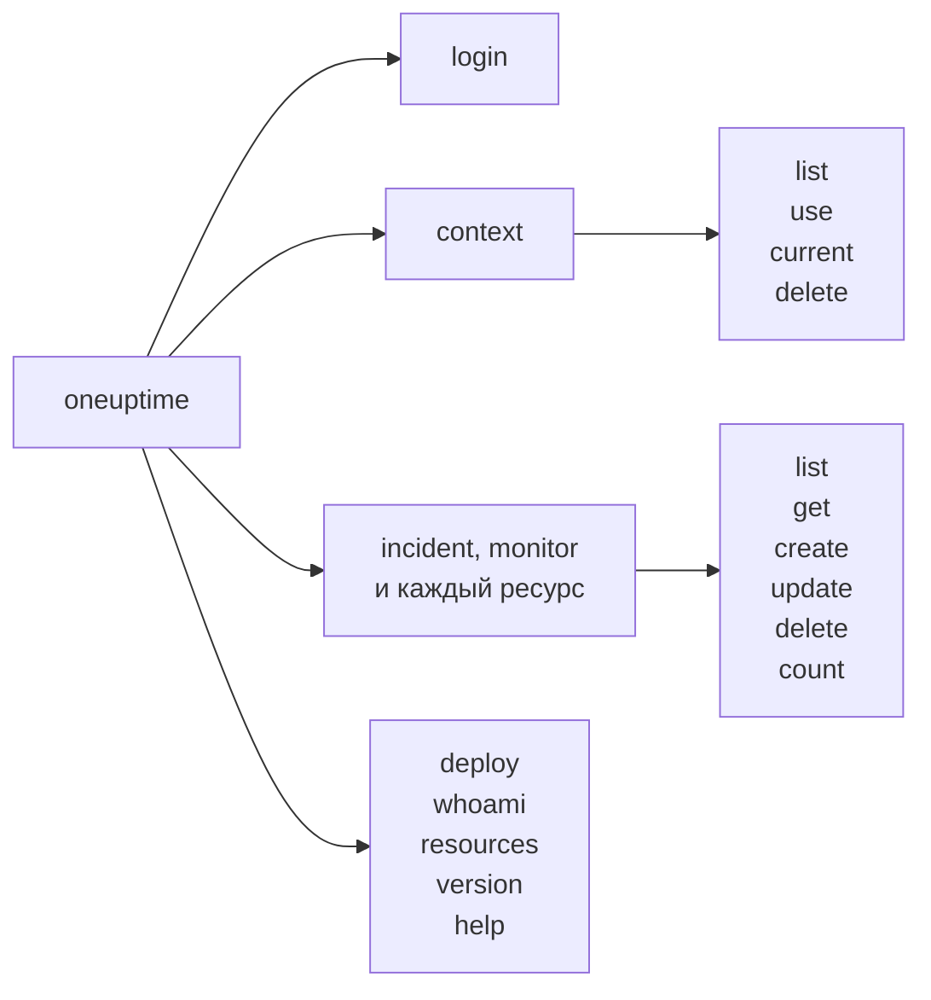

# Справочник команд

Каждая команда CLI `oneuptime` с её аргументами, параметрами и значениями по умолчанию. Добавьте `--help` к любой команде, чтобы увидеть то же самое в терминале.

:::cards
- [Глобальные параметры](#глобальные-параметры): Параметры, которые принимает каждая команда.
- [Вход и контексты](#вход-и-контексты): login и команды context.
- [Команды ресурсов](#команды-ресурсов): list, get, create, update, delete и count.
- [Другие команды](#другие-команды): deploy, whoami, resources, version и help.
:::

## Команды



## Глобальные параметры

| Параметр | Что делает | По умолчанию |
| --- | --- | --- |
| `--api-key <key>` | API-ключ для этой команды | `ONEUPTIME_API_KEY`, затем ключ контекста |
| `--url <url>` | Адрес вашего OneUptime для этой команды | `ONEUPTIME_URL`, затем URL контекста |
| `--context <name>` | Сохранённый контекст для этой команды | Текущий контекст |
| `-o, --output <format>` | `json`, `table` или `wide` | `table` в терминале, `json` в конвейере |
| `--no-color` | Выводит без цветов | Цвета, если не задана `NO_COLOR` |
| `-V, --version` | Выводит версию CLI | |
| `-h, --help` | Показывает справку по команде | |

Параметры ставятся до или после команды: `oneuptime --context staging incident list` и `oneuptime incident list --context staging` делают одно и то же.

## Вход и контексты

### `oneuptime login`

Сохраняет API-ключ и адрес как контекст и делает его текущим. См. [Вход](/docs/cli/authentication#вход).

```bash
oneuptime login <api-key> <instance-url> [--context-name <name>]
```

| Аргумент или параметр | Обязателен | Что это | По умолчанию |
| --- | --- | --- | --- |
| `<api-key>` | Да | API-ключ вашего проекта | |
| `<instance-url>` | Да | Адрес вашего OneUptime, например `https://oneuptime.com` | |
| `--context-name <name>` | Нет | Имя, под которым сохраняется контекст | `default` |

### `oneuptime context list`

Выводит сохранённые контексты; `*` отмечает текущий. API-ключи никогда не выводятся.

```bash
oneuptime context list [-o <format>]
```

| Параметр | Обязателен | Что это |
| --- | --- | --- |
| `-o, --output <format>` | Нет | `json`, `table` или `wide`. JSON даёт `name`, `apiUrl` и `isCurrent` каждого контекста |

### `oneuptime context use`

Делает сохранённый контекст текущим.

```bash
oneuptime context use <name>
```

| Аргумент | Обязателен | Что это |
| --- | --- | --- |
| `<name>` | Да | Имя сохранённого контекста |

### `oneuptime context current`

Показывает имя и URL текущего контекста и его API-ключ, скрытый, кроме первых четырёх и последних четырёх символов.

```bash
oneuptime context current
```

### `oneuptime context delete`

Удаляет сохранённый контекст. Если он был текущим, текущим становится первый оставшийся контекст.

```bash
oneuptime context delete <name>
```

| Аргумент | Обязателен | Что это |
| --- | --- | --- |
| `<name>` | Да | Имя сохранённого контекста |

## Команды ресурсов

`<resource>` — это команда вида записей из таблиц раздела [Ресурсы](#ресурсы), например `incident` или `monitor`. Примеры см. в разделе [Операции с ресурсами](/docs/cli/resource-operations).

### `oneuptime <resource> list`

Выводит записи, сначала самые новые. Метки же выводятся по названию, сначала нумерованные (`2. Team` перед `10. Owner`).

```bash
oneuptime <resource> list [--query <json>] [--limit <n>] [--skip <n>] [--sort <json>] [-o <format>]
```

| Параметр | Что делает | По умолчанию |
| --- | --- | --- |
| `--query <json>` | Фильтр в виде JSON | Все записи, которые может читать ключ |
| `--limit <n>` | Наибольшее число возвращаемых записей, до 10 000 | `10` |
| `--skip <n>` | Сколько записей пропустить сначала | `0` |
| `--sort <json>` | Порядок в виде JSON: `{"<field>":"ASC"}` или `{"<field>":"DESC"}` | Сначала самые новые |
| `-o, --output <format>` | `json`, `table` или `wide` | `table` в терминале, `json` в конвейере |

### `oneuptime <resource> get`

Читает одну запись. Только записи: у телеметрии нет `get`.

```bash
oneuptime <resource> get <id> [-o <format>]
```

| Аргумент или параметр | Обязателен | Что это |
| --- | --- | --- |
| `<id>` | Да | ID записи, UUID |
| `-o, --output <format>` | Нет | `json`, `table` или `wide` |

### `oneuptime <resource> create`

Создаёт запись и выводит её.

```bash
oneuptime <resource> create (--data <json> | --file <path>) [-o <format>]
```

| Параметр | Обязателен | Что это |
| --- | --- | --- |
| `--data <json>` | Один из двух | Запись в виде JSON |
| `--file <path>` | Один из двух | JSON-файл с записью. Если указан вместе с `--data`, используется файл |
| `-o, --output <format>` | Нет | `json`, `table` или `wide` |

### `oneuptime <resource> update`

Изменяет поля, которые вы передаёте. Только записи: у телеметрии нет `update`.

```bash
oneuptime <resource> update <id> --data <json> [-o <format>]
```

| Аргумент или параметр | Обязателен | Что это |
| --- | --- | --- |
| `<id>` | Да | ID записи |
| `--data <json>` | Да | Поля, которые нужно изменить, в виде JSON |
| `-o, --output <format>` | Нет | `json`, `table` или `wide` |

### `oneuptime <resource> delete`

Удаляет запись сразу, ничего не спрашивая. Только записи: у телеметрии нет `delete`.

```bash
oneuptime <resource> delete <id> [--force]
```

| Аргумент или параметр | Обязателен | Что это |
| --- | --- | --- |
| `<id>` | Да | ID записи |
| `--force` | Нет | Принимается и ничего не меняет: `delete` никогда не просит подтверждения |

### `oneuptime <resource> count`

Считает записи и выводит число.

```bash
oneuptime <resource> count [--query <json>] [-o <format>]
```

| Параметр | Обязателен | Что это |
| --- | --- | --- |
| `--query <json>` | Нет | Фильтр в виде JSON. Без него — все записи, которые может читать ключ |
| `-o, --output <format>` | Нет | `json`, `table` или `wide` |

### Ресурсы

Записи принимают `list`, `get`, `create`, `update`, `delete` и `count`:

| Область | Команды |
| --- | --- |
| Мониторинг | `monitor`, `monitor-status`, `monitor-status-event` |
| Инциденты | `incident`, `incident-state`, `incident-severity`, `incident-state-timeline`, `incident-public-note`, `incident-internal-note`, `incident-alert`, `postmortem-status` |
| Оповещения | `alert`, `alert-state`, `alert-severity`, `alert-state-timeline`, `alert-internal-note` |
| Страницы состояния | `status-page`, `status-page-announcement` |
| Плановое обслуживание | `scheduled-maintenance-event`, `scheduled-maintenance-state`, `scheduled-maintenance-state-timeline` |
| Команды и дежурства | `team`, `on-call-policy` |
| Безопасность | `security-case`, `security-case-evidence`, `security-case-note`, `security-case-priority`, `security-case-status`, `security-case-task`, `security-detection`, `security-playbook` |
| Метки | `label` |

Телеметрия принимает `list`, `create` и `count`:

| Область | Команды |
| --- | --- |
| Наблюдаемость | `log`, `metric`, `span`, `exception-instance`, `monitor-log` |
| Безопасность | `security-event`, `threat-intel-indicator` |
| Изменения и затраты | `change-event`, `kubernetes-cost-allocation` |

CLI выпускается вместе с OneUptime, поэтому `oneuptime resources` выводит команды той версии, которую вы установили.

### Запросы к API

Каждая операция — один запрос к API с ключом в заголовке `APIKey`. `<path>` — путь ресурса в API из `oneuptime resources`: `/incident` для `incident`, `/on-call-duty-policy` для `on-call-policy`.

| Операция | Запрос | Тело |
| --- | --- | --- |
| `list` | `POST /api/<path>/get-list` | `query`, `select`, `skip`, `limit` и `sort` |
| `get` | `POST /api/<path>/<id>/get-item` | `select` |
| `create` | `POST /api/<path>` | `{"data": ...}` |
| `update` | `PUT /api/<path>/<id>/` | `{"data": ...}` |
| `delete` | `DELETE /api/<path>/<id>/` | Нет |
| `count` | `POST /api/<path>/count` | `query` |

## Другие команды

### `oneuptime deploy`

Записывает развёртывание или другое изменение из конвейера: оно отображается на графиках сервиса, и OneUptime AI читает его, когда расследует инцидент. Команда пишет с ключом приёма телеметрии, а не с API-ключом. См. [Развёртывания и изменения](/docs/telemetry/change-events).

```bash
oneuptime deploy [--service <name>] [--service-version <version>] [--previous-version <version>] [--commit <sha>] [--repository <url>] [--branch <name>] [--pull-request <number>] [--environment <name>] [--title <title>] [--description <text>] [--type <type>] [--time <time>] [--attribute <key=value...>] [--ingestion-key <key>]
```

| Параметр | Обязателен | Что это | По умолчанию |
| --- | --- | --- | --- |
| `--service <name>` | Нет | Сервис, который был развёрнут | Изменение для всего проекта |
| `--service-version <version>` | Нет | Развёрнутая версия | |
| `--previous-version <version>` | Нет | Версия, которую она заменила | |
| `--commit <sha>` | Нет | Развёрнутый коммит | |
| `--repository <url>` | Нет | Репозиторий, в котором находится коммит | |
| `--branch <name>` | Нет | Развёрнутая ветка | |
| `--pull-request <number>` | Нет | Развёрнутый pull request | |
| `--environment <name>` | Нет | Окружение, в которое выполнено развёртывание | |
| `--title <title>` | Нет | Заголовок изменения; обязателен для любого вида изменения, кроме развёртывания | `Deploy <version>` |
| `--description <text>` | Нет | Подробности изменения | |
| `--type <type>` | Нет | Вид изменения, например `config-change` или `rollback` | `deployment` |
| `--time <time>` | Нет | Когда оно произошло, например `2026-10-19T10:00:00Z` | Сейчас |
| `--attribute <key=value...>` | Нет | Дополнительные атрибуты в виде `key=value`, один или несколько | |
| `--ingestion-key <key>` | Нет | Ключ приёма телеметрии проекта | `ONEUPTIME_TELEMETRY_INGESTION_KEY` |

### `oneuptime whoami`

Показывает URL и API-ключ, которые использует следующая команда, с замаскированным ключом, и контекст, из которого они взяты. Она не обращается к OneUptime. См. [Проверьте, что будет использовать CLI](/docs/cli/authentication#проверьте-что-будет-использовать-cli).

```bash
oneuptime whoami
```

### `oneuptime resources`

Выводит каждый вид записей, для которого у CLI есть команда: его команду, названия в единственном и множественном числе, тип и путь в API, а также общее число.

```bash
oneuptime resources [--type <type>] [-o <format>]
```

| Параметр | Обязателен | Что это | По умолчанию |
| --- | --- | --- | --- |
| `--type <type>` | Нет | `database` для записей, `analytics` для телеметрии | Оба |
| `-o, --output <format>` | Нет | `json`, `table` или `wide`. JSON даёт `name`, `singularName`, `pluralName`, `modelType` и `apiPath` каждого | `table` в терминале, `json` в конвейере |

### `oneuptime version`

Выводит версию CLI, как и `oneuptime --version`.

```bash
oneuptime version
```

### `oneuptime help`

Показывает справку по CLI или по команде.

```bash
oneuptime help [command]
```

## Переменные окружения

| Переменная | Что делает |
| --- | --- |
| `ONEUPTIME_API_KEY` | API-ключ, когда его не задаёт флаг `--api-key` |
| `ONEUPTIME_URL` | Адрес вашего OneUptime, когда его не задаёт флаг `--url` |
| `ONEUPTIME_TELEMETRY_INGESTION_KEY` | Ключ приёма телеметрии, с которым пишет `oneuptime deploy`, когда его не задаёт флаг `--ingestion-key` |
| `NO_COLOR` | Заданная с любым значением, отключает цвета |

## Файлы

| Файл | Что хранит |
| --- | --- |
| `~/.oneuptime/config.json` | Сохранённые контексты, их API-ключи и текущий контекст |

## Коды выхода

| Код | Значение |
| --- | --- |
| `0` | Получилось |
| `1` | Не получилось: OneUptime отклонил запрос, или команда была неверной |
| `2` | Нет пригодного API-ключа: не найден, недействителен или ниже своего плана |
| `3` | Не найдено: OneUptime ответил `404` |

Примеры см. в разделе [Коды выхода](/docs/cli/scripting#коды-выхода).

## Дальнейшие шаги

:::cards
- [Обзор CLI](/docs/cli/index): Установить CLI и выполнить первые команды.
- [Операции с ресурсами](/docs/cli/resource-operations): Примеры каждой операции.
- [Скрипты и CI/CD](/docs/cli/scripting): CLI в скриптах и конвейерах.
:::
