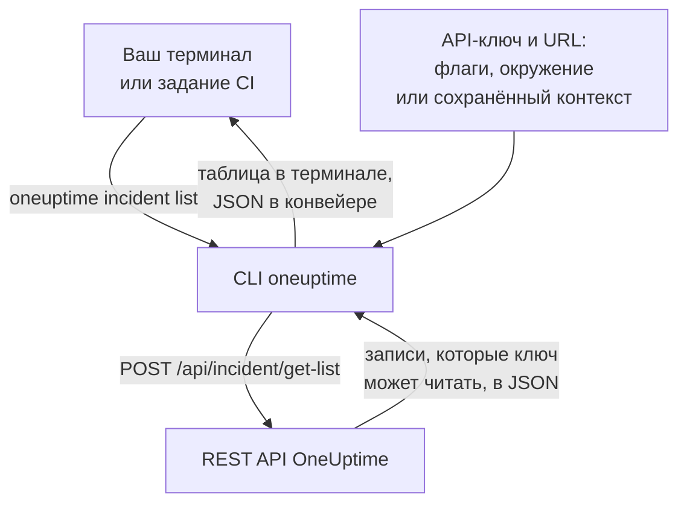

# Обзор CLI

CLI OneUptime, `oneuptime`, управляет вашим проектом OneUptime из терминала или скрипта. Она выводит, читает, создаёт, изменяет, удаляет и считает мониторы, инциденты, оповещения, страницы состояния и другие записи, которые предлагает API OneUptime, с API-ключом вашего проекта.

:::cards
- [Как работает CLI](#как-работает-cli): Одна команда, один запрос к API, один ответ.
- [Установка CLI](#установка-cli): Одна команда npm и версия, которую нужно выбрать.
- [Первые команды](#первые-команды): Сохраните API-ключ, затем выведите свои инциденты.
- [Команды кратко](#команды-кратко): Каждая команда и страница, которая её объясняет.
:::

## Как работает CLI

Каждая команда отправляет один запрос к REST API OneUptime и выводит ответ. API-ключ и адрес вашего OneUptime CLI берёт из флагов, переменных окружения или контекста, который сохранила команда `oneuptime login`. Ключ решает, что команда может читать и изменять, точно так же, как в API.



Команды для записей входят в CLI: у каждого вида записей, который API OneUptime открывает инструментам, есть своя, это те же записи, для которых у [сервера MCP](/docs/ai/mcp-server) есть инструменты. Запустите `oneuptime resources`, чтобы вывести их.

## Перед началом

- **Node.js и npm** актуальной LTS-версии, чтобы установить CLI.
- **API-ключ вашего проекта.** Создайте его в **Настройки проекта → Расширенный → Ключи API** кнопкой **Создать: API-ключ**: см. [Создайте API-ключ](/docs/api-reference/api-reference#создайте-api-ключ).
- **В OneUptime Cloud — план Growth или выше.** API-ключи проекта работают только на нём: см. [API-ключи и SCIM ниже их плана](/docs/api-reference/api-reference#api-ключи-и-scim-ниже-их-плана).

## Установка CLI

Установите пакет `@oneuptime/cli` из npm. Он добавляет команду `oneuptime`, а `--version` выводит установленную версию:

```bash
npm install -g @oneuptime/cli
oneuptime --version
```

CLI выпускается вместе с OneUptime и имеет тот же номер версии. В самостоятельно размещённом OneUptime установите CLI той же версии, что и ваш OneUptime, чтобы её команды соответствовали записям вашего сервера:

```bash
npm install -g @oneuptime/cli@<your-oneuptime-version>
```

> [!WARNING]
> Версии CLI до 14.0.64 завершаются сразу при запуске с ошибкой вроде `Cannot find module 'Common/Models/DatabaseModels/Index'`. Установите 14.0.64 или новее командой `npm install -g @oneuptime/cli@latest`. Если ваш самостоятельно размещённый OneUptime старше 14.0.64, сначала [обновите OneUptime](/docs/installation/upgrading#как-обновиться), а затем установите CLI той версии, до которой обновились.

## Первые команды

:::steps
### Сохраните API-ключ

Войдите с ключом и адресом вашего OneUptime. CLI сохраняет их как контекст с именем `default` и с этого момента использует его:

```bash
oneuptime login <your-api-key> https://oneuptime.com
```

Она отвечает `Logged in successfully. Context "default" is now active.` В самостоятельно размещённом OneUptime используйте его адрес вместо `https://oneuptime.com`.

### Выведите свои инциденты

```bash
oneuptime incident list
```

Десять самых новых инцидентов появляются в виде таблицы. `login` сохраняет ключ, не проверяя его, поэтому именно эта команда первой показывает, что ключ работает: если его отклонили, см. [Устранение неполадок](/docs/cli/authentication#устранение-неполадок).

### Посмотрите, чем ещё можно управлять

```bash
oneuptime resources
```

Список показывает каждый вид записей, с которым можно работать, и его команду, например `monitor`, `status-page` или `on-call-policy`.
:::

## Команды кратко

| Команда | Что делает | Подробнее |
| --- | --- | --- |
| `oneuptime login <api-key> <instance-url>` | Сохраняет API-ключ и адрес как контекст | [Аутентификация](/docs/cli/authentication#вход) |
| `oneuptime context list`, `use`, `current`, `delete` | Выводит, переключает, показывает и удаляет сохранённые контексты | [Аутентификация](/docs/cli/authentication#контексты) |
| `oneuptime whoami` | Показывает URL и API-ключ, которые использует следующая команда | [Аутентификация](/docs/cli/authentication#проверьте-что-будет-использовать-cli) |
| `oneuptime deploy` | Записывает развёртывание или другое изменение для графиков и OneUptime AI | [Развёртывания и изменения](/docs/telemetry/change-events) |
| `oneuptime <resource> list`, `get`, `create`, `update`, `delete`, `count` | Работает с одним видом записей | [Операции с ресурсами](/docs/cli/resource-operations) |
| `oneuptime resources` | Выводит виды записей с их командами | [Справочник команд](/docs/cli/command-reference#oneuptime-resources) |
| `oneuptime version` | Выводит версию CLI | [Справочник команд](/docs/cli/command-reference#oneuptime-version) |
| `oneuptime help [command]` | Показывает справку по команде | [Получение справки](#получение-справки) |

## Глобальные параметры

Эти параметры работают с любой командой, до неё или после:

| Параметр | Что делает |
| --- | --- |
| `--api-key <key>` | API-ключ для этой команды вместо сохранённого |
| `--url <url>` | Адрес вашего OneUptime для этой команды |
| `--context <name>` | Сохранённый контекст для этой команды вместо текущего |
| `-o, --output <format>` | `table`, `json` или `wide`: см. [Форматы вывода](/docs/cli/output-formats) |
| `--no-color` | Выводит без цветов |
| `-V, --version` | Выводит версию CLI |
| `-h, --help` | Показывает справку по команде |

## Получение справки

У каждой команды есть своя справка с её аргументами, параметрами и значениями по умолчанию:

```bash
oneuptime --help
oneuptime help incident
oneuptime incident list --help
```

## Дальнейшие шаги

:::cards
- [Аутентификация](/docs/cli/authentication): Контексты для каждого окружения и то, какой ключ использует команда.
- [Операции с ресурсами](/docs/cli/resource-operations): Выводить, читать, создавать, изменять, удалять и считать записи.
- [Форматы вывода](/docs/cli/output-formats): Таблицы для людей, JSON для скриптов.
- [Скрипты и CI/CD](/docs/cli/scripting): Коды выхода, jq и конвейеры.
- [Справочник команд](/docs/cli/command-reference): Каждая команда, параметр и значение по умолчанию.
:::
