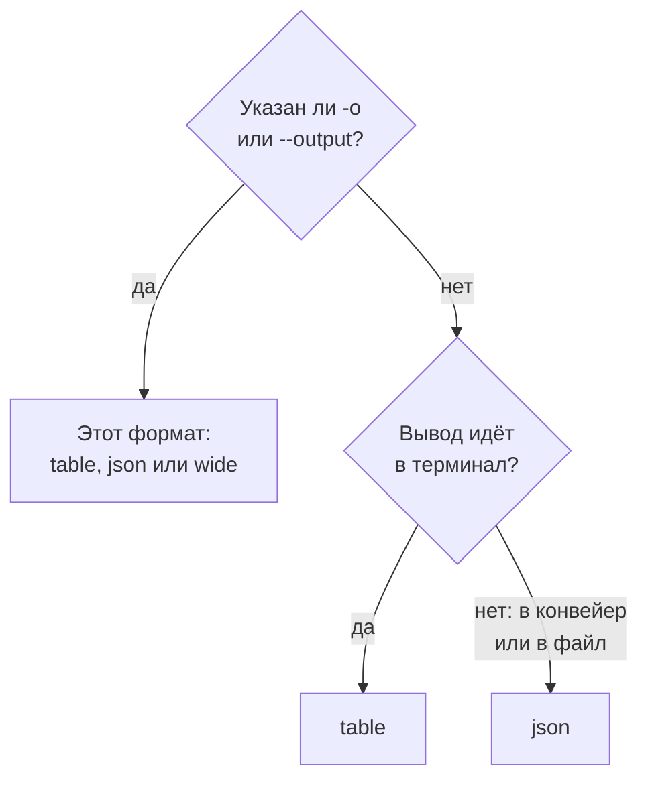

# Форматы вывода

CLI выводит таблицу, когда вы читаете её ответ в терминале, и JSON, когда его читает скрипт или другая программа. Выберите формат любой команды с помощью `-o` или `--output`.

:::cards
- [Как выбирается формат](#как-выбирается-формат): Терминал получает таблицу, конвейер — JSON.
- [Таблица](#таблица): Шесть столбцов, каждое значение обрезано на 60 символах.
- [JSON](#json): Каждое поле целиком, для скриптов и jq.
- [Широкий](#широкий): Таблица со всеми столбцами.
:::

## Как выбирается формат



| Формат | Что выводит | Лучше всего для |
| --- | --- | --- |
| `table` | Таблицу не более чем из шести столбцов; одну запись — строкой на каждое поле | Чтения в терминале |
| `json` | Ответ в том виде, в каком его прислал OneUptime, с отступом в два пробела | Скриптов, `jq` и файлов |
| `wide` | Таблицу со столбцом для каждого поля | Сравнения многих полей сразу |

`-o` работает с каждой командой, которая выводит записи: `list`, `get`, `create`, `update` и `count` ресурса, `oneuptime resources` и `oneuptime context list`. Его можно поставить в любом месте командной строки. Любое другое значение отклоняется до отправки запроса:

```text
error: option '-o, --output <format>' argument 'yaml' is invalid. Allowed choices are json, table, wide.
```

## Таблица

В терминале по умолчанию выводится таблица. `oneuptime resources --type analytics`, например, выводит такую:

```text
┌────────────────────────────┬────────────────────────────┬─────────────────────────────┬───────────┬─────────────────────────────┐
│ Command                    │ Singular                   │ Plural                      │ Type      │ API Path                    │
├────────────────────────────┼────────────────────────────┼─────────────────────────────┼───────────┼─────────────────────────────┤
│ log                        │ Log                        │ Logs                        │ analytics │ /logs                       │
├────────────────────────────┼────────────────────────────┼─────────────────────────────┼───────────┼─────────────────────────────┤
│ span                       │ Span                       │ Spans                       │ analytics │ /span                       │
├────────────────────────────┼────────────────────────────┼─────────────────────────────┼───────────┼─────────────────────────────┤
│ metric                     │ Metric                     │ Metrics                     │ analytics │ /metrics                    │
├────────────────────────────┼────────────────────────────┼─────────────────────────────┼───────────┼─────────────────────────────┤
│ exception-instance         │ Exception Instance         │ Exception Instances         │ analytics │ /exceptions                 │
├────────────────────────────┼────────────────────────────┼─────────────────────────────┼───────────┼─────────────────────────────┤
│ monitor-log                │ Monitor Log                │ Monitor Logs                │ analytics │ /monitor-log                │
├────────────────────────────┼────────────────────────────┼─────────────────────────────┼───────────┼─────────────────────────────┤
│ kubernetes-cost-allocation │ Kubernetes Cost Allocation │ Kubernetes Cost Allocations │ analytics │ /kubernetes-cost-allocation │
├────────────────────────────┼────────────────────────────┼─────────────────────────────┼───────────┼─────────────────────────────┤
│ security-event             │ Security Event             │ Security Events             │ analytics │ /security-events            │
├────────────────────────────┼────────────────────────────┼─────────────────────────────┼───────────┼─────────────────────────────┤
│ change-event               │ Change Event               │ Change Events               │ analytics │ /change-events              │
├────────────────────────────┼────────────────────────────┼─────────────────────────────┼───────────┼─────────────────────────────┤
│ threat-intel-indicator     │ Threat Intel Indicator     │ Threat Intel Indicators     │ analytics │ /threat-intel-indicators    │
└────────────────────────────┴────────────────────────────┴─────────────────────────────┴───────────┴─────────────────────────────┘

Total: 9 resources
```

Для списка записей таблица показывает не более шести столбцов: сначала `_id`, `name`, `title`, `status`, `createdAt` и `updatedAt` — те из них, что есть у записей, — затем следующие поля записей по порядку. Столбцы берутся из первой записи. Значение длиннее 60 символов обрезается до первых 57, за которыми следует `...`.

Одна запись, как её выводят `get` и `create`, — это таблица из двух столбцов: имя поля и его значение, по строке на поле.

OneUptime присылает даты и ID других записей как объекты, например `{"_type":"DateTime","value":"2026-10-14T09:12:44.000Z"}`, и таблица показывает их этим текстом. Их значение находится в `value`: см. [JSON](#json).

## JSON

JSON — это ответ в том виде, в каком его прислал OneUptime, с отступом в два пробела: список — это массив записей, а одна запись — объект.

```bash
oneuptime incident list --limit 1 -o json
```

```json
[
  {
    "_id": "6f1c2a40-3b1e-4c55-9a0b-3e2f8d7c1a11",
    "createdAt": {
      "_type": "DateTime",
      "value": "2026-10-14T09:12:44.000Z"
    },
    "title": "Checkout API is down",
    "currentIncidentStateId": {
      "_type": "ObjectID",
      "value": "0b7d5e2c-8f4a-4d1b-9c3e-5a6f7b8c9d0e"
    }
  }
]
```

У записи есть каждое поле, которое может читать ключ; эта сокращена до четырёх. Собственный `_id` записи — текст, а другие ID и даты — объекты, чьё `value` их содержит:

```bash
oneuptime incident list -o json | jq -r '.[] | "\(.createdAt.value)  \(.title)"'
```

Когда вывод идёт не в терминал, как в `oneuptime incident list | jq '.[].title'`, CLI выводит JSON без `-o json`. Всё равно пишите `-o json` в скриптах, чтобы они от этого не зависели.

## Широкий

`-o wide` — это таблица со столбцом для каждого поля записей. Каждое значение по-прежнему обрезается на 60 символах, а у записей много полей, поэтому широкая таблица очень широкая: листайте её с `less -S`.

```bash
oneuptime incident list -o wide | less -S
```

## Цвета

Заголовки таблиц бирюзовые; сообщения зелёные, когда что-то получилось, синие для информации и красные для ошибок. Отключите цвета флагом `--no-color` или задав `NO_COLOR` с любым значением:

```bash
oneuptime incident list --no-color
NO_COLOR=1 oneuptime incident list
```

## Что выводит каждая команда

Записи и количества идут в стандартный вывод, а ошибки — в стандартный поток ошибок, поэтому конвейер читает только ответ.

| Команда | В таблице | В JSON |
| --- | --- | --- |
| `list`, который ничего не нашёл | `No results found.` | `[]` |
| `get` или `create` | Строка на каждое поле | Запись |
| `count` | Число | Число |
| `update` | Пустая строка | `{}` |
| `delete` | `Monitor <id> deleted successfully.` | Та же строка |

## Дальнейшие шаги

:::cards
- [Скрипты и CI/CD](/docs/cli/scripting): Читать JSON с помощью jq в скриптах и конвейерах.
- [Операции с ресурсами](/docs/cli/resource-operations): Операции, ответы которых это.
- [Справочник команд](/docs/cli/command-reference): Каждая команда и каждый параметр.
:::
