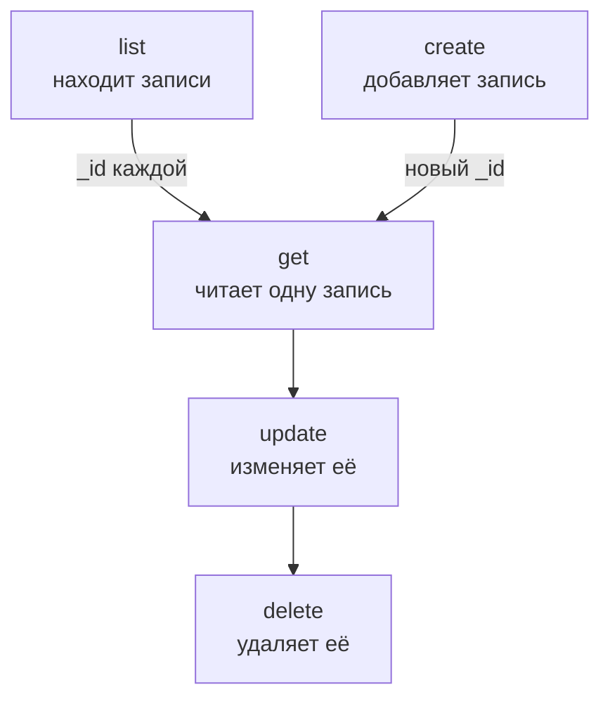

# Операции с ресурсами

Каждый вид записей — отдельная команда, например `incident`, `monitor` или `status-page`, с теми операциями, которые API для неё принимает: у большинства это `list`, `get`, `create`, `update`, `delete` и `count`. Эта страница показывает каждую операцию с фильтрами, постраничным выводом и флагами, которыми записывается запись, а также команды, которые делают то же, что кнопки панели управления.

:::cards
- [Найдите команду для записи](#найдите-команду-для-записи): oneuptime resources выводит их все.
- [Вывод записей](#вывод-записей): Фильтрация, сортировка и постраничный вывод.
- [Создание записи](#создание-записи): Флаг для каждого поля или запись в виде JSON.
- [Подтвердить, устранить и добавить заметки](#подтвердить-устранить-и-добавить-заметки): Кнопки панели управления в виде команд.
- [Удаление записи](#удаление-записи): Сразу и без отмены.
:::

## Как операции связаны между собой

Чтение, изменение и удаление записи требуют её ID. Вывод, подсчёт и создание не требуют ни одного, а список или создание дают вам ID, которые принимают остальные:



ID — это UUID, например `6f1c2a40-3b1e-4c55-9a0b-3e2f8d7c1a11`. Его также можно скопировать со страницы записи в OneUptime: см. [Как найти ID ресурса](/docs/api-reference/api-reference#как-найти-id-ресурса).

## Найдите команду для записи

```bash
oneuptime resources
```

Список показывает каждый вид записей с его командой, названиями, типом и путём в API. Типов два:

| Тип | Что в нём |
| --- | --- |
| `database` | Записи, которыми вы управляете: мониторы, инциденты, оповещения, страницы состояния, команды и другое |
| `analytics` | Телеметрия: логи, спаны, метрики, исключения и другие события |

Выведите один тип командой `oneuptime resources --type database` или `--type analytics`. [Справочник команд](/docs/cli/command-reference#ресурсы) перечисляет все команды.

Ресурс принимает те операции, которые API для него принимает. Большинство принимают все шесть; ресурс, который OneUptime пишет сам, например журнал писем, доступен только для чтения. `oneuptime <resource> --help` выводит подкоманды ресурса.

## Поля ресурса

`fields` выводит поля ресурса из самой CLI, без API-ключа и без запроса:

```bash
oneuptime incident fields
```

У каждого поля есть тип, назначение, признак того, должно ли создание его указать, и флаг, который его задаёт. Поле с ID называет ресурс, к которому относится ID: `incidentSeverityId` берёт его из `oneuptime incident-severity list`. С `-o json` скрипт или ИИ-агент читает то же самое, с одинаковыми ключами для каждого поля: `name`, `title`, `type`, `description`, `required`, `create`, `update`, `read`, `flag`, `emailFlag` и `relatedResource`.

## Вывод записей

```bash
oneuptime <resource> list [--query <json>] [--limit <n>] [--skip <n>] [--sort <json>] [--fields <names>] [--all] [-o <format>]
```

| Параметр | Что делает | По умолчанию |
| --- | --- | --- |
| `--query <json>` | Возвращает только подходящие записи: см. [Фильтрация списка](#фильтрация-списка) | Все записи, которые может читать ключ |
| `--limit <n>` | Наибольшее число возвращаемых записей, до 10 000 | `10` |
| `--skip <n>` | Сколько подходящих записей пропустить сначала | `0` |
| `--sort <json>` | Порядок, например `{"createdAt":"ASC"}`, или `"DESC"`, чтобы сначала шли самые новые | Сначала самые новые |
| `--fields <names>` | Поля для возврата через запятую, например `title,createdAt` | Все поля, которые может читать ключ |
| `--all` | Все подходящие записи, страница за страницей, вместо `--limit` и `--skip`. Только записи | |
| `-o, --output <format>` | `table`, `json` или `wide` | `table` в терминале, `json` в конвейере |

```bash
# The ten newest incidents
oneuptime incident list

# The oldest monitors first, 50 at a time: the second page
oneuptime monitor list --sort '{"createdAt":"ASC"}' --limit 50 --skip 50

# Every field of each incident, as JSON
oneuptime incident list -o json

# The title, the state and the creation date of every incident
oneuptime incident list --all --fields title,currentIncidentState.name,createdAt -o json
```

Список запрашивает у OneUptime каждое поле каждой записи, которое может читать ключ. `--fields` запрашивает вместо этого названные поля, а после точки — поле связанной записи, как в `currentIncidentState.name`. Таблица показывает шесть полей; JSON показывает все (см. [Форматы вывода](/docs/cli/output-formats)). `--all` читает все страницы, по 100 записей за раз, до 100 000; `count` говорит, сколько их.

Метки выводятся по названию, а не начиная с самых новых: сначала метки, чьи названия начинаются с числа, в порядке этого числа (`2. Team` перед `10. Owner`), затем остальные по алфавиту. Чтобы вывести их в другом порядке, укажите `--sort`.

### Фильтрация списка

`--query` принимает тот же фильтр, что и API: поле со значением совпадает с этим значением, а объект с `_type` сравнивает.

| Фильтр | Совпадает с |
| --- | --- |
| `{"title":"Checkout API is down"}` | Записями точно с этим значением |
| `{"title":{"_type":"Search","value":"checkout"}}` | Текстом, который содержит значение |
| `{"createdAt":{"_type":"GreaterThan","value":"2026-10-01T00:00:00.000Z"}}` | Более поздними датами или большими числами |
| `{"currentIncidentState":{"isResolvedState":false}}` | Полем записи, на которую ссылается ресурс: здесь — нерешёнными инцидентами |

```bash
oneuptime incident list --query '{"title":{"_type":"Search","value":"checkout"}}'
```

[Фильтрация, сортировка и постраничный вывод](/docs/api-reference/api-reference#фильтрация-сортировка-и-постраничный-вывод) в справочнике API перечисляет все `_type`.

## Чтение записи

```bash
oneuptime <resource> get <id> [--fields <names>] [-o <format>]
```

```bash
oneuptime incident get 6f1c2a40-3b1e-4c55-9a0b-3e2f8d7c1a11
```

Таблица показывает по строке на каждое поле записи, обрезая каждое значение на 60 символах; `-o json` показывает значения целиком. На ID, который не называет ни одной записи, доступной вашему ключу, приходит ответ `Not found`, и команда завершается с кодом `3`.

## Создание записи

```bash
oneuptime <resource> create [--<field> <value>]... [--data <json>] [--file <path>] [-o <format>]
```

У каждого поля, которое принимает создание, есть флаг: `--title <text>`, `--incident-severity-id <id>`, `--labels <ids>` для ID через запятую, `--is-visible-on-status-page [true|false]` для поля «да или нет», истинного, когда флаг указан без значения, и `--monitor-steps <json>` для поля с JSON. `oneuptime <resource> create --help` выводит их, а [`fields`](#поля-ресурса) говорит, для чего каждое. Проект берётся из API-ключа, поэтому запись его никогда не называет.

```bash
# A manual monitor
oneuptime monitor create --name "Checkout API" --monitor-type Manual

# An incident with one of your severities
oneuptime incident create --title "Checkout API is down" --incident-severity-id <severity-id>

# The same incident, from a file
oneuptime incident create --file incident.json
```

`--data` принимает запись в виде JSON, а `--file` читает её из JSON-файла, с полями API: [справочник API](/reference) перечисляет поля каждого ресурса. Если указаны оба, используется файл, а флаги накладываются поверх любого из них.

У поля, которое называет человека по ID пользователя, есть второй флаг, который называет его по адресу электронной почты: `--user-email` рядом с `--user-id`, `--owner-user-emails` рядом с `--owner-users`. CLI ищет человека среди участников проекта API-ключа и приглашённых в него. Участник команды, названный адресом, которого нет ни у кого в проекте, получает приглашение в проект, как при приглашении из панели управления:

```bash
oneuptime team-member create --team-id <team-id> --user-email alice@example.com
```

CLI выводит новую запись с её `_id`. Инцидент начинается в состоянии создания вашего проекта, если `currentIncidentStateId` не называет другое: см. [Состояние, в котором начинается новая запись](/docs/api-reference/api-reference#состояние-в-котором-начинается-новая-запись). Чтобы найти ID ваших уровней серьёзности:

```bash
oneuptime incident-severity list -o json | jq -r '.[] | "\(._id)  \(.name)"'
```

> [!TIP]
> В Windows укажите поля их флагами или поместите JSON в файл и используйте `--file`: PowerShell и командная строка заключают JSON в кавычки в командной строке иначе, чем Bash.

## Обновление записи

```bash
oneuptime <resource> update <id> [--<field> <value>]... [--data <json>] [--file <path>] [-o <format>]
```

Укажите только изменяемые поля, их флагами или в виде JSON:

```bash
# Rename a monitor
oneuptime monitor update <monitor-id> --name "Checkout API (EU)"

# Record an incident's root cause
oneuptime incident update <incident-id> --root-cause "A full disk on the primary database"
```

OneUptime отвечает на обновление пустым объектом: CLI выводит пустую строку или `{}` с `-o json`. Запустите `get`, чтобы увидеть запись в её нынешнем виде. Чтобы перевести инцидент в другое состояние, укажите `--current-incident-state-id`: изменение записывается в его хронологию, как это делает панель управления, а состояние раньше текущего отклоняется. [`acknowledge` и `resolve`](#подтвердить-устранить-и-добавить-заметки) находят состояние за вас. Чтобы найти ID состояния «решён», первого в порядке вашего проекта:

```bash
oneuptime incident-state list --query '{"isResolvedState":true}' --sort '{"order":"ASC"}' --limit 1 -o json | jq -r '.[0]._id'
```

## Подтвердить, устранить и добавить заметки

У инцидентов, оповещений, их эпизодов и событий обслуживания есть команды для того, что с ними делают кнопки панели управления:

| Команда | Что делает | Ресурсы |
| --- | --- | --- |
| `acknowledge <id>` | Переводит запись в состояние «подтверждён» вашего проекта | `incident`, `alert`, `incident-episode`, `alert-episode` |
| `resolve <id>` | Переводит её в состояние «решён» вашего проекта | Те же четыре |
| `start <id>` | Переводит событие в состояние «продолжается» вашего проекта | `scheduled-maintenance-event` |
| `end <id>` | Переводит его в состояние «закончено» вашего проекта | `scheduled-maintenance-event` |
| `add-note <id> --note <markdown>` | Добавляет заметку, которую могут прочитать только те, кто видит запись, или с `--public` заметку на страницах состояния записи | Все пять |

```bash
oneuptime incident acknowledge 6f1c2a40-3b1e-4c55-9a0b-3e2f8d7c1a11
oneuptime incident add-note 6f1c2a40-3b1e-4c55-9a0b-3e2f8d7c1a11 --note "Rolled back the 14:05 deploy."
oneuptime incident resolve 6f1c2a40-3b1e-4c55-9a0b-3e2f8d7c1a11
```

`acknowledge` отвечает `Incident 6f1c2a40-3b1e-4c55-9a0b-3e2f8d7c1a11 acknowledged: it is in Acknowledged now.` Запись, уже находящаяся в этом состоянии или дальше, остаётся как есть: команда сообщает об этом и завершается с кодом `0`. С `-o json` она отвечает `_id` записи, действием `action`, признаком изменения `changed` и состоянием `state`, в котором находится запись. Оповещения и эпизоды оповещений принимают только внутренние заметки.

## Удаление записи

```bash
oneuptime <resource> delete <id>
```

```bash
oneuptime monitor delete 6f1c2a40-3b1e-4c55-9a0b-3e2f8d7c1a11
```

Она отвечает `Monitor 6f1c2a40-3b1e-4c55-9a0b-3e2f8d7c1a11 deleted successfully.` С `-o json` она отвечает `_id` записи и `"deleted": true`.

> [!CAUTION]
> `delete` удаляет запись сразу. CLI не просит подтверждения, и отменить это нельзя. Она принимает `--force` для скриптов, написанных с ним, и `--force` ничего не меняет.

## Подсчёт записей

```bash
oneuptime <resource> count [--query <json>]
```

```bash
# Every incident
oneuptime incident count

# Incidents that are not resolved
oneuptime incident count --query '{"currentIncidentState":{"isResolvedState":false}}'
```

CLI выводит одно число, одинаковое в таблице и в JSON, поэтому скрипт может прочитать его как есть.

## Устранение неполадок

:::details Сообщение «Not found: API error (404)»
Записи нет, она в другом проекте или ключ не может её читать: OneUptime отвечает одинаково в каждом случае. Проверьте ID с помощью `list` и права ключа. Команда завершается с кодом `3`.
:::

:::details Сообщение «Left out fields this API key may not read»
Список или чтение запрашивает каждое поле записи, а OneUptime отклоняет поле, которое ключ не может читать: CLI запрашивает снова без него и называет пропущенные поля в стандартном потоке ошибок. Дайте ключу право, которое их читает, или назовите нужные поля в `--fields`: названное поле, которое ключ не может читать, останавливает команду с `API error (422)`.
:::

:::details Сообщение «Error: Invalid JSON»
Значение `--query`, `--sort` или `--data` — не JSON. В Bash и zsh заключите его в одинарные кавычки; в Windows укажите поля их флагами или поместите запись в файл и используйте `--file`.
:::

:::details API error (400) при создании или обновлении
OneUptime отклонил поле: сообщение его называет, а `oneuptime <resource> fields` выводит поля с флагами, которые их задают. Команда, не указавшая ни одного поля, отклоняется до отправки, с перечнем флагов, которые нужно указать.
:::

:::details Сообщение «No one in this project, or invited to it, has the email address»
Флаг почты называет человека, который не участник проекта API-ключа и не приглашён в него. Пригласите его командой `oneuptime team-member create --team-id <team-id> --user-email <email>` или назовите по ID пользователя.
:::

## Дальнейшие шаги

:::cards
- [Форматы вывода](/docs/cli/output-formats): Читать ответы в виде таблиц или JSON.
- [Скрипты и CI/CD](/docs/cli/scripting): Использовать эти операции в скриптах и конвейерах.
- [Справочник команд](/docs/cli/command-reference): Каждая команда, параметр и значение по умолчанию.
:::
