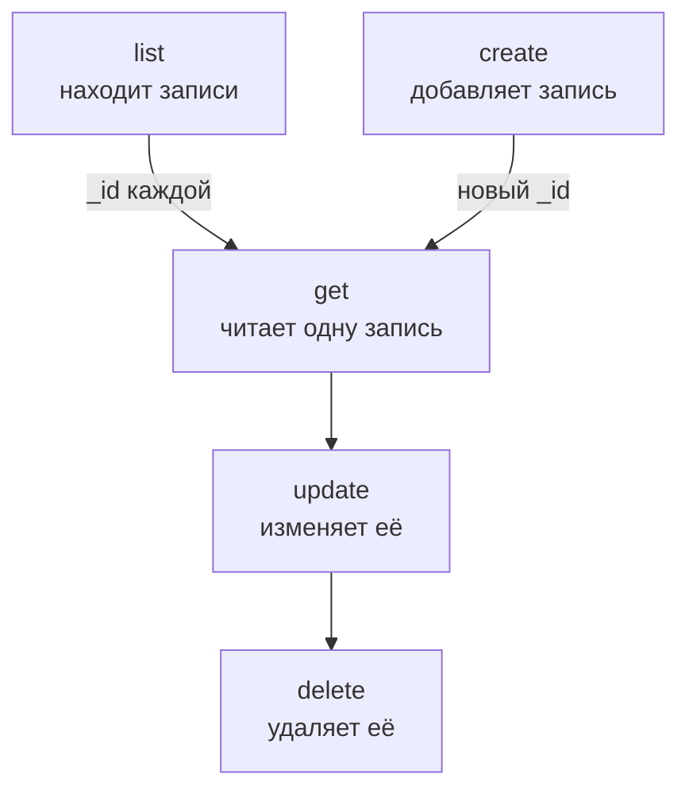

# Операции с ресурсами

Каждый вид записей — отдельная команда, например `incident`, `monitor` или `status-page`, и каждая принимает одни и те же операции: `list`, `get`, `create`, `update`, `delete` и `count`. Эта страница показывает каждую операцию с фильтрами, постраничным выводом и JSON, в котором записывается запись.

:::cards
- [Найдите команду для записи](#найдите-команду-для-записи): oneuptime resources выводит их все.
- [Вывод записей](#вывод-записей): Фильтрация, сортировка и постраничный вывод.
- [Создание записи](#создание-записи): Из JSON в командной строке или в файле.
- [Удаление записи](#удаление-записи): Сразу и без отмены.
:::

## Как операции связаны между собой

Чтение, изменение и удаление записи требуют её ID. Вывод, подсчёт и создание не требуют ни одного, а список или создание дают вам ID, которые принимают остальные:



ID — это UUID, например `6f1c2a40-3b1e-4c55-9a0b-3e2f8d7c1a11`. Его также можно скопировать со страницы записи в OneUptime: см. [Как найти ID ресурса](/docs/api-reference/api-reference#как-найти-id-ресурса).

## Найдите команду для записи

```bash
oneuptime resources
```

Список показывает каждый вид записей с его командой, названиями, типом и путём в API. Типов два:

| Тип | Что хранит | Операции |
| --- | --- | --- |
| `database` | Записи, которыми вы управляете: мониторы, инциденты, оповещения, страницы состояния, команды и другое | `list`, `get`, `create`, `update`, `delete`, `count` |
| `analytics` | Телеметрию: логи, спаны, метрики, исключения и другие события | `list`, `create`, `count` |

Выведите один тип командой `oneuptime resources --type database` или `--type analytics`. [Справочник команд](/docs/cli/command-reference#ресурсы) перечисляет все команды.

## Вывод записей

```bash
oneuptime <resource> list [--query <json>] [--limit <n>] [--skip <n>] [--sort <json>] [-o <format>]
```

| Параметр | Что делает | По умолчанию |
| --- | --- | --- |
| `--query <json>` | Возвращает только подходящие записи: см. [Фильтрация списка](#фильтрация-списка) | Все записи, которые может читать ключ |
| `--limit <n>` | Наибольшее число возвращаемых записей, до 10 000 | `10` |
| `--skip <n>` | Сколько подходящих записей пропустить сначала | `0` |
| `--sort <json>` | Порядок, например `{"createdAt":"ASC"}`, или `"DESC"`, чтобы сначала шли самые новые | Сначала самые новые |
| `-o, --output <format>` | `table`, `json` или `wide` | `table` в терминале, `json` в конвейере |

```bash
# The ten newest incidents
oneuptime incident list

# The oldest monitors first, 50 at a time: the second page
oneuptime monitor list --sort '{"createdAt":"ASC"}' --limit 50 --skip 50

# Every field of each incident, as JSON
oneuptime incident list -o json
```

Список запрашивает у OneUptime каждое поле каждой записи, которое может читать ключ. Таблица показывает шесть из них; JSON показывает все (см. [Форматы вывода](/docs/cli/output-formats)). Чтобы пройти по всем записям, увеличивайте `--skip` на `--limit`, пока страница не вернётся пустой; `count` говорит, сколько их всего.

### Фильтрация списка

`--query` принимает тот же фильтр, что и API: поле со значением совпадает с этим значением, а объект с `_type` сравнивает.

| Фильтр | Совпадает с |
| --- | --- |
| `{"title":"Checkout API is down"}` | Записями точно с этим значением |
| `{"title":{"_type":"Search","value":"checkout"}}` | Текстом, который содержит значение |
| `{"createdAt":{"_type":"GreaterThan","value":"2026-10-01T00:00:00.000Z"}}` | Более поздними датами или большими числами |
| `{"currentIncidentState":{"isResolvedState":false}}` | Полем записи, на которую ссылается ресурс: здесь — нерешёнными инцидентами |

```bash
oneuptime incident list --query '{"title":{"_type":"Search","value":"checkout"}}'
```

[Фильтрация, сортировка и постраничный вывод](/docs/api-reference/api-reference#фильтрация-сортировка-и-постраничный-вывод) в справочнике API перечисляет все `_type`.

## Чтение записи

```bash
oneuptime <resource> get <id> [-o <format>]
```

```bash
oneuptime incident get 6f1c2a40-3b1e-4c55-9a0b-3e2f8d7c1a11
```

Таблица показывает по строке на каждое поле записи, обрезая каждое значение на 60 символах; `-o json` показывает значения целиком. На ID, который не называет ни одной записи, доступной вашему ключу, приходит ответ `Not found`, и команда завершается с кодом `3`.

## Создание записи

```bash
oneuptime <resource> create --data <json> [-o <format>]
oneuptime <resource> create --file <path> [-o <format>]
```

`--data` принимает запись в виде JSON, а `--file` читает её из JSON-файла. Укажите одно из двух; если указаны оба, используется файл. Поля — это поля API, и [справочник API](/reference) перечисляет поля каждого ресурса. Проект берётся из API-ключа, поэтому запись никогда его не называет.

```bash
# A manual monitor
oneuptime monitor create --data '{"name":"Checkout API","monitorType":"Manual"}'

# An incident with one of your severities
oneuptime incident create --data '{"title":"Checkout API is down","incidentSeverityId":"<severity-id>"}'

# The same incident, from a file
oneuptime incident create --file incident.json
```

CLI выводит новую запись с её `_id`. Инцидент начинается в состоянии создания вашего проекта, если `currentIncidentStateId` не называет другое: см. [Состояние, в котором начинается новая запись](/docs/api-reference/api-reference#состояние-в-котором-начинается-новая-запись). Чтобы найти ID ваших уровней серьёзности:

```bash
oneuptime incident-severity list -o json | jq -r '.[] | "\(._id)  \(.name)"'
```

> [!TIP]
> В Windows поместите JSON в файл и используйте `--file`: PowerShell и командная строка заключают JSON в кавычки в командной строке иначе, чем Bash.

## Обновление записи

```bash
oneuptime <resource> update <id> --data <json> [-o <format>]
```

`--data` обязателен и содержит только поля, которые нужно изменить:

```bash
# Rename a monitor
oneuptime monitor update <monitor-id> --data '{"name":"Checkout API (EU)"}'

# Move an incident to your resolved state
oneuptime incident update <incident-id> --data '{"currentIncidentStateId":"<resolved-state-id>"}'
```

OneUptime отвечает на обновление пустым объектом: CLI выводит пустую строку или `{}` с `-o json`. Запустите `get`, чтобы увидеть запись в её нынешнем виде. Перевод инцидента в другое состояние этим способом записывает изменение в его хронологию, как это делает панель управления, а состояние раньше текущего отклоняется. Чтобы найти ID состояния «решён», первого в порядке вашего проекта:

```bash
oneuptime incident-state list --query '{"isResolvedState":true}' --sort '{"order":"ASC"}' --limit 1 -o json | jq -r '.[0]._id'
```

## Удаление записи

```bash
oneuptime <resource> delete <id>
```

```bash
oneuptime monitor delete 6f1c2a40-3b1e-4c55-9a0b-3e2f8d7c1a11
```

Она отвечает `Monitor 6f1c2a40-3b1e-4c55-9a0b-3e2f8d7c1a11 deleted successfully.`

> [!CAUTION]
> `delete` удаляет запись сразу. CLI не просит подтверждения, и отменить это нельзя. Она принимает `--force` для скриптов, написанных с ним, и `--force` ничего не меняет.

## Подсчёт записей

```bash
oneuptime <resource> count [--query <json>]
```

```bash
# Every incident
oneuptime incident count

# Incidents that are not resolved
oneuptime incident count --query '{"currentIncidentState":{"isResolvedState":false}}'
```

CLI выводит одно число, одинаковое в таблице и в JSON, поэтому скрипт может прочитать его как есть.

## Что умеет каждый тип

| Операция | `database` | `analytics` |
| --- | --- | --- |
| `list` | Да | Да |
| `get` | Да | Нет |
| `create` | Да | Да |
| `update` | Да | Нет |
| `delete` | Да | Нет |
| `count` | Да | Да |

## Устранение неполадок

:::details Сообщение «Not found: API error (404)»
Записи нет, она в другом проекте или ключ не может её читать: OneUptime отвечает одинаково в каждом случае. Проверьте ID с помощью `list` и права ключа. Команда завершается с кодом `3`.
:::

:::details Сообщение «API error (422): You do not have permissions to select on»
Список или чтение запрашивает каждое поле записи, а ключ не может читать одно из них: сообщение называет поле и права, которые могут его читать. Дайте ключу одно из этих прав.
:::

:::details Сообщение «Error: Invalid JSON»
Значение `--query`, `--sort` или `--data` — не JSON. В Bash и zsh заключите его в одинарные кавычки; в Windows поместите запись в файл и используйте `--file`.
:::

:::details API error (400) при создании или обновлении
OneUptime отклонил поле: сообщение его называет. `No fields to update` означает, что в `--data` не было ни одного поля для изменения.
:::

## Дальнейшие шаги

:::cards
- [Форматы вывода](/docs/cli/output-formats): Читать ответы в виде таблиц или JSON.
- [Скрипты и CI/CD](/docs/cli/scripting): Использовать эти операции в скриптах и конвейерах.
- [Справочник команд](/docs/cli/command-reference): Каждая команда, параметр и значение по умолчанию.
:::
