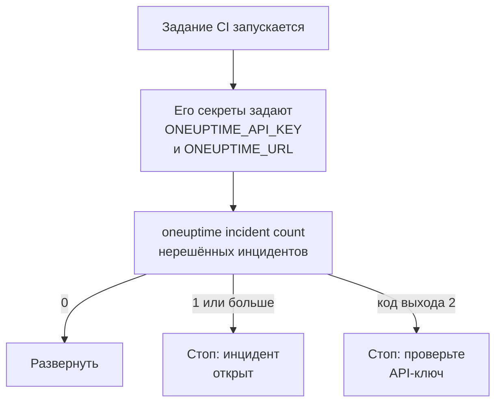

# Скрипты и CI/CD

CLI работает в скрипте так же, как в терминале. Дайте ей API-ключ в переменных окружения, читайте её ответы как JSON и позвольте её коду выхода сообщить скрипту, что произошло. Эта страница показывает каждое из этого, а также полные конвейеры для GitHub Actions, GitLab CI и Docker.

:::cards
- [Передайте скрипту API-ключ](#передайте-скрипту-api-ключ): Две переменные окружения, никакого сохранённого контекста.
- [Коды выхода](#коды-выхода): 0, когда всё получилось, и почему не получилось.
- [Чтение ответов с jq](#чтение-ответов-с-jq): ID, заголовки и даты из JSON.
- [Примеры конвейеров](#примеры-конвейеров): GitHub Actions, GitLab CI и Docker.
:::

## Как скрипт использует CLI

Развёртывание может сначала спросить OneUptime, открыт ли инцидент, и остановиться, если открыт:



## Передайте скрипту API-ключ

Задайте `ONEUPTIME_API_KEY` и `ONEUPTIME_URL` из секретов вашей системы CI. Тогда CLI не нужны ни `login`, ни файл конфигурации. Флаг по-прежнему важнее них для одной команды, а они важнее сохранённых контекстов.

```bash
export ONEUPTIME_API_KEY="$CI_ONEUPTIME_API_KEY"
export ONEUPTIME_URL="https://oneuptime.com"
oneuptime incident count
```

> [!TIP]
> Дайте каждому конвейеру собственный API-ключ только с тем доступом, который ему нужен: проверке, которая только читает, нужен ключ, который только читает. Удалите ключ в OneUptime, когда конвейер выводится из работы.

Если одна машина выполняет задания для нескольких проектов, сохраните контекст для каждого и указывайте его в каждой команде, чтобы задание никогда не использовало текущий контекст другого:

```bash
oneuptime --context production incident count
oneuptime --context staging monitor count
```

## Коды выхода

| Код | Значение | Например |
| --- | --- | --- |
| `0` | Получилось | Список, даже такой, который ничего не нашёл |
| `1` | Не получилось | OneUptime отклонил запрос, например `API error (422)`; недопустимый JSON; отсутствующий или неизвестный параметр; несохранённый контекст |
| `2` | Нет пригодного API-ключа | Учётные данные не найдены; недействительный API-ключ; ключ ниже своего плана (`402`); `401` |
| `3` | Не найдено | OneUptime ответил `404`: записи нет, она в другом проекте или ключ не может её читать |

`whoami` и `context current` завершаются с `0`, даже когда ничего не сохранено: они сообщают, что задано, но не проверяют это. Скрипт различает случаи по коду:

```bash
oneuptime incident get "$INCIDENT_ID" -o json > incident.json
case $? in
  0) echo "Saved the incident to incident.json" ;;
  2) echo "Check ONEUPTIME_API_KEY and ONEUPTIME_URL" >&2; exit 1 ;;
  3) echo "There is no incident $INCIDENT_ID" >&2; exit 1 ;;
  *) echo "OneUptime refused the request" >&2; exit 1 ;;
esac
```

Сообщения об ошибках идут в стандартный поток ошибок, поэтому `incident.json` содержит только ответ.

## Чтение ответов с jq

Пишите `-o json` в скриптах. В конвейере CLI и так выводит JSON, но флаг сохраняет работу скрипта, где бы он ни запускался:

```bash
# The title of each incident
oneuptime incident list -o json | jq -r '.[].title'

# The ID of a new monitor
MONITOR_ID=$(oneuptime monitor create --data '{"name":"Checkout API","monitorType":"Manual"}' -o json | jq -r '._id')

# When each incident was created: dates come as objects
oneuptime incident list -o json | jq -r '.[] | "\(.createdAt.value)  \(.title)"'

# The newest 100 incidents as CSV
oneuptime incident list --limit 100 -o json | jq -r '.[] | [._id, .title, .createdAt.value] | @csv'
```

Подсчёт выводит одно число, готовое к сравнению:

```bash
OPEN=$(oneuptime incident count --query '{"currentIncidentState":{"isResolvedState":false}}')
echo "$OPEN incidents are open"
```

## Создание записей из файлов

Храните записи как JSON-файлы рядом с кодом и создавайте их оттуда:

```json title="monitors/checkout-api.json"
{
  "name": "Checkout API",
  "monitorType": "Manual"
}
```

```bash
oneuptime monitor create --file monitors/checkout-api.json
```

Много записей из одного JSON-массива, по одному созданию на каждую:

```bash
jq -c '.[]' monitors.json | while IFS= read -r monitor; do
  oneuptime monitor create --data "$monitor" -o json | jq -r '._id'
done
```

> [!NOTE]
> Каждый запуск создаёт новые записи. Чтобы держать мониторы и страницы состояния в соответствии с файлами, менять только изменившееся и удалять исчезнувшее, используйте [провайдер Terraform](/docs/terraform/index).

## Примеры конвейеров

:::tabs
@tab GitHub Actions
```yaml title=".github/workflows/deploy.yml"
name: Deploy
on:
  push:
    branches: [main]

jobs:
  deploy:
    runs-on: ubuntu-latest
    steps:
      - uses: actions/checkout@v4
      - uses: actions/setup-node@v4
        with:
          node-version: lts/*
      - name: Install the OneUptime CLI
        run: npm install -g @oneuptime/cli
      - name: Stop while an incident is open
        env:
          ONEUPTIME_API_KEY: ${{ secrets.ONEUPTIME_API_KEY }}
          ONEUPTIME_URL: https://oneuptime.com
        run: |
          OPEN=$(oneuptime incident count --query '{"currentIncidentState":{"isResolvedState":false}}')
          if [ "$OPEN" -gt 0 ]; then
            echo "$OPEN incidents are open: not deploying."
            exit 1
          fi
      - name: Deploy
        run: ./deploy.sh
```
@tab GitLab CI
```yaml title=".gitlab-ci.yml"
check-incidents:
  stage: test
  image: node:lts
  variables:
    ONEUPTIME_URL: https://oneuptime.com
  script:
    - npm install -g @oneuptime/cli
    - OPEN=$(oneuptime incident count --query '{"currentIncidentState":{"isResolvedState":false}}')
    - echo "$OPEN incidents are open"
    - test "$OPEN" -eq 0
```
@tab Docker
```dockerfile title="Dockerfile"
FROM node:lts-slim
RUN npm install -g @oneuptime/cli
ENTRYPOINT ["oneuptime"]
```
:::

В GitHub Actions добавьте `ONEUPTIME_API_KEY` в разделе **Settings → Secrets and variables → Actions** репозитория; в GitLab добавьте её как маскированную переменную CI/CD. С образом Docker передавайте переменные при каждом запуске:

```bash
docker build -t oneuptime-cli .
docker run --rm -e ONEUPTIME_API_KEY -e ONEUPTIME_URL oneuptime-cli incident count
```

## Дальнейшие шаги

:::cards
- [Аутентификация](/docs/cli/authentication): Какой ключ использует команда, когда задано несколько.
- [Форматы вывода](/docs/cli/output-formats): JSON, который читают ваши скрипты.
- [Операции с ресурсами](/docs/cli/resource-operations): Фильтры, постраничный вывод и поля записи.
- [Провайдер Terraform](/docs/terraform/index): Хранить конфигурацию OneUptime в файлах.
:::
