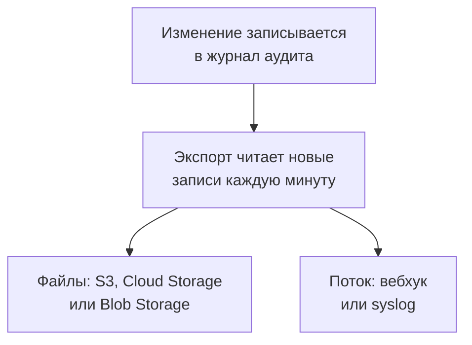

# Экспорт журнала аудита

Отправляйте журнал аудита по мере записи в хранилище или сервис по вашему выбору: Amazon S3 или S3-совместимое хранилище, Google Cloud Storage, Azure Blob Storage, вебхук или syslog. Храните там записи столько, сколько требуют ваши проверки на соответствие требованиям, и ищите их в своём SIEM. Владельцы и администраторы проекта экспортируют его журнал аудита из настроек проекта, а мастер-администраторы экспортируют журнал всех проектов из Admin Dashboard. Экспорт входит в план Enterprise в OneUptime Cloud и в Enterprise Edition при самостоятельном размещении.

:::cards
- [Настройка экспорта](#настройка-экспорта): Выберите место назначения, проверьте его, сохраните.
- [Что отправляется](#что-отправляется): Один объект JSON на запись, по стабильной схеме.
- [Когда отправляются записи](#когда-отправляются-записи): Каждую минуту, каждая запись один раз, по порядку.
- [Когда место назначения не отвечает](#когда-место-назначения-не-отвечает): Повторные попытки, ошибка, и ничего не пропускается.
:::

## Как запись доходит до места назначения



- **Один экспорт, одно место назначения.** У проекта может быть несколько экспортов, и каждый отправляет все записи в своё место назначения.
- **Экспорт проекта или всего экземпляра.** Экспорт проекта отправляет записи этого проекта. Экспорт, настроенный в Admin Dashboard, отправляет записи всех проектов, которые ведут журнал аудита.
- **С момента сохранения.** Экспорт отправляет то, что записано после его сохранения, если только вы не укажете в **Экспортировать с** более раннюю дату.

## Перед началом

- **В OneUptime Cloud — план Enterprise.** На других планах страница показывает, что делает функция и как её получить.
- **При самостоятельном размещении — Enterprise Edition** с лицензией, которая включает журналы аудита. См. [Редакция Enterprise](/docs/self-hosted/enterprise).
- **Включённый журнал аудита** в каждом проекте, который вы экспортируете. См. [Журналы аудита](/docs/configuration/audit-logs).
- **Project Owner или Project Admin**, чтобы экспортировать журнал аудита проекта, или мастер-администратор, чтобы экспортировать журнал экземпляра.

## Настройка экспорта

:::steps
### Откройте страницу экспорта

Для проекта перейдите в **Настройки проекта → Журналы аудита → Экспорт**. Для всего экземпляра перейдите в **Настройки → Экспорт журнала аудита** в Admin Dashboard.

### Выберите место назначения

Нажмите **Добавить экспорт** и выберите одно из шести мест назначения ниже. Место назначения экспорта потом изменить нельзя.

### Укажите, как до него добраться

Заполните то, что просит место назначения. Настройки, которые большинство оставляет как есть, ждут в **Дополнительные поля**, а **Руководство по настройке** открывает раздел места назначения на этой странице.

### Отправьте тест

Нажмите **Записать тестовый файл** или **Отправить тестовую запись**. Хранилище получает файл `oneuptime-audit-log-export-test.ndjson.gz` в своей папке, а вебхук или syslog получает одну запись с действием `Test`. Неудачный тест говорит, что нужно исправить.

### Начните экспорт

Нажмите **Далее**, дайте экспорту имя и нажмите **Начать экспорт**. Первые записи приходят в течение нескольких минут.
:::

Строка экспорта показывает, как у него дела: **Экспортируется**, **Сбой**, **Приостановлено**, **Ожидание записей** или **Запускается**. **Отправьте тест** отправляет тест с сохранёнными настройками, а **Редактировать** меняет их: учётные данные, которые вы оставите пустыми, сохраняют прежнее значение.

## Места назначения

| Место назначения | Что приходит | Вход с помощью |
| --- | --- | --- |
| [Amazon S3](#amazon-s3) | Сжатые файлы NDJSON | Ключа доступа |
| [S3-совместимое хранилище](#s3-совместимое-хранилище) | Сжатые файлы NDJSON | Ключа доступа |
| [Google Cloud Storage](#google-cloud-storage) | Сжатые файлы NDJSON | Ключа сервисного аккаунта |
| [Azure Blob Storage](#azure-blob-storage) | Сжатые файлы NDJSON | Токена SAS или ключа доступа |
| [Webhook](#webhook) | Запросы HTTPS | Необязательного заголовка и секрета подписи |
| [Syslog](#syslog) | Сообщения RFC 5424 | Не нужен |

### Amazon S3

| Поле | Что ввести |
| --- | --- |
| **Бакет** | Бакет, в который записываются файлы. |
| **Регион** | Регион бакета. Сначала в нём стоит `us-east-1`. |
| **Идентификатор ключа доступа** | Ключ доступа, которому разрешено записывать объекты в бакет. |
| **Секретный ключ доступа** | Секрет ключа. |
| **Папка** | В **Дополнительные поля**. Если оставить её пустой, файлы попадут в `oneuptime/audit-logs/`. |

Ключу нужно только `s3:PutObject` на папку:

```json
{
  "Version": "2012-10-17",
  "Statement": [
    {
      "Effect": "Allow",
      "Action": "s3:PutObject",
      "Resource": "arn:aws:s3:::my-audit-logs/oneuptime/audit-logs/*"
    }
  ]
}
```

### S3-совместимое хранилище

Те же поля, что и для Amazon S3, после поля **Эндпоинт**: S3-адрес хранилища, например `https://minio.example.com:9000` или `https://<account>.r2.cloudflarestorage.com`. В **Регион** укажите тот, который ожидает хранилище: `us-east-1` для MinIO и значения Wasabi по умолчанию, `auto` для Cloudflare R2.

### Google Cloud Storage

Введите **Бакет** и вставьте **Ключ сервисного аккаунта** (JSON), у сервисного аккаунта которого есть роль Storage Object Creator на бакете. **Папка** ждёт в **Дополнительные поля**.

### Azure Blob Storage

Введите **Учётная запись хранения** и **Контейнер** и выберите в **Способ входа**, как входить: **Токен SAS** с разрешениями Create и Write на контейнер или **Ключ доступа** учётной записи хранения. Токен SAS можно ограничить этим контейнером, поэтому он надёжнее. **Облако** и **Папка** ждут в **Дополнительные поля**.

### Webhook

OneUptime отправляет каждый пакет методом POST на **URL** в виде массива JSON (`application/json`) или по одной записи на строку (`application/x-ndjson`), как указано в **Формат тела**, с такими заголовками:

| Заголовок | Значение |
| --- | --- |
| `X-OneUptime-Event` | `audit-log-export` |
| `X-OneUptime-Batch-Id` | Идентификатор первой записи пакета: тот же пакет при повторной отправке несёт тот же идентификатор. |
| `X-OneUptime-Entry-Count` | Сколько записей в теле. |
| `X-OneUptime-Signature` | `sha256=` и HMAC-SHA256 тела, вычисленный с **Секрет подписи**, если он задан. |

**Учётные данные**, например `Bearer <token>`, отправляются в заголовке, который вы выбираете в **Имя заголовка**, по умолчанию `Authorization`. **Формат тела**, **Имя заголовка** и **Секрет подписи** ждут в **Дополнительные поля**. Любой ответ 2xx считается доставкой. Ответ `413` делит пакет на два, а любой другой отказ позже отправляет весь пакет заново.

### Syslog

Каждая запись — одно сообщение RFC 5424 на **Хост** и **Порт** по TLS на порт `6514`, если только **Протокол** не задаёт TCP, с facility 13 (log audit) и severity 6 (informational):

```text
<110>1 2026-10-24T09:15:03.000Z oneuptime.example.com oneuptime - audit-log - {"schemaVersion":1,"id":"..."}
```

Сообщения разделяются подсчётом октетов (RFC 5425), если только **Разделение сообщений** не задаёт одно сообщение на строку. Получателю, чей сертификат подписал частный ЦС, нужен сертификат этого ЦС в **Сертификат ЦС**. Оба поля ждут в **Дополнительные поля**.

## Что отправляется

Каждая запись — один объект JSON, ключи которого всегда идут в таком порядке:

| Ключ | Что содержит |
| --- | --- |
| `schemaVersion` | `1`. Изменение схемы приходит с новой версией. |
| `id` | Идентификатор записи. Одна и та же запись, отправленная дважды, имеет один и тот же идентификатор. |
| `createdAt` | Когда изменение было записано, в UTC. |
| `projectId` | Проект, в котором сделано изменение. |
| `action` | `Create`, `Update`, `Delete` или `Download`. |
| `resourceType`, `resourceId`, `resourceName` | Что изменилось. |
| `rootResourceType`, `rootResourceId` | Ресурс, к которому оно относится, например SLO для его правила. |
| `userId`, `userName`, `userEmail`, `userType` | Кто сделал изменение. |
| `apiKeyId`, `apiKeyName` | Ключ API, с которым оно сделано, если есть. |
| `mcpOAuthGrantId`, `mcpClientName` | Клиент MCP, через который оно сделано, если есть. |
| `workflowId`, `workflowName` | Рабочий процесс, который его сделал, если есть. |
| `changes` | Каждое изменённое поле: `field`, с `oldValue` и `newValue`. |

Файл содержит по одной записи на строку, сжат gzip и раскладывается по часу своей первой записи: `oneuptime/audit-logs/2026/10/24/09/20261024T091503Z_<first entry id>.ndjson.gz`.

Ключи, токены и пароли никогда не уходят наружу: они записываются как `[REDACTED]`, а поля, которые никому нельзя читать, исключаются из каждой записи.

## Когда отправляются записи

- **Каждую минуту.** Записи, сделанные больше минуты назад, читаются начиная с самых старых и отправляются пакетами: до 5 000 записей или 16 МБ на файл и 500 записей на запрос вебхука или подключение syslog.
- **Файлы пишутся не на каждую запись.** Файл записывается, когда пакет заполнен или его первой записи исполнилось пять минут.
- **Каждая запись один раз, по порядку.** После каждой доставки экспорт запоминает последнюю отправленную запись, поэтому перезапуск или другой воркер продолжают с этого места.
- **Повтор можно распознать.** Пакет, отправленный заново после сбоя, пишет то же имя файла или несёт тот же `X-OneUptime-Batch-Id`, а каждая запись несёт свой `id`.

## Когда место назначения не отвечает

Пакет пробуют отправить три раза с интервалом в несколько секунд, затем экспорт ждёт перед новой попыткой: минуту, потом две, четыре и так далее, до часа. Его строка показывает **Сбой**, а **Просмотреть ошибку** показывает, что ответило место назначения и когда будет следующая попытка.

Ничего не пропускается: записи ждут в журнале аудита, и следующая удачная доставка догоняет, начиная с самой старой. Запись старше срока хранения журнала аудита своего проекта удаляется раньше, чем её можно отправить, поэтому исправьте экспорт со сбоем в этот срок.

Чтобы приостановить экспорт, выберите **Выключить** в меню его строки: он сохраняет свою позицию, а **Включить** отправляет то, что было записано за это время. В OneUptime Cloud проект, который уходит с плана Enterprise, перестаёт экспортировать, а его экспорты ждут под карточкой повышения плана, где их можно выключить или удалить. При самостоятельном размещении экспорт останавливается, пока лицензия не включает журналы аудита, и продолжается с того места, где остановился, как только лицензия их включает.

## Устранение неполадок

:::details Тест сообщает, что доступ запрещён
Ключу, токену или сервисному аккаунту нельзя записывать туда, куда пишет экспорт. Дайте ему разрешение создавать объекты в папке, как показано выше в разделе каждого места назначения, и отправьте тест снова.
:::

:::details Тест не может достучаться до адреса
Экспорт проекта в OneUptime Cloud не может обращаться к адресам частной сети. При самостоятельном размещении может, если только `DATA_SOURCE_BLOCK_PRIVATE_ADDRESSES` не равно `true`, а экспорт, настроенный в Admin Dashboard, может всегда. К адресам loopback и link-local обращения не бывает никогда.
:::

:::details Ничего не приходит
Проверьте, что журнал аудита включён в проекте и что кто-то что-то изменил после сохранения экспорта. Хранилище получает файл только тогда, когда пакет заполнен или ему пять минут.
:::

## Дальнейшие шаги

:::cards
- [Журналы аудита](/docs/configuration/audit-logs): Что записывается и как долго хранится.
- [Пользователи, команды и разрешения](/docs/permissions/index): Решите, кто может настраивать экспорт.
- [Редакция Enterprise](/docs/self-hosted/enterprise): Журналы аудита на самостоятельно размещённой установке.
:::
