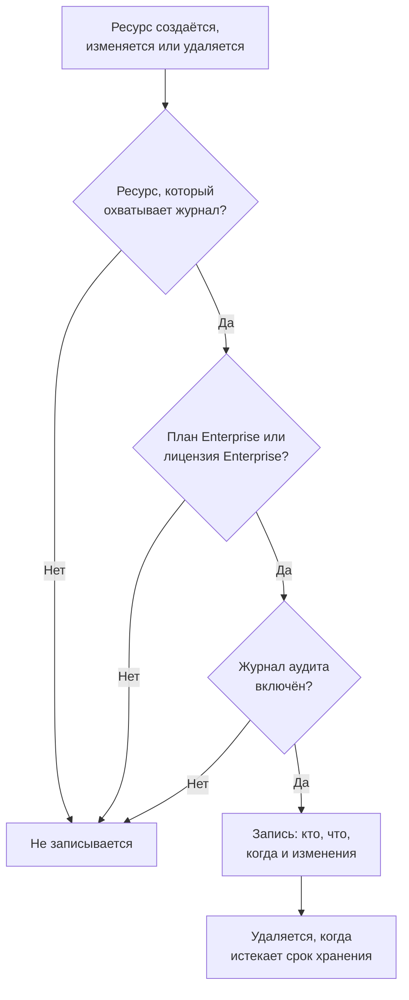

# Журналы аудита

Журнал аудита фиксирует, кто что изменил в вашем проекте: каждое создание, изменение и удаление ресурсов, которые он охватывает, со значениями до и после, а также каждый вход в систему и выход из неё. С его помощью можно выяснить, кто выключил монитор или изменил ключ API, кто входил в систему и откуда, и вести записи для проверок на соответствие требованиям. Он входит в план Enterprise в OneUptime Cloud и в Enterprise Edition при самостоятельном размещении.

:::cards
- [Включить журнал аудита](#включить-журнал-аудита): Изначально он выключен во всех проектах.
- [Читать журнал аудита](#читать-журнал-аудита): Кто что изменил и когда.
- [Что записывается](#что-записывается): Ресурсы и действия, которые он охватывает.
- [Входы и сеансы](#входы-и-сеансы): Кто входил в систему и как завершился каждый сеанс.
- [Сколько хранятся записи](#сколько-хранятся-записи): От 7 до 180 дней.
:::

## Как изменение становится записью

- **Изначально он выключен.** Проект ничего не записывает, пока кто-нибудь не включит журнал аудита, и не записывает ничего из того, что было до этого момента.
- **Он записывает то, что делают люди.** Записывается изменение, сделанное человеком, ключом API, клиентом MCP или рабочим процессом. Изменение, которое делает сам OneUptime, например фоновая задача, пропускается, если вы не включите **Хранить системные события**.
- **Записи нельзя изменить.** Никто не может отредактировать или удалить запись ни в панели управления, ни через API. Запись исчезает, только когда истекает срок её хранения.

## Перед началом

- **В OneUptime Cloud — план Enterprise.** На других планах страницы журнала аудита показывают, что делает функция и как её получить.
- **При самостоятельном размещении — Enterprise Edition** с лицензией, которая включает журналы аудита. См. [Редакция Enterprise](/docs/self-hosted/enterprise).
- **Роль, которая может читать журнал аудита.** Project Owner, Project Admin, Settings Admin или разрешение **Read Audit Log**. Чтобы включить журнал аудита и изменить его настройки, нужен Project Owner, Project Admin или разрешение на редактирование проекта.

## Включить журнал аудита

:::steps
### Откройте настройки журнала аудита

Перейдите в **Настройки проекта → Журналы аудита → Настройки**. Раздел **Журналы аудита** в боковом меню изначально свёрнут: нажмите на него, чтобы открыть.

### Измените настройки

Нажмите **Edit Audit Log Settings**.

### Включите его

Включите **Включить журналы аудита**, задайте **Хранение (дней)** и выберите, нужно ли **Хранить системные события**. Нажмите **Сохранить изменения**.
:::

| Настройка | Начальное значение | Что делает |
| --- | --- | --- |
| **Включить журналы аудита** | Выкл. | С этого момента записывает изменения ресурсов проекта. |
| **Хранение (дней)** | 7 | Сколько дней хранится каждая запись: от 7 до 180. |
| **Хранить системные события** | Выкл. | Также записывает изменения, которые делает сам OneUptime и которые не запускал ни человек, ни ключ. |

Изменение этих настроек вступает в силу в течение минуты.

## Читать журнал аудита

**Настройки проекта → Журналы аудита → Журналы аудита** перечисляет все записи проекта, сначала новые:

| Столбец | Что показывает |
| --- | --- |
| **Когда** | Как давно, с датой и временем. |
| **Действие** | `Create`, `Update` или `Delete`, `Download` для файла захвата пакетов, который кто-то скачал, либо `Sign In`, `Sign Out`, `Session Timeout` или `Session Revoked` для сеанса. |
| **Ресурс** | Имя ресурса, которое открывает его, пока он существует, и его тип. |
| **Субъект** | Кто внёс изменение: человек, ключ API, рабочий процесс или `System` для изменения, которое сделал сам OneUptime. Для изменения, сделанного человеком через клиент MCP, указан этот клиент. |
| **Изменения** | Сколько полей изменилось или было записано при создании или удалении. Для сеанса — как был выполнен вход или почему сеанс завершился. Нажмите, чтобы увидеть каждое поле. |

Фильтруйте по полям **Тип ресурса**, **Имя ресурса**, **Действие**, **Электронная почта пользователя** или **Время**. Изменение показывает только изменившиеся поля, до и после, а сохранение, которое ничего не меняет, записи не добавляет.

Ресурс без собственного имени называется тем, что называет его в OneUptime: исключение — своим типом и началом сообщения, где идентификаторы, адреса и всё, что похоже на секрет, скрыты, выполнение runbook-а — своим runbook-ом, номер телефона политики входящих вызовов — самим номером, а шаблон или домен — своим собственным именем.

У мониторов, инцидентов, оповещений, страниц состояния, SLO и многих других ресурсов также есть своя страница **Журналы аудита** в свёрнутом разделе бокового меню, например **Расширенный**. Она показывает записи только этого ресурса вместе с записями того, что к нему относится: страница SLO показывает также его правила и владельцев.

## Что записывается

Записывается всё, что люди создают, изменяют или удаляют в проекте: мониторы, инциденты, оповещения, страницы статуса, рабочие процессы и их шаги, очереди, дашборды, политики дежурств, команды и их участники, ключи API и каждая настройка. **Тип ресурса** говорит, к чему относится запись, например `Monitor`, `Workflow` или `Queue`.

| Не записывается | Почему |
| --- | --- |
| Журналы сообщений | Каждый уже является записью письма, SMS, звонка, push-уведомления или сообщения в чате, которое OneUptime отправил или получил. |
| Записи запусков | Каждая уже является записью запуска рабочего процесса, эскалации дежурства, сканирования, импорта или запуска ИИ. |
| То, что сообщают агенты и телеметрия | Найденные ресурсы, показания и потребление меняются с каждым отчётом, а не потому, что их кто-то изменил. |
| Ленты активности | Лента показывает изменения, которые журнал аудита уже записывает. |
| Рабочее состояние OneUptime | Сеансы читателей страниц статуса, задания в очереди и другое состояние, которое OneUptime хранит во время работы. |
| Личные настройки уведомлений человека | Адреса, номера и личные правила дежурства каждого человека принадлежат только ему. |
| Личные предпочтения человека | Продукты, которые каждый человек закрепляет на своей верхней панели, принадлежат только ему, и видит их только он. |

Также записывается, когда администратор добавляет или удаляет метод уведомления или личное правило дежурства в чужой учётной записи, без самого адреса или номера.

Поля, которые пишет только OneUptime, например когда хост был замечен в последний раз, не включаются ни в одну запись, как и поля, которые никому нельзя читать. Когда OneUptime пишет такое поле по чьей-то просьбе, например при объединении одного исключения с другим или сбросе URL вебхука, запись фиксирует это как изменение этого человека. Ключи, токены и пароли записываются как `[REDACTED]`: запись показывает, что они изменились, но не их значение. Шаги рабочего процесса записываются как то, что изменилось, с названиями настроек шага, но никогда не с тем, что в них введено, а перемещение шага по холсту не записывается.

То, что OneUptime делает по чьей-то просьбе, тоже записывается как изменение этого человека, хранит проект системные события или нет:

- Запуск, подтверждение, завершение, пропуск и отмена выполнения runbook-а. Его шаги записываются как то, что сделали с каждым из них, например `Approved "Restart the API" (step 3)`, и никогда не вместе с тем, что вывел шаг.
- То, что меняет правило, когда его кто-то запускает: метки и владельцы, которых оно добавляет, записи, которые правило конфиденциальности делает приватными, устройства, которые перемещает правило назначения площадки, устройства и мониторы, которые создаёт правило автоимпорта, и то, что правило мониторов страницы статуса или SLO меняет на своей странице или в своём SLO.
- Покупка, привязка и освобождение номера телефона политики входящих вызовов.
- Разрешение оповещения о данных, которое кто-то отметил как ожидаемое или как не проблему.
- Сброс ссылки календарной ленты.
- Команды, в которые человек входит при входе через SSO.

То, что правило делает само, — собственное изменение OneUptime; оно записывается, когда включено **Хранить системные события**: метки и владельцы, которых правило добавляет при создании записи, и запись, которую оно тогда делает приватной; устройства и мониторы, которые правило автоимпорта создаёт по новым результатам сканирования; и то, что правило мониторов страницы статуса или SLO меняет, когда сохраняют правило, монитор или метку.

Сброс ИИ-агента хоста, кластера или облачной учётной записи записывается на собственной странице **Журналы аудита** этого ресурса как изменение `aiAgentResetAt`, сделанное тем, кто его сбросил: кто и когда. Так же записывается создание ключа для ИИ-агента облачной учётной записи: ключи показаны как изменённые, никогда вместе с ключом или хешем. То, что агент сообщает при подключении и отметках о себе, как и раньше, не записывается.

## Входы и сеансы

Каждый раз, когда участник проекта входит в OneUptime, журнал аудита записывает это, а затем ещё раз — когда этот сеанс завершается. Вход выполняется в OneUptime, а не в отдельный проект, поэтому его записывает каждый проект, участником которого является этот человек.

| Действие | Когда записывается |
| --- | --- |
| `Sign In` | Кто-то входит в систему: с паролем или по ссылке для входа, с ключом доступа, через Google, Microsoft, Vercel или единый вход. |
| `Sign Out` | Человек выходит из системы. |
| `Session Timeout` | OneUptime завершает сеанс по истечении срока: времени бездействия или длительности сеанса, заданных администратором сервера, либо 30 дней без использования. |
| `Session Revoked` | OneUptime завершает сеанс, потому что пароль был изменён, учётная запись заблокирована или администратор сервера сбросил двухфакторную аутентификацию либо сделал её обязательной. |

**Ресурс** записи — это сеанс, названный по устройству, с которого выполнен вход, например `Chrome 130 on macOS`. **Субъект** записи — человек, которому принадлежит сеанс, поэтому фильтр по полю **Электронная почта пользователя** находит все его входы и сеансы. В подробностях указано, как он вошёл и с каким вторым фактором, IP-адрес и место, а для завершённого сеанса — когда был выполнен вход, когда сеанс использовался в последний раз и когда истёк его срок. Собственный поставщик SSO проекта указывается только в журнале аудита этого проекта.

Входы и сеансы записываются независимо от того, хранит ли проект системные события. Истёкшая длительность сеанса или 30 дней без использования записываются в течение нескольких минут после истечения срока. Истёкшее время бездействия записывается, когда открытая вкладка этого человека или мобильное приложение в следующий раз обращается к OneUptime.

## Сколько хранятся записи

Каждая запись хранится столько, сколько было задано в поле **Хранение (дней)** у проекта, когда она была сделана, а затем удаляется. Новый срок хранения применяется к новым записям: уже сделанные записи сохраняют свои даты. Через API тоже срок хранения — целое число дней от 7 до 180: любое другое значение отклоняется.

Чтобы хранить записи дольше 180 дней, отправляйте их по мере записи в своё хранилище или SIEM: см. [Экспорт журнала аудита](/docs/configuration/audit-log-export). Их также можно читать через API с ключом API, у которого есть **Read Audit Log**, и сохранять там, где они вам нужны. См. [Справочник API OneUptime](/docs/api-reference/api-reference).

## Когда план или лицензия больше не включают журналы аудита

- **В OneUptime Cloud** проект, который уходит с плана Enterprise, перестаёт записывать, а его страницы журнала аудита показывают карточку повышения плана, пока он не вернётся на этот план.
- **При самостоятельном размещении** журнал аудита перестаёт записывать, когда пробный период Enterprise или льготный период заканчивается без лицензии или когда лицензия не включает журналы аудита. Журнал аудита показывает это красным. Уже сделанные записи сохраняются, и запись возобновляется с теми же настройками, как только будет активирована лицензия. См. [Когда лицензия истекла или отсутствует](/docs/self-hosted/enterprise#когда-лицензия-истекла-или-отсутствует).

## Устранение неполадок

:::details Журнал аудита пуст
Журнал аудита изначально выключен и не записывает ничего, что было до его включения. Если список сообщает, что журнал аудита выключен, перейдите по его ссылке в настройки и включите его. Иначе измените монитор или инцидент и обновите список.
:::

:::details Изменения нет в журнале аудита
Проверьте, что ресурс указан в разделе [Что записывается](#что-записывается) и что изменение было сделано после включения журнала аудита. Изменение, которое сделал сам OneUptime, записывается, только если включено **Хранить системные события**.
:::

## Дальнейшие шаги

:::cards
- [Экспорт журнала аудита](/docs/configuration/audit-log-export): Отправляйте журнал аудита в своё хранилище или SIEM.
- [Пользователи, команды и разрешения](/docs/permissions/index): Решите, кто может читать журнал аудита.
- [Настройки проекта](/docs/configuration/project-settings): Остальные настройки проекта.
- [Биллинг и использование](/docs/configuration/billing): Смените план проекта.
- [Редакция Enterprise](/docs/self-hosted/enterprise): Журналы аудита в самостоятельно размещённой установке.
:::
