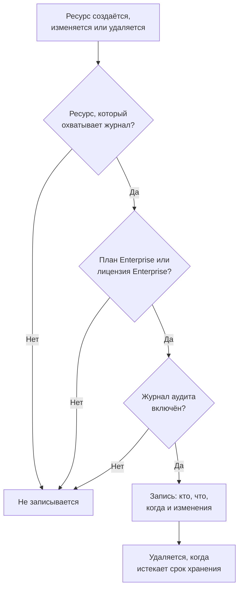

# Журналы аудита

Журнал аудита фиксирует, кто что изменил в вашем проекте: каждое создание, изменение и удаление ресурсов, которые он охватывает, со значениями до и после. С его помощью можно выяснить, кто выключил монитор или изменил ключ API, и вести записи для проверок на соответствие требованиям. Он входит в план Enterprise в OneUptime Cloud и в Enterprise Edition при самостоятельном размещении.

:::cards
- [Включить журнал аудита](#включить-журнал-аудита): Изначально он выключен во всех проектах.
- [Читать журнал аудита](#читать-журнал-аудита): Кто что изменил и когда.
- [Что записывается](#что-записывается): Ресурсы и действия, которые он охватывает.
- [Сколько хранятся записи](#сколько-хранятся-записи): От 7 до 180 дней.
:::

## Как изменение становится записью

- **Изначально он выключен.** Проект ничего не записывает, пока кто-нибудь не включит журнал аудита, и не записывает ничего из того, что было до этого момента.
- **Он записывает то, что делают люди.** Записывается изменение, сделанное человеком, ключом API, клиентом MCP или рабочим процессом. Изменение, которое делает сам OneUptime, например фоновая задача, пропускается, если вы не включите **Хранить системные события**.
- **Записи нельзя изменить.** Никто не может отредактировать или удалить запись ни в панели управления, ни через API. Запись исчезает, только когда истекает срок её хранения.

## Перед началом

- **В OneUptime Cloud — план Enterprise.** На других планах страницы журнала аудита показывают, что делает функция и как её получить.
- **При самостоятельном размещении — Enterprise Edition** с лицензией, которая включает журналы аудита. См. [Редакция Enterprise](/docs/self-hosted/enterprise).
- **Роль, которая может читать журнал аудита.** Project Owner, Project Admin, Settings Admin или разрешение **Read Audit Log**. Чтобы включить журнал аудита и изменить его настройки, нужен Project Owner, Project Admin или разрешение на редактирование проекта.

## Включить журнал аудита

:::steps
### Откройте настройки журнала аудита

Перейдите в **Настройки проекта → Журналы аудита → Настройки**. Раздел **Журналы аудита** в боковом меню изначально свёрнут: нажмите на него, чтобы открыть.

### Измените настройки

Нажмите **Edit Audit Log Settings**.

### Включите его

Включите **Включить журналы аудита**, задайте **Хранение (дней)** и выберите, нужно ли **Хранить системные события**. Нажмите **Сохранить изменения**.
:::

| Настройка | Начальное значение | Что делает |
| --- | --- | --- |
| **Включить журналы аудита** | Выкл. | С этого момента записывает изменения ресурсов проекта. |
| **Хранение (дней)** | 7 | Сколько дней хранится каждая запись: от 7 до 180. |
| **Хранить системные события** | Выкл. | Также записывает изменения, которые делает сам OneUptime и которые не запускал ни человек, ни ключ. |

Изменение этих настроек вступает в силу в течение минуты.

## Читать журнал аудита

**Настройки проекта → Журналы аудита → Журналы аудита** перечисляет все записи проекта, сначала новые:

| Столбец | Что показывает |
| --- | --- |
| **Когда** | Как давно, с датой и временем. |
| **Действие** | `Create`, `Update` или `Delete` либо `Download` для файла захвата пакетов, который кто-то скачал. |
| **Ресурс** | Имя ресурса, которое открывает его, пока он существует, и его тип. |
| **Субъект** | Кто внёс изменение: человек, ключ API, рабочий процесс или `System` для изменения, которое сделал сам OneUptime. Для изменения, сделанного человеком через клиент MCP, указан этот клиент. |
| **Изменения** | Сколько полей изменилось или было записано при создании или удалении. Нажмите, чтобы увидеть каждое поле. |

Фильтруйте по полям **Тип ресурса**, **Имя ресурса**, **Действие**, **Электронная почта пользователя** или **Время**. Изменение показывает только изменившиеся поля, до и после, а сохранение, которое ничего не меняет, записи не добавляет.

У мониторов, инцидентов, оповещений, страниц состояния, SLO и многих других ресурсов также есть своя страница **Журналы аудита** в свёрнутом разделе бокового меню, например **Расширенный**. Она показывает записи только этого ресурса вместе с записями того, что к нему относится: страница SLO показывает также его правила и владельцев.

## Что записывается

| Ресурс | **Тип ресурса** в журнале |
| --- | --- |
| Мониторы | `Monitor` |
| Инциденты | `Incident` |
| Оповещения | `Alert` |
| Страницы состояния | `Status Page` |
| События планового обслуживания | `Scheduled Maintenance Event` |
| Политики дежурств | `On-Call Policy` |
| Цели уровня обслуживания (SLO) | `Service Level Objective` |
| Правила и владельцы SLO | `SLO Burn Rate Rule`, `SLO Monitor Rule`, `Service Level Objective User Owner`, `Service Level Objective Team Owner` |
| Команды | `Team` |
| Пользовательские роли, а также команды и API-ключи, которые их получают | `Custom Role`, `Team Custom Role`, `API Key Custom Role` |
| Метки | `Label` |
| Состояния и уровни серьёзности инцидентов | `Incident State`, `Incident Severity` |
| Состояния и уровни серьёзности оповещений | `Alert State`, `Alert Severity` |
| Статусы мониторов | `Monitor Status` |
| Состояния планового обслуживания | `Scheduled Maintenance State` |
| Роли инцидента | `Incident Role` |
| Статусы постмортема | `Postmortem Status` |
| Ключи API | `API Key` |
| Клиенты MCP, которые подключают люди | `MCP Client Authorization` |
| Элементы инвентаря | `Inventory Item` |
| Конфигурации коллектора | `Collector Config` |
| Серверы vCenter | `vCenter` |
| Захваты пакетов и их скачивания | `Packet Capture` |
| Кейсы безопасности с их приоритетами и статусами, плейбуки и их запуски, защищённые сущности, критичность сущностей, а также риск сущности, когда его сбрасывают | `Security Case`, `Security Case Priority`, `Security Case Status`, `Security Playbook`, `Security Playbook Run`, `Protected Entity`, `Entity Criticality`, `Entity Risk` |
| Исключения правил | `Rule Exception` |
| Списки отслеживания | `Watchlist` |
| Значения списков отслеживания | `Watchlist Value` |
| Задачи и доказательства кейсов безопасности | `Security Case Task`, `Security Case Evidence` |
| Хранилища данных и их находки, а также проблемы, настройки, настройки проверок, пользовательские типы данных и правила размещения данных в Безопасности данных | `Data Store`, `Data Store Finding`, `Data Security Issue`, `Data Security Setting`, `Check Setting`, `Custom Data Type`, `Residency Rule` |
| Экспорты журнала аудита | `Audit Log Export` |

Также записывается, когда администратор добавляет или удаляет метод уведомления или личное правило дежурства в чужой учётной записи, без самого адреса или номера.

Другие данные в журнал аудита не попадают, например кто состоит в команде или разрешение, добавленное команде отдельно. Поля, которые никому нельзя читать, не включаются ни в одну запись, а ключи, токены и пароли записываются как `[REDACTED]`: запись показывает, что они изменились, но не их значение.

## Сколько хранятся записи

Каждая запись хранится столько, сколько было задано в поле **Хранение (дней)** у проекта, когда она была сделана, а затем удаляется. Новый срок хранения применяется к новым записям: уже сделанные записи сохраняют свои даты.

Чтобы хранить записи дольше 180 дней, отправляйте их по мере записи в своё хранилище или SIEM: см. [Экспорт журнала аудита](/docs/configuration/audit-log-export). Их также можно читать через API с ключом API, у которого есть **Read Audit Log**, и сохранять там, где они вам нужны. См. [Справочник API OneUptime](/docs/api-reference/api-reference).

## Когда план или лицензия больше не включают журналы аудита

- **В OneUptime Cloud** проект, который уходит с плана Enterprise, перестаёт записывать, а его страницы журнала аудита показывают карточку повышения плана, пока он не вернётся на этот план.
- **При самостоятельном размещении** журнал аудита перестаёт записывать, когда пробный период Enterprise или льготный период заканчивается без лицензии или когда лицензия не включает журналы аудита. Журнал аудита показывает это красным. Уже сделанные записи сохраняются, и запись возобновляется с теми же настройками, как только будет активирована лицензия. См. [Когда лицензия истекла или отсутствует](/docs/self-hosted/enterprise#когда-лицензия-истекла-или-отсутствует).

## Устранение неполадок

:::details Журнал аудита пуст
Журнал аудита изначально выключен и не записывает ничего, что было до его включения. Если список сообщает, что журнал аудита выключен, перейдите по его ссылке в настройки и включите его. Иначе измените монитор или инцидент и обновите список.
:::

:::details Изменения нет в журнале аудита
Проверьте, что ресурс указан в разделе [Что записывается](#что-записывается) и что изменение было сделано после включения журнала аудита. Изменение, которое сделал сам OneUptime, записывается, только если включено **Хранить системные события**.
:::

## Дальнейшие шаги

:::cards
- [Экспорт журнала аудита](/docs/configuration/audit-log-export): Отправляйте журнал аудита в своё хранилище или SIEM.
- [Пользователи, команды и разрешения](/docs/permissions/index): Решите, кто может читать журнал аудита.
- [Настройки проекта](/docs/configuration/project-settings): Остальные настройки проекта.
- [Биллинг и использование](/docs/configuration/billing): Смените план проекта.
- [Редакция Enterprise](/docs/self-hosted/enterprise): Журналы аудита в самостоятельно размещённой установке.
:::
