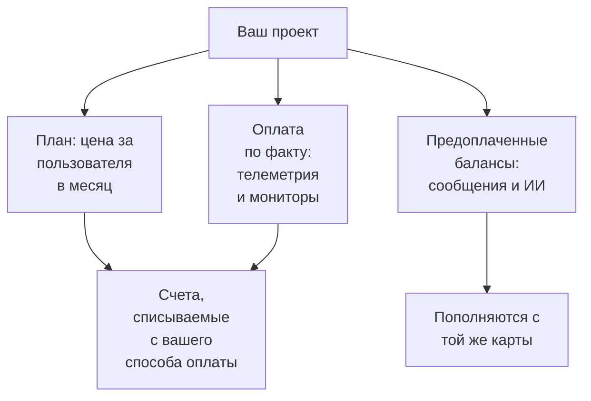

# Биллинг и использование

В OneUptime Cloud проект платит за свой план, за каждого пользователя, и за то, что использует: телеметрию, активные мониторы, а также сообщения и работу ИИ, которые он оплачивает из предоплаченных балансов. На этой странице показано, где посмотреть и изменить каждую из этих статей и кто может это делать. В самостоятельно размещённой установке нет ни биллинга, ни этих страниц.

:::cards
- [Ваш план и места](#ваш-план-и-места): Сколько стоит план и кто считается местом.
- [Способы оплаты](#способы-оплаты): Карта, с которой списываются ваши счета.
- [Счета](#счета): Оплачивайте и скачивайте их и проверяйте, что вы использовали.
- [Предоплаченные балансы](#предоплаченные-балансы): Сообщения и ИИ, пополняемые вручную или автоматически.
:::

## За что платит проект

| Что | Как тарифицируется |
| --- | --- |
| План | Цена за пользователя в месяц, с оплатой ежемесячно или ежегодно. Каждый человек в проекте — это место. |
| Телеметрия | $0.10 за каждый принятый GB, с хранением 15 дней. Более долгое хранение стоит дороже, а хранение меньше 7 дней оплачивается как 7 дней: см. [Сколько стоит хранение](/docs/telemetry/data-retention#сколько-стоит-хранение). |
| Воспроизведение сеансов | $2 за GB, с хранением 15 дней. |
| Активные мониторы | $1 за монитор в месяц. Активен любой монитор, кроме ручного, даже когда он выключен. |
| SMS, звонки, WhatsApp и Telegram | Оплачиваются из баланса проекта по мере отправки каждого сообщения. |
| OneUptime AI | Оплачивается из кредитов ИИ проекта, если только он не работает на вашем собственном провайдере LLM. |

[Страница цен](https://oneuptime.com/pricing) сравнивает планы.

## Перед началом

- **OneUptime Cloud.** Раздел **Биллинг и счета** в **Настройки проекта** есть только в OneUptime Cloud и изначально свёрнут: нажмите на его заголовок, чтобы открыть его.
- **Роль, которая может читать биллинг.** Project Owners, люди с **Manage Billing** и три роли биллинга читают все страницы биллинга. См. [Кто что может делать](#кто-что-может-делать).

## Ваш план и места

Перейдите в **Настройки проекта → Биллинг и счета → Биллинг**. Карточка **Текущий план** показывает план проекта и его цену за пользователя, а также **Места**: по одному на каждого человека в проекте.

Человек считается местом с того момента, как вы его пригласили, ещё до того, как он примет приглашение, и до тех пор, пока вы его не удалите. Чтобы изменить число мест, приглашайте или удаляйте людей: см. [Приглашение пользователей](/docs/permissions/inviting-people).

## Сменить план

:::steps
### Сначала добавьте способ оплаты

Для смены плана нужен способ оплаты. Без него **Change Plan** вместо этого открывает **Add a Payment Method**: см. [Способы оплаты](#способы-оплаты).

### Нажмите Change Plan

На карточке **Текущий план** нажмите **Change Plan**. **Годовой план** изначально включён: выключите его, чтобы увидеть ежемесячные цены.

### Выберите план

Каждый план показывает свою цену за пользователя. Примечание под планами говорит, что будет с вашим пробным периодом: **Your free trial carries over**, пока проект ещё на пробном периоде, и **Changing plan does not start a free trial**, когда это уже не так.

### Сохраните изменение

Нажмите **Сохранить изменения**. Платный план оплачивается с момента перехода на него, а каждый человек, которого вы приглашаете на нём, оплачивается с момента приглашения.
:::

Ключам API нужен план Growth или более высокий, а ниже плана Scale подключения SCIM только удаляют людей. План, который их останавливает, ещё до выбора говорит, сколько их, а страница **Биллинг** показывает **Не входит в этот тариф**, пока они остановлены. Ничего не удаляется: на плане, который их включает, они снова работают.

> [!NOTE]
> Купили OneUptime через реселлера или облачный маркетплейс (AWS Marketplace, Microsoft Marketplace, Google Cloud Marketplace или Vercel Marketplace)? Страница **Биллинг** сообщает об этом. Реселлер меняет план за вас, а маркетплейс выставляет план и использование проекта в вашем облачном счёте.

## Способы оплаты

Карточка **Способы оплаты** перечисляет карты проекта. Счета автоматически списываются с карты по умолчанию.

:::steps
### Нажмите кнопку добавления

Нажмите **Добавить способ оплаты** на карточке **Способы оплаты**.

### Введите данные карты

Введите платёжные данные и нажмите **Save payment method**. Добавленный способ становится способом по умолчанию, а его добавление включает оплату по факту использования. План при этом не меняется.
:::

- **Установить по умолчанию** делает другой способ из списка тем, с которого списываются счета.
- **Re-sync Autopay** у способа по умолчанию исправляет продление, которое всё ещё списывается со старой карты.
- У проекта остаётся хотя бы один способ оплаты: добавьте другой, прежде чем удалить последний.

## Платёжный адрес и почта для счетов

Карточка **Реквизиты компании / Платёжный адрес** содержит то, что ваши счета говорят о вас. Нажмите **Обновить** и заполните два шага:

| Шаг | Поля |
| --- | --- |
| **Платёжный адрес** | **Реквизиты компании / Платёжный адрес**: юридическое название компании, адрес и номер плательщика НДС или налоговый номер. **Страна**: страна для выставления счетов. |
| **Счета** | **Email финансового / бухгалтерского отдела**: куда отправляются счета, квитанции и сообщения о биллинге, несколько адресов через запятую. **Отправлять счета по электронной почте**: отправлять туда каждый счёт сразу после выставления. |

## Счета

**Настройки проекта → Биллинг и счета → Счета** перечисляет счета проекта, у каждого — **Номер счёта**, **Дата счёта**, **Сумма** и **Статус счёта**.

- **Оплатить счёт** оплачивает ещё не оплаченный счёт.
- **Скачать** открывает счёт в формате PDF. У ещё не оплаченного счёта эта команда находится в меню строки **⋯**.

Когда ваш банк ещё обрабатывает платёж, OneUptime сообщает об этом: некоторым банкам нужно до 2 дней, чтобы подтвердить оплату картой, и счёт обновится сам. Не оплачивайте его повторно.

## История использования

**Настройки проекта → Биллинг и счета → История использования** показывает телеметрию, отправленную проектом, по одной строке на продукт, сервис и день:

| Столбец | Что показывает |
| --- | --- |
| **Продукт** | Журналы, трассировки, метрики и другие виды телеметрии. |
| **День** | День, когда она была отправлена. |
| **Сервис** | Сервис или хост, кластер либо другой ресурс, который её отправил. |
| **Принято данных (в GB)** | Сколько поступило. |
| **Срок хранения данных (в днях)** | Как долго она хранится. |
| **Общая стоимость** | Сколько она стоила, в долларах США. |

Использование за день появляется, когда день закончился. Фильтруйте по полям **Продукт**, **День** или **Сервис**, чтобы найти то, что выросло.

## Предоплаченные балансы

SMS, звонки, сообщения WhatsApp и Telegram оплачиваются из баланса проекта, а OneUptime AI — из его кредитов ИИ. Каждый из них вы пополняете заранее:

| Баланс | Где |
| --- | --- |
| SMS, звонки, WhatsApp и Telegram | **Настройки проекта → Уведомления → Настройки уведомлений** |
| OneUptime AI | **Настройки проекта → ИИ → Кредиты ИИ** |

:::steps
### Пополните сейчас

На карточке страницы **Текущий баланс** нажмите **Пополнить баланс**. Введите сумму от $20 до $1,000 и нажмите **Пополнить**. Сумма списывается с карты проекта.

### Или пусть баланс пополняется сам

Нажмите **Редактировать: Автопополнение** на карточке **Автопополнение** и включите **Включить автопополнение**. Изначально оно выключено. Когда оно включено, OneUptime добавляет $20 каждый раз, когда баланс опускается до $10, или суммы, которые вы выберете.
:::

Когда баланса не хватает, сообщение не отправляется или OneUptime AI останавливается, а владельцы проекта получают письмо. См. [Когда оповещение не отправлено](/docs/on-call/escalation-rules#когда-оповещение-не-отправлено) и [Когда кредиты ИИ заканчиваются](/docs/ai/ai-sre#когда-кредиты-ии-заканчиваются).

## Кто что может делать

| Чтобы | Нужно |
| --- | --- |
| Читать страницы биллинга: план, счета, использование, балансы и способы оплаты | Project Owner, **Manage Billing**, **Администратор биллинга**, **Участник биллинга** или **Зритель биллинга** |
| Скачать счёт | Project Owner, Project Admin, **Manage Billing**, **Read Invoices**, **Администратор биллинга** или **Участник биллинга** |
| Изменить платёжный адрес и почту для счетов | Project Owner, **Manage Billing**, **Администратор биллинга** или **Участник биллинга** |
| Включить или выключить SMS, звонки, WhatsApp или Telegram | Project Owner, **Manage Billing** или **Администратор биллинга** |
| Добавить способ оплаты | Project Owner, **Manage Billing** или **Create Payment Method** |
| Оплатить счёт | Project Owner, **Manage Billing** или **Edit Invoices** |
| Сменить план, пополнить баланс или изменить автопополнение | Project Owner или **Manage Billing** |

Кнопка, которой вам нельзя пользоваться, отображается заблокированной и сообщает, кому можно. О ролях биллинга см. [Пользователи, команды и разрешения](/docs/permissions/index#команды).

## Настройки, которым нужен план

В OneUptime Cloud этим настройкам администрирования нужен план. Страница, плана для которой у вас нет, показывает, что делает функция и какой план ей нужен.

| Настройка | Нужный план |
| --- | --- |
| Метки | Growth |
| Ключи API | Growth |
| Собственные серверы SMTP и учётные записи Twilio | Growth |
| Собственные провайдеры LLM | Growth |
| Подключение клиентов MCP | Growth |
| Создание команд | Scale |
| SSO, OIDC и SCIM | Scale |
| Переопределения срока хранения | Scale |
| Журналы аудита | Enterprise |

## Отменить план

Чтобы перестать платить за проект, удалите его: выставление счетов прекращается, когда он удалён. См. [Удалить проект](/docs/configuration/project-settings#удалить-проект). Проект, купленный через реселлера, отменяется у реселлера, а купленный через облачный маркетплейс — на маркетплейсе.

## Устранение неполадок

:::details "Add a payment method in Project Settings > Billing and Invoices > Billing before using paid monitoring or telemetry"
Проекту на плане Free нужен способ оплаты, прежде чем он создаст активные мониторы или начнёт отправлять телеметрию, потому что они оплачиваются по факту использования. Добавьте его в разделе [Способы оплаты](#способы-оплаты). Ручные мониторы остаются бесплатными.
:::

:::details Красный баннер сообщает о неоплаченных счетах
Проект с неоплаченными счетами становится неактивным и удаляется, если они так и остаются неоплаченными. Откройте **Счета** и нажмите **Оплатить счёт** у каждого, который ещё не оплачен.
:::

:::details Change Plan открывает Add a Payment Method
У проекта ещё нет способа оплаты. Добавьте его, затем смените план.
:::

:::details История использования пуста
Использование считается по дням, и день появляется, когда он закончился. У проекта, который не отправлял телеметрию, строк нет.
:::

## Дальнейшие шаги

:::cards
- [Настройки проекта](/docs/configuration/project-settings): Всё остальное, что относится ко всему проекту.
- [Приглашение пользователей](/docs/permissions/inviting-people): Добавьте людей, для которых нужны ваши места.
- [Хранение данных](/docs/telemetry/data-retention): Храните телеметрию столько, сколько нужно, и не дольше.
- [Фильтры отбрасывания и правила очистки](/docs/telemetry/drop-filters-and-scrub-rules): Перестаньте платить за телеметрию, которую не используете.
:::
