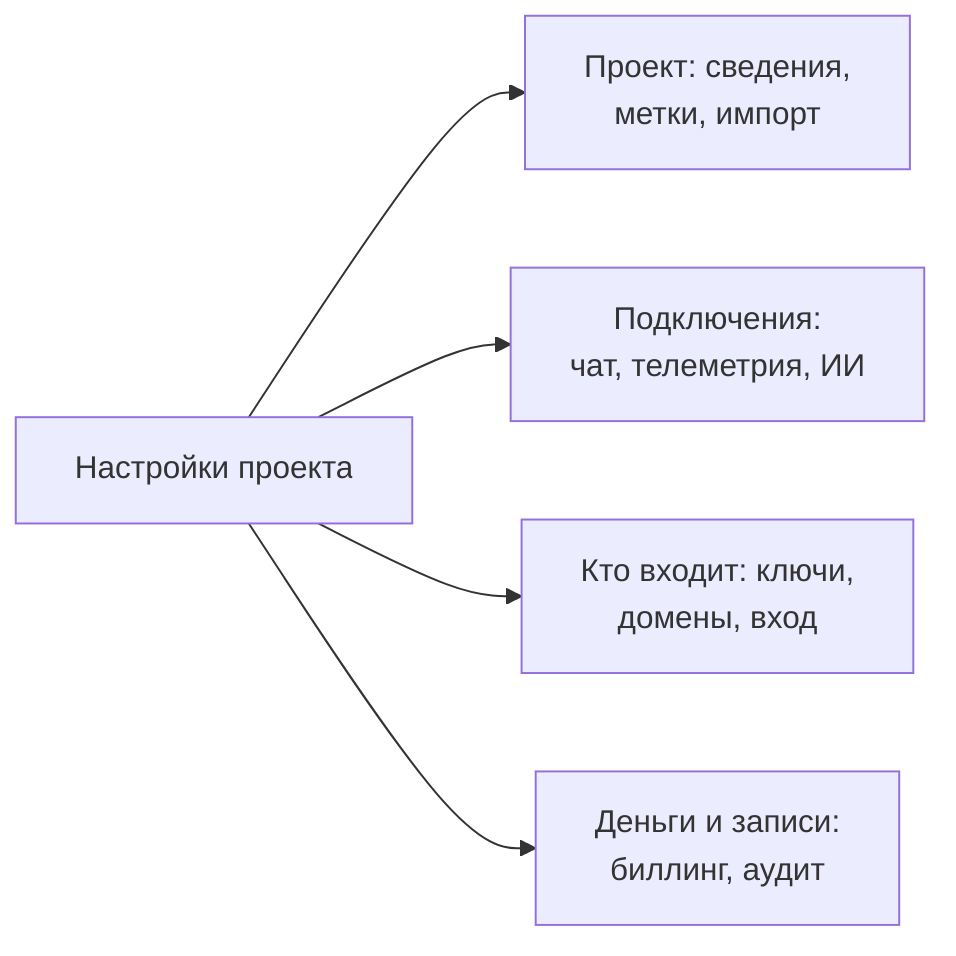

# Настройки проекта

В настройках проекта находится то, что относится ко всему проекту: название, подключённые инструменты, ключи, способ входа людей, биллинг и журнал аудита. Большую часть этого вы настраиваете один раз и редко к ней возвращаетесь. Эта страница — карта настроек; на ней описаны настройки, у которых нет своей страницы: сведения о проекте, метки и удаление проекта.

:::cards
- [Найти настройку](#найти-настройку): Что содержит каждый раздел бокового меню.
- [Сведения о проекте](#сведения-о-проекте): Имя, идентификатор и доступ поддержки.
- [Продукты](#продукты): Продукты, которые показывает этот проект, и те, что он скрывает.
- [Метки](#метки): Метки для ресурсов, разрешений и правил.
- [Удалить проект](#удалить-проект): Что для этого нужно и что исчезнет вместе с ним.
:::

## Открыть настройки проекта

Перейдите в **Продукты → Настройки → Настройки проекта**. Боковое меню группирует страницы по разделам, и сначала открыт только раздел **Базовый**: нажмите на заголовок раздела, чтобы открыть его. Раздел открывается сам на любой своей странице.

## Перед началом

- **Роль, которая может изменять проект.** Владельцы проекта и Администраторы проекта изменяют большинство этих настроек. Биллинг, каналы уведомлений и удаление проекта требуют большего, как сказано в каждом разделе.
- **В OneUptime Cloud — план, в который входит настройка.** Некоторым настройкам нужен план: см. [Настройки, которым нужен план](/docs/configuration/billing#настройки-которым-нужен-план).

## Найти настройку

| Раздел | Страницы | Где прочитать подробнее |
| --- | --- | --- |
| **Базовый** | **Проект**, **Продукты**, **Метки** | [Сведения о проекте](#сведения-о-проекте), [Продукты](#продукты), [Метки](#метки) |
| **Рабочее пространство** | **Slack**, **Microsoft Teams**, **Mattermost**, **Видеозвонки** | [Slack](/docs/workspace-connections/slack), [Microsoft Teams](/docs/workspace-connections/microsoft-teams), [Mattermost](/docs/workspace-connections/mattermost), [Видеозвонки](/docs/workspace-connections/video-calls) |
| **Телеметрия и APM** | **Ключи приёма**, **Хранение данных**, **Использование** | [Ключи приёма](/docs/telemetry/ingestion-keys), [Хранение данных](/docs/telemetry/data-retention), [Использование телеметрии](/docs/telemetry/usage) |
| **Уведомления** | **Каналы уведомлений**, **Журналы уведомлений**, **Мобильные приложения** | [Уведомления](#уведомления) |
| **ИИ** | **Функции ИИ**, **Провайдеры LLM**, **Внешние MCP-серверы**, **Кредиты ИИ**, **Результаты ИИ**, **Журналы ИИ**, **MCP-сервер** | [Провайдеры LLM](/docs/ai/llm-provider), [Внешние MCP-серверы](/docs/ai/external-mcp-servers), [Сервер MCP](/docs/ai/mcp-server), [AI SRE](/docs/ai/ai-sre#контроль-затрат) |
| **Расширенный** | **Домены**, **Ключи API**, **Импорт из другого инструмента** | [Собственные домены](/docs/status-pages/branding-and-domains#пользовательские-домены), [Ключи API](/docs/permissions/index#ключи-api), [Переход с Opsgenie](/docs/moving-to-oneuptime/opsgenie) и другие руководства по переходу |
| **Безопасность** | **SSO**, **SCIM** | [SSO](/docs/identity/sso), [SCIM](/docs/identity/scim) |
| **Биллинг и счета** | **Биллинг**, **Счета** | [Биллинг и использование](/docs/configuration/billing) |
| **Журналы аудита** | **Журналы аудита**, **Настройки**, **Экспорт** | [Журналы аудита](/docs/configuration/audit-logs), [Экспорт журнала аудита](/docs/configuration/audit-log-export) |
| **Опасная зона** | **Удалить проект** | [Удалить проект](#удалить-проект) |

**Биллинг и счета** и **Кредиты ИИ** есть только в OneUptime Cloud: в самостоятельно размещённой установке биллинга нет.

## Сведения о проекте

На странице **Настройки проекта → Базовый → Проект** две карточки.

Карточка **Детали проекта** показывает имя и идентификатор проекта:

- **Имя проекта**: нажмите **Редактировать: Проект**, чтобы переименовать проект. Имя содержит не менее 2 символов. Для переименования нужен Владелец проекта или разрешение на редактирование проекта или на управление биллингом.
- **Идентификатор проекта**: скопируйте его для API, CLI и Terraform или при обращении в поддержку.
- **Data Residency**: в OneUptime Cloud — где хранятся данные проекта, после того как OneUptime это зафиксировал. Задаёт его только OneUptime.

**Доступ службы поддержки** в OneUptime Cloud определяет, может ли команда поддержки OneUptime открывать проект. Включите **Разрешить поддержке OneUptime доступ к этому проекту**, когда вам нужна помощь: OneUptime сначала переспрашивает, потому что поддержка сможет видеть и изменять в проекте всё, и вы нажимаете **Пустить поддержку**. Выключите его, когда работа закончена: изменение сохраняется сразу. Изменять это могут Владельцы проекта и Администраторы проекта.

## Продукты

**Настройки проекта → Базовый → Продукты** выбирает продукты, которые этот проект показывает в меню **Продукты**, на главной странице и в списке поиска. У каждого продукта есть переключатель, который сохраняется сразу при переключении: включённый показывает продукт. Пользователи, команды и настройки проекта показываются всегда, а **Показать все продукты** снова показывает все.

Скрытый продукт не отключён. Он переносится в **Другие продукты** — последнюю строку меню **Продукты**: поиск по-прежнему находит его, его страницы и API работают, а данные продолжают поступать. Тот, кто его закрепил, сохраняет закрепление.

На сервере с собственным хостингом главный администратор также может отключить продукт для всех проектов в разделе **Настройки → Продукты** в Admin Dashboard (см. [Запускайте только то, что нужно](/docs/installation/docker-compose#запускайте-только-то-что-нужно)). У такого продукта здесь нет переключателя: на нём написано **Отключено на этом сервере** и указано, кто может его включить.

Каждый продукт показывается, пока кто-нибудь не скроет его здесь. Сам по себе продукт не скрывается: то, для чего проект нужен по словам Владельца проекта или Администратора проекта на главной странице, только задаёт там первые шаги, а продукт, который ещё не настроен, остаётся на своём месте в меню.

Каждый продукт сообщает, чем он является для проекта: **Используется**, **Не настроено** или, в OneUptime Cloud, нужный ему тариф. Когда в скрытый продукт начинают поступать данные, главная страница сообщает об этом Владельцам проекта и Администраторам проекта и предлагает **Показать** или **Оставить скрытым**.

Меняют её Владельцы проекта, Администраторы проекта и все, кто вправе редактировать проект; остальные участники проекта могут её видеть.

Под продуктом **Мониторы** находится переключатель **Группы мониторов**: он добавляет группы мониторов в меню мониторов. В новом проекте он выключен, сохраняется, как только вы его переключаете, а выключение не удаляет ни одной группы. Чтобы изменить его, нужна роль Владелец проекта или пользовательская роль с разрешением Edit Project или Manage Billing. См. [Группы мониторов](/docs/monitor/monitor-groups).

## Метки

Метки — это теги, которые вы ставите на мониторы, инциденты, страницы статуса и другие ресурсы. Они фильтруют и группируют списки и ограничивают, как далеко распространяются разрешения команды и правила проекта.

:::steps
### Откройте метки

Перейдите в **Настройки проекта → Базовый → Метки**.

### Создайте метку

Нажмите **Создать: Метка**. Задайте **Имя** и, если хотите, **Описание**. **Цвет метки** уже выбран — это цвет, который ещё не использует ни одна метка на странице: выберите другой, если хотите. Нажмите **Создать: Метка**, чтобы сохранить её.
:::

В OneUptime Cloud для создания и изменения меток нужен план Growth. Как метки ограничивают разрешения, см. в разделе [Метки](/docs/permissions/index#метки), а как ставить метки на ресурсы при их создании — в разделе [Правила меток и владельцев](/docs/configuration/label-and-owner-rules).

В списке метки записи показываются одна под другой; если их больше четырёх, видны первые три и ссылка на остальные. Везде, где перечисляются метки (в списках, на странице записи и в каждом выборе меток), они идут в естественном порядке: сначала метки, чьи названия начинаются с числа, в порядке этого числа (`2. Team` перед `10. Owner`), затем остальные по алфавиту, без учёта регистра. Чтобы задать порядок своих меток, начните их названия с числа, например `1. Category` и `2. Subcategory`.

### Архивирование метки

Чтобы вывести метку из употребления, архивируйте её через меню **⋯** её строки вместо удаления. Всё, где метка уже есть, её сохраняет, и по ней по-прежнему можно фильтровать, но добавить её куда-либо снова нельзя: ни один выбор меток её не предлагает, а API, Terraform и MCP её отклоняют. Диалог перечисляет правила и разрешения, настроенные на эту метку: они продолжают её использовать, пока вы их не измените. Метки из архива показаны отдельно, в свёрнутом разделе **Метки в архиве**, где **Извлечь из архива** возвращает метку. **Удалить** сначала перечисляет всё, откуда метка будет удалена, и предлагает **Архивировать вместо этого**.

**Используется** в меню строки метки считает записи каждого вида, у которых есть эта метка, и открывает их по одной странице. Записи, которые вам нельзя открывать, считаются, но не называются.

## Уведомления

**Настройки проекта → Уведомления** определяют, как проект отправляет уведомления:

- **Каналы уведомлений**: карточка **Каналы уведомлений** включает и выключает для проекта SMS, телефонные звонки, WhatsApp и Telegram. Изначально все четыре выключены. Включает их Владелец проекта, **Администратор биллинга** или тот, у кого есть **Manage Billing**. На этой странице, в свёрнутом блоке **Дополнительные настройки**, также находятся **Последовательность по умолчанию для новых участников** и **Телефон для дежурных** — то, как участников вызывают по умолчанию (см. [Последовательность по умолчанию](/docs/notifications/on-call-rules#последовательность-по-умолчанию)), — собственные почтовые серверы проекта в разделе **Пользовательские конфигурации SMTP** (см. [SMTP](/docs/emails/smtp)) и его собственная учётная запись Twilio (см. [Интеграция с Twilio](/docs/self-hosted/twilio-integration)). В OneUptime Cloud на ней находится баланс, из которого оплачиваются эти сообщения: см. [Предоплаченные балансы](/docs/configuration/billing#предоплаченные-балансы).
- **Журналы уведомлений**: каждое уведомление, отправленное проектом, с отдельной вкладкой для каждого канала: **Электронная почта**, **SMS**, **WhatsApp**, **Telegram**, **Вебхук**, **Вызов**, **Push** и **Рабочее пространство**. Вкладка **Вебхук** хранит от каждого адреса только схему и хост: остальное — секрет webhook.
- **Мобильные приложения**: где взять приложения для iOS и Android. См. [Обзор приложений](/docs/mobile-desktop-apps/index).

## Удалить проект

Удаление проекта удаляет в нём всё, для всех участников: мониторы, инциденты, страницы статуса, настройки дежурств и телеметрию. Вернуть это нельзя.

:::steps
### Откройте опасную зону

Перейдите в **Настройки проекта → Опасная зона → Удалить проект**.

### Нажмите кнопку удаления

Нажмите **Удалить: Проект**. Диалог попросит подтвердить действие.

### Введите имя проекта

Введите имя в точности так, как оно написано. Кнопка **Удалить: Проект** остаётся заблокированной, пока вы этого не сделаете. В OneUptime Cloud диалог также спрашивает, почему вы уходите: отвечать необязательно.

### Подтвердите

Нажмите **Удалить: Проект**. OneUptime удалит проект и выведет вас из него.
:::

> [!CAUTION]
> Удаление проекта нельзя отменить. Для него нужен Владелец проекта или разрешение на удаление проекта.

В OneUptime Cloud план проекта отменяется удалением проекта: выставление счетов прекращается, когда проект удалён. Проект, который оплачивается через облачный маркетплейс, получает последнее списание за использование, а покупка на маркетплейсе остаётся активной, пока вы не отмените её там.

## Устранение неполадок

:::details Кажется, что раздела бокового меню нет
Все разделы, кроме **Базовый**, изначально свёрнуты. Нажмите на заголовок раздела, чтобы открыть его. В самостоятельно размещённой установке нет ни раздела **Биллинг и счета**, ни страницы **Кредиты ИИ**.
:::

:::details Кнопка Редактировать: Проект заблокирована
Для переименования нужен Владелец проекта или разрешение на редактирование проекта или на управление биллингом. Заблокированная кнопка называет разрешение, которого вам не хватает.
:::

:::details Кнопка Удалить: Проект в диалоге остаётся заблокированной
Введите имя проекта в точности так, как его показывает диалог: регистр букв имеет значение.
:::

## Дальнейшие шаги

:::cards
- [Приглашение пользователей](/docs/permissions/inviting-people): Приведите свою команду в проект.
- [Биллинг и использование](/docs/configuration/billing): Ваш план, способы оплаты, счета и использование.
- [Журналы аудита](/docs/configuration/audit-logs): Узнайте, кто что изменил в проекте.
- [SSO](/docs/identity/sso): Пусть люди входят через вашего поставщика удостоверений.
:::
