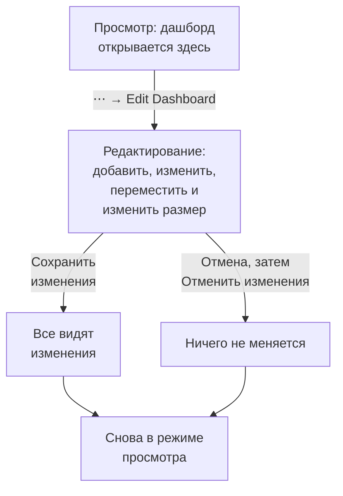

# Создание дашборда

Чтобы создать дашборд, откройте **Продукты → Дашборды**, нажмите **Создать: Панель** и выберите шаблон или **Blank Dashboard**, чтобы начать с нуля. Шаблон сам заполняет имя дашборда (с номером, как «Kubernetes Dashboard 2», если в проекте такой уже есть); для пустого дашборда имя нужно ввести. Нажмите **Создать: Панель**, и новый дашборд откроется. Пустой дашборд открывается на пустом холсте с кнопкой **Добавить виджет** для первого виджета.

:::cards
- [Создать дашборд](#создать-дашборд): Начните с шаблона или с пустого холста.
- [Редактирование и сохранение](#редактирование-и-сохранение): Ни у кого ничего не меняется, пока вы не нажмёте «Сохранить изменения».
- [Добавить виджет](#добавить-виджет): Выберите его в каталоге, настройте и поставьте на место.
- [Масштабирование всплеска](#масштабирование-всплеска): Протяните выделение по графику, чтобы прочитать весь дашборд в этот момент.
:::

## Перед началом

Владельцы и администраторы проекта могут создавать и редактировать любые дашборды. Остальным нужно разрешение команды: `CreateDashboard`, чтобы создавать дашборды, и `EditDashboard`, чтобы их менять. Участники и наблюдатели проекта могут читать дашборды без этих разрешений. Тот, кому нельзя редактировать дашборд, всё равно открывает его меню **⋯**, где пункт **Edit Dashboard** заблокирован и показывает, какое разрешение нужно.

## Создать дашборд

:::steps
### Откройте выбор шаблона

Откройте **Продукты → Дашборды** и нажмите **Создать: Панель**. Диалог **Создать из шаблона** показывает **Blank Dashboard** и пятнадцать шаблонов, сгруппированных по тому, за чем они следят.

### Выберите шаблон

Нажмите на карточку. Шаблон сам создаёт свои виджеты, а часто и переменные; **Blank Dashboard** начинается с пустого холста.

### Назовите дашборд

Имя шаблона заполнено и пронумеровано с учётом имён, которые уже есть в проекте. Имя пустого дашборда пустое: введите его. Описание необязательно, свёрнуто в разделе **Дополнительные поля**, и его можно добавить позже на странице **Обзор** дашборда.

### Создайте его

Нажмите **Создать: Панель**. Новый дашборд откроется: сразу с виджетами шаблона или с пустым холстом пустого дашборда и кнопкой **Добавить виджет** на нём.
:::

Шаблоны по группам, под которыми их показывает выбор шаблона:

| Группа | Шаблоны |
| --- | --- |
| Get Started | Blank Dashboard |
| Monitoring & APM | Monitor Dashboard, Metrics Dashboard, Real User Monitoring Dashboard, SLO Dashboard |
| Incident Response | Incident Dashboard, Alert Dashboard |
| Infrastructure | Kubernetes Dashboard, Kubernetes Cost Dashboard, Hosts Dashboard, Proxmox Dashboard, VMware Dashboard, Ceph Dashboard, Storage Array Dashboard, Docker Swarm Dashboard, Network Dashboard |

Шаблон — это отправная точка, а не связь: после создания дашборда меняйте его как угодно. Шаблон больше его не обновляет.

## Редактирование и сохранение

Дашборд открывается в режиме просмотра, для чтения. Чтобы изменить его, откройте меню **⋯** на его панели инструментов и выберите **Edit Dashboard**. Панель инструментов показывает **Editing** рядом с именем и заменяет временной диапазон и другие элементы управления кнопками **Добавить виджет**, **Переменные**, **Отмена** и **Сохранить изменения**.

Ваши изменения видны только вам, пока вы их не сохраните. Во время редактирования ничего не сохраняется, поэтому другие продолжают видеть дашборд таким, каким он был.

- **Сохранить изменения** сохраняет виджеты, их положение и размеры, переменные и интервал автообновления — всё сразу — и возвращает в режим просмотра. Если сохранение отклонено, например потому что вы тем временем потеряли разрешение, вы остаётесь в режиме редактирования со своими изменениями, а причина показывается над сеткой.
- **Отмена** сначала спрашивает, потому что отбрасывает ваши изменения: **Отменить изменения** возвращает дашборд к сохранённому виду, а **Продолжить редактирование** возвращает вас к работе.

Во время редактирования автообновление приостанавливается, а увеличенный временной диапазон возвращается к выбранному вами диапазону.

## Добавить виджет

:::steps
### Откройте каталог виджетов

Нажмите **Добавить виджет**: на панели инструментов во время редактирования или на холсте пустого дашборда. Каталог группирует виджеты по тому, что они показывают. Введите текст в поле поиска, чтобы найти виджет по названию или назначению ("error budget", "pods"), и нажмите Enter, чтобы добавить первый результат.

### Выберите виджет

Нажмите на него. Виджет встаёт на первое свободное место сетки, где он помещается, и открываются его настройки.

### Задайте, что он показывает

Диалог настроек показывает **Live Preview** виджета над его настройками, и предпросмотр следует за каждым вашим изменением. Выберите, что читает виджет (запрос метрик, фильтр, текст) и как он выглядит, затем нажмите **Готово**.

### Поставьте его на место

Перетащите виджет, чтобы переместить его, и потяните за его края или углы, чтобы изменить размер. См. [Виджеты на сетке](#виджеты-на-сетке).
:::

[Виджеты дашборда](/docs/dashboards/widgets) описывает каждый виджет и его настройки.

## Виджеты на сетке

Холст — это сетка шириной в двенадцать колонок. Виджеты привязываются к ней, а страница растёт вниз по мере добавления строк. Пока вы перетаскиваете виджет, пунктирный контур показывает, куда он встанет, с его колонкой и строкой; пока вы меняете размер виджета, контур показывает его размер в единицах сетки. Мешающие виджеты отодвигаются, поэтому два виджета никогда не перекрываются.

У каждого вида виджета есть минимальный размер, чтобы то, что он рисует, оставалось читаемым: график занимает не меньше шести колонок в ширину и трёх строк в высоту, а одно число помещается в одну ячейку.

Чтобы изменить виджет позже, нажмите на него во время редактирования. Его настройки откроются снова, с двумя дополнительными кнопками внизу:

- **Duplicate Widget** добавляет копию с теми же настройками на первое свободное место.
- **Удалить виджет** удаляет его после подтверждения.

## Временной диапазон и автообновление

В режиме просмотра селектор временного диапазона на панели инструментов задаёт окно, которое читают все виджеты графиков, чисел, логов и трассировок. Выберите предустановку — от последних 5 минут до последних 3 месяцев — или собственные начало и конец. При каждом открытии дашборд начинается с последнего часа.

Списки инцидентов, оповещений, мониторов и ресурсов показывают своё текущее состояние, каким бы ни был временной диапазон.

Рядом с временным диапазоном меню автообновления заново читает каждый виджет каждые 5 секунд, 10 секунд, 30 секунд, 1 минуту, 5 минут или 15 минут и показывает обратный отсчёт до следующего обновления. Не включайте его во время расследования, чтобы картинка не двигалась. Чтобы сделать интервал собственным для дашборда, выберите его, затем отредактируйте дашборд и нажмите **Сохранить изменения**: каждый визит будет начинаться с него.

Селектор временного диапазона, переменные и автообновление появляются, как только на дашборде есть виджет.

### Масштабирование всплеска

Чтобы рассмотреть всплеск, не нужно обращаться к селектору временного диапазона. Протяните выделение по интересному участку любого линейного графика или графика с областями, и **весь дашборд** перейдёт к этому окну — так же, как если бы вы выбрали его в селекторе временного диапазона: каждый виджет, использующий временной диапазон, выполняет запрос заново вместе с ним, так что вы читаете один и тот же момент по всему дашборду, а не один график в масштабе, отличном от соседей. Живые списки по-прежнему показывают то, что происходит сейчас.

**Дважды щёлкните по любому графику**, чтобы отменить: дашборд вернётся к диапазону, который был до начала масштабирования, сколько бы раз вы ни приближали. Пока масштабирование активно, рядом с селектором временного диапазона появляется кнопка **Reset zoom**, а двойной щелчок по немасштабированному дашборду ничего не делает.

Увеличенное окно фиксировано, поэтому при включённом автообновлении оно перестаёт сдвигаться вперёд — это сделано намеренно, ведь окно, ускользающее посреди расследования, было бы хуже. Сбросьте масштаб, чтобы окно снова сдвигалось.

Масштабирование работает только в режиме просмотра; в режиме редактирования перетаскивание перемещает виджеты и меняет их размер. Столбчатые диаграммы масштабируются так же — протяните выделение по столбцам, — а двойной щелчок по одной из них сбрасывает дашборд, как и любой другой график. Масштабирует только протягивание: простой щелчок по графику никогда не меняет диапазон дашборда. Те же жесты работают на графиках по всему OneUptime; см. [Масштабирование до диапазона времени](/docs/telemetry/charts-and-time-ranges).

## Полный экран

**⋯ → Full Screen** показывает виджеты дашборда на весь экран — для настенного экрана или совещания. Нажмите Esc, чтобы выйти.

## Советы для дашбордов, которые не устаревают

- **Одна тема на дашборд.** Несколько сфокусированных дашбордов лучше одной страницы со всем, за чем вы следите.
- **Самый важный виджет — наверх.** Люди читают сверху вниз, поэтому пусть первое, что они видят, отвечает на вопрос «всё ли в порядке?»
- **Называйте разделы виджетами «Текст».** Короткий заголовок через каждые несколько строк («Задержка», «Ошибки», «Ёмкость») позволяет пробежать страницу глазами даже с другого конца комнаты.
- **Переменные вместо копий.** Если вы собираетесь собрать такой же дашборд для второго сервиса, добавьте вместо этого переменную `service`. См. [Переменные и фильтры дашборда](/docs/dashboards/variables).
- **Делайте копию перед большим изменением.** **Дублировать: Панель** на странице **Настройки** дашборда создаёт безопасную копию, на которой можно проверить идеи.

## Дальнейшие шаги

:::cards
- [Виджеты дашборда](/docs/dashboards/widgets): Все виджеты, их настройки и какой из них выбрать.
- [Переменные и фильтры дашборда](/docs/dashboards/variables): Один дашборд для каждого сервиса, хоста или клиента.
- [Совместный доступ и публичные дашборды](/docs/dashboards/sharing): Поделитесь дашбордом за пределами команды.
- [Конфигурация и разрешения дашборда](/docs/dashboards/configuration): Владельцы, метки, архивирование и кто что может делать.
:::
