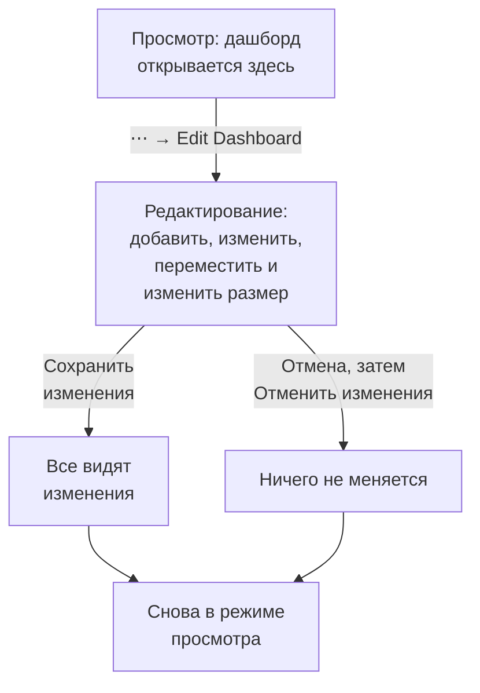

# Создание дашборда

Чтобы создать дашборд, откройте **Продукты → Дашборды** и нажмите **Создать панель**. Диалог **Создать панель** спрашивает, с чего начать, а затем — имя. **Начать с нуля** даёт пустой дашборд; шаблон сам создаёт свои виджеты, а часто и переменные, и заполняет своё имя (с номером, как «Kubernetes Dashboard 2», если в проекте такой уже есть). Нажмите **Создать панель**, и новый дашборд откроется. Пустой дашборд открывается на своём холсте с кнопкой **Добавить виджет** для первого виджета.

:::cards
- [Создать дашборд](#создать-дашборд): Начните с нуля или с шаблона.
- [Редактирование и сохранение](#редактирование-и-сохранение): Ни у кого ничего не меняется, пока вы не нажмёте «Сохранить изменения».
- [Добавить виджет](#добавить-виджет): Выберите его в каталоге, настройте и поставьте на место.
- [Масштабирование всплеска](#масштабирование-всплеска): Протяните выделение по графику, чтобы прочитать весь дашборд в этот момент.
:::

## Перед началом

Владельцы и администраторы проекта могут создавать и редактировать любые дашборды. Остальным нужно разрешение команды: `CreateDashboard`, чтобы создавать дашборды, и `EditDashboard`, чтобы их менять. Участники и наблюдатели проекта могут читать дашборды без этих разрешений. Тот, кому нельзя редактировать дашборд, всё равно открывает его меню **⋯**, где пункт **Редактировать панель** заблокирован и показывает, какое разрешение нужно.

## Создать дашборд

:::steps
### Выберите, с чего начать

Откройте **Продукты → Дашборды** и нажмите **Создать панель**. Диалог **Создать панель** открывается на **Начать с нуля** — пустом дашборде для ваших виджетов. Ниже **Или начать с шаблона** показывает шесть шаблонов в разделе **Рекомендуемые**.

### Выберите шаблон

Нажмите на шаблон, чтобы увидеть, что он добавит: его виджеты, названные так же, как в **Добавить виджет**, и переменные, которыми вы сужаете его на панели инструментов. Для остальных выберите категорию рядом с полем поиска, или **Все шаблоны**, или введите текст в **Поиск шаблонов…**: совпасть должно каждое введённое слово. Затем нажмите **Использовать шаблон** или дважды щёлкните шаблон. В поле поиска стрелки выбирают шаблон, а **Enter** применяет его.

### Назовите дашборд

Имя шаблона заполнено и пронумеровано с учётом имён, которые уже есть в проекте. С **Начать с нуля** оно остаётся пустым: введите его. Описание необязательно, свёрнуто в разделе **Дополнительные поля**, и его можно добавить позже на странице **Обзор** дашборда. **Назад** возвращает к шаблонам такими, какими вы их оставили.

### Создайте его

Нажмите **Создать панель**. Новый дашборд откроется: сразу с виджетами шаблона или с пустым холстом и кнопкой **Добавить виджет** на нём.
:::

Шаблоны по категориям, под которыми их показывает выбор шаблона:

| Категория | Шаблоны |
| --- | --- |
| Мониторинг и APM | Monitor Dashboard, Metrics Dashboard, Real User Monitoring Dashboard, SLO Dashboard |
| Реагирование на инциденты | Incident Dashboard, Alert Dashboard |
| Инфраструктура | Kubernetes Dashboard, Kubernetes Cost Dashboard, Hosts Dashboard, Proxmox Dashboard, VMware Dashboard, Ceph Dashboard, Storage Array Dashboard, Docker Swarm Dashboard, Network Dashboard |

В **Рекомендуемые** входят Monitor Dashboard, Incident Dashboard, Alert Dashboard, Kubernetes Dashboard, Hosts Dashboard и Metrics Dashboard. Шаблон — это отправная точка, а не связь: после создания дашборда меняйте его как угодно. Шаблон больше его не обновляет.

## Редактирование и сохранение

Дашборд открывается в режиме просмотра, для чтения. Чтобы изменить его, откройте меню **⋯** на его панели инструментов и выберите **Редактировать панель**. Панель инструментов показывает **Редактирование** рядом с именем и заменяет временной диапазон и другие элементы управления кнопками **Добавить виджет**, **Переменные**, **Отмена** и **Сохранить изменения**, а под ними добавляет строку с полями дашборда **Период по умолчанию** и **Автообновление по умолчанию**.

Ваши изменения видны только вам, пока вы их не сохраните. Во время редактирования ничего не сохраняется, поэтому другие продолжают видеть дашборд таким, каким он был.

- **Сохранить изменения** сохраняет виджеты, их положение и размеры, переменные, а также период и автообновление по умолчанию — всё сразу — и возвращает в режим просмотра. Если сохранение отклонено, например потому что вы тем временем потеряли разрешение, вы остаётесь в режиме редактирования со своими изменениями, а причина показывается над сеткой.
- **Отмена** сначала спрашивает, потому что отбрасывает ваши изменения: **Отменить изменения** возвращает дашборд к сохранённому виду, а **Продолжить редактирование** возвращает вас к работе.

Во время редактирования автообновление приостанавливается, а увеличенный временной диапазон возвращается к выбранному вами диапазону.

## Добавить виджет

:::steps
### Откройте каталог виджетов

Нажмите **Добавить виджет**: на панели инструментов во время редактирования или на холсте пустого дашборда. Каталог группирует виджеты по тому, что они показывают. Введите текст в поле поиска, чтобы найти виджет по названию или назначению ("error budget", "pods"), и нажмите Enter, чтобы добавить первый результат.

### Выберите виджет

Нажмите на него. Виджет встаёт на первое свободное место сетки, где он помещается, и открываются его настройки.

### Задайте, что он показывает

Диалог настроек показывает **Live Preview** виджета над его настройками, и предпросмотр следует за каждым вашим изменением. Выберите, что читает виджет (запрос метрик, фильтр, текст) и как он выглядит, затем нажмите **Готово**.

### Поставьте его на место

Перетащите виджет, чтобы переместить его, и потяните за его края или углы, чтобы изменить размер. См. [Виджеты на сетке](#виджеты-на-сетке).
:::

[Виджеты дашборда](/docs/dashboards/widgets) описывает каждый виджет и его настройки.

## Виджеты на сетке

Холст — это сетка шириной в двенадцать колонок. Виджеты привязываются к ней, а страница растёт вниз по мере добавления строк. Пока вы перетаскиваете виджет, пунктирный контур показывает, куда он встанет, с его колонкой и строкой; пока вы меняете размер виджета, контур показывает его размер в единицах сетки. Мешающие виджеты отодвигаются, поэтому два виджета никогда не перекрываются.

У каждого вида виджета есть минимальный размер, чтобы то, что он рисует, оставалось читаемым: график занимает не меньше шести колонок в ширину и трёх строк в высоту, а одно число помещается в одну ячейку.

Сетка такой же ширины, как экран. На более узком экране её колонки сужаются, а строки сохраняют свою высоту. На телефоне виджеты показываются один под другим, каждый шириной с экран, в том порядке, в каком они стоят на сетке: строка за строкой сверху вниз, а внутри строки — слева направо. График там рисуется выше, чтобы его линиям хватало места. При редактировании на телефоне вы видите сетку, которая прокручивается по горизонтали.

Чтобы изменить виджет позже, нажмите на него во время редактирования. Его настройки откроются снова, с двумя дополнительными кнопками внизу:

- **Duplicate Widget** добавляет копию с теми же настройками на первое свободное место.
- **Удалить виджет** удаляет его после подтверждения.

## Временной диапазон и автообновление

В режиме просмотра селектор временного диапазона на панели инструментов задаёт окно, которое читают все виджеты графиков, чисел, логов и трассировок. Выберите предустановку — от последних 5 минут до последних 3 месяцев — или собственные начало и конец. Дашборд открывается на своём периоде по умолчанию: последнем часе, если только тот, кто его редактирует, не задаст другой.

Списки инцидентов, оповещений, мониторов и ресурсов показывают своё текущее состояние, каким бы ни был временной диапазон.

Рядом с временным диапазоном меню автообновления заново читает каждый виджет каждые 5 секунд, 10 секунд, 30 секунд, 1 минуту, 5 минут или 15 минут и показывает обратный отсчёт до следующего обновления. Не включайте его во время расследования, чтобы картинка не двигалась. Дашборд открывается со своим автообновлением по умолчанию: выключенным, если только тот, кто его редактирует, не задаст другое.

Селектор временного диапазона, переменные и автообновление появляются, как только на дашборде есть виджет.

### Значения дашборда по умолчанию

Пока вы редактируете дашборд, строка под кнопками панели инструментов задаёт, с чем его открывают все: **Период по умолчанию** — предустановка от последних 5 минут до последних 3 месяцев — и **Автообновление по умолчанию**. **Сохранить изменения** сохраняет их вместе с остальным дашбордом — и для вашей команды, и для посетителей его публичной ссылки. Собственные начало и конец не могут быть значением по умолчанию: дашборд навсегда остался бы на этом моменте. Эта строка появляется, как только на дашборде есть виджет.

Дашборды, сохранённые до появления этих настроек, открываются на последнем часе и с тем автообновлением, которое у них было. Через API и Terraform оба значения хранятся в `dashboardViewConfig` дашборда: `timeRange` — предустановка в написании справочника API, например `Past 1 Day`, и `refreshInterval`, например `1m`. Любое другое значение отклоняется.

### Ваш собственный выбор

Временной диапазон и автообновление, которые вы выбираете в режиме просмотра, касаются только вас, и браузер запоминает их для каждого дашборда: перезагрузка страницы, перезапуск браузера или перезагрузка настенного экрана открывают дашборд таким, каким вы его оставили. Запоминается только предустановка. Собственный диапазон или масштабирование действуют, пока вы не уйдёте со страницы, поэтому дашборд никогда не застревает на моменте в прошлом.

Первый пункт каждого селектора называет значение дашборда по умолчанию, например По умолчанию (Past 1 Day). Выберите его, чтобы вернуться к значению по умолчанию: браузер забывает ваш выбор, и дашборд снова следует своему значению по умолчанию, даже если позже кто-то его изменит. Когда вы сами сохраняете новые значения по умолчанию, вы сразу их видите.

### Масштабирование всплеска

Чтобы рассмотреть всплеск, не нужно обращаться к селектору временного диапазона. Протяните выделение по интересному участку любого линейного графика или графика с областями, и **весь дашборд** перейдёт к этому окну — так же, как если бы вы выбрали его в селекторе временного диапазона: каждый виджет, использующий временной диапазон, выполняет запрос заново вместе с ним, так что вы читаете один и тот же момент по всему дашборду, а не один график в масштабе, отличном от соседей. Живые списки по-прежнему показывают то, что происходит сейчас.

**Дважды щёлкните по любому графику**, чтобы отменить: дашборд вернётся к диапазону, который был до начала масштабирования, сколько бы раз вы ни приближали. Пока масштабирование активно, рядом с селектором временного диапазона появляется кнопка **Сбросить масштаб**, а двойной щелчок по немасштабированному дашборду ничего не делает.

Увеличенное окно фиксировано, поэтому при включённом автообновлении оно перестаёт сдвигаться вперёд — это сделано намеренно, ведь окно, ускользающее посреди расследования, было бы хуже. Сбросьте масштаб, чтобы окно снова сдвигалось.

Масштабирование работает только в режиме просмотра; в режиме редактирования перетаскивание перемещает виджеты и меняет их размер. Столбчатые диаграммы масштабируются так же — протяните выделение по столбцам, — а двойной щелчок по одной из них сбрасывает дашборд, как и любой другой график. Масштабирует только протягивание: простой щелчок по графику никогда не меняет диапазон дашборда. Те же жесты работают на графиках по всему OneUptime; см. [Масштабирование до диапазона времени](/docs/telemetry/charts-and-time-ranges).

## Полный экран

**⋯ → Во весь экран** показывает виджеты дашборда на весь экран — для настенного экрана или совещания. Нажмите Esc, чтобы выйти.

## Советы для дашбордов, которые не устаревают

- **Одна тема на дашборд.** Несколько сфокусированных дашбордов лучше одной страницы со всем, за чем вы следите.
- **Самый важный виджет — наверх.** Люди читают сверху вниз, поэтому пусть первое, что они видят, отвечает на вопрос «всё ли в порядке?»
- **Называйте разделы виджетами «Текст».** Короткий заголовок через каждые несколько строк («Задержка», «Ошибки», «Ёмкость») позволяет пробежать страницу глазами даже с другого конца комнаты.
- **Переменные вместо копий.** Если вы собираетесь собрать такой же дашборд для второго сервиса, добавьте вместо этого переменную `service`. См. [Переменные и фильтры дашборда](/docs/dashboards/variables).
- **Делайте копию перед большим изменением.** **Дублировать: Панель** на странице **Настройки** дашборда создаёт безопасную копию, на которой можно проверить идеи.

## Дальнейшие шаги

:::cards
- [Виджеты дашборда](/docs/dashboards/widgets): Все виджеты, их настройки и какой из них выбрать.
- [Переменные и фильтры дашборда](/docs/dashboards/variables): Один дашборд для каждого сервиса, хоста или клиента.
- [Совместный доступ и публичные дашборды](/docs/dashboards/sharing): Поделитесь дашбордом за пределами команды.
- [Конфигурация и разрешения дашборда](/docs/dashboards/configuration): Владельцы, метки, архивирование и кто что может делать.
:::
