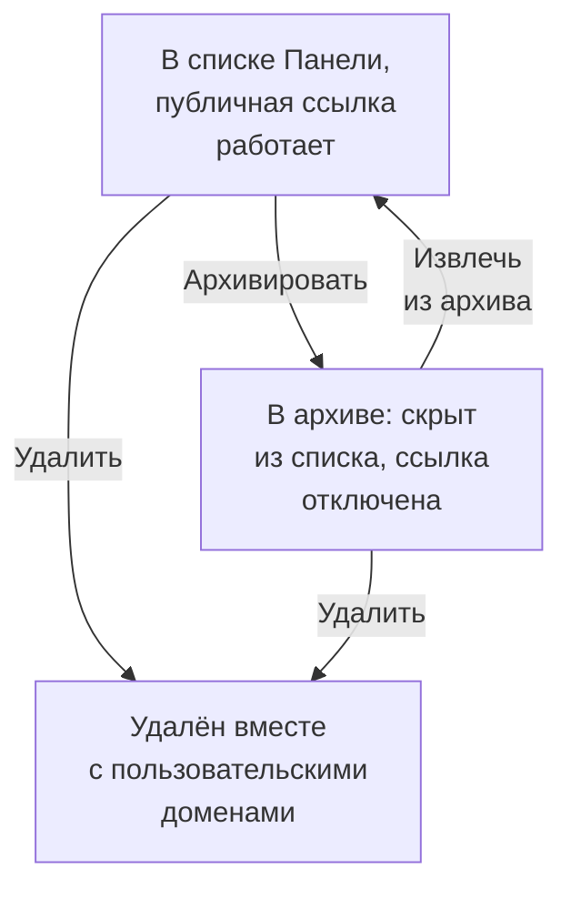

# Конфигурация и разрешения дашборда

Когда у вас появился дашборд, который стоит сохранить, эта страница расскажет, кто может его читать и менять, как владельцы и метки упорядочивают ваши дашборды и как скопировать, экспортировать, заархивировать и удалить дашборд.

:::cards
- [Кто что может делать](#кто-что-может-делать): Разрешения за каждым действием и у кого они есть.
- [Владельцы](#владельцы): Пользователи и команды, которым принадлежит дашборд.
- [Дублирование дашборда](#дублирование-дашборда): Безопасная копия, пронумерованная за вас.
- [Архивирование дашборда](#архивирование-дашборда): Уберите дашборд, не удаляя его.
:::

## Кто что может делать

Дашборды подчиняются [разрешениям](/docs/permissions/index) вашего проекта. Каждое действие требует одного из них, выданного через команду:

| Чтобы | Нужно |
| --- | --- |
| Читать дашборды | `ReadDashboard` или роль в проекте: Project Owner, Project Admin, Project Member, Viewer или одна из ролей Settings |
| Создавать дашборды | `CreateDashboard`, Project Owner или Project Admin |
| Менять дашборд: его виджеты, переменные, общий доступ, брендинг, а также архивировать его | `EditDashboard`, Project Owner или Project Admin |
| Удалять дашборд | `DeleteDashboard`, Project Owner или Project Admin |
| Добавлять и удалять владельцев | Разрешения на владельцев дашбордов, Project Owner, Project Admin или Project Member |
| Добавлять и менять пользовательские домены | Разрешения на домены дашбордов, Project Owner, Project Admin, Project Member, Settings Admin или Settings Member |
| Создавать правила владельцев и правила меток | Разрешения на правила, Project Owner или Project Admin |

Так что Project Member читает все дашборды, но чтобы их собирать, ему нужны `CreateDashboard` и `EditDashboard`. Чтение, редактирование и удаление можно по отдельности ограничить дашбордами, которыми владеет команда, или дашбордами с определёнными метками: см. [Область: насколько далеко действует разрешение](/docs/permissions/index#область-насколько-далеко-действует-разрешение).

Назначайте их на странице **Права доступа** команды: откройте **Продукты → Команды** и выберите команду.

Кто может видеть дашборд за пределами проекта — отдельный вопрос, на который отвечает его страница **Общий доступ**: см. [Доступ к публичным дашбордам](#доступ-к-публичным-дашбордам).

## Владельцы

**Владельцы** дашборда — это пользователи и команды, которым он принадлежит. Добавляйте их на странице **Владельцы** дашборда или выберите несколько дашбордов в списке **Панели** и добавьте владельцев всем сразу.

Владельцы сужают доступ, когда вы об этом просите: разрешение команды, ограниченное дашбордами этой команды, действует только на дашборды, у которых владельцем указана эта команда или действующий человек. Само по себе владение ничего не даёт.

Список **Панели** показывает владельцев каждого дашборда, а его фильтр **Владелец** находит дашборды, которыми владеет человек или команда.

## Метки

Метки — это теги для упорядочивания дашбордов. Добавляйте их на странице **Обзор** дашборда, где также редактируются его имя и описание, или сразу нескольким дашбордам из списка **Панели**.

Распространённые схемы:

- **По команде**: `team:platform`, `team:checkout`, `team:growth`.
- **По окружению**: `env:prod`, `env:staging`.
- **По назначению**: `purpose:oncall`, `purpose:exec`, `purpose:investigation`.

Фильтр **Метки** в списке **Панели** — самый быстрый способ найти дашборд в проекте, где их накопилось много. Метки также ограничивают разрешения: разрешение команды, ограниченное определёнными метками, действует только на дашборды с одной из них.

## Правила владельцев и меток

Вместо того чтобы добавлять владельцев и метки вручную, поручите это правилам. В разделе **Настройки** бокового меню **Панели** **Правила владельца** добавляют владельцев, а **Правила меток** — метки каждому новому дашборду, который им соответствует: по уже имеющимся у него меткам или по шаблону в имени или описании. Раздел [Правила меток и владельцев](/docs/configuration/label-and-owner-rules) объясняет, как правила сопоставляются и как применить правило к уже существующим дашбордам.

## Доступ к публичным дашбордам

Кто может видеть дашборд за пределами проекта — это один выбор на его странице **Общий доступ** (также **⋯ → Поделиться** на самом дашборде; см. [Совместный доступ и публичные дашборды](/docs/dashboards/sharing)):

1. **Только участники этого проекта** (по умолчанию) — у дашборда нет публичной ссылки; его публичный адрес показывает страницу «не найдено».
2. **Все, у кого есть ссылка** — любой, у кого есть публичная ссылка, может видеть дашборд без входа.
3. **Все, у кого есть ссылка и пароль** — посетители вводят пароль, прежде чем дашборд появится.

В разделе **Дополнительные настройки** на той же странице **Список разрешённых IP** (план Scale) отклоняет запросы к публичной ссылке с любого IP-адреса, которого в нём нет. Самая закрытая публичная конфигурация — **Все, у кого есть ссылка и пароль** вместе со списком разрешённых IP: это удобно для партнёрских порталов, где нужны оба уровня защиты.

## Дублирование дашборда

Чтобы скопировать дашборд, откройте его, перейдите на его страницу **Настройки** и нажмите **Дублировать: Панель**. Имя копии заполняется за вас: имя дашборда с номером, следующим за уже существующими в проекте («Checkout API» копируется как «Checkout API 2», а копия этой копии — как «Checkout API 3»). При желании измените его, подтвердите кнопкой **Дублировать: Панель**, и копия откроется. В ней есть виджеты, переменные, описание и метки дашборда. Брендинг и пользовательские домены остаются у оригинала, а публичный доступ у копии всегда сначала выключен, чтобы вы сами решили, включать ли его.

Это правильный ход, когда нужно ответвить шаблон (например, «наш дашборд дежурного») в копию для конкретного сервиса.

## Экспорт и импорт

Дашборд переносится в формате JSON:

- **Экспорт: Панель** на странице **Настройки** дашборда скачивает его как JSON-файл. Чтобы экспортировать несколько, выберите их в списке **Панели** и выберите **Экспорт в JSON**.
- **Импорт из JSON** над списком **Панели** создаёт дашборды из такого файла в этом или в другом проекте.

Экспорт содержит собственные настройки дашборда, в том числе его виджеты и переменные. Его владельцы и метки в экспорт не входят, а для виджетов, которые указывают на ресурсы этого проекта, например на SLO или источник данных, в другом проекте их, возможно, придётся выбрать заново.

## Архивирование дашборда

Заархивируйте дашборд, которым больше не пользуетесь, но хотите сохранить. Заархивированный дашборд исчезает из списка **Панели**, а если он публичный, его публичная ссылка перестаёт работать: его URL и пользовательские домены отвечают "Dashboard not found". Его виджеты, переменные, брендинг, домены и публичные настройки сохраняются, поэтому после извлечения из архива он возвращается точно в прежнем виде, включая публичную ссылку.

Чтобы заархивировать один дашборд, откройте его, перейдите на его страницу **Настройки** и нажмите **Архивировать**. Чтобы заархивировать несколько, выберите их в списке **Панели** и выберите **Архивировать**. Чтобы вернуть дашборд, откройте **Дашборды → Расширенный → Архивировано**, выберите его и выберите **Извлечь из архива** или откройте его и нажмите **Извлечь из архива** на баннере вверху его страниц.

Архивирование — обратимая альтернатива удалению: если сомневаетесь, начните с него.

## Удаление дашборда

Откройте страницу **Удалить** дашборда. Удаление нельзя отменить: дашборд, его виджеты и переменные, а также все привязанные к нему пользовательские домены удаляются. Ваша телеметрия не затрагивается.

Если дашборд опубликован на пользовательском домене, адрес перестаёт отвечать сразу после удаления. Чтобы адрес продолжал работать, после удаления этого дашборда добавьте домен к другому дашборду: домен принадлежит одновременно только одному дашборду.

## Журналы аудита

Страница **Журналы аудита** дашборда перечисляет каждое изменение дашборда и кто его внёс. Журналы аудита входят в план Enterprise; см. [Редакция Enterprise](/docs/self-hosted/enterprise).

## Хранение данных и резервные копии

Сами дашборды не устаревают. Данные, которые они показывают, подчиняются настройкам хранения вашего проекта: если временной диапазон — последние 3 месяца, проект, который хранит логи 15 дней, покажет последние 15 дней из них.

Если вы размещаете OneUptime самостоятельно, достаточно регулярной резервной копии базы данных: конфигурация дашборда хранится вместе с остальным проектом. В OneUptime Cloud резервное копирование выполняется за вас. Чтобы получить собственную копию, экспортируйте дашборд в JSON или прочитайте его через [API OneUptime](/docs/api-reference/api-reference).

## Дальнейшие шаги

:::cards
- [Совместный доступ и публичные дашборды](/docs/dashboards/sharing): Публичные ссылки, пароли, списки разрешённых IP и пользовательские домены.
- [Пользователи, команды и разрешения](/docs/permissions/index): Команды, роли, области действия и блокировки.
- [Переменные и фильтры дашборда](/docs/dashboards/variables): Один дашборд для каждого сервиса.
- [Обзор дашбордов](/docs/dashboards/index): Общая картина.
:::
