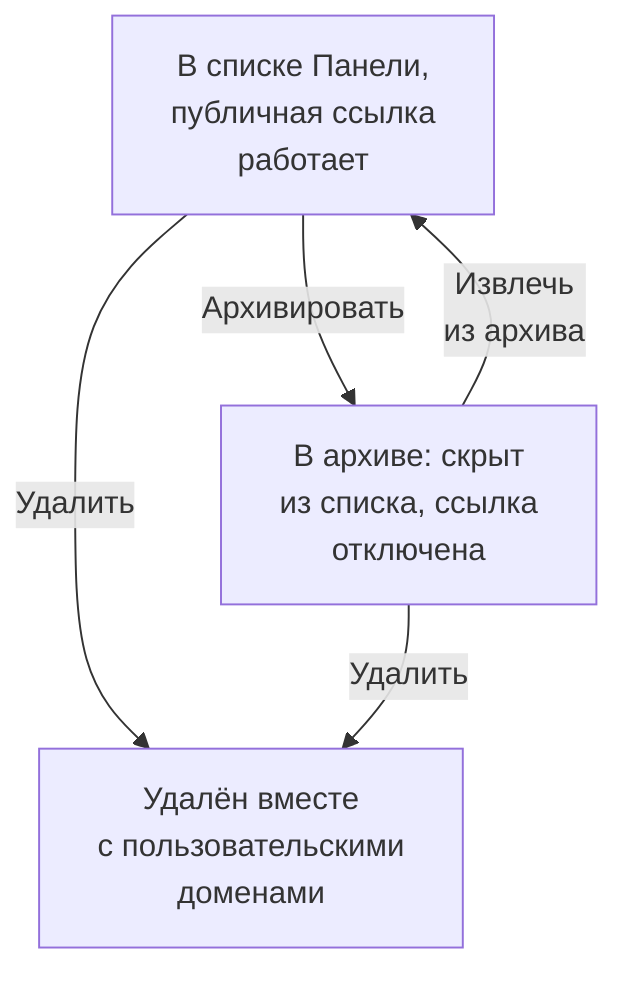

# Конфигурация и разрешения панели

Когда у вас появилась панель, которую стоит сохранить, эта страница расскажет, кто может её читать и менять, как владельцы и метки упорядочивают ваши панели и как скопировать, экспортировать, заархивировать и удалить панель.

:::cards
- [Кто что может делать](#кто-что-может-делать): Разрешения за каждым действием и у кого они есть.
- [Владельцы](#владельцы): Пользователи и команды, которым принадлежит панель.
- [Дублирование панели](#дублирование-панели): Безопасная копия, пронумерованная за вас.
- [Архивирование панели](#архивирование-панели): Уберите панель, не удаляя её.
:::

## Кто что может делать

Панели подчиняются [разрешениям](/docs/permissions/index) вашего проекта. Каждое действие требует одного из них, выданного через команду:

| Чтобы | Нужно |
| --- | --- |
| Читать панели | `ReadDashboard` или роль в проекте: Владелец проекта, Администратор проекта, Участник проекта, Зритель или одна из ролей Settings |
| Создавать панели | `CreateDashboard`, Владелец проекта или Администратор проекта |
| Менять панель: её виджеты, переменные, общий доступ, брендинг, а также архивировать её | `EditDashboard`, Владелец проекта или Администратор проекта |
| Удалять панель | `DeleteDashboard`, Владелец проекта или Администратор проекта |
| Добавлять и удалять владельцев | Разрешения на владельцев панелей, Владелец проекта, Администратор проекта или Участник проекта |
| Добавлять и менять пользовательские домены | Разрешения на домены панелей, Владелец проекта, Администратор проекта, Участник проекта, Администратор настроек или Участник настроек |
| Создавать правила владельцев и правила меток | Разрешения на правила, Владелец проекта или Администратор проекта |

Так что Участник проекта читает все панели, но чтобы их собирать, ему нужны `CreateDashboard` и `EditDashboard`. Чтение, редактирование и удаление можно по отдельности ограничить панелями, которыми владеет команда, или панелями с определёнными метками: см. [Область: насколько далеко действует разрешение](/docs/permissions/index#область-насколько-далеко-действует-разрешение).

Назначайте их на странице **Права доступа** команды: откройте **Продукты → Команды** и выберите команду.

Кто может видеть панель за пределами проекта — отдельный вопрос, на который отвечает её страница **Общий доступ**: см. [Доступ к публичным панелям](#доступ-к-публичным-панелям).

## Владельцы

**Владельцы** панели — это пользователи и команды, которым она принадлежит. Добавляйте их на странице **Владельцы** панели или выберите несколько панелей в списке **Панели** и добавьте владельцев всем сразу.

Владельцы сужают доступ, когда вы об этом просите: разрешение команды, ограниченное панелями этой команды, действует только на панели, у которых владельцем указана эта команда или действующий человек. Само по себе владение ничего не даёт.

Список **Панели** показывает владельцев каждой панели, а его фильтр **Владелец** находит панели, которыми владеет человек или команда.

## Метки

Метки — это теги для упорядочивания панелей. Добавляйте их на странице **Обзор** панели, где также редактируются её имя и описание, или сразу нескольким панелям из списка **Панели**.

Распространённые схемы:

- **По команде**: `team:platform`, `team:checkout`, `team:growth`.
- **По окружению**: `env:prod`, `env:staging`.
- **По назначению**: `purpose:oncall`, `purpose:exec`, `purpose:investigation`.

Фильтр **Метки** в списке **Панели** — самый быстрый способ найти панель в проекте, где их накопилось много. Метки также ограничивают разрешения: разрешение команды, ограниченное определёнными метками, действует только на панели с одной из них.

## Правила владельцев и меток

Вместо того чтобы добавлять владельцев и метки вручную, поручите это правилам. В разделе **Настройки** бокового меню **Панели** **Правила владельца** добавляют владельцев, а **Правила меток** — метки каждой новой панели, которая им соответствует: по уже имеющимся у него меткам или по шаблону в имени или описании. Раздел [Правила меток и владельцев](/docs/configuration/label-and-owner-rules) объясняет, как правила сопоставляются и как применить правило к уже существующим панелям.

## Доступ к публичным панелям

Кто может видеть панель за пределами проекта — это один выбор на её странице **Общий доступ** (также **⋯ → Поделиться** на самой панели; см. [Совместный доступ и публичные панели](/docs/dashboards/sharing)):

1. **Только участники этого проекта** (по умолчанию) — у панели нет публичной ссылки; его публичный адрес показывает страницу «не найдено».
2. **Все, у кого есть ссылка** — любой, у кого есть публичная ссылка, может видеть панель без входа.
3. **Все, у кого есть ссылка и пароль** — посетители вводят пароль, прежде чем панель появится.
4. **Только вошедшие пользователи** — панель видят, после входа, только приглашённые вами приватные пользователи и люди, которых впускает ваш единый вход.

В разделе **Дополнительные настройки** на той же странице **Список разрешённых IP** (план Scale) отклоняет запросы к публичной ссылке с любого IP-адреса, которого в нём нет. Самая закрытая публичная конфигурация — **Все, у кого есть ссылка и пароль** вместе со списком разрешённых IP: это удобно для партнёрских порталов, где нужны оба уровня защиты.

## Дублирование панели

Чтобы скопировать панель, откройте её, перейдите на её страницу **Настройки** и нажмите **Дублировать: Панель**. Имя копии заполняется за вас: имя панели с номером, следующим за уже существующими в проекте («Checkout API» копируется как «Checkout API 2», а копия этой копии — как «Checkout API 3»). При желании измените его, подтвердите кнопкой **Дублировать: Панель**, и копия откроется. В ней есть виджеты, переменные, описание и метки панели. Брендинг и пользовательские домены остаются у оригинала, а публичный доступ у копии всегда сначала выключен, чтобы вы сами решили, включать ли его.

Это правильный ход, когда нужно ответвить шаблон (например, «наша панель дежурного») в копию для конкретного сервиса.

## Экспорт и импорт

Панель переносится в формате JSON:

- **Экспорт: Панель** на странице **Настройки** панели скачивает её как JSON-файл. Чтобы экспортировать несколько, выберите их в списке **Панели** и выберите **Экспорт в JSON**.
- **Импорт из JSON** над списком **Панели** создаёт панели из такого файла в этом или в другом проекте.

Экспорт содержит собственные настройки панели, в том числе её виджеты и переменные. Её владельцы и метки в экспорт не входят, а для виджетов, которые указывают на ресурсы этого проекта, например на SLO или источник данных, в другом проекте их, возможно, придётся выбрать заново.

## Архивирование панели

Заархивируйте панель, которой больше не пользуетесь, но хотите сохранить. Заархивированная панель исчезает из списка **Панели**, а если она публичная, её публичная ссылка перестаёт работать: её URL и пользовательские домены отвечают "Dashboard not found". Её виджеты, переменные, брендинг, домены и публичные настройки сохраняются, поэтому после извлечения из архива она возвращается точно в прежнем виде, включая публичную ссылку.

Чтобы заархивировать одну панель, откройте её, перейдите на её страницу **Настройки** и нажмите **Архивировать**. Чтобы заархивировать несколько, выберите их в списке **Панели** и выберите **Архивировать**. Чтобы вернуть панель, откройте **Панели → Расширенный → Архивировано**, выберите её и выберите **Извлечь из архива** или откройте её и нажмите **Извлечь из архива** на баннере вверху её страниц.

Архивирование — обратимая альтернатива удалению: если сомневаетесь, начните с него.

## Удаление панели

Откройте страницу **Удалить панель** панели. Удаление нельзя отменить: панель, её виджеты и переменные, а также все привязанные к ней пользовательские домены удаляются. Ваша телеметрия не затрагивается.

Если панель опубликована на пользовательском домене, адрес перестаёт отвечать сразу после удаления. Чтобы адрес продолжал работать, после удаления этой панели добавьте домен к другой панели: домен принадлежит одновременно только одной панели.

## Журналы аудита

Страница **Журналы аудита** панели перечисляет каждое изменение панели и кто его внёс. Журналы аудита входят в план Enterprise; см. [Редакция Enterprise](/docs/self-hosted/enterprise).

## Хранение данных и резервные копии

Сами панели не устаревают. Данные, которые они показывают, подчиняются настройкам хранения вашего проекта: если временной диапазон — последние 3 месяца, проект, который хранит логи 15 дней, покажет последние 15 дней из них.

Если вы размещаете OneUptime самостоятельно, достаточно регулярной резервной копии базы данных: конфигурация панели хранится вместе с остальным проектом. В OneUptime Cloud резервное копирование выполняется за вас. Чтобы получить собственную копию, экспортируйте панель в JSON или прочитайте её через [API OneUptime](/docs/api-reference/api-reference).

## Дальнейшие шаги

:::cards
- [Совместный доступ и публичные панели](/docs/dashboards/sharing): Публичные ссылки, пароли, списки разрешённых IP и пользовательские домены.
- [Пользователи, команды и разрешения](/docs/permissions/index): Команды, роли, области действия и блокировки.
- [Переменные и фильтры панели](/docs/dashboards/variables): Одна панель для каждого сервиса.
- [Обзор панелей](/docs/dashboards/index): Общая картина.
:::
