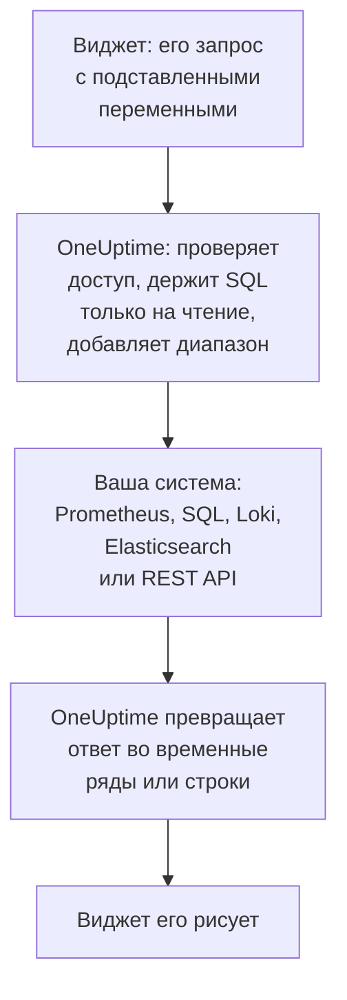

# Внешние источники данных

Внешний источник данных подключает систему за пределами OneUptime, например Prometheus, базу данных SQL, ClickHouse, Loki, Elasticsearch или REST API, чтобы ваши дашборды могли показывать её данные рядом с вашими собственными. Систему подключают один раз; после этого каждый виджет выполняет запрос только на чтение на языке самой системы.

:::cards
- [Подключить источник данных](#подключить-источник-данных): Выберите тип, затем укажите, где он находится и как войти.
- [Написать запрос](#написать-запрос): PromQL, SQL, LogQL, Query DSL или HTTP-запрос.
- [Ограничения](#ограничения): Тайм-ауты и лимиты, которые защищают обе стороны.
- [Безопасность](#безопасность): Запросы только на чтение и учётные данные только на запись.
:::

## Как выполняется запрос

Виджет отправляет свой запрос в OneUptime с уже подставленными переменными. OneUptime проверяет, что вам разрешено читать источник данных, подставляет временной диапазон и обращается к вашей системе с хранящимися у него учётными данными. Затем он превращает ответ во временные ряды или строки, которые рисует виджет.



## Перед началом

- **Тарифный план, который это включает.** В OneUptime Cloud создание и изменение источников данных требует плана **Growth**. Удаление работает на любом плане.
- **Разрешение на добавление.** Владельцы и администраторы проекта могут добавлять источники данных; остальным нужно `CreateDataSource`, а также `EditDataSource` и `DeleteDataSource`, чтобы изменять и удалять их. Все, кто может читать источники данных проекта, включая участников и наблюдателей, видят данные их виджетов.
- **Учётная запись только для чтения.** Дашборды только читают. Подключайте базы данных учётной записью, которая может только читать, а HTTP-источники — токеном, который может только выполнять запросы.
- **Путь до системы.** К вашей системе подключается API-сервер OneUptime, поэтому он должен иметь к ней доступ: какие адреса отклоняются, см. в разделе [Безопасность](#безопасность).

## Поддерживаемые системы

| Тип | Язык запросов | Работает с |
| --- | --- | --- |
| Prometheus | PromQL | Prometheus, Thanos, Cortex, Mimir, VictoriaMetrics |
| PostgreSQL | SQL | PostgreSQL, TimescaleDB, CockroachDB |
| MySQL | SQL | MySQL, MariaDB |
| Microsoft SQL Server | T-SQL | SQL Server, Azure SQL |
| ClickHouse | SQL | ClickHouse через его HTTP-интерфейс |
| Grafana Loki | LogQL | Loki и Loki-совместимые эндпоинты |
| Elasticsearch | Query DSL (JSON) | Elasticsearch, OpenSearch |
| REST API | HTTP-запрос (JSON) | Любой HTTP(S) API, отвечающий в JSON |

## Подключить источник данных

:::steps
### Откройте источники данных

Откройте **Продукты → Дашборды**, раскройте **Настройки** в боковом меню и нажмите **Источники данных**.

### Выберите тип

Нажмите **Создать: Data Source**. Диалог **Choose a Data Source Type** группирует типы по тому, что в них хранится: метрики, логи, базы данных, поиск и API. Нажмите на нужный.

### Назовите его

В разделе **Основная информация** задайте **Имя**, например «Production Prometheus», и при желании **Описание**.

### Укажите, где он находится

В разделе **Подключение** для HTTP-источника указывается **URL**, на котором он отвечает. Для базы данных указываются **Database Host**, **Database Port** (оставьте пустым для 5432, 3306, 1433 или 8123) и **Имя базы данных**.

### Укажите, как войти

В разделе **Аутентификация** введите **Имя пользователя** и **Пароль** или, для HTTP-источника, **API-токен**, который отправляется как bearer-токен. В разделе **Дополнительные поля** есть **Custom HTTP Headers**, например `{ "X-Scope-OrgID": "tenant-1" }`, и **Additional Options**: `sslEnabled` и `sslRejectUnauthorized` для баз данных и `elasticsearchIndex` для Elasticsearch, который без него читает все индексы (`*`).

### Проверьте его

Нажмите **Создать: Data Source**, затем **Тест** в его строке. OneUptime подключается с указанными вами данными и сообщает, получилось ли и что пошло не так.
:::

Чтобы позже изменить источник данных, откройте его из списка. **Редактировать** в **Data Source Details** меняет всё, кроме секретов; **Обновить учётные данные** заменяет пароль, токен или заголовки и оставляет поля, которые вы не заполнили, как были; **Тест** проверяет его снова.

## Использовать в виджете

Отредактируйте дашборд, нажмите **Добавить виджет** и выберите виджет из группы «Внешние источники данных»: **График**, **Значение**, **Измеритель** или **Таблица**. В его настройках:

- Выберите **Data Source** и напишите **Запрос**. Редактор называет язык запросов и показывает пример для этого типа.
- На графике **Добавить запрос** накладывает дополнительные запросы на те же оси, а **Legend (optional)** называет каждый ряд по его меткам: `{{instance}} — errors` ставит в начало метку ряда `instance`.
- Для значения или измерителя **Reduce** сводит точки к одному числу: последнее значение (по умолчанию), первое, среднее, сумма, минимум или максимум. **Unit** добавляет суффикс и масштабирует известные единицы: `Bytes` читается как 1.5 MB, `ms` — как 2.4 s.
- В таблице работает любой запрос только на чтение, и её строки показываются в том виде, в каком пришли.

## Написать запрос

У каждого типа свой язык, но правила того, что возвращается, одни и те же:

- **Графикам, значениям и измерителям нужны временные ряды.** SQL-запрос возвращает столбец времени с именем `time`, `timestamp`, `date` или `ts` и числовой столбец `value` (или его первый числовой столбец); все остальные столбцы становятся метками ряда. Elasticsearch нужна агрегация `date_histogram`, а Loki — метрический запрос вроде `rate()` или `count_over_time()`.
- **Таблицы показывают строки** в том виде, в каком их возвращает запрос: строки SQL, ряды Prometheus, строки логов Loki, документы Elasticsearch или объекты по пути `rowsPath` в REST API.

:::tabs
@tab Prometheus
```text title="PromQL"
sum by (job) (rate(http_requests_total{job=~"{{job}}"}[5m]))
```
@tab SQL
```sql title="SQL"
SELECT date_trunc('minute', created_at) AS time, COUNT(*) AS value
FROM orders
WHERE created_at BETWEEN $__startTime AND $__endTime
GROUP BY 1
ORDER BY 1
```
@tab Loki
```text title="LogQL"
sum by (app) (rate({app="api"} |= "error" [5m]))
```
@tab Elasticsearch
```json title="Query DSL"
{
  "query": { "range": { "@timestamp": { "gte": "$__startTime", "lte": "$__endTime" } } },
  "aggs": {
    "over_time": {
      "date_histogram": { "field": "@timestamp", "fixed_interval": "1m" }
    }
  }
}
```
@tab REST API
```json title="Request"
{
  "path": "/api/stats?from=$__startTimeMs&to=$__endTimeMs",
  "method": "GET",
  "rowsPath": "data.items",
  "timestampField": "time",
  "valueField": "count",
  "seriesField": "service"
}
```
:::

### Макросы времени

Prometheus и Loki получают временной диапазон дашборда с каждым запросом, поэтому их запросам больше ничего не нужно. Остальные типы подставляют временной диапазон туда, где вы пишете макрос:

| Макрос | Превращается в | Где |
| --- | --- | --- |
| `$__startTime`, `$__endTime` | Начало и конец диапазона в UTC: `'2026-10-13 09:00:00'` в SQL, ISO 8601 в остальных | SQL, Elasticsearch, REST API |
| `$__startTimeMs`, `$__endTimeMs` | То же самое в миллисекундах с 1970 года | SQL, Elasticsearch, REST API |
| `$__rangeSeconds` | Длина диапазона в секундах | SQL |

Макросы SQL записываются в UTC, поэтому запускайте сессии базы данных в UTC или выполняйте преобразование в запросе.

### Переменные дашборда

Напишите `{{name}}` в любом месте запроса, и виджет подставит туда значение переменной перед отправкой запроса. Несколько значений переменной с множественным выбором объединяются через `|` — это то, что нужно сопоставителю регулярного выражения в PromQL или LogQL: `job=~"{{job}}"`. Переменная, в которой ничего не выбрано, оставляет заполнитель как есть, поэтому ошибка называет его. Как добавить переменную, показано в разделе [Переменные и фильтры дашборда](/docs/dashboards/variables).

## Ограничения

Каждый запрос ограничен, чтобы дашборд из двадцати виджетов, обновляющийся каждую минуту, не мог перегрузить OneUptime или вашу систему:

| Ограничение | Значение |
| --- | --- |
| Подключение | 10 секунд |
| Выполнение запроса | 30 секунд |
| Точки в ответе с временным рядом | 11 000 |
| Строки в таблице | 1 000 |
| Ряды в одном ответе | 100 |
| Ответ HTTP-источника | 20 MB |

Запросы по диапазону к Prometheus и Loki запрашивают около 250 точек на весь временной диапазон, не чаще чем раз в 10 секунд и не реже чем раз в сутки.

## Безопасность

- **SQL остаётся только на чтение.** Запрос должен быть одним оператором, который начинается с `SELECT`, `WITH`, `SHOW`, `EXPLAIN`, `DESCRIBE` или `DESC`. Слова, которые записывают данные или меняют сессию, например `INSERT`, `UPDATE`, `DELETE`, `DROP`, `INTO` или `SET`, отклоняются везде за пределами строк и имён в кавычках, поэтому заключайте в кавычки столбец, названный одним из них. Кавычку внутри строки пишите двумя кавычками (`''`): обратная косая черта перед кавычкой отклоняется. Сессии PostgreSQL, MySQL и ClickHouse тоже работают только на чтение. У SQL Server нет сессии только на чтение, поэтому подключайте его логином только для чтения.
- **Учётные данные только на запись.** **Пароль**, **API-токен** и **Custom HTTP Headers** хранятся в зашифрованном виде, и API никогда их не возвращает — даже вам.
- **Адреса проверяются.** Loopback-адреса, адреса link-local (где находятся метаданные облака) и другие зарезервированные адреса отклоняются везде. Частные адреса отклоняются в OneUptime Cloud и разрешены в самостоятельно размещённой установке, если только `DATA_SOURCE_BLOCK_PRIVATE_ADDRESSES` не равно `true`: см. [Доступ к частной сети](/docs/self-hosted/private-network-access).
- **Публичные дашборды никогда их не выполняют.** Виджеты «Внешних источников данных» исключаются из [публичного дашборда](/docs/dashboards/sharing) вместе с запросами.

## Устранение неполадок

:::details Тест сообщает, что не удаётся подключиться
Проверьте URL или хост и порт с того места, где работает OneUptime: брандмауэр, частный адрес в OneUptime Cloud или база данных, которая слушает только на своей машине, отсюда выглядят одинаково. Для базы данных, которой нужен TLS, добавьте `{ "sslEnabled": true }` в **Additional Options**.
:::

:::details "Only read-only queries are allowed"
Запрос не начинается с `SELECT`, `WITH`, `SHOW`, `EXPLAIN`, `DESCRIBE` или `DESC`. Отправьте один оператор, который только читает: второй оператор после `;` тоже отклоняется с сообщением "Only a single SQL statement is allowed per query."
:::

:::details "Query contains a keyword that is not allowed"
Слово, которое записывает данные, стоит за пределами строки, часто как имя столбца, например `delete` или `set`. Заключите его в кавычки так, как это делает база данных: `"delete"` в PostgreSQL, `[delete]` в SQL Server и в обратные апострофы в MySQL и ClickHouse.
:::

:::details График остаётся пустым, но таблица показывает строки
Запрос возвращает строки, но не временные ряды. В SQL назовите столбец времени `time`, а число — `value`, в Elasticsearch добавьте агрегацию `date_histogram`, а запрос логов Loki превратите в метрический запрос с `rate()` или `count_over_time()`.
:::

:::details Часть данных отсутствует
Ответ упёрся в [ограничение](#ограничения). Сузьте временной диапазон, отфильтруйте запрос или агрегируйте его в меньшее число рядов.
:::

## Дальнейшие шаги

:::cards
- [Виджеты дашборда](/docs/dashboards/widgets): Все виджеты, включая группу «Внешние источники данных».
- [Переменные и фильтры дашборда](/docs/dashboards/variables): Переменные для ваших запросов.
- [Доступ к частной сети](/docs/self-hosted/private-network-access): Доступ к системам в частной сети из самостоятельно размещённой установки.
- [Конфигурация и разрешения дашборда](/docs/dashboards/configuration): Кто может добавлять источники данных и кто их читает.
:::
