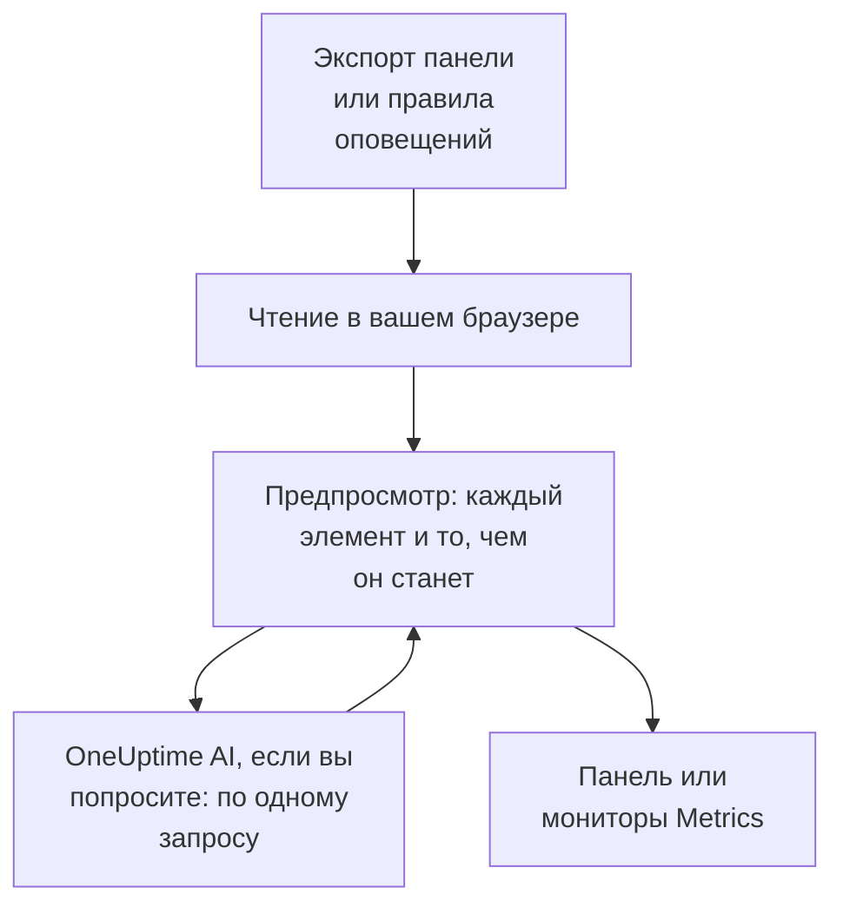

# Импорт из Grafana и Datadog

Перенесите в OneUptime панель, которую вы собрали в Grafana или Datadog, или правила оповещений, написанные для Prometheus, Grafana или Datadog. Вы вставляете или загружаете файл, видите, чем станет каждая панель и каждое правило, и только после этого создаёте панель или мониторы.

:::cards
- [Импорт панели](#импорт-панели): JSON-модель панели Grafana или экспорт панели Datadog.
- [Импорт правил оповещений](#импорт-правил-оповещений): Файлы правил Prometheus, правила оповещений Grafana и мониторы Datadog.
- [Как преобразуется каждый элемент](#как-преобразуется-каждый-элемент): Точно, приблизительно или никак, и почему.
- [Преобразование запроса с OneUptime AI](#преобразование-запроса-с-oneuptime-ai): Для запроса, который не преобразует ни одно правило.
:::

## Как проходит импорт

OneUptime читает файл в вашем браузере и преобразует каждую панель, виджет, переменную и правило по отдельности. Предпросмотр перечисляет их все вместе с тем, чем станет каждый. Ничего не создаётся, пока вы не решите это создать, и тогда создаётся с вашими собственными правами, так же как это делают формы панелей и мониторов.

## Прежде чем начать

- Импортированные виджеты и мониторы читают собственные метрики этого проекта с помощью PromQL. Отправляйте их через Prometheus remote write, OpenTelemetry или Datadog Agent, и они сохранят свои прежние имена.
- Для импорта панели нужна роль, которая может создавать панели, а для импорта правил оповещений — роль, которая может создавать мониторы.
- Файл может занимать до 10 МБ, и из него читается до 500 панелей или правил.

## Импорт панели

:::steps
### Откройте импорт панели

Откройте **Продукты → Панели**, затем **Дополнительные параметры → Import from Grafana or Datadog**.

### Вставьте панель

В Grafana скопируйте JSON-модель из настроек панели. В Datadog экспортируйте JSON панели. Вставьте его или выберите **Upload a File**, затем выберите **Предпросмотр**.

### Создайте панель

Проверьте, чем станет каждая панель и каждая переменная, дайте панели имя и выберите **Создать панель**. Откроется новая панель.
:::

PromQL из Grafana сохраняется в том виде, в каком он написан: OneUptime подставляет `$__interval`, `$__rate_interval` и `$__range` так же, как Grafana, а переменная со значением All соответствует любому значению. Запрос Datadog становится PromQL по метрикам, которые отправил Datadog Agent: `avg:system.cpu.user{host:web-1}` читает `system_cpu_user{host="web-1"}`.

## Импорт правил оповещений

:::steps
### Откройте импорт оповещений

Откройте **Продукты → Мониторы**, затем **Дополнительные параметры → Import Alerts**.

### Вставьте правила

Вставьте файл правил Prometheus или ресурс PrometheusRule, экспорт правил оповещений Grafana или мониторы Datadog, экспортированные в JSON, затем выберите **Предпросмотр**.

### Создайте мониторы

Снимите отметку с ненужных правил, выберите в **When a rule fires**, что открывает сработавшее правило, и выберите **Создать мониторы**.
:::

Каждое правило становится монитором Metrics с одним запросом PromQL, условием правила и его окном. Он открывает оповещение или инцидент для каждого ряда, который превышает порог, и закрывает его, когда ряд восстанавливается. Заголовок и описание берутся из сводки или сообщения правила, с подставленными метками ряда.

## Как преобразуется каждый элемент

| Статус | Что он означает |
| --- | --- |
| **Converted exactly** | Читает те же данные и показывает их так же. |
| **Converted approximately** | Создаётся, а его заметки говорят, что отличается. |
| **Not converted** | Для него ничего не создаётся, а его заметки говорят почему. |

Не преобразуются правила записи, правила оповещений по логам, виджеты Datadog, которые читают логи, трассировки или события, а также мониторы аномалий, выбросов и прогнозов Datadog.

## Преобразование запроса с OneUptime AI

Запрос, который не преобразует ни одно правило, показывает **Convert with OneUptime AI**; для этого ИИ должен быть включён для проекта. Только этот запрос, вместе с именами переменных панели, отправляется [провайдеру LLM](/docs/ai/llm-provider) вашего проекта. Ответ проверяется как любой запрос и показывается вам: выберите **Use This Query**, чтобы его использовать. Ничего не создаётся, пока вы не создадите панель или мониторы.

## Следующие шаги

:::cards
- [Виджеты панели](/docs/dashboards/widgets): Измените то, что показывает импортированный виджет.
- [Переменные и фильтры панели](/docs/dashboards/variables): Переменные, которые создал импорт.
- [Мониторинг метрик](/docs/monitor/metrics-monitor): Мониторы, которые создал импорт.
- [PromQL](/docs/telemetry/promql): Язык, который читают импортированные виджеты и мониторы.
:::
