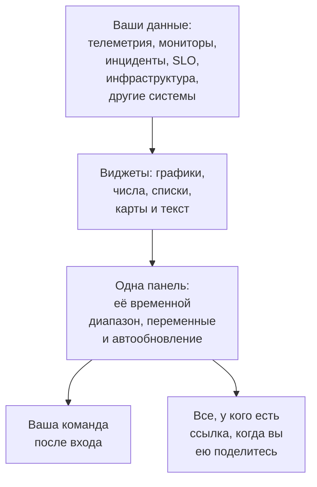

# Обзор панелей

Панель — это одна страница виджетов, которые вы располагаете сами: графики ваших метрик, логов и трассировок, списки инцидентов, оповещений и мониторов, ваши SLO и инфраструктура и даже данные из систем за пределами OneUptime. Соберите панель для экрана дежурного, для утренней проверки команды или как страницу для своих клиентов и поделитесь им с проектом или с любым, у кого есть ссылка. Чтобы выбрать между панелью, публичной панелью и страницей статуса, см. [Что выбрать?](/docs/introduction/which-one#панель-публичная-панель-или-страница-статуса).

:::cards
- [Как устроена панель](#как-устроена-панель): Откуда берутся его данные и кто их видит.
- [Где найти панели](#где-найти-панели): Список Панели и собственные страницы каждой панели.
- [Первая панель](#первая-панель): От шаблона до общей страницы за пять шагов.
- [Пример: панель дежурного](#пример-панель-дежурного): Одна страница, которая подходит для любого сервиса.
:::

## Как устроена панель

Каждый виджет читает данные из одного источника в пределах временного диапазона панели, отфильтрованные её переменными. Все, кто открывает панель, видят одни и те же виджеты: ваша команда — после входа в систему, а посетители — по публичной ссылке, когда вы ею поделитесь.

| Термин | Что это значит |
| --- | --- |
| Панель | Одна страница: имя, сетка виджетов, временной диапазон, переменные и настройка автообновления. |
| Виджет | Одна плитка на сетке: график, число, список, карта, часы или блок текста. |
| Переменная | Селектор на панели инструментов, который сужает каждый поддерживающий его виджет до одного сервиса, хоста или клиента. |
| Временной диапазон | Окно, которое читают все графики и числа. Панель открывается на своём значении по умолчанию — последнем часе, если только тот, кто её редактирует, не задаст другое, — и каждый зритель может выбрать своё. |
| Автообновление | Как часто виджеты заново читают свои данные: выключено или от каждых 5 секунд до каждых 15 минут. |
| Просмотр и редактирование | Панель открывается для чтения. Редактирование — отдельный шаг, который заканчивается сохранением или отменой ваших изменений. |

## Для чего нужны панели

- **Страница «всё ли в порядке?»** для дежурного инженера, стендапа команды или экрана на стене.
- **Видеть связи**: всплеск CPU рядом с ростом задержки и открытым инцидентом сразу заметен на одной странице и легко теряется на трёх.
- **Расследования**: поставьте рядом графики, которые вы постоянно открываете заново, и протяните выделение по всплеску, чтобы прочитать все виджеты в этот момент.
- **Делиться за пределами команды**: страница производительности для клиента или партнёра, при желании защищённая паролем или списком разрешённых IP.

## Где найти панели

Откройте **Продукты → Панели**. Список **Панели** показывает панели проекта с их описаниями, метками и владельцами. Ищите по имени или описанию, сужайте список фильтрами **Владелец** и **Метки** или выберите несколько панелей, чтобы изменить их метки или владельцев, заархивировать их или экспортировать в JSON.

В боковом меню списка есть страницы, которые обслуживают все ваши панели:

| Страница | Что вы там делаете |
| --- | --- |
| **Панели** | Панели проекта. Создайте панель или загрузите панели через **Импорт из JSON**. |
| **Панели → Плейлисты** | [Показывать панели один за другим](/docs/dashboards/playlists) на экране, например на стене NOC. |
| **Настройки → Правила владельца** | Автоматически добавлять владельцев новым панелям. |
| **Настройки → Правила меток** | Автоматически добавлять метки новым панелям. |
| **Настройки → Источники данных** | Подключить Prometheus, базы данных SQL, ClickHouse, Loki, Elasticsearch или REST API. |
| **Расширенный → Архивировано** | Панели, которые вы заархивировали. Извлекайте их из архива здесь. |

Откройте панель, и в её собственном боковом меню будут эти страницы. Все разделы, кроме **Базовый**, изначально свёрнуты: нажмите на заголовок раздела, чтобы раскрыть его.

| Страница | Что вы там делаете |
| --- | --- |
| **Панель** | Сама панель. Читайте её или редактируйте через её меню **⋯**. |
| **Обзор** | Его имя, описание и метки. |
| **Общий доступ** | Кто может его видеть, его публичная ссылка и список разрешённых IP в разделе «Дополнительные настройки». |
| **Брендинг** | Заголовок страницы, описание, логотип, тема и favicon публичной панели. |
| **Пользовательские домены** | Разместить публичную панель на собственном домене. |
| **Приватные пользователи** | Люди, которые могут войти по публичной ссылке, когда панель видят только вошедшие пользователи. |
| **Единый вход** | Поставщики SAML и OpenID Connect, через которых они входят, и **Требовать SSO для входа**. |
| **Настройки** | Дублировать, экспортировать или заархивировать панель. |
| **Владельцы** | Пользователи и команды, которым он принадлежит. |
| **Журналы аудита** | Каждое изменение панели и кто его внёс. |
| **Удалить панель** | Удалить панель навсегда. |

## Первая панель

:::steps
1. **Создайте** — выберите шаблон или **Начать с нуля**. Шаблон заполняет имя и открывается со своими виджетами; панель с нуля открывается без содержимого, с кнопкой **Добавить виджет** на холсте.
2. **Добавьте виджеты** — выберите виджет в каталоге, задайте в его настройках, что он читает, затем перетащите его на место и измените размер.
3. **Добавьте переменные, если они нужны** — например, переменная `service` позволяет одной панели показывать любой сервис.
4. **Сохраните** — нажмите **Сохранить изменения**. Пока вы этого не сделаете, ничего из изменённого во время редактирования не сохраняется.
5. **(Необязательно) Опубликуйте** — выберите **⋯ → Поделиться** на панели и решите, кто может её видеть: все, у кого есть ссылка, или все, у кого есть ссылка и пароль.
:::

[Создание панели](/docs/dashboards/authoring) разбирает каждый шаг.

## Пример: панель дежурного

Цель: одна страница для сервиса checkout с его задержкой, долей ошибок, открытыми инцидентами и последними логами, которая подходит и для любого другого сервиса.

1. Нажмите **Создать панель**, выберите **Начать с нуля** и назовите панель «Дежурство checkout».
2. Нажмите **Добавить виджет** и добавьте **График** метрики задержки запросов, агрегированной как P95.
3. Рядом добавьте **Значение** доли ошибок с порогом предупреждения 1 и критическим порогом 5.
4. Под ними добавьте **Список инцидентов**, отфильтрованный по нерешённым инцидентам, и **Поток логов** с логами сервиса.
5. Откройте **Переменные**, добавьте переменную с именем `service` с источником Telemetry Attribute и ключом атрибута `service.name` и задайте ей значение по умолчанию `checkout`.
6. Нажмите **Сохранить изменения**. Выберите `payments` в селекторе `service` на панели инструментов: график, значение и поток логов переключатся на сервис payments, а список инцидентов продолжит показывать все нерешённые инциденты.

## Как панели связаны с остальным OneUptime

- **Мониторы и телеметрия** — источник данных. Любую метрику, лог и трассировку, которые вы отправляете, можно вывести на виджет.
- **Инциденты и оповещения** появляются в виджетах **Список инцидентов** и **Список оповещений**. Панель только показывает их: работают с ними на их собственных страницах.
- **Страницы статуса** сообщают клиентам, работает ли ваш сервис. Панели подробно показывают, как он себя ведёт. Они работают бок о бок.
- **Рабочие процессы** реагируют на происходящее. Панели — место, где вы это читаете.

## Дальнейшие шаги

:::cards
- [Создание панели](/docs/dashboards/authoring): Создайте панель, отредактируйте её и сохраните изменения.
- [Виджеты панели](/docs/dashboards/widgets): Все виджеты и какой из них выбрать.
- [Переменные и фильтры панели](/docs/dashboards/variables): Одна панель для каждого сервиса, хоста или клиента.
- [Совместный доступ и публичные панели](/docs/dashboards/sharing): Публичные ссылки, пароли, списки разрешённых IP и пользовательские домены.
:::
