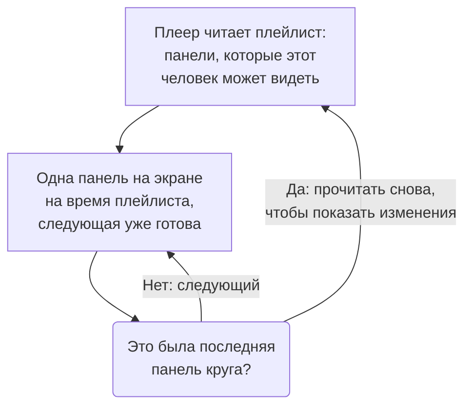

# Плейлисты панелей

Плейлист показывает ряд панелей один за другим на экране, которого никто не касается, например на стене NOC или на телевизоре команды: каждую панель столько времени, сколько вы выберете, снова и снова, пока кто-нибудь его не приостановит. Создайте плейлист один раз, откройте его плеер на экране и оставьте его работать.

:::cards
- [Как воспроизводится плейлист](#как-воспроизводится-плейлист): Порядок, очередь показа и то, что показывает каждая панель.
- [Создание плейлиста](#создание-плейлиста): Имя, панели по порядку и сколько времени показывается каждый.
- [Воспроизведение на экране](#воспроизведение-на-экране): Панель плеера, её кнопки и клавиши.
- [Кто что видит](#кто-что-видит): Разрешения и панели, которые человеку читать нельзя.
:::

## Как воспроизводится плейлист

Плеер показывает первую панель плейлиста, затем следующую, когда время текущей истекло, а после последнего начинает снова с первого. Каждая панель открывается так, как её сохранили редакторы: со своим временным диапазоном по умолчанию, своим автообновлением и своими переменными, что бы ни было в адресе плеера. Пока одна панель на экране, плеер незаметно отрисовывает следующую, поэтому экран никогда не пустеет между двумя панелями.

Плейлист называет свои панели и никогда их не копирует: изменение, которое редактор сохранил в панели, появится на экране, когда эта панель в следующий раз дойдёт до очереди. Плеер перечитывает плейлист перед каждым кругом, поэтому добавленная, перемещённая или удалённая панель появляется в пределах круга, без перезагрузки экрана; если это чтение не удалось, экран снова показывает тот круг, который у него есть.

## Создание плейлиста

:::steps
### Откройте плейлисты
Откройте **Продукты → Панели**, затем **Плейлисты** в боковом меню. Список показывает, сколько панелей в каждом плейлисте и сколько времени показывается каждый, а в каждой строке есть **Воспроизвести**.

### Задайте имя
Нажмите **Создать: Плейлист** и укажите в поле **Имя**, где он будет идти, например «Стена NOC».

### Добавьте панели
В поле **Панели** выберите каждую панель в **Добавить панель** в том порядке, в котором экран их показывает. Кнопки в строке панели перемещают её вверх или вниз либо убирают её. Архивные панели не предлагаются.

### Выберите, сколько показывать каждый
**Показывать каждую панель** начинается с одной минуты; выберите время от 15 секунд до часа. Нажмите **Создать: Плейлист**.
:::

Страница плейлиста перечисляет его панели по порядку, время показа каждого и **Ссылка на плеер**. **Изменить плейлист** меняет имя, панели, их порядок и время. **Удалить: Плейлист панелей** внизу страницы удаляет плейлист, но никогда не удаляет его панели.

Через API и Terraform плейлист — это `name`, его `dashboards` в виде списка вроде `[{"dashboardId": "<id>"}]` в порядке показа, не больше 100, и `intervalInSeconds`, любое целое число секунд от 10 до 86400 (сутки). Значение вне этих пределов отклоняется с объяснением, что не так.

## Воспроизведение на экране

Нажмите **Воспроизвести** в строке плейлиста или на его странице. Плеер заполняет окно браузера поверх остального OneUptime; **Во весь экран** заполняет весь экран. Чтобы экран запускался сам по себе, откройте на нём **Ссылка на плеер** и добавьте её в закладки: ссылка сразу открывает плеер.

Панель плеера называет панель на экране, плейлист, место в круге («2 из 5») и панель, которая идёт следующей. Линия под панелью заполняется, пока длится очередь панели. Кнопки панели переходят к предыдущей панели, ставят на паузу или воспроизводят и переходят к следующему; на компьютере то же самое делают эти клавиши:

| Клавиши | Что делает |
| --- | --- |
| `Space` | **Пауза или воспроизведение**. На паузе панель остаётся на экране, а панель показывает **Приостановлено**. |
| `Right Arrow` | **Следующая панель**. |
| `Left Arrow` | **Предыдущая панель**. |
| `F` | **Во весь экран** или обратно. |
| `Esc` | **Выйти из плеера** и вернуться на страницу плейлиста. В полноэкранном режиме первое нажатие `Esc` только выходит из него. |
| `?` | **Показать сочетания клавиш**. |

Панель, к которой вы переходите, следующая или предыдущая, получает полное время показа. На странице, которая читается справа налево, например на персидском, стрелки меняются местами: `Left Arrow` переходит к следующей панели. Во время воспроизведения плеер не даёт экрану уснуть, если браузер это позволяет.

## Кто что видит

У плейлистов есть свои разрешения, которые выдаются через команду так же, как разрешения панелей:

| Чтобы | Нужно |
| --- | --- |
| Видеть и воспроизводить плейлисты | `ReadDashboardPlaylist` или роль в проекте: Project Owner, Project Admin, Project Member, Viewer или одна из ролей Settings |
| Создавать плейлисты | `CreateDashboardPlaylist`, Project Owner или Project Admin |
| Менять плейлист: его имя, панели и время | `EditDashboardPlaylist`, Project Owner или Project Admin |
| Удалять плейлист | `DeleteDashboardPlaylist`, Project Owner или Project Admin |

Плейлист никогда не показывает человеку панель, которую ему нельзя читать. Плеер воспроизводит только те панели, которые человек, вошедший на этом экране, может читать и которые не в архиве, а остальные пропускает: удалённую панель, архивную или ту, к которой его разрешения не пускают. Страница плейлиста говорит, почему пропускается каждый из них. При сохранении плейлиста в нём остаются панели, которые редактор сам не видит, поэтому ничего из того, что туда добавил кто-то другой, не теряется.

| Когда плеер находит | Он показывает |
| --- | --- |
| Панели, которые можно показать | Каждый по очереди. |
| Ни одной панели, которую можно показать | **Пока нечего показать** и проверяет снова каждую минуту. |
| Плейлист удалён или недоступен этому человеку | **Плейлист не найден**. |
| Чтение не удалось | **Не удалось загрузить плейлист** и пробует снова каждую минуту или по кнопке **Повторить попытку**. |

> [!NOTE]
> Плеер предназначен для того, кто вошёл в OneUptime. Чтобы плейлист шёл на экране, войдите на этом экране с учётной записью, которая может читать плейлист и его панели, например с учётной записью участника команды с ролью Viewer.

## Дальнейшие шаги

:::cards
- [Создание панели](/docs/dashboards/authoring): Соберите панели, которые показывает плейлист.
- [Переменные и фильтры панели](/docs/dashboards/variables): Сохранённый выбор, с которым открывается каждая панель.
- [Совместный доступ и публичные панели](/docs/dashboards/sharing): Покажите панель людям, которые не входят в систему.
- [Конфигурация и разрешения панели](/docs/dashboards/configuration): Владельцы, метки и кто может читать панель.
:::
