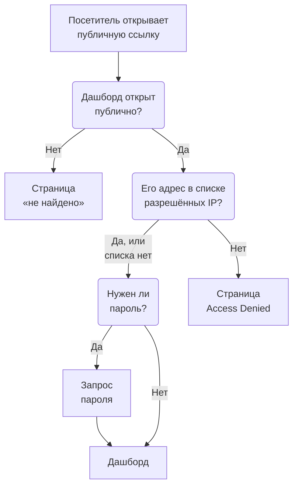

# Совместный доступ и публичные дашборды

По умолчанию дашборд закрыт внутри вашего проекта: видеть его могут только те, кто входит в ваш проект. Его также можно открыть по публичной ссылке, защитить эту ссылку паролем, ограничить определёнными IP-адресами и разместить на собственном домене. На этой странице описаны все четыре варианта.

:::cards
- [Кто может видеть дашборд](#кто-может-видеть-дашборд): Один выбор из трёх и тарифный план, который нужен каждому.
- [Доступ по паролю](#доступ-по-паролю): Поделитесь ссылкой, а затем паролем с теми, кто должен видеть дашборд.
- [Список разрешённых IP](#список-разрешённых-ip): Откройте публичную ссылку только для своего офиса или VPN.
- [Пользовательские домены](#пользовательские-домены): Разместите дашборд на собственном домене с бесплатным сертификатом.
:::

## Что проходит посетитель

Посетитель, открывший публичную ссылку дашборда, по очереди проходит каждую из этих проверок. Участники проекта, которые входят в OneUptime, видят дашборд внутри продукта, что бы вы здесь ни выбрали.



## Кто может видеть дашборд

Откройте дашборд и выберите **⋯ → Поделиться** или откройте **Общий доступ** в боковом меню дашборда. Карточка **Кто может видеть эту панель** — это один выбор:

- **Только участники этого проекта** (по умолчанию): участники видят дашборд, когда входят в OneUptime. У него нет публичной ссылки: его публичный адрес показывает ту же страницу «не найдено», что и адрес без дашборда, и ничего о дашборде, даже его имя.
- **Все, у кого есть ссылка**: дашборд публичный. Любой, у кого есть его ссылка, может его видеть без входа в систему.
- **Все, у кого есть ссылка и пароль**: посетители открывают ссылку, а затем вводят один пароль, которым вы с ними делитесь. Учётная запись никому не нужна.

Выбор варианта требует подтверждения с объяснением того, что изменится для посетителей, после чего он сразу вступает в силу. При выборе **Все, у кого есть ссылка и пароль** тот же диалог запрашивает пароль, если у дашборда его нет; пока выбран этот вариант, **Изменить пароль** заменяет его. Пока дашборд публичный, под выбором находятся адреса, по которым его открывают посетители: сначала его пользовательские домены, затем его публичная ссылка, и рядом с каждым — **Скопировать ссылку**. Пользовательский домен, который ещё не работает, помечен **Ещё не работает** с указанием причины.

Внутри проекта то, кто что видит, определяют владельцы и метки: см. [Конфигурация и разрешения дашборда](/docs/dashboards/configuration). Тот, кто может видеть дашборд, но не редактировать его, видит выбор и может скопировать публичную ссылку, но не может изменить выбор.

В OneUptime Cloud для публикации дашборда нужен план **Growth**: на более низком плане два публичных варианта показывают нужный им план и не могут быть выбраны. Сделать дашборд снова закрытым (**Только участники этого проекта**) можно на любом плане, поэтому дашборд, оставшийся публичным после окончания пробного периода или перехода на более низкий план, всегда можно закрыть; диалог сообщает, что для повторной публикации нужен **Growth**. Переключение между **Все, у кого есть ссылка** и **Все, у кого есть ссылка и пароль**, а также смена пароля работают на любом плане. На дашборд, созданный через API или Terraform, распространяются те же планы: созданному публичным нужен **Growth**, а созданному со списком разрешённых IP — **Scale**.

Выбор хранится в трёх столбцах, которые API и Terraform читают и записывают, как и раньше: `isPublicDashboard`, `enableMasterPassword` и `masterPassword`. Публичная ссылка есть только у публичного дашборда, и его посетителей просят ввести пароль всякий раз, когда включено `enableMasterPassword`. Публичный дашборд с включённым `enableMasterPassword`, но без заданного пароля никого не пускает по своей публичной ссылке: страница **Общий доступ** показывает его как **Все, у кого есть ссылка и пароль**, сообщает, что открыть ссылку пока никто не может, и предлагает **Задать пароль**. Выбор **Только участники этого проекта** также выключает `enableMasterPassword` и сохраняет пароль, чтобы при повторной публикации с паролем его можно было использовать снова.

## Публичные дашборды

Публичный дашборд:

- Всегда открывается для чтения. Посетители не могут его редактировать и никогда не видят элементов редактирования.
- Включает добавленные вами переменные. Посетители выбирают значения в тех же селекторах, что и ваша команда, и могут менять временной диапазон, масштабировать, включать автообновление и переходить в полноэкранный режим. Он открывается с периодом и автообновлением дашборда по умолчанию, а браузер каждого посетителя запоминает его собственный выбор.
- Позволяет посетителям [сортировать его списки и таблицы](/docs/dashboards/widgets#сортировка-списков-и-таблиц), нажимая на заголовок столбца, как это делает ваша команда. Браузер каждого посетителя запоминает его собственную сортировку, а OneUptime сам сортирует весь список, всегда только по одному из столбцов виджета.
- Использует брендинг, заданный на странице **Брендинг** дашборда: заголовок страницы, описание, логотип, тема, favicon.
- Позволяет каждому посетителю переключаться между светлым и тёмным дашбордом кнопкой с солнцем или луной на панели инструментов; как именно, описано в разделе [Тема](#тема).

Относитесь к публикации дашборда как к публикации веб-страницы. Каждый виджет на нём становится доступным для чтения любому, у кого есть ссылка. Прежде чем делиться, посмотрите, что находится на холсте.

Каждый виджет публикует только то, что рисует, и только для тех ресурсов, на которые он настроен. Виджет SLO, например, публикует ключевые числа этого SLO, но никогда не его определение: см. [SLO](/docs/dashboards/widgets#slo). Исключение — виджеты внешнего **Data Source**: они полностью убираются с публичного дашборда, а не отрисовываются, потому что их конфигурация — это сам запрос. Ещё несколько виджетов нельзя показать без сессии с входом, и они сообщают об этом на своём месте: их перечисляет раздел [На публичном дашборде](/docs/dashboards/widgets#на-публичном-дашборде).

## Доступ по паролю

Выберите **Все, у кого есть ссылка и пароль** и введите пароль в диалоге. Перед появлением дашборда посетители видят запрос пароля. Запрос показывает имя дашборда, заголовок страницы и favicon в теме дашборда — и больше ничего: описание, логотип и виджеты появляются после ввода пароля. Пароль хранится в виде хеша — прочитать его обратно никто не может. Новый пароль начинает действовать сразу; те, кто ввёл старый, могут продолжать видеть дашборд не более 7 дней.

Используйте пароль, когда:

- Вы хотите поделиться с партнёром или клиентом, но не хотите, чтобы URL был полезен в случае утечки.
- Дашборд «полупубличный»: достаточно открытый, чтобы не приглашать каждого зрителя в команду, но недостаточно открытый, чтобы выкладывать его в открытый интернет.

Для более строгого контроля (отдельные учётные записи для каждого зрителя, журнал аудита, кто что смотрел) оставьте дашборд на **Только участники этого проекта** и пригласите зрителей в команду с доступом только на чтение.

## Список разрешённых IP

В разделе **Дополнительные настройки** на странице **Общий доступ** секция **Список разрешённых IP** (столбец `ipWhitelist`) ограничивает публичную ссылку перечисленными вами IP-адресами или диапазонами IPv4, по одному на строку, например `203.0.113.7` или `10.0.0.0/8`. Ограничение действует с паролем и без него; участников проекта, которые входят в систему, оно не затрагивает. Оставьте поле пустым, чтобы разрешить все адреса. Оно сохраняется отдельно от выбора, и для его изменения в OneUptime Cloud нужен план **Scale**; очистить его можно на любом плане. Пока список действует, свёрнутый заголовок **Дополнительные настройки** показывает **Список разрешённых IP** с числом его записей. При самостоятельном размещении изменение списка входит в Enterprise Edition: в Community Edition уже заданный список продолжает действовать, и его можно только удалить.

Используйте его, когда:

- Дашборд должен быть доступен только из вашего офиса или VPN.
- Портал поставщика должен быть доступен только с его известных IP.
- Нужна дополнительная защита поверх пароля.

Запросы с любого другого IP отклоняются со страницей **Access Denied**, которая ничего не показывает о дашборде: ни его имени, ни брендинга, ни запроса пароля. Строка, которая не является ни IP-адресом, ни диапазоном IPv4, отклоняется при сохранении, потому что сервер её пропустил бы.

## Пользовательские домены

Изначально публичный дашборд доступен по своей публичной ссылке, на адресе самого OneUptime. Чтобы разместить его на собственном поддомене, например `dashboard.acme.com`, откройте **Брендинг → Пользовательские домены** в боковом меню дашборда. Это работает точно так же, как страница **Пользовательские домены** у страницы статуса.

Карточка называется **Пользовательские домены** и говорит, что делать: направьте CNAME-запись каждого домена на CNAME-запись дашбордов вашей установки, и OneUptime выпустит SSL-сертификат домена и будет продлевать его за вас. В таблице два столбца: **Домен** и **Статус**.

Перенос дашборда на собственный домен занимает три шага, и только первые два — ваши:

1. **Добавьте домен**: поддомен и один из ваших подтверждённых доменов.
2. **Добавьте его CNAME-запись** у своего DNS-провайдера. Диалог **Настройка DNS** открывается с этой записью сразу после добавления домена.
3. **Бесплатный SSL-сертификат выпускается автоматически**, как только запись найдена. Нажимать ничего не нужно.

После подтверждения дашборд доступен и на вашем пользовательском домене, и по исходному URL.

### Добавление домена

Нажмите **Создать: Дашборд Домен**. Диалог состоит из одной страницы:

- **Поддомен**: только метка, с подсказкой `dashboard (leave blank for root)`. Введите только `dashboard`, а не полное имя хоста. Оставьте поле пустым или введите `@`, чтобы использовать корневой домен (apex).
- **Домен**: домены, подтверждённые в разделе **Настройки проекта → Расширенный → Домены**, где вы доказываете владение доменом с помощью TXT-записи. Неподтверждённого домена в списке нет, потому что он был бы отклонён. Ссылка **Добавить домен** рядом с полем открывает эту страницу в новой вкладке.
- **Дополнительные поля**: свёрнуто. Пока раздел свёрнут, его заголовок сообщает, какой сертификат будет использовать домен: «Мы выпускаем бесплатный SSL-сертификат для этого домена и продлеваем его автоматически.» Раскрывайте его, только чтобы использовать собственный сертификат (см. ниже).

Нажмите **Создать: Дашборд Домен**. Диалог закроется, и откроется **Настройка DNS** нового домена. Полное имя домена фиксируется при добавлении, поэтому **Редактировать** меняет только его сертификат. Чтобы использовать другой поддомен, добавьте этот домен и удалите старый.

### Настройка DNS и «Проверить сейчас»

Диалог **Настройка DNS** показывает запись, которую нужно добавить у вашего DNS-провайдера, — по одному полю в строке, у каждого кнопка копирования: **Тип** `CNAME`, **Имя** — полный добавленный вами домен, и **Значение** — CNAME-запись дашбордов вашей установки. Для корневого домена, без поддомена, диалог добавляет примечание: многие DNS-провайдеры не разрешают там CNAME-запись, поэтому используйте вместо неё запись ALIAS, ANAME или CNAME flattening вашего провайдера с тем же значением.

OneUptime проверяет каждый неподтверждённый домен каждые 15 минут, и когда проверка находит запись, в той же проверке заказывает бесплатный сертификат Let's Encrypt для домена, вернётесь вы или нет. Чтобы проверить сразу, нажмите **Проверить сейчас**:

- **Запись пока не найдена.** Диалог остаётся открытым и сообщает, какую запись он искал. Новой DNS-записи может понадобиться время, чтобы появиться. Нажмите **Проверить сейчас** позже ещё раз или оставьте это проверке каждые 15 минут.
- **Запись найдена.** Диалог сообщает «Ваша CNAME-запись подтверждена.» и что будет дальше с сертификатом. Бесплатный сертификат заказывается в этот момент и обычно начинает работать в течение 15 минут.

Пока домен не подтверждён и его сертификат не установлен, в его строке есть действие **Настройка DNS**, которое открывает тот же диалог. Для подтверждённого домена, у которого заказ сертификата раз за разом не удаётся или сертификат истёк, **Проверить сейчас** там заказывает его снова и показывает, почему не удался последний заказ. Он заказывает не чаще одного раза на домен в 15 минут; между этим OneUptime сам продолжает попытки, выжидая чуть дольше после каждой неудачи подряд. Продление происходит автоматически, задолго до истечения срока сертификата, а неудачная проверка DNS никогда не удаляет ещё действующий сертификат.

### Как читать столбец «Статус»

Столбец **Статус** показывает, на каком этапе пути к HTTPS находится каждый домен, в одном из восьми состояний — тех же, что и у страниц статуса. Если заказ не удался, причина указана строкой ниже.

| Что показывает столбец «Статус» | Что это значит |
| --- | --- |
| Ожидание DNS: добавьте CNAME-запись. | CNAME-запись пока не найдена. Откройте **Настройка DNS**, чтобы увидеть запись, добавьте её у своего DNS-провайдера, затем нажмите **Проверить сейчас** или дождитесь проверки каждые 15 минут. |
| Выпускается бесплатный сертификат, обычно в течение 15 минут. | Запись подтверждена, сертификат заказывается или записывается. Делать ничего не нужно. |
| Пока не удалось выпустить бесплатный сертификат. Мы продолжаем попытки. | Запись подтверждена, но заказ сертификата не удался по причине, указанной строкой ниже. Устраните причину, затем откройте **Настройка DNS** и нажмите **Проверить сейчас**, чтобы заказать снова прямо сейчас. |
| Срок действия сертификата истёк. Мы продолжаем попытки его обновить. | Сертификат домена истёк, потому что продления не удались. Откройте **Настройка DNS** и нажмите **Проверить сейчас**, чтобы продлить его прямо сейчас и узнать причину. |
| Сертификат выпущен, обновляется автоматически. | Готово. Домен отдаёт свой сертификат по HTTPS, а OneUptime его продлевает. |
| Сертификат выпущен, но обновить его не удалось. Мы продолжаем попытки. | Домен по-прежнему отдаёт действующий сертификат, но последнее продление не удалось по причине, указанной строкой ниже. OneUptime повторит попытку задолго до истечения срока сертификата. |
| Используется ваш загруженный сертификат. | Запись подтверждена, и домен обслуживается с загруженным вами сертификатом. |
| Подтверждено. Используется HTTPS вашего прокси. | В самостоятельно размещённой установке без ключа учётной записи Let's Encrypt запись подтверждена, и домен работает. Его HTTPS обеспечивает ваш собственный прокси, если только вы не загрузите сертификат. |

Если заказ не удаётся, обычные причины — CAA-запись вашего домена, которая не разрешает `letsencrypt.org`, а в самостоятельно размещённой установке — сервер, до которого Let's Encrypt не может достучаться по порту 80.

### Собственный сертификат и перевыпуск

Чтобы использовать собственный сертификат, раскройте **Дополнительные поля** при добавлении домена, включите **Загрузить пользовательский сертификат** и вставьте **Сертификат** и его **Закрытый ключ сертификата**. OneUptime начнёт отдавать его в течение 15 минут вместо заказа сертификата Let's Encrypt, и он заменит любой сертификат Let's Encrypt, который был у домена раньше. Продлевать загруженный сертификат — ваша задача: отредактируйте домен и вставьте новый. Если раньше у домена был бесплатный сертификат, OneUptime продолжает продлевать его, пока используется ваш, так что вернуться обратно можно мгновенно.

После того как для домена заказан бесплатный сертификат, в строке появляется **Reissue SSL**: эта кнопка запрашивает у Let's Encrypt совершенно новый сертификат, если он нужен вам раньше автоматического продления. Каждый домен можно перевыпускать раз в 24 часа.

В самостоятельно размещённой установке пользовательские домены дашбордов включаются переменной окружения `DASHBOARD_CNAME_RECORD` (`dashboard.cnameRecord` в Helm-чарте) — это цель, на которую указывают ваши CNAME-записи. Без неё карточка и диалог **Настройка DNS** показывают "Custom Domains not enabled for this OneUptime installation" вместо записи, а OneUptime не подтверждает домены и не заказывает сертификаты для дашбордов. Установка без ключа учётной записи Let's Encrypt (`LETS_ENCRYPT_ACCOUNT_KEY`, `letsEncrypt.accountKey` в Helm-чарте) не заказывает сертификаты: домен дашборда работает, как только его запись подтверждена, и обслуживается по HTTPS вашего собственного прокси или с загруженным вами сертификатом.

### Кто может проверять и перевыпускать

**Проверить сейчас**, заказ сертификата домена и **Reissue SSL** изменяют домен, поэтому им нужно разрешение на его редактирование: **Edit Dashboard Domain** или включающая его роль (Project Owner, Project Admin, Project Member, Settings Admin или Settings Member).

Тот, кто может только читать домен, например Viewer или Settings Viewer, всё равно видит столбец **Статус** и запись, которую нужно добавить, в **Настройка DNS**. Для него **Проверить сейчас** и **Reissue SSL** заблокированы и показывают, какое разрешение нужно. OneUptime в любом случае сам продолжает проверять каждый домен и заказывать для него сертификат.

То же касается API-ключей. Ключ, который может только читать домены дашбордов, не может вызывать `verify-cname`, `order-ssl` или `reissue-ssl` на `/dashboard-domain`. Выдайте ему **Read Dashboard Domain** и **Edit Dashboard Domain**, если это нужно.

Домен принадлежит одновременно только одному дашборду проекта. К одному дашборду можно привязать несколько пользовательских доменов, если вы показываете одно и то же содержимое разным аудиториям: дашборд для клиентов под вашим брендом, совместно брендированный дашборд для партнёра или публичная страница состояния с собственным URL.

## Брендинг

На странице **Брендинг** дашборда можно настроить:

- **Заголовок страницы** — то, что показывается во вкладке браузера и вверху страницы.
- **Описание страницы** — описание, которое используют поисковые системы и превью в соцсетях.
- **Логотип** — изображение в шапке публичного дашборда.
- **Тема** — светлая, тёмная или как настроено устройство каждого посетителя; см. [Тема](#тема).
- **Favicon** — маленький значок во вкладке браузера.

Логотип и favicon — это файлы, загруженные в собственный проект дашборда, и это проверяется при каждом сохранении — из дашборда, через API, Terraform или рабочий процесс. Файл, загруженный в другом проекте, отклоняется теми же словами, что и файл, которого больше нет: "The logo's file could not be found. Upload the logo again." или "The favicon's file could not be found. Upload the favicon again." Публичный дашборд показывает только изображения своего проекта.

Заголовок и описание страницы также выводятся вверху панели инструментов дашборда для вашей команды вместо его имени и описания. Логотип, тема и favicon действуют только на публичном дашборде.

Посетители видят брендинг только после того, как им разрешено видеть дашборд. До ввода пароля дашборд с доступом по паролю показывает только свой заголовок страницы, favicon и тему, а поисковые системы и превью ссылок видят заголовок страницы, но не описание страницы. Дашборд со списком разрешённых IP показывает свой брендинг только адресам из списка, а поисковые системы и превью ссылок не видят из него ничего.

### Тема

Карточка **Тема**, сразу под логотипом, определяет, как публичный дашборд выглядит для посетителей. Выберите один из трёх вариантов, и он сразу сохранится; кнопки **Редактировать** нет.

| Вариант | Что видят посетители |
| ------ | ----------------- |
| **Светлая** | Светлый дашборд, как бы ни было настроено их устройство. У дашбордов, созданных до появления этой настройки, выбрано **Светлая**, поэтому они выглядят как всегда. |
| **Тёмная** | Тёмный дашборд, как бы ни было настроено их устройство. |
| **Как на устройстве посетителя** | Светлый или тёмный, как настроено их устройство, и дашборд меняется вместе с устройством, пока он открыт. |

Что бы вы ни выбрали, кнопка с солнцем или луной на панели инструментов дашборда позволяет каждому посетителю переключиться на светлый или тёмный дашборд или вернуться к заданной вами теме, а его браузер запоминает выбор для всех публичных дашбордов по этому адресу. На тёмном дашборде логотип стоит на светлой подложке, поэтому логотип, сделанный для белой страницы, по-прежнему хорошо виден.

Дашборд, созданный с этого момента, начинает с **Как на устройстве посетителя**. В API и Terraform поле называется `theme`, со значением `Light`, `Dark` или `System` (**Как на устройстве посетителя**), написанным именно так; любое другое значение отклоняется. Конфигурация Terraform, в которой `theme` не задан, получает `Light`, поэтому конфигурация, написанная до появления настройки, никогда не планирует изменений на дашборде, которым управляет.

Тема передаётся в HTML дашборда, поэтому дашборд с самого начала рисуется в ней: тёмный дашборд не вспыхивает белым при загрузке, и его запрос пароля тоже рисуется в ней. Ей следует каждый виджет; собственный код HTML-виджета может оформить тёмную тему, как описано в разделе [HTML](/docs/dashboards/widgets#html). Страницы **Access Denied** и «не найдено» ничего не показывают о дашборде, поэтому следуют за посетителем: его собственным выбором, а без него — его устройством.

## Встраивание

Публичный дашборд можно встроить на свой сайт через iframe — по его публичной ссылке или по одному из его пользовательских доменов:

```html title="embed.html"
<iframe
  src="https://dashboard.acme.com"
  width="100%"
  height="800"
  frameborder="0"
></iframe>
```

Если дашборд защищён паролем, посетители увидят запрос пароля внутри iframe.

Чтобы встроенный дашборд выглядел в стиле вашего сайта, добавьте к его адресу `?theme=light` или `?theme=dark`, как в `https://dashboard.acme.com/?theme=dark`: тогда дашборд рисуется в этой теме для всех, кто открывает этот адрес, независимо от его собственной темы и выбора посетителя, а на его панели инструментов нет кнопки темы. `?theme=system` следует за устройством каждого посетителя. Тема сохраняется и при переходе через запрос пароля.

## Отправка ссылки

Публичная ссылка открывает дашборд с сохранёнными значениями по умолчанию. Чтобы отправить ссылку, которая откроется на конкретном значении, добавьте к ней переменную в виде `?var-<name>=<value>`, как это делает адресная строка, когда посетитель выбирает значение; несколько значений разделяются запятыми. Чтобы ссылка открывала свой временной диапазон или своё автообновление, так же добавьте `range` и `refresh`: `?range=1d&refresh=1m` открывает последние сутки с обновлением каждую минуту, как может понадобиться настенному экрану. `range` принимает `5m`, `15m`, `30m`, `1h`, `2h`, `3h`, `1d`, `2d`, `7d`, `14d`, `1mo` или `3mo`, а `refresh` — `off`, `5s`, `10s`, `30s`, `1m`, `5m` или `15m`. Они важнее значений дашборда по умолчанию и собственного выбора посетителя, а посетители всё равно могут их изменить. Чтобы открыть дашборд в нужной теме, добавьте `theme=light`, `theme=dark` или `theme=system`, как описано в разделе [Встраивание](#встраивание).

## Дальнейшие шаги

:::cards
- [Конфигурация и разрешения дашборда](/docs/dashboards/configuration): Владельцы, метки и кто может менять общий доступ.
- [Переменные и фильтры дашборда](/docs/dashboards/variables): Селекторы, которыми пользуются посетители, и ссылки с сохранённым выбором.
- [Виджеты дашборда](/docs/dashboards/widgets): Что каждый виджет публикует на публичном дашборде.
- [Обзор страниц статуса](/docs/status-pages/index): Сообщайте клиентам, работает ли ваш сервис.
:::
