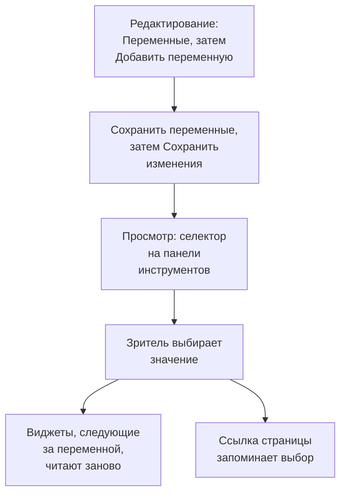

# Переменные и фильтры дашборда

Переменная — это селектор на панели инструментов дашборда. Добавьте переменную `service`, и одни и те же графики покажут `checkout`, `payments` или `search`: зрители выбирают на панели инструментов, а вам не нужно собирать три почти одинаковых дашборда.

:::cards
- [Добавить переменную](#добавить-переменную): Задайте имя, выберите, откуда берутся значения, и сохраните.
- [Источники переменных](#источники-переменных): Telemetry Attribute, Project Labels, Custom List и Text Input.
- [Как виджеты используют переменную](#как-виджеты-используют-переменную): Какие виджеты следуют каким переменным.
- [Ссылки с сохранённым выбором](#ссылки-с-сохранённым-выбором): Отправьте ссылку, которая откроется на том же сервисе.
:::

## Как работает переменная

Переменные задаются во время редактирования дашборда и сохраняются вместе с ним. В режиме просмотра каждая из них — селектор на панели инструментов. Когда зритель выбирает значение, каждый виджет, следующий за переменной, заново читает свои данные, а ссылка страницы запоминает выбор.



## Добавить переменную

:::steps
### Откройте диалог переменных

Откройте дашборд, выберите **⋯ → Редактировать панель** и нажмите **Переменные** на панели инструментов. Диалог **Переменные панели** перечисляет переменные дашборда; кнопка на панели инструментов показывает их число.

### Добавьте переменную

Нажмите **Добавить переменную**. Новая переменная читает атрибут телеметрии; при необходимости выберите другой **Источник**.

### Заполните её

Задайте **Имя**, которое используют виджеты и ссылки, например `service`: буквы, цифры и подчёркивания, начиная с буквы или подчёркивания, отличное от других имён дашборда. При желании заполните поле **Метка** для панели инструментов, значение **По умолчанию**, с которого начинать, и отметьте **Разрешить множественный выбор**, чтобы зрители могли выбирать несколько значений.

### Сохраните её

Нажмите **Сохранить переменные**, затем **Сохранить изменения** на панели инструментов. Селектор переменной появится на панели инструментов, когда дашборд вернётся в режим просмотра.
:::

Чтобы позже изменить или удалить переменную, снова откройте диалог: измените её поля или нажмите на значок корзины рядом с ней.

## Источники переменных

**Источник** определяет, откуда берутся значения переменной и какие виджеты за ней следуют.

| Источник | Откуда берутся значения | Множественный выбор |
| --- | --- | --- |
| Telemetry Attribute | Значения одного ключа атрибута в ваших метриках, например `service.name` | Да |
| Project Labels | Разрешённые вами метки проекта, от 1 до 1 000 | Да |
| Custom List | Значения, которые вы вводите через запятую, например `prod, staging` | Да |
| Text Input | То, что вводит зритель | Нет |

### Telemetry Attribute

Задайте **Ключ атрибута**, например `service.name`, `host.name` или `k8s.namespace.name`; поле подсказывает ключи, которые есть в вашей телеметрии. Селектор предлагает до 100 значений этого ключа, прочитанных из ваших метрик за последние сутки, так что новый сервис появляется в нём без правки дашборда.

Это самый распространённый источник, потому что ему не нужен собственный список: значения — те, что вы уже отправляете.

### Project Labels

Выберите существующие метки проекта, чтобы предложить их в выпадающем списке дашборда. Например, создайте переменную с именем `UNIT`, задайте ей источник **Метки проекта** и выберите метки `0660` и `0661`.

Дашборд сохраняет ID и отображаемые имена выбранных меток. Фильтрация использует ID, поэтому переименование метки проекта не ломает её привязку. Отображаемые имена сохраняются вместе с дашбордом; выберите переименованную метку заново в редакторе переменных, чтобы обновить её отображаемое имя. Публичные дашборды показывают те же сохранённые варианты.

В виджете **Список мониторов** откройте **Фильтры → Переменная метки** и выберите `UNIT`. Теперь при выборе `0660` показываются мониторы с этой меткой. Другие виджеты это не затрагивает, если они явно не поддерживают и не привязывают переменную: у **Список SLO** есть такая же настройка **Переменная метки**.

Фиксированные фильтры виджета продолжают действовать. Например, при фиксированной метке `network` и `UNIT`, равной `0660`, монитор должен иметь обе метки. Несколько выбранных единиц совпадают с любой из них. Выбор **Все** снимает только условие переменной и сохраняет фиксированные фильтры по меткам, статусу и типу монитора.

Отсутствующая переменная или выбор вне настроенных вариантов показывает ошибку. Выбранная метка без подходящих мониторов показывает пустой список. Когда привязка виджета больше не нужна, удалите её явно.

### Custom List и Text Input

Custom List предлагает значения, которые вы ввели через запятую. Text Input позволяет зрителю ввести любое значение, например IP-адрес или ID запроса. Ни один из них сам по себе не фильтрует виджет: их значения подставляются туда, где вы пишете `{{name}}` (см. ниже).

Переменная Query со старого дашборда сохраняется и показывает текстовое поле на панели инструментов: OneUptime больше не загружает её значения из запроса.

## Множественный выбор и значения по умолчанию

Когда отмечено **Разрешить множественный выбор**, зрители выбирают одно или несколько значений, а виджеты показывают любое из них. Пустой выбор означает **Все**, и переменная с множественным выбором всегда начинает с **Все**, поэтому её значение **По умолчанию** недоступно.

Переменная с одиночным выбором начинает со своего значения **По умолчанию** или с **Все**, если его нет. **Все** снимает фильтр переменной, и виджеты показывают всё.

Используйте множественный выбор, чтобы сравнить «checkout и payments вместе», не покидая дашборд. Избегайте его там, где числа не складываются между значениями, например в среднем от средних.

## Как виджеты используют переменную

Каждый источник доходит до виджетов по-своему:

- Переменные **Атрибут телеметрии** фильтруют виджеты, ничего не требуя настраивать в них самих: каждый график, значение, измеритель и таблицу метрик; **График логов**, **Поток логов**, **График трассировок** и **Таблица трассировок**; а также списки инфраструктуры, чьи ресурсы несут этот атрибут, например `host.name` в списках хостов и `k8s.namespace.name` в списках Kubernetes. График метрики без этого атрибута не показывает данных, пока выбрано значение: выберите **Все**, чтобы снова его увидеть. **Список трассировок** и списки инцидентов и оповещений за ними не следуют.
- Переменные **Метки проекта** фильтруют **Список мониторов** или **Список SLO**, у которых они указаны в **Переменная метки**.
- **Любую переменную** можно вписать в текст как `{{name}}`: в [HTML-виджете](/docs/dashboards/widgets#html), в запросе [внешнего источника данных](/docs/dashboards/data-sources) и в заголовке виджета **Список мониторов** или **Список SLO**. Заголовок вроде `{{UNIT}} NETWORK` показывает `0660 NETWORK`, `0660, 0661 NETWORK` или `All NETWORK`. Заголовок управляет только отображаемым текстом; чтобы фильтровать запрос мониторов, настройте **Переменная метки**.

[Виджет SLO](/docs/dashboards/widgets#slo) может следовать за переменной Telemetry Attribute по ключу `sloName`, чтобы зрители выбирали, какой SLO он показывает.

## Ссылки с сохранённым выбором

Ссылка страницы несёт выбор каждой переменной в виде `?var-<name>=<value>`, несколько значений — через запятую, поэтому скопированная ссылка открывается с тем же выбором, включая явное **Все**. Ссылка вроде этой открывается на сервисе payments:

```text title="A dashboard link with a variable"
https://oneuptime.com/dashboard/<project-id>/dashboards/<dashboard-id>?var-service=payments
```

Ссылка несёт также выбранные вами временной диапазон и автообновление — как `range` и `refresh`, — чтобы те, кому вы её отправляете, видели то же, что и вы. Их значения перечислены в разделе [Отправка ссылки](/docs/dashboards/sharing#отправка-ссылки).

## Пример: один дашборд для каждого сервиса

У дашборда сервиса обычно есть:

1. Переменная `service`, источник Telemetry Attribute, ключ атрибута `service.name`, по умолчанию — ваш самый нагруженный сервис. Оставьте множественный выбор выключенным, чтобы графики показывали по одному сервису.
2. Переменная `namespace`, источник Telemetry Attribute, ключ атрибута `k8s.namespace.name`, с включённым множественным выбором для сравнения пространств имён.
3. Переменная `environment`, источник Custom List, значения `prod, staging`, используемая как `{{environment}}` в запросе источника данных.
4. Виджеты, читающие эти атрибуты: графики и значения метрик сервиса, поток логов и список подов Kubernetes.

Результат: один дашборд для каждого сервиса с тремя селекторами наверху.

## Дальнейшие шаги

:::cards
- [Виджеты дашборда](/docs/dashboards/widgets): Какие виджеты следуют каким переменным.
- [Внешние источники данных](/docs/dashboards/data-sources): Подставьте переменную в запрос PromQL или SQL.
- [Совместный доступ и публичные дашборды](/docs/dashboards/sharing): Переменные на публичном дашборде.
- [Создание дашборда](/docs/dashboards/authoring): Режим редактирования, сохранение и временной диапазон.
:::
