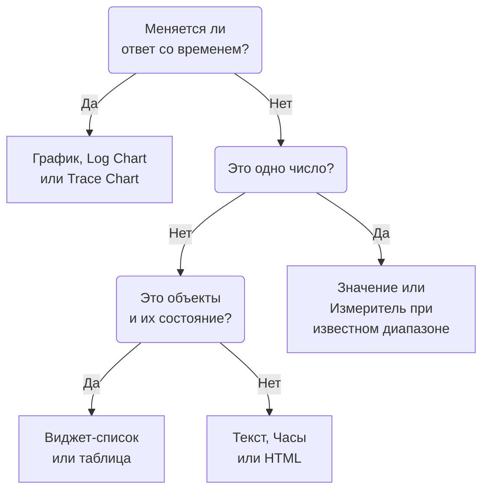

# Виджеты дашборда

Виджет — это одна плитка на дашборде. На этой странице перечислены все виджеты каталога **Добавить виджет**: что каждый показывает и какие настройки важны, по группам самого каталога. Как размещать виджеты на сетке и сохранять их, см. в разделе [Создание дашборда](/docs/dashboards/authoring).

:::cards
- [Какой виджет выбрать?](#какой-виджет-выбрать): Выбирайте по вопросу, на который отвечает плитка.
- [Графики и числа](#графики-и-числа): График, Значение, Измеритель и Таблица на основе запроса метрик.
- [Логи, трассировки и безопасность](#логи-трассировки-и-безопасность): Графики объёма, живые потоки и списки.
- [Когда виджет нельзя показать](#когда-виджет-нельзя-показать): Что показывает сломанный виджет и как его исправить.
:::

## Какой виджет выбрать?

Начните с вопроса, на который должна ответить плитка:

| Вопрос | Виджет |
| --- | --- |
| Как метрика менялась со временем? | **График** |
| Сколько логов, какой важности, во времени? | **Log Chart** |
| Насколько быстры запросы и сколько из них падает, во времени? | **Trace Chart** |
| Чему равно одно число прямо сейчас? | **Значение** или **Измеритель**, если у него известный диапазон |
| Какие хосты, сервисы или эндпоинты выделяются? | **Таблица** или **Trace Table** |
| Что происходит прямо сейчас? | **Поток логов**, **Список трассировок**, **Список инцидентов** или **Список оповещений** |
| Все ли наши сайты работают? | **Список мониторов** |
| Соблюдаем ли мы обещанную надёжность? | **SLO** или **SLO List** |
| В каком состоянии наши кластеры и хосты? | Виджет из группы «Инфраструктура» |
| Где в мире наша сеть и что в ней не работает? | **Network Map** |
| Заголовок, заметка, время в другом офисе? | **Текст** или **Часы** |
| Данные, которые хранятся вне OneUptime? | Виджет из группы «Внешние источники данных» |
| Что-то, чего не покрывает ни один виджет? | **HTML**, когда вы уверены, что никакой другой виджет этого не делает |



Большинство дашбордов сочетают несколько виджетов: график сверху, одно-два значения рядом, текстовый заголовок и один-два списка внизу.

## Графики и числа

Эти четыре виджета читают запрос метрик, построенный так же, как в обозревателе метрик: выберите метрику и агрегацию, добавьте фильтры по атрибутам и сгруппируйте по атрибуту, чтобы получить по одному ряду на значение.

### График

Временной ряд одного или нескольких запросов метрик за временной диапазон дашборда. **Chart Type** рисует его как линейный, столбчатый, с областями, с накопленными областями или круговой график. **Additional Queries** накладывает другие метрики на те же оси, а **Formulas** объединяет их с помощью `+`, `-`, `*`, `/`, `%`, `^` и скобок, как в `(1 - a) * 100`. Настройки отображения каждого запроса добавляют легенду и единицу измерения, цвет, линии предупреждения и критического уровня, а также скорость в секунду для счётчиков, которые только растут.

Используйте его, когда историю рассказывает форма линии: задержка, ошибки, пропускная способность или глубина очереди.

### Значение

Одно крупное число со спарклайном: значение запроса за весь временной диапазон — сумма для суммы или количества, наибольшее для максимума, наименьшее для минимума и среднее в остальных случаях. Стрелка сравнивает вторую половину диапазона с первой и окрашивается по **Trend Direction**: лучше или хуже более высокое значение, либо это определяется по имени метрики. **Warning Threshold** окрашивает фон в жёлтый, а **Critical Threshold** — в красный, когда значение их достигает.

Используйте его, когда на вопрос отвечает одно число: доля ошибок, задержка P95 или количество запросов, обслуженных сегодня.

### Измеритель

Шкала между минимумом и максимумом, по умолчанию 0 и 100, с жёлтой зоной от **Warning Threshold** и красной зоной от **Critical Threshold**.

Используйте его, когда значение живёт в известном диапазоне: использование CPU или диска в процентах, заполненность очереди.

### Таблица

Значения метрик в виде строк. **Group By Attributes** даёт по строке на значение, например по одной на `host.name`; без группировки каждая строка — это интервал времени. **Metrics & Columns** задаёт столбцы: метрики и формулы над ними, например доступность в процентах. При группировке **Reduce across time** превращает ряд каждой строки в одно значение: последнее значение, среднее, сумму, минимум или максимум.

Используйте её для разбивки, а не для тренда: самые шумные хосты, ошибки по сервисам, запросы по эндпоинтам.

## Текст, часы и HTML

Этим виджетам не нужен источник данных.

### Текст

Строка или блок текста — для заголовка, заметки или ссылок на ваши ранбуки. Включите **Markdown**, чтобы рисовать заголовки, ссылки, списки, код и таблицы; иначе текст показывается как введён, при желании жирным, курсивом или подчёркнутым.

### Часы

Текущее время в любом часовом поясе, цифрами или аналоговым циферблатом, с подписью вроде «Офис в Сиднее». Без часового пояса показывают время каждого зрителя. Добавьте по одним на офис, чтобы видеть, кто сейчас не спит.

### HTML

Ваши собственные HTML, CSS и JavaScript, отрисованные как виджет. Его настройки — тело HTML, необязательная таблица стилей, необязательный скрипт и три переключателя разрешений.

Используйте его, когда нужно то, чего не покрывает ни один встроенный виджет: встроенный бейдж стороннего сервиса, таблица из внутреннего API, своя легенда или набор оформленных ссылок на ваши инструменты.

#### Что он может и чего не может

Виджет отрисовывается в изолированном фрейме (sandbox) на собственном изолированном источнике (origin). Внутри этого фрейма ваш код может делать почти что угодно: строить DOM, запускать таймеры, загружать данные с любого URL, рисовать на canvas.

Чего он не может — так это дотянуться до окружающей страницы OneUptime. У него нет доступа к DOM дашборда, cookies, локальному хранилищу или сессии API, и он не может увести вкладку браузера на другую страницу. Это так, будь дашборд приватным или опубликованным.

Два следствия, о которых стоит знать, прежде чем что-то вставлять:

- `fetch` из виджета — это межсайтовый запрос из непрозрачного источника, поэтому вызываемый сервер должен разрешить его через CORS. Вызывать отсюда API OneUptime не поддерживается.
- Виджет изначально прозрачный. Задайте фон для `body` в своём CSS, если хотите, чтобы он заполнял карточку.

#### Использование переменных дашборда

Напишите `{{variableName}}` в любом месте HTML, CSS или JavaScript, и перед отрисовкой виджета это место заменится текущим значением переменной. Выбор нового значения перерисовывает виджет. Заполнитель с именем несуществующей переменной остаётся как есть.

Скрипты получают те же значения, а также временной диапазон дашборда, в `window.ONEUPTIME`:

```javascript title="window.ONEUPTIME"
window.ONEUPTIME.variables.environment; // current value, or "" if unset
window.ONEUPTIME.startDate; // ISO 8601 string, start of the dashboard's time range
window.ONEUPTIME.endDate; // ISO 8601 string, end of it
```

Виджет перезагружается при каждом обновлении дашборда, так что виджет, который сам загружает данные, не отстаёт от интервала обновления.

#### Разрешения

**Run JavaScript** (включено по умолчанию) запускает ваш скрипт. Выключите его, чтобы отрисовывать только разметку и стили: тогда скрипт полностью исключается из виджета, а не просто блокируется.

**Open links in a new tab** (включено по умолчанию) позволяет ссылкам и `window.open` открывать вкладку браузера. Ссылки всегда открываются в новой вкладке; виджет никогда не может увести сам дашборд на другую страницу.

**Allow forms to submit** (выключено по умолчанию) позволяет отправлять `<form>` внутри виджета.

Тот, кто может редактировать дашборд, решает, что выполняет этот виджет, а все, кто смотрит дашборд, это выполняют — на публичном дашборде в том числе анонимные посетители. Относитесь к доступу на редактирование дашборда с HTML-виджетом так же, как к доступу к любому другому коду, который вы выпускаете.

## Логи, трассировки и безопасность

| Виджет | Что показывает | Важные настройки |
| --- | --- | --- |
| **Log Chart** | Объём логов во времени, по одному ряду на уровень важности, столбцами, линиями или областями. | Уровни важности, текст в теле, фильтры по атрибутам. |
| **Поток логов** | Последние строки логов, подходящие под фильтр. | Уровень важности, текст в теле, фильтры по атрибутам вроде `@service.name:checkout`, число строк. |
| **Trace Chart** | Число запросов, число ошибок или время ответа (среднее, минимум, максимум, от P50 до P99) во времени. | Метрика, какие спаны считать и атрибут для разбиения рядов. |
| **Список трассировок** | Последние трассировки с их длительностью и статусом. | Статус, число строк. |
| **Trace Table** | Основные имена спанов, статусы или значения атрибутов по числу запросов, с медианным, средним, минимальным и максимальным временем ответа. | По чему группировать строки и какие спаны считать. |
| **Security Events** | Последние события безопасности с важностью, классом события и хостом. | Уровни важности, классы событий, текст сообщения. |
| **Security Events Flow** | Поток событий безопасности от источника через класс события к уровню важности. | Уровни важности, число событий. |

Виджеты трассировок считают только корневые спаны, как и обозреватель трассировок, если вы не включите дочерние спаны в их настройках. Обычная схема — график задержки сверху и список медленных трассировок под ним.

## Инциденты, оповещения и мониторы

| Виджет | Что показывает | Фильтры |
| --- | --- | --- |
| **Список инцидентов** | Инциденты с их состоянием и важностью. | Нерешённые, подтверждённые или решённые; важность, состояние, мониторы и метки. |
| **Список оповещений** | Оповещения с их состоянием и важностью. | Нерешённые, подтверждённые или решённые; важность, состояние, мониторы и метки. |
| **Список мониторов** | Мониторы с их текущим статусом. | Работает или нет, статус, тип монитора и метки или **Label Variable**, которую зрители выбирают на панели инструментов. |

Как и большинство виджетов-списков, эти три могут вместо таблицы рисовать соты из ячеек, окрашенных по статусу: выберите это в настройке **Режим просмотра**. Они показывают текущее состояние, каким бы ни был временной диапазон дашборда.

## Цели уровня обслуживания

### SLO

Одна цель уровня обслуживания (SLO), показанная одним числом или линией во времени.

**Настройки**: какой SLO или SLO, выбранный в переменной дашборда; какое из трёх чисел (SLI, Error Budget Remaining или Burn Rate); отображение Tile или График; и необязательный заголовок.

- **Tile** показывает текущее число и вторую строку, если она есть: цель под SLI, оставшиеся минуты под бюджетом ошибок. Плашка статуса окрашивает всё целиком.
- **График** рисует то же число за временной диапазон дашборда, с целью в виде пунктирной линии на ряду SLI. История записывается каждые несколько минут воркером оценки, поэтому совсем новый SLO выглядит на графике пустым, пока его не оценят в первый раз.

Используйте его, когда дашборд отвечает на вопрос «выполняем ли мы обещанное?», а не «что происходит прямо сейчас?».

Виджет SLO работает на [публичных дашбордах](/docs/dashboards/sharing). Публикуются ключевые числа SLO — его имя, цель, текущий SLI, оставшийся бюджет ошибок, скорость сжигания и статус, — какое бы из них ни рисовал виджет. Определение остаётся закрытым: мониторы, за которыми он следит, его метки, описание, запрос и расписание оценки никогда не отправляются публичному зрителю. Виджет Tile публикует только эти текущие числа; виджет График публикует ещё и историю того единственного ряда, который рисует, и ничего больше.

### SLO List

Все SLO с их статусом, SLI, бюджетом ошибок и скоростью сжигания, начиная с тех, у кого бюджета осталось меньше всего. Фильтруйте список по статусу или меткам либо через **Label Variable**, которую зрители выбирают на панели инструментов. [Метрики и дашборды SLO](/docs/slo/metrics) показывает оба виджета SLO в работе.

## Инфраструктура

Каждый из этих виджетов перечисляет ресурсы, о которых агент или коллектор сообщает в OneUptime. Сужайте их фильтрами по кластеру, хосту или пространству имён и показывайте списком или сотами.

| Группа | Виджеты | Кто заполняет |
| --- | --- | --- |
| **Хосты** | **Хосты** с их статусом подключения, ОС, CPU и памятью | Любой коллектор OpenTelemetry, который отправляет `host.name` |
| **Kubernetes** | **Поды**, **Узлы**, **Пространства имен**, **Развертывания**, **StatefulSets**, **DaemonSets**, **Задачи**, **CronJobs** | [Агент Kubernetes](/docs/monitor/kubernetes-agent) |
| **Docker** | **Хосты**, **Контейнеры**, **Образы**, **Сети**, **Тома** | Агент Docker |
| **Docker Swarm** | **Узлы**, **Службы** | Агент Docker Swarm |
| **Podman** | **Хосты**, **Контейнеры**, **Образы**, **Сети**, **Тома** | Агент Podman |
| **Proxmox** | **Узлы**, **Guests** | Агент Proxmox |
| **VMware** | **Хосты**, **Virtual Machines** | Агент VMware или подключённый вами vCenter |
| **Ceph** | **OSDs** в виде стены, окрашенной по состоянию, и **Pools** | Агент Ceph |
| **Системы хранения** | **Тома** и **Hardware** в виде стены, окрашенной по статусу | Агент Storage Array |

Используйте их для страницы, которая сочетает состояние вашей инфраструктуры с телеметрией работающих на ней нагрузок.

### Network Map

Ваши сетевые площадки на карте мира: каждая закреплена по своей широте и долготе и окрашена по сводному статусу мониторов. Близкие площадки делят один маркер с числом внутри; маркер, который обозначает ровно одну площадку, открывает её по щелчку.

Карта сама подбирает рамку под нарисованные площадки: сеть внутри одной страны заполняет кадр этой страной, а раскиданная по континентам открывается на весь мир. Кнопок масштабирования и прокрутки нет: плитка дашборда — это картинка, а по иерархии ходят на странице Network Map в разделе Network.

Над картой написано, сколько площадок не работает, потому что красную точку в два пикселя среди двухсот зелёных никто не разглядит с расстояния, с которого смотрят на дашборд. Под картой строка покрытия сообщает, чего карта не показывает: площадки без координат и то, был ли достигнут предел строк.

**Настройки**: заголовок, вид карты или списка, максимум рисуемых площадок, печатать ли названия площадок, а также фильтры по типу площадки и по статусу. Названия площадок убираются автоматически, когда карта становится слишком плотной, чтобы их можно было прочитать; всплывающая подсказка по-прежнему называет каждый маркер.

Площадка появляется, только если у неё есть координаты. Добавьте площадке широту и долготу (или импортируйте их из CSV), чтобы закрепить её на карте.

## Внешние источники данных

Группа «Внешние источники данных» рисует виджеты **График**, **Значение**, **Измеритель** или **Таблица** по данным системы, которая не принадлежит OneUptime: Prometheus, PostgreSQL, MySQL, SQL Server, ClickHouse, Loki, Elasticsearch или любого REST API. Систему подключают один раз, а затем запрос каждого виджета пишут на языке самой системы. Как это сделать, показано в разделе [Внешние источники данных](/docs/dashboards/data-sources).

## На публичном дашборде

[Публичный дашборд](/docs/dashboards/sharing) рисует для посетителей большинство виджетов, и каждый показывает только то, на что был настроен. Некоторые нельзя показать без сессии с входом в систему:

- **Log Chart**, **Trace Chart**, **Trace Table**, **Security Events** и **Security Events Flow** сообщают на своём месте, что они недоступны на публичных дашбордах.
- Виджеты «Внешних источников данных» полностью исключаются из публичного дашборда, потому что их настройки — это сам запрос.

## Когда виджет нельзя показать

Виджет, который не удаётся нарисовать, показывает на своём месте **Не удалось показать этот виджет**, а остальной дашборд продолжает работать. Так бывает, когда у OneUptime нет виджета такого типа (он был удалён, его тип написали с ошибкой, когда дашборд создавали через API, или его добавила более новая версия) или когда виджет падает при отрисовке, например из-за неполных сохранённых настроек.

Если вы можете редактировать дашборд, нажмите на виджете **Изменить виджет**. Дашборд перейдёт в режим редактирования с открытыми настройками этого виджета: исправьте их или нажмите **Удалить виджет**, а затем **Сохранить изменения**. Виджет, упавший при отрисовке, также предлагает **Повторить попытку** и перерисовывается при следующем автообновлении или когда вы меняете временной диапазон.

Посетителям публичного дашборда сообщается только, что виджет показать не удалось.

## Дальнейшие шаги

:::cards
- [Переменные и фильтры дашборда](/docs/dashboards/variables): Позвольте зрителям направлять виджеты на сервис, хост или клиента.
- [Внешние источники данных](/docs/dashboards/data-sources): Графики Prometheus, SQL, Loki и других систем рядом с вашими данными.
- [Создание дашборда](/docs/dashboards/authoring): Добавляйте, располагайте и сохраняйте виджеты.
- [Совместный доступ и публичные дашборды](/docs/dashboards/sharing): Поделитесь дашбордом за пределами команды.
:::
