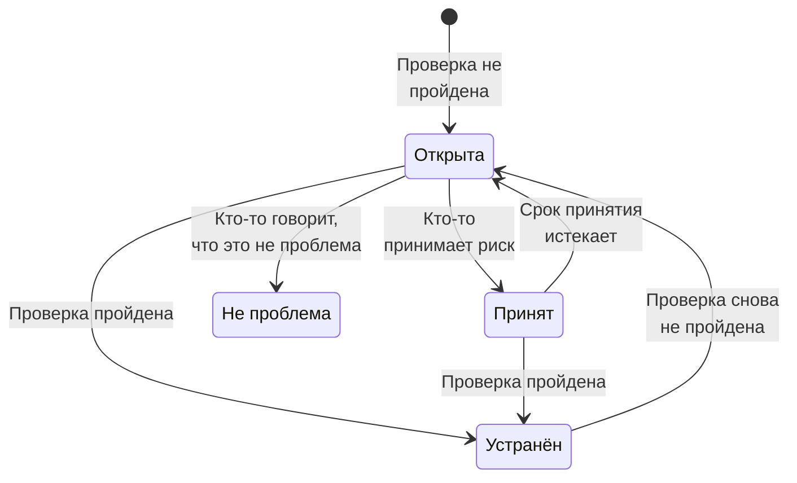

# Проверки и проблемы Безопасности данных

Безопасность данных выполняет 34 проверки для каждого хранилища, разделённые на девять групп. Проверка читает то, что известно об одном хранилище, — как оно настроено, что в нём найдено, кто имеет к нему доступ, где оно находится, — и проходит, не проходит или не может определить результат. Непройденная проверка открывает одну проблему в этом хранилище, и проблема закрывается сама, как только проверка проходит. На этой странице перечислены все проверки, описано, как вычисляются серьёзность и оценка риска проблемы и что происходит с проблемой на протяжении её жизни. События безопасности, Network Flows и сейф адресов безопасности принадлежат самому OneUptime, который ведёт их для вашей безопасности: они указаны, никогда не сканируются и не проверяются (см. [Хранилища, которые OneUptime ведёт для вашей безопасности](/docs/data-security/compliance#хранилища-которые-oneuptime-ведёт-для-вашей-безопасности)).

:::cards
- [Как проверка принимает решение](#как-проверка-принимает-решение): Пройдена, не пройдена или нельзя определить, и насколько серьёзен провал.
- [Все проверки](#все-проверки): Все 34, с тем, что проверяет каждая и как это исправить.
- [Оценка риска](#оценка-риска): Как упорядочиваются проблемы внутри одной серьёзности.
- [Что происходит с проблемой](#что-происходит-с-проблемой): Открыта, устранена, принята, не проблема, как была устранена каждая, и исправления, отслеживаемые до продакшена.
- [Анализ OneUptime AI](#анализ-oneuptime-ai): Реальна ли проблема, что под угрозой, что сломает исправление и кратчайший путь к исправлению.
- [Исправить отсюда](#исправить-отсюда): Закройте доступ извне или включите недостающую защиту одним щелчком.
- [Проблемы с одной причиной](#проблемы-с-одной-причиной): Проблемы, вызванные одной ошибкой, собраны в группу, и их причина исправляется один раз.
:::

## Как проверка принимает решение

Каждая проверка читает факты о хранилище и отвечает одним из четырёх способов:

| Ответ | Что это значит | Что происходит с проблемой |
| --- | --- | --- |
| Пройдена | Проверка не находит ничего неправильного. | Открытая или принятая проблема устраняется. |
| Не пройдена | Проверка находит проблему и одним предложением говорит, что увидела: это доказательство проблемы. | Открывается проблема, или уже открытая обновляется. |
| Нельзя определить | Факт не удалось прочитать: у роли нет разрешения, вызов завершился ошибкой. | Ничего не меняется: открытая проблема остаётся открытой, потому что никто не должен заключать, что проблема устранена, когда OneUptime не смог посмотреть. |
| Неприменимо | У хранилища такого вида нет такой настройки. | Открытая проблема устраняется. |

### Серьёзность зависит от данных

Одна и та же проблема важнее на более конфиденциальных данных. Каждая проверка задаёт серьёзность для каждого уровня чувствительности, и проблема получает ту, что соответствует её хранилищу: публичный бакет с номерами карт получает уровень «Критический», а публичный бакет с изображениями сайта — лишь «Низкий». Прочерк означает, что проблемы нет вовсе. Чувствительность хранилища определяется его находками (см. [Типы конфиденциальных данных](/docs/data-security/data-types#чувствительность)), поэтому образцы содержимого делают серьёзность правильной.

Несколько проверок вместо этого задают серьёзность по тому, что увидели. **В нём хранятся секреты** получает уровень «Высокий» в любом хранилище и «Критический» в хранилище, которое публично или открыто другим аккаунтам.

## Все проверки

Серьёзность указана для данных с чувствительностью «Ограниченный», «Конфиденциальный», «Внутренний» и «Публичный», в таком порядке. Страница каждой проблемы показывает полное исправление для её хранилища — шаги в консоли, команду CLI и, где уместно, Terraform — с уже подставленными именем и регионом хранилища.

### Доступность извне

| Проверка | Где выполняется | Что проверяет | Серьёзность | Как исправить |
| --- | --- | --- | --- | --- |
| Кто угодно в интернете может его читать (`public-read`) | Объектное хранилище, аналитическое хранилище, поиск | Политика, ACL или привязки IAM хранилища позволяют кому угодно читать его данные без входа. | Критический / Критический / Высокий / Низкий | Удалите все разрешения для анонимных субъектов и для всех прошедших аутентификацию. Файлам, которые должны быть публичными, место в хранилище с отметкой **Публичный намеренно**, где больше ничего нет. |
| Кто угодно в интернете может его изменить (`public-write`) | Объектное хранилище, аналитическое хранилище, поиск | Политика, ACL или привязки IAM хранилища позволяют кому угодно записывать или удалять его данные. | Критический / Критический / Критический / Высокий | Удалите все разрешения на запись или удаление для анонимных субъектов и для всех прошедших аутентификацию. |
| Публичный доступ не заблокирован (`public-access-not-blocked`) | AWS S3 Bucket | S3 Block Public Access включён не полностью для бакета или его аккаунта, поэтому одно изменение политики может сделать его публичным. | Высокий / Средний / Низкий / — | Включите для бакета все четыре настройки Block Public Access. |
| База данных принимает подключения из интернета (`internet-reachable`) | База данных, аналитическое хранилище, поиск, кэш | У базы данных включён публичный эндпоинт или публичный сетевой доступ. | Высокий / Высокий / Средний / Низкий | Отключите публичный эндпоинт и подключайтесь к базе данных через частную сеть или бастион. |
| Его брандмауэр пропускает любые адреса (`open-to-all-addresses`) | База данных, аналитическое хранилище, поиск, кэш | Правило брандмауэра или авторизованная сеть разрешает 0.0.0.0/0 или весь диапазон адресов. | Критический / Критический / Высокий / Средний | Замените правило «разрешить всё» адресами или сетями, которым нужен доступ. |
| Его снимок может восстановить кто угодно (`snapshot-public`) | База данных, снимок | Снимок базы данных открыт публично, поэтому любой облачный аккаунт может восстановить его полную копию. | Критический / Критический / Критический / Высокий | Сделайте снимок приватным. |
| Его снимок открыт другим аккаунтам (`snapshot-shared-externally`) | База данных, снимок | Снимок базы данных открыт аккаунтам за пределами подключённых вами. | Высокий / Высокий / Средний / Низкий | Прекратите общий доступ к снимку для аккаунтов, у которых его быть не должно. |
| К нему имеют доступ аккаунты за пределами вашей организации (`shared-with-external-accounts`) | Все хранилища, кроме телеметрии | Политика хранилища даёт доступ аккаунтам, клиентам или проектам, которые не подключены к OneUptime. | Высокий / Высокий / Средний / Низкий | Проверьте каждого внешнего субъекта и удалите тех, кому доступ не нужен. |

### Шифрование

| Проверка | Где выполняется | Что проверяет | Серьёзность | Как исправить |
| --- | --- | --- | --- | --- |
| Его данные не зашифрованы при хранении (`not-encrypted-at-rest`) | Все хранилища, кроме телеметрии | Шифрование хранилища выключено. | Высокий / Средний / Низкий / — | Включите шифрование при хранении. Экземпляр RDS нельзя зашифровать на месте: восстановите зашифрованную копию из его снимка. |
| Данные уровня «Ограниченный» не защищены вашим собственным ключом (`no-customer-managed-key`) | Все хранилища, кроме телеметрии | В хранилище лежат данные уровня «Ограниченный», но оно зашифровано ключом поставщика по умолчанию, а не ключом, которым управляет клиент. | Средний / — / — / — | Зашифруйте хранилище ключом, которым вы управляете в своём сервисе ключей. |
| Разрешены незашифрованные подключения (`encryption-in-transit-not-enforced`) | Все хранилища, кроме телеметрии | Хранилище принимает подключения без TLS. | Высокий / Средний / Низкий / — | Требуйте TLS для каждого подключения. В S3 запретите все запросы, где `aws:SecureTransport` равно false. |
| Оно принимает TLS старше 1.2 (`weak-tls`) | Все хранилища, кроме телеметрии | Минимальная версия TLS — 1.0 или 1.1. | Средний / Средний / Низкий / — | Задайте минимальную версию TLS 1.2 или выше. |

### Восстановление

| Проверка | Где выполняется | Что проверяет | Серьёзность | Как исправить |
| --- | --- | --- | --- | --- |
| У него нет резервных копий или они хранятся меньше 7 дней (`no-backups`) | База данных, аналитическое хранилище | Автоматическое резервное копирование выключено, или копии хранятся меньше 7 дней. | Высокий / Средний / Низкий / — | Включите автоматическое резервное копирование и храните копии не меньше 7 дней. |
| Восстановление на момент времени выключено (`no-point-in-time-recovery`) | AWS DynamoDB Table, Azure Cosmos DB Account | Таблицу или базу данных нельзя восстановить на момент до ошибки. | Средний / Низкий / — / — | Включите восстановление на момент времени. |
| Его можно удалить за один шаг (`deletion-protection-off`) | База данных, аналитическое хранилище | Защита от удаления выключена. | Средний / Низкий / — / — | Включите защиту от удаления. |
| Удалённые или перезаписанные файлы нельзя восстановить (`deleted-data-not-recoverable`) | Объектное хранилище | Версионирование и мягкое удаление выключены. | Средний / Низкий / — / — | Включите версионирование или мягкое удаление. |

### Видимость

| Проверка | Где выполняется | Что проверяет | Серьёзность | Как исправить |
| --- | --- | --- | --- | --- |
| Никто не узнает, кто его читал (`access-not-logged`) | Все хранилища, кроме телеметрии | Чтение хранилища не журналируется: нет ни журналов доступа, ни журналов аудита доступа к данным. | Высокий / Средний / Низкий / — | Включите журналирование доступа или аудита для чтения: журналы доступа к серверу S3 или события данных CloudTrail, диагностические журналы StorageRead в Azure, журналы аудита Data Access в Cloud Storage. |

### Доступ

| Проверка | Где выполняется | Что проверяет | Серьёзность | Как исправить |
| --- | --- | --- | --- | --- |
| Любой, у кого есть ключ аккаунта, может читать всё (`shared-key-access`) | Azure Storage Account | Учётная запись хранения разрешает доступ по общему ключу, который обходит Microsoft Entra ID и не оставляет персонального журнала аудита. | Средний / Низкий / — / — | Переведите приложения на Microsoft Entra ID, затем отключите доступ по ключу учётной записи хранения. |
| Объекты могут иметь собственные правила доступа (`object-acls-enabled`) | AWS S3 Bucket, Google Cloud Storage Bucket | ACL объектов включены, поэтому один объект можно сделать публичным, пока бакет выглядит приватным. | Низкий / Низкий / — / — | В S3 задайте для Object Ownership значение Bucket owner enforced. В Cloud Storage включите uniform bucket-level access. |
| Больше 25 субъектов могут читать данные уровня «Ограниченный» (`many-readers`) | Все хранилища, кроме телеметрии | Доступ на чтение к хранилищу есть у большего числа субъектов, чем большинство команд в состоянии проверить. | Средний / — / — / — | Откройте страницу **Кто имеет доступ** хранилища и удалите неиспользуемый доступ или доступ шире, чем нужно. |
| Субъекты, не использовавшиеся 90 дней, всё ещё имеют к нему доступ (`unused-access`) | Все хранилища, кроме телеметрии | Роли и пользователи, которые не использовались 90 дней, всё ещё имеют доступ к конфиденциальным данным хранилища. | Средний / Низкий / — / — | Откройте страницу **Кто имеет доступ** хранилища, где они отмечены как **Не использовалась 90 дней**, и удалите доступ, который каждому из них больше не нужен. |

### Гигиена данных

| Проверка | Где выполняется | Что проверяет | Серьёзность | Как исправить |
| --- | --- | --- | --- | --- |
| В нём хранятся секреты (`secrets-stored`) | Все хранилища, кроме телеметрии | В данных хранилища найдены пароли, ключи API, токены или закрытые ключи. | Высокий / Высокий / Высокий / Высокий | Смените каждый найденный секрет, как утёкший. Перенесите секреты в менеджер секретов и удалите их из хранилища. |
| Хранятся коды безопасности карт (`card-security-codes-stored`) | Все хранилища, кроме телеметрии | Найдены коды CVV или CVC. PCI DSS запрещает хранить их после авторизации платежа, в зашифрованном виде или нет. | Критический / Критический / Критический / Критический | Остановите код, который их записывает, удалите сохранённые коды и проверьте, что их не осталось в резервных копиях. |
| Номера карт хранятся в читаемом виде (`card-numbers-readable`) | Все хранилища, кроме телеметрии | Найдены полные номера карт в читаемом виде. PCI DSS требует, чтобы они были нечитаемыми везде, где хранятся. | Высокий / Высокий / Высокий / Высокий | Токенизируйте номера карт у своего платёжного провайдера или зашифруйте их на уровне полей и удалите читаемые копии. |
| Пароли хранятся в открытом виде (`plaintext-passwords`) | Все хранилища, кроме телеметрии | Поле пароля содержит значения, которые не являются хешами паролей (bcrypt, argon2, scrypt или PBKDF2). | Критический / Критический / Критический / Критический | Хешируйте пароли с помощью bcrypt, scrypt или argon2, перенесите сохранённые и заставьте каждый аккаунт сбросить пароль. |
| Продакшен-данные скопированы в непродакшен-хранилище (`production-data-in-non-production`) | Все хранилища, кроме телеметрии | Значения, найденные в продакшен-хранилище, найдены и здесь, в хранилище разработки, тестирования или staging. | Высокий / Средний / — / — | Замените копию замаскированными или синтетическими данными и удалите реальные данные из непродакшен-хранилища. |
| Конфиденциальные данные, которыми никто не пользовался 90 дней (`stale-sensitive-data`) | Все хранилища, кроме телеметрии | В хранилище лежат конфиденциальные данные, и за 90 дней не было ни чтений, ни записей. | Средний / Низкий / — / — | Убедитесь, что данные больше не нужны, затем заархивируйте их с датой окончания хранения или удалите. |
| В новом столбце хранятся персональные данные (`new-personal-data-column`) | Все хранилища, кроме телеметрии | У столбца, добавленного за последние 14 дней, имя говорит о том, что в нём хранятся персональные данные. | Высокий / Высокий / Средний / Средний | Убедитесь, что в столбце должны храниться эти данные, и запишите почему. Если не должны, удалите столбец или прекратите запись в него. |
| У этого конфиденциального хранилища нет владельца (`no-owner`) | Все хранилища | В хранилище лежат конфиденциальные данные, и у него нет владельца. | Средний / Низкий / — / — | Добавьте владельца на странице **Владельцы** хранилища или правило владельца, которое совпадает с его тегами. |

### Телеметрия

| Проверка | Где выполняется | Что проверяет | Серьёзность | Как исправить |
| --- | --- | --- | --- | --- |
| Конфиденциальные данные попадают в вашу телеметрию (`sensitive-data-in-telemetry`) | Телеметрия | Журналы, трассировки, метрики, исключения, записи сеансов или разговоры с ИИ содержат конфиденциальные данные, которые не маскирует при приёме ни одно правило. | Высокий / Средний / Низкий / — | Нажмите **Очистить** у каждой находки, чтобы маскировать данные при приёме, затем исправьте код, который их записывает. |
| Секреты попадают в вашу телеметрию (`secrets-in-telemetry`) | Телеметрия | Пароли, ключи API или токены появляются в журналах, трассировках, метриках, исключениях или разговорах с ИИ. | Критический / Критический / Критический / Критический | Сначала смените секрет, затем нажмите **Очистить** и исправьте код, который его записывает. |

### Размещение данных

| Проверка | Где выполняется | Что проверяет | Серьёзность | Как исправить |
| --- | --- | --- | --- | --- |
| Данные хранятся за пределами регионов, где им разрешено находиться (`residency-violation`) | Все хранилища, кроме телеметрии | Регион хранилища или регион, в который реплицируются его данные, нарушает правило размещения данных. | Высокий / Высокий / Средний / — | Перенесите данные в разрешённый регион или прекратите их копирование в другой. Если передача законна, примите проблему и запишите почему. |

### ИИ

| Проверка | Где выполняется | Что проверяет | Серьёзность | Как исправить |
| --- | --- | --- | --- | --- |
| Конфиденциальные данные отправляются поставщику ИИ (`sensitive-data-to-ai`) | Разговоры с ИИ | Разговоры с ИИ, записанные в OneUptime, передают конфиденциальные данные поставщику модели. | Критический / Высокий / Низкий / — | Удаляйте конфиденциальные значения до отправки промптов или отправляйте эти вызовы в модель, которую размещаете сами. |
| Данные уровня «Ограниченный» лежат в хранилище для ИИ (`sensitive-data-in-ai-store`) | Все хранилища, кроме телеметрии | В хранилище с тегом данных для обучения или поиска ИИ лежат данные уровня «Ограниченный». | Высокий / Средний / — / — | Удалите или замаскируйте данные уровня «Ограниченный», прежде чем их используют для обучения модели или как источник для её ответов. |

## Оценка риска

Серьёзность говорит, насколько плоха проблема. Оценка риска от 0 до 100 упорядочивает проблемы одной серьёзности по тому, что делает ту же проблему хуже:

```text
risk = severity + 10 × exposure + 6 × volume + 5 × activity + 4 × production, at most 100
```

| Фактор | Баллы |
| --- | --- |
| Серьёзность | 75 за Критический, 50 за Высокий, 25 за Средний, 0 за Низкий |
| Доступность извне | 10 за Публичный, 8 за Другие аккаунты, 6 за Доступно из интернета, 3 за Неизвестно, 0 за Приватный |
| Объём | До 6, по оценочному числу конфиденциальных записей хранилища по логарифмической шкале: 1 за 10 записей, 3 за 1000, 5 за миллион, 6 за десять миллионов и больше |
| Активность | 5, если Security Operations видела обнаружения в хранилище за последнюю неделю |
| Продакшен | 4 за хранилище в продакшене |

Дополнительные факторы добавляют не больше 25 баллов, поэтому проблема никогда не получает оценку ниже, чем проблема более низкой серьёзности. Публичный продакшен-бакет с миллионом записей данных уровня «Ограниченный» получает 75 + 10 + 5 + 4 = 94 за критическую проблему. Каждая проблема перечисляет факторы, которые добавили баллы к её оценке, с их баллами, а хранилище показывает оценку своей худшей открытой проблемы.

Окружение хранилища — Продакшен, Staging, Development, Test или Неизвестно — определяется по его тегам (`env`, `environment`, `stage`, `tier` и подобным) или, если их нет, по словам в его имени, например `prod`, `staging`, `dev` или `qa`. Задайте его в хранилище, когда ни то ни другое ничего не говорит.

## Что происходит с проблемой



OneUptime открывает, обновляет и устраняет проблемы по мере выполнения проверок. От человека требуется решить, что будет с проблемой дальше:

| Статус | Как она туда попадает | Что дальше |
| --- | --- | --- |
| **Открыта** | Её проверка сейчас не проходит в хранилище. | Она учитывается в Обзоре, в сводке хранилища и в соответствии требованиям, пока проверка не пройдёт. |
| **Устранён** | Её проверка прошла при одном из следующих запусков, больше неприменима или была выключена, либо её хранилище было заархивировано. Человек также может выбрать **Отметить как устранённое**: тогда хранилище сразу проверяется снова. | Она показывает, как была устранена (см. ниже). Она открывается снова, если проверка снова не проходит, и проблема считает, сколько раз она открывалась повторно. |
| **Принят** | Человек выбрал **Принять риск**, заполнив поле **Причина** и указав дату в **Принят до**, не дальше чем через год. | Она остаётся закрытой до этой даты, а затем открывается снова, если проверка всё ещё не проходит. Тогда примите её снова, если причина всё ещё актуальна. |
| **Не проблема** | Человек выбрал **Не проблема** и объяснил почему в поле **Причина**: находка была ошибочной. | Она остаётся закрытой, даже пока проверка не проходит, и сохраняет причину. **Открыть снова** возвращает её в статус «Открыта». |

Роли Участник безопасности, Администратор безопасности, Администратор проекта и Владелец проекта могут менять статус проблемы и **Назначить** её человеку или команде. Каждое изменение записывается в **Хронология** проблемы: когда она открылась, каждое изменение серьёзности, каждое изменение статуса и кто его сделал, запрошенные повторные проверки и что сделали интеграции.

Проблема, которая открывается снова, сохраняет свою историю. Принятые риски пересматриваются каждый день, поэтому срок принятия истекает вовремя, даже если ничего не сканировалось.

### Как проблема была устранена

Устранённая проблема показывает, как её устранили, вверху своей страницы и в списке проблем, который можно отфильтровать по этому признаку в поле **Способ устранения**:

| Способ устранения | Что это значит |
| --- | --- |
| **Исправлено в коде** | Пул-реквест с исправлением кода выпущен, и новая версия сервиса больше не пишет эти данные. Проблема показывает, какой именно и когда: «Исправлено в пул-реквесте #482, развёрнуто в версии 2.4.1, проверено». |
| **Исправлено в коде инфраструктуры** | Пул-реквест в Terraform, CloudFormation или Bicep, который объявляет хранилище, слит, и хранилище прошло свою проверку, как только изменение было применено. |
| **Исправлено отсюда** | Действие реагирования ([Исправить отсюда](#исправить-отсюда)) изменило хранилище, и после этого его проверка прошла. |
| **Локализовано при приёме** | Каждую находку проблемы в телеметрии скрывает правило очистки до того, как она сохраняется. Это не исправление: код по-прежнему пишет эти данные — в stdout и во все остальные места, куда сервис отправляет свою телеметрию. Проблема сообщает об этом оранжевым, вместе с тем, что правило изменило за последнюю неделю, и предлагает **Исправить код**. |
| **Проверка пройдена** | Её проверка проходит, хотя OneUptime ничего не менял. |
| **Устранено человеком** | Кто-то выбрал **Отметить как устранённое**. Хранилище сразу проверяется снова, и проблема открывается снова, если её проверка всё ещё не проходит. |
| **Больше не проверяется** | Её проверка была выключена или больше не применяется к хранилищу. |
| **Хранилище архивировано** | Её хранилища больше нет в его источнике. |

Обзор считает проблемы, исправленные там, где они возникают, отдельно от утечек, которые только локализованы при приёме, а **В вашей телеметрии** оставляет локализованную находку на виду с отметкой **Очищено**, пока код не перестанет её писать.

### Исправления, отслеживаемые до продакшена

Пул-реквест, который OneUptime AI открыл для проблемы (**Исправить с ИИ** или один пул-реквест для [группы проблем](#проблемы-с-одной-причиной)), в момент слияния ещё ничего не исправил. OneUptime следит за ним, пока продакшен это не докажет:

- **Утечка в коде.** OneUptime ждёт записанного развёртывания сервиса, которое содержит слияние, а затем наблюдает за его новой версией. Если данные скрывает правило очистки, оно не должно изменить ни одного значения в этой версии; если ни одно правило их не скрывает, ни одна запись этой версии не должна содержать эти данные в тех местах, где они были найдены. Кроме того, новая версия должна проработать сутки и отправить не меньше логов или спанов, чем старая отправила за тот час, когда утечку видели в последний раз. Тогда проблема получает статус **Исправлено в коде**. Одно изменённое значение или одна запись, в которой всё ещё есть эти данные, означает, что исправление не остановило утечку, а о версии, которая за неделю отправляет слишком мало, ничего сказать нельзя. Развёртывания сопоставляются по коммиту: записывайте их с помощью `oneuptime deploy` или отправляйте `vcs.ref.head.revision` (см. [Развёртывания и изменения](/docs/telemetry/change-events)).
- **Конфигурация хранилища.** Когда пул-реквест сливается, его хранилища сразу считываются заново. Каждая проблема, проверка которой после этого проходит, получает статус **Исправлено в коде инфраструктуры**. Если хранилище всё ещё не проходит проверку, когда его считывают заново через сутки после слияния, исправление **слито, не применено**: владельцам хранилища и человеку, который запросил пул-реквест, один раз отправляется письмо, и это отражается в хронологиях проблемы и хранилища. Обычно не хватает apply.
- **Правило очистки сохраняется.** После проверенного исправления кода правило очистки, которое локализовало утечку, остаётся, так что регрессия скрывается сразу, как только появляется. Проблема показывает, что правило ничего не изменило после исправления, и предлагает **Удалить правило**.
- **Регрессия.** За проверенным исправлением продолжают следить: если сохранённое правило снова изменяет значения или сканирование снова находит эти данные, проблема открывается снова и показывает, какая версия их вернула. Она остаётся открытой, пока её снова не исправят, даже если правило скрывает эти данные.

Каждый шаг отражается в **Хронологии** проблемы и хранилища, а Результаты ИИ считают проверенные исправления по видам (см. [Насколько хорошо работает OneUptime AI](/docs/ai/ai-sre#насколько-хорошо-работает-oneuptime-ai)).

## Анализ OneUptime AI

Пока в **Безопасность данных → ИИ** включено **Работать с новыми проблемами**, OneUptime AI сам анализирует каждую новую или вновь открытую проблему с серьёзностью «Критическая» или «Высокая», ещё до того, как её кто-то откроет; ваши правила ИИ для безопасности данных могут выбрать другие проблемы. Любую проблему можно проанализировать с её страницы кнопкой **Проанализировать проблему**. Анализ открывает **Обзор** проблемы в карточке **Анализ OneUptime AI** и отвечает на основе того, что знает безопасность данных:

- реальна ли она: **Реальная**, **Вероятно, намеренно**, **Вероятно, ошибочная находка** или **Невозможно определить**, и почему;
- что под угрозой: данные и примерно сколько записей, кто может до них добраться, их копии в других хранилищах и кейсы безопасности по ним;
- что сломает исправление: сервисы, замеченные за использованием хранилища, идентичности, использовавшие доступ за последние 90 дней, и разрешения, которые удалит исправление и которыми что-то ещё пользуется;
- кратчайший путь к исправлению: что сдерживает проблему сейчас, код, который объявляет хранилище, и кто должен этим заняться.

Каждая строка называет факты, на которых основана; их перечисляет кнопка под ней, например **Показать факты, на которых она основана (3)**. Строка, не основанная ни на одном факте, отбрасывается, вердикт, причина которого не основана ни на одном, — это **Невозможно определить**, а хранилище с ограниченными данными никогда не бывает **Вероятно, намеренно** лишь со слов OneUptime AI. Строка, основанная на том, что вам нельзя читать, например кто может добраться до хранилища, скрыта от вас и сообщает об этом.

OneUptime AI никогда не меняет проблему: её статус и серьёзность остаются за её проверкой и за вами. Для **Вероятно, намеренно** он предлагает **Принять риск** с готовой причиной и **Публичный намеренно** для публичного хранилища; для **Вероятно, ошибочная находка** — **Не проблема** с готовой причиной. Ничего не изменится, пока вы не выберете.

Анализ хранится в проблеме, с записью в её **Хронология** при каждом написании, на языке, который выбрало большинство участников вашего проекта (**Проанализировать снова** пишет его на вашем). Он переписывается, только когда изменилось то, на чём он основан, поэтому открытие проблемы ничего не спрашивает у OneUptime AI; **Проанализировать снова** спрашивает в любом случае. **Проблемы** фильтрует и показывает проблемы по **Вердикт OneUptime AI**. Что он отправляет и чего никогда не отправляет — в [OneUptime AI в безопасности данных](/docs/data-security/ai). Когда ИИ выключен, анализа нет.

## Исправить отсюда

Открытую проблему, которую исправляет одно изменение настроек хранилища, — публичный бакет, снимок с общим доступом, бакет, удалённые файлы которого нельзя восстановить, — можно исправить с её страницы. Над шагами в консоли **Исправить отсюда** предлагает изменение, которое её исправляет:

| Проблема | Её хранилище | Кнопка | Что она меняет |
| --- | --- | --- | --- |
| `public-read`, `public-write` или `public-access-not-blocked` | Бакет S3, учётная запись хранения Azure или бакет Cloud Storage | **Заблокировать публичный доступ** | Включает четыре настройки Block Public Access бакета, отключает анонимный доступ к BLOB-объектам учётной записи хранения или принудительно включает для бакета предотвращение публичного доступа |
| `snapshot-public` или `snapshot-shared-externally` | Снимок RDS, база данных RDS или кластер Aurora или DocumentDB | **Отозвать общий доступ** | Прекращает общий доступ к снимку или к каждому общему ручному снимку базы данных для всех и для аккаунтов за пределами подключённых вами |
| `deleted-data-not-recoverable` | Бакет S3 или бакет Cloud Storage | **Включить управление версиями** | Хранит предыдущую версию каждого перезаписанного или удалённого объекта, пока её не удалит правило жизненного цикла |
| `deleted-data-not-recoverable` | Учётная запись хранения Azure | **Включить обратимое удаление** | Хранит удалённые BLOB-объекты и контейнеры 14 дней, чтобы их можно было восстановить |
| `object-acls-enabled` | Бакет S3 | **Отключить ACL объектов** | Задаёт для Object Ownership значение Bucket owner enforced, чтобы только политика бакета решала, кто его читает |
| `object-acls-enabled` | Бакет Cloud Storage | **Включить единообразный доступ** | Включает единообразный доступ на уровне бакета, чтобы только политика IAM бакета решала, кто его читает |
| `encryption-in-transit-not-enforced` или `weak-tls` | Учётная запись хранения Azure | **Требовать безопасную передачу** | Включает безопасную передачу и задаёт минимальную версию TLS 1.2, чтобы учётная запись принимала только HTTPS с TLS 1.2 или новее |
| `no-point-in-time-recovery` | Таблица DynamoDB | **Включить восстановление на момент времени** | Позволяет восстановить таблицу на любую секунду последних 35 дней |

Сначала она запрашивает подтверждение и говорит, что изменится, что перестанет работать и сколько это стоит. Она меняет настройки хранилища, но никогда не его данные, и ничего не меняет там, где всё уже как надо. Хранилище с отметкой **Публичный намеренно** никогда не блокируется.

Она действует через облачное подключение хранилища, поэтому в подключении должно быть включено **Реагирование безопасности данных** и заново выполнена команда настройки (см. [Настройка Безопасности данных](/docs/data-security/setup#позвольте-безопасности-данных-закрывать-доступ-извне)). До этого панель говорит, что нужно включить. Сразу после изменения хранилище проверяется снова, и проблема устраняется сама, как только её проверка проходит. **Хронология** проблемы и **Хронология** хранилища показывают, что было сделано и кем.

## Проблемы с одной причиной

Один модуль Terraform, который выключает журналы доступа, создаёт сорок бакетов с сорока проблемами. Безопасность данных собирает вместе проблемы, вызванные одной ошибкой, чтобы их причина исправлялась один раз.

**Группировать по причине** в разделе **Проблемы** показывает каждую группу над списком: «Проблем: 40, одна причина: модуль static-site», что находит её проверка, сколько исправлено и сколько осталось. Её хранилища данных раскрываются под ней, каждое со ссылкой на свою проблему, а фильтры списка сужают их так же, как сужают строки. Проблемы без группы перечислены под группами. Группировка включается, как только в группе пять проблем, и браузер запоминает ваш выбор.

Группу образуют факты, а не OneUptime AI. Проблемы одной проверки на хранилищах данных одного облака образуют группу, когда у их хранилищ есть общий факт из этих, от самого сильного:

| Факт | Где он читается |
| --- | --- |
| Код, который их объявляет | Файл в подключённом репозитории, названный по модулю или стеку, который называют их теги |
| Их стек | Собственный тег стека CloudFormation или тег, который называет стек |
| Тег | Тег, который называет модуль, стек или компонент, создавший их, например `module` или `component` |
| Кто их создал | Идентичность, которая создала их по журналу изменений облака, для хранилищ, чьи теги не называют ничего, что их создало |
| Шаблон имён | Часть их имён, которая есть у немногих других хранилищ, например `static-site-*` |

В группе не меньше двух проблем, проблема входит не больше чем в одну группу и остаётся в своей группе, пока её хранилище разделяет факт группы. Пока в **Безопасность данных → ИИ** включено **Работать с новыми проблемами**, OneUptime AI называет каждую группу по её фактам, например «модуль static-site выключает журналы доступа», а название, которое говорит то, чего не говорят факты, не сохраняется. Иначе группа называется по своему факту.

**Исправить причину** у группы говорит, что изменится, что останется в стороне и почему, ещё до любых изменений:

- **Один пул-реквест** для хранилищ данных, объявленных в коде: OneUptime AI меняет модуль или файл, который их объявляет, в репозитории, который вы подтверждаете, а не каждое хранилище по отдельности. Пул-реквест перечисляет каждое хранилище и каждую проблему, которые он исправляет, и появляется в разделе **Код** и в **Хронологии** каждой проблемы. Ему нужно то же, что и **Исправить с ИИ**: разрешение изменять проблемы безопасности данных и репозиторий, в котором OneUptime AI может работать.
- **Одно одобрение** для хранилищ данных, созданных в консоли: изменение, которое делает [Исправить отсюда](#исправить-отсюда), для каждого из них через его облачное подключение. Ему нужно разрешение редактировать хранилища данных.
- **Не включены**: хранилище, отмеченное как **Публичный намеренно**, никогда не блокируется. Хранилище, чей анализ говорит, что исправление отнимет доступ, которым что-то ещё пользуется, ждёт, пока вы отметите **Всё равно исправить**. Хранилище, которое ни одно облачное подключение не позволяет изменить безопасности данных, остаётся для его консоли, с причиной.

Если в группе есть хранилища обоих видов, одно нажатие делает обе части, и любую из них можно не включать. Каждая проблема решается сама, как только её проверка пройдёт, а группа показывает, сколько осталось, пока не останется ни одной. Группа, все проблемы которой исправлены, остаётся в списке семь дней.

OneUptime AI предлагает исправление каждой группы так, как говорят ваши правила ИИ для безопасности данных: без правил пул-реквест ждёт вас в **Безопасность данных → ИИ**, а правило, у которого **Исправление** — **Без запроса**, открывает его само. Изменение через облачные подключения всегда ждёт вас. В кейсе безопасности данных шаг **Fix the code with AI** плейбука запрашивает пул-реквест группы этого кейса. Проблема в группе сообщает об этом под **Анализ OneUptime AI**, с кнопкой **Исправить причину**.

Группы видят только те, кто читает проблемы безопасности данных во всём проекте: группа называет хранилища, до которых чтение, ограниченное метками, не может дойти.

## Где найдены данные проблемы в телеметрии

Проблема в телеметрии - **Конфиденциальные данные попадают в вашу телеметрию** или **Секреты попадают в вашу телеметрию** - называет в своём доказательстве каждый вид данных, который не маскирует ни одно правило очистки, например "2 kinds of sensitive data are not scrubbed: IP address, Ireland PPS number." На её странице в разделе **Где найдено** показано, где находится каждый из них:

- **Что и где.** Каждый тип данных с его уровнем конфиденциальности и место в телеметрии, где он находится: атрибут вроде `attributes.user.pps`, текст строки лога, сообщение исключения, промпт. Ниже - сколько значений из выборки совпало, когда сканирование видело его в последний раз, и его замаскированные образцы. Сервис или RUM-приложение ссылается на свои журналы, трассировки, метрики, исключения или воспроизведения сеансов.
- **Записи, в которых встречались данные.** **Показать записи, в которых они встречались** показывает именно те записи, в которых их нашло последнее сканирование, - каждое сканирование сохраняет вместе с находкой до 10 таких записей, - а для находки, появившейся до того, как сканирования начали их сохранять, записи, написанные за тот час, который прочитало это сканирование. Каждая показывает свою строку - строку лога, атрибут спана, сообщение исключения, промпт - в отрывке вокруг данных, которые выделены, причём каждое чувствительное значение в нём замаскировано так же, как образцы находки, и говорит, что это за запись (строка лога и её уровень важности, спан и его имя, исключение и его тип, вызов ИИ, сеанс, точка данных метрики и её метрика), когда она записана и какой сервис её отправил. Каждая открывается там, где OneUptime уже её показывает: **Открыть трассировку** наводит просмотр трассировки на спан, **Открыть в журналах** открывает именно эту строку в обозревателе логов, над строками её спана в минуты вокруг неё, **Открыть исключение** показывает группу исключения, **Открыть воспроизведение сеанса** воспроизводит сеанс, а **Открыть в метриках** открывает в обозревателе метрик метрику точки с группировкой по атрибуту, в котором находятся данные. Сначала видны три записи, остальные открываются одним щелчком, а первая находка показывает свои записи при открытии страницы. Когда хранение телеметрии их больше не держит, находка так и говорит и показывает вместо них свои замаскированные образцы.
- **Очистить.** Рядом с каждой ещё не замаскированной находкой кнопка **Очистить** создаёт правило, которое маскирует её при приёме (см. [Очистить](/docs/data-security/telemetry#очистить)). Если на это не способно ни одно правило, как в случае имени метрики или собственных сведений сеанса, вместо кнопки объясняется почему. Для имени метрики **Отбросить эту метрику** может прекратить сохранение этих метрик, пока код не исправлен (см. [Отбросить эту метрику](/docs/data-security/telemetry#отбросить-эту-метрику)). Уже очищенная находка остаётся в списке с отметкой **Очищено** (**Отброшено** для имени метрики), чтобы было видно, что осталось. Проблема устраняется сама, как только все находки за ней очищены и хранилище проверено снова.

**Безопасность данных > В вашей телеметрии** перечисляет находки в телеметрии всех сервисов, начиная с тех, которые не маскирует ни одно правило. Тому, кто может читать замаскированные образцы, **Показать записи** в каждой строке открывает те же записи рядом со списком, а под ними - **Очистить**.

В списке - находки, которые учитывает проверка: уверенность не ниже средней, совпадение со значением или подтверждение человеком, появление за последние 30 дней и отсутствие отметки «не конфиденциально». Значение здесь никогда не показывается целиком: откройте запись, чтобы его увидеть, - для этого нужно то же разрешение, что и для чтения этой телеметрии в любом другом месте. Поэтому записи видит тот, кто может читать замаскированные образцы - роль Участник безопасности и выше, - и может читать журналы, трассировки, метрики, исключения или сеансы этого сервиса; Зритель безопасности видит, что и где найдено, без образцов и записей. Значение, которое является лишь тестовым, значение, разрешённое проектом, или значение, уже замаскированное правилом очистки при приёме, совпадением не считается.

## Настройки проверок

**Безопасность данных → Настройки → Проверки** перечисляет все проверки по группам с тем, что каждая ищет, и серьёзностью, которую получает провал для каждой чувствительности. Каждую проверку можно настроить для проекта, и каждое изменение сразу сохраняется:

- **Её переключатель** выключает проверку, если она не подходит к вашему способу работы. Её открытые и принятые проблемы устраняются и сообщают, что проверка больше не выполняется.
- **Её серьёзность** по умолчанию — **По чувствительности**, либо одна серьёзность, которую получает каждый провал проверки, что бы ни лежало в хранилище.

Чтобы заглушить проверку только для одного хранилища, примите риск по проблеме этого хранилища или отметьте проблему как «не проблема». Если ошибочна находка, а не проблема несущественна, вместо этого отметьте находку как неконфиденциальную (см. [Типы конфиденциальных данных](/docs/data-security/data-types#неконфиденциальное-и-никогда-не-конфиденциальное)).

**Проверить сейчас** в хранилище заново читает его конфигурацию и выполняет его проверки. **Сканировать сейчас** берёт образцы его содержимого, а его проверки выполняются по окончании сканирования.

## Дальнейшие шаги

:::cards
- [Интеграции Безопасности данных](/docs/data-security/integrations): Кейсы безопасности, оповещения и письма владельцам при открытии проблемы.
- [Потоки данных, доступ и размещение](/docs/data-security/flows-access-residency): Доступ, копии и регионы, которые читают несколько проверок.
- [Соответствие требованиям Безопасности данных](/docs/data-security/compliance): Требования стандартов, для которых каждая проверка служит доказательством.
:::
