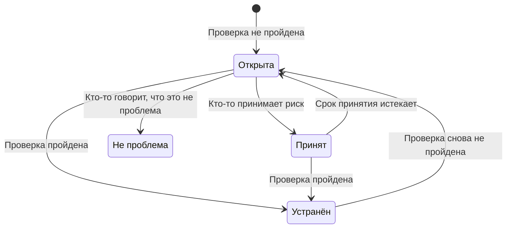

# Проверки и проблемы Безопасности данных

Безопасность данных выполняет 32 проверки для каждого хранилища, разделённые на девять групп. Проверка читает то, что известно об одном хранилище, — как оно настроено, что в нём найдено, кто имеет к нему доступ, где оно находится, — и проходит, не проходит или не может определить результат. Непройденная проверка открывает одну проблему в этом хранилище, и проблема закрывается сама, как только проверка проходит. На этой странице перечислены все проверки, описано, как вычисляются серьёзность и оценка риска проблемы и что происходит с проблемой на протяжении её жизни.

:::cards
- [Как проверка принимает решение](#как-проверка-принимает-решение): Пройдена, не пройдена или нельзя определить, и насколько серьёзен провал.
- [Все проверки](#все-проверки): Все 32, с тем, что проверяет каждая и как это исправить.
- [Оценка риска](#оценка-риска): Как упорядочиваются проблемы внутри одной серьёзности.
- [Что происходит с проблемой](#что-происходит-с-проблемой): Открыта, устранена, принята, не проблема.
- [Исправить отсюда](#исправить-отсюда): Заблокируйте публичный бакет или прекратите общий доступ к снимку одним щелчком.
:::

## Как проверка принимает решение

Каждая проверка читает факты о хранилище и отвечает одним из четырёх способов:

| Ответ | Что это значит | Что происходит с проблемой |
| --- | --- | --- |
| Пройдена | Проверка не находит ничего неправильного. | Открытая или принятая проблема устраняется. |
| Не пройдена | Проверка находит проблему и одним предложением говорит, что увидела: это доказательство проблемы. | Открывается проблема, или уже открытая обновляется. |
| Нельзя определить | Факт не удалось прочитать: у роли нет разрешения, вызов завершился ошибкой. | Ничего не меняется: открытая проблема остаётся открытой, потому что никто не должен заключать, что проблема устранена, когда OneUptime не смог посмотреть. |
| Неприменимо | У хранилища такого вида нет такой настройки. | Открытая проблема устраняется. |

### Серьёзность зависит от данных

Одна и та же проблема важнее на более конфиденциальных данных. Каждая проверка задаёт серьёзность для каждого уровня чувствительности, и проблема получает ту, что соответствует её хранилищу: публичный бакет с номерами карт получает уровень «Критический», а публичный бакет с изображениями сайта — лишь «Низкий». Прочерк означает, что проблемы нет вовсе. Чувствительность хранилища определяется его находками (см. [Типы конфиденциальных данных](/docs/data-security/data-types#чувствительность)), поэтому образцы содержимого делают серьёзность правильной.

Несколько проверок вместо этого задают серьёзность по тому, что увидели. **В нём хранятся секреты** получает уровень «Высокий» в любом хранилище и «Критический» в хранилище, которое публично или открыто другим аккаунтам.

## Все проверки

Серьёзность указана для данных с чувствительностью «Ограниченный», «Конфиденциальный», «Внутренний» и «Публичный», в таком порядке. Страница каждой проблемы показывает полное исправление для её хранилища — шаги в консоли, команду CLI и, где уместно, Terraform — с уже подставленными именем и регионом хранилища.

### Доступность извне

| Проверка | Где выполняется | Что проверяет | Серьёзность | Как исправить |
| --- | --- | --- | --- | --- |
| Кто угодно в интернете может его читать (`public-read`) | Объектное хранилище, аналитическое хранилище, поиск | Политика, ACL или привязки IAM хранилища позволяют кому угодно читать его данные без входа. | Критический / Критический / Высокий / Низкий | Удалите все разрешения для анонимных субъектов и для всех прошедших аутентификацию. Файлам, которые должны быть публичными, место в хранилище с отметкой **Публичный намеренно**, где больше ничего нет. |
| Кто угодно в интернете может его изменить (`public-write`) | Объектное хранилище, аналитическое хранилище, поиск | Политика, ACL или привязки IAM хранилища позволяют кому угодно записывать или удалять его данные. | Критический / Критический / Критический / Высокий | Удалите все разрешения на запись или удаление для анонимных субъектов и для всех прошедших аутентификацию. |
| Публичный доступ не заблокирован (`public-access-not-blocked`) | AWS S3 Bucket | S3 Block Public Access включён не полностью для бакета или его аккаунта, поэтому одно изменение политики может сделать его публичным. | Высокий / Средний / Низкий / — | Включите для бакета все четыре настройки Block Public Access. |
| База данных принимает подключения из интернета (`internet-reachable`) | База данных, аналитическое хранилище, поиск, кэш | У базы данных включён публичный эндпоинт или публичный сетевой доступ. | Высокий / Высокий / Средний / Низкий | Отключите публичный эндпоинт и подключайтесь к базе данных через частную сеть или бастион. |
| Его брандмауэр пропускает любые адреса (`open-to-all-addresses`) | База данных, аналитическое хранилище, поиск, кэш | Правило брандмауэра или авторизованная сеть разрешает 0.0.0.0/0 или весь диапазон адресов. | Критический / Критический / Высокий / Средний | Замените правило «разрешить всё» адресами или сетями, которым нужен доступ. |
| Его снимок может восстановить кто угодно (`snapshot-public`) | База данных, снимок | Снимок базы данных открыт публично, поэтому любой облачный аккаунт может восстановить его полную копию. | Критический / Критический / Критический / Высокий | Сделайте снимок приватным. |
| Его снимок открыт другим аккаунтам (`snapshot-shared-externally`) | База данных, снимок | Снимок базы данных открыт аккаунтам за пределами подключённых вами. | Высокий / Высокий / Средний / Низкий | Прекратите общий доступ к снимку для аккаунтов, у которых его быть не должно. |
| К нему имеют доступ аккаунты за пределами вашей организации (`shared-with-external-accounts`) | Все хранилища, кроме телеметрии | Политика хранилища даёт доступ аккаунтам, клиентам или проектам, которые не подключены к OneUptime. | Высокий / Высокий / Средний / Низкий | Проверьте каждого внешнего субъекта и удалите тех, кому доступ не нужен. |

### Шифрование

| Проверка | Где выполняется | Что проверяет | Серьёзность | Как исправить |
| --- | --- | --- | --- | --- |
| Его данные не зашифрованы при хранении (`not-encrypted-at-rest`) | Все хранилища, кроме телеметрии | Шифрование хранилища выключено. | Высокий / Средний / Низкий / — | Включите шифрование при хранении. Экземпляр RDS нельзя зашифровать на месте: восстановите зашифрованную копию из его снимка. |
| Данные уровня «Ограниченный» не защищены вашим собственным ключом (`no-customer-managed-key`) | Все хранилища, кроме телеметрии | В хранилище лежат данные уровня «Ограниченный», но оно зашифровано ключом поставщика по умолчанию, а не ключом, которым управляет клиент. | Средний / — / — / — | Зашифруйте хранилище ключом, которым вы управляете в своём сервисе ключей. |
| Разрешены незашифрованные подключения (`encryption-in-transit-not-enforced`) | Все хранилища, кроме телеметрии | Хранилище принимает подключения без TLS. | Высокий / Средний / Низкий / — | Требуйте TLS для каждого подключения. В S3 запретите все запросы, где `aws:SecureTransport` равно false. |
| Оно принимает TLS старше 1.2 (`weak-tls`) | Все хранилища, кроме телеметрии | Минимальная версия TLS — 1.0 или 1.1. | Средний / Средний / Низкий / — | Задайте минимальную версию TLS 1.2 или выше. |

### Восстановление

| Проверка | Где выполняется | Что проверяет | Серьёзность | Как исправить |
| --- | --- | --- | --- | --- |
| У него нет резервных копий или они хранятся меньше 7 дней (`no-backups`) | База данных, аналитическое хранилище | Автоматическое резервное копирование выключено, или копии хранятся меньше 7 дней. | Высокий / Средний / Низкий / — | Включите автоматическое резервное копирование и храните копии не меньше 7 дней. |
| Восстановление на момент времени выключено (`no-point-in-time-recovery`) | AWS DynamoDB Table, Azure Cosmos DB Account | Таблицу или базу данных нельзя восстановить на момент до ошибки. | Средний / Низкий / — / — | Включите восстановление на момент времени. |
| Его можно удалить за один шаг (`deletion-protection-off`) | База данных, аналитическое хранилище | Защита от удаления выключена. | Средний / Низкий / — / — | Включите защиту от удаления. |
| Удалённые или перезаписанные файлы нельзя восстановить (`deleted-data-not-recoverable`) | Объектное хранилище | Версионирование и мягкое удаление выключены. | Средний / Низкий / — / — | Включите версионирование или мягкое удаление. |

### Видимость

| Проверка | Где выполняется | Что проверяет | Серьёзность | Как исправить |
| --- | --- | --- | --- | --- |
| Никто не узнает, кто его читал (`access-not-logged`) | Все хранилища, кроме телеметрии | Чтение хранилища не журналируется: нет ни журналов доступа, ни журналов аудита доступа к данным. | Высокий / Средний / Низкий / — | Включите журналирование доступа или аудита для чтения: журналы доступа к серверу S3 или события данных CloudTrail, диагностические журналы StorageRead в Azure, журналы аудита Data Access в Cloud Storage. |

### Доступ

| Проверка | Где выполняется | Что проверяет | Серьёзность | Как исправить |
| --- | --- | --- | --- | --- |
| Любой, у кого есть ключ аккаунта, может читать всё (`shared-key-access`) | Azure Storage Account | Учётная запись хранения разрешает доступ по общему ключу, который обходит Microsoft Entra ID и не оставляет персонального журнала аудита. | Средний / Низкий / — / — | Переведите приложения на Microsoft Entra ID, затем отключите доступ по ключу учётной записи хранения. |
| Объекты могут иметь собственные правила доступа (`object-acls-enabled`) | AWS S3 Bucket, Google Cloud Storage Bucket | ACL объектов включены, поэтому один объект можно сделать публичным, пока бакет выглядит приватным. | Низкий / Низкий / — / — | В S3 задайте для Object Ownership значение Bucket owner enforced. В Cloud Storage включите uniform bucket-level access. |
| Больше 25 субъектов могут читать данные уровня «Ограниченный» (`many-readers`) | Все хранилища, кроме телеметрии | Доступ на чтение к хранилищу есть у большего числа субъектов, чем большинство команд в состоянии проверить. | Средний / — / — / — | Откройте страницу **Кто имеет доступ** хранилища и удалите неиспользуемый доступ или доступ шире, чем нужно. |

### Гигиена данных

| Проверка | Где выполняется | Что проверяет | Серьёзность | Как исправить |
| --- | --- | --- | --- | --- |
| В нём хранятся секреты (`secrets-stored`) | Все хранилища, кроме телеметрии | В данных хранилища найдены пароли, ключи API, токены или закрытые ключи. | Высокий / Высокий / Высокий / Высокий | Смените каждый найденный секрет, как утёкший. Перенесите секреты в менеджер секретов и удалите их из хранилища. |
| Хранятся коды безопасности карт (`card-security-codes-stored`) | Все хранилища, кроме телеметрии | Найдены коды CVV или CVC. PCI DSS запрещает хранить их после авторизации платежа, в зашифрованном виде или нет. | Критический / Критический / Критический / Критический | Остановите код, который их записывает, удалите сохранённые коды и проверьте, что их не осталось в резервных копиях. |
| Номера карт хранятся в читаемом виде (`card-numbers-readable`) | Все хранилища, кроме телеметрии | Найдены полные номера карт в читаемом виде. PCI DSS требует, чтобы они были нечитаемыми везде, где хранятся. | Высокий / Высокий / Высокий / Высокий | Токенизируйте номера карт у своего платёжного провайдера или зашифруйте их на уровне полей и удалите читаемые копии. |
| Пароли хранятся в открытом виде (`plaintext-passwords`) | Все хранилища, кроме телеметрии | Поле пароля содержит значения, которые не являются хешами паролей (bcrypt, argon2, scrypt или PBKDF2). | Критический / Критический / Критический / Критический | Хешируйте пароли с помощью bcrypt, scrypt или argon2, перенесите сохранённые и заставьте каждый аккаунт сбросить пароль. |
| Продакшен-данные скопированы в непродакшен-хранилище (`production-data-in-non-production`) | Все хранилища, кроме телеметрии | Значения, найденные в продакшен-хранилище, найдены и здесь, в хранилище разработки, тестирования или staging. | Высокий / Средний / — / — | Замените копию замаскированными или синтетическими данными и удалите реальные данные из непродакшен-хранилища. |
| Конфиденциальные данные, которыми никто не пользовался 90 дней (`stale-sensitive-data`) | Все хранилища, кроме телеметрии | В хранилище лежат конфиденциальные данные, и за 90 дней не было ни чтений, ни записей. | Средний / Низкий / — / — | Убедитесь, что данные больше не нужны, затем заархивируйте их с датой окончания хранения или удалите. |
| У этого конфиденциального хранилища нет владельца (`no-owner`) | Все хранилища | В хранилище лежат конфиденциальные данные, и у него нет владельца. | Средний / Низкий / — / — | Добавьте владельца на странице **Владельцы** хранилища или правило владельца, которое совпадает с его тегами. |

### Телеметрия

| Проверка | Где выполняется | Что проверяет | Серьёзность | Как исправить |
| --- | --- | --- | --- | --- |
| Конфиденциальные данные попадают в вашу телеметрию (`sensitive-data-in-telemetry`) | Телеметрия | Журналы, трассировки, исключения, записи сеансов или разговоры с ИИ содержат конфиденциальные данные, которые не маскирует ни одно правило очистки. | Высокий / Средний / Низкий / — | Нажмите **Очистить** у каждой находки, чтобы маскировать данные при приёме, затем исправьте код, который их записывает. |
| Секреты попадают в вашу телеметрию (`secrets-in-telemetry`) | Телеметрия | Пароли, ключи API или токены появляются в журналах, трассировках, исключениях или разговорах с ИИ. | Критический / Критический / Критический / Критический | Сначала смените секрет, затем нажмите **Очистить** и исправьте код, который его записывает. |

### Размещение данных

| Проверка | Где выполняется | Что проверяет | Серьёзность | Как исправить |
| --- | --- | --- | --- | --- |
| Данные хранятся за пределами регионов, где им разрешено находиться (`residency-violation`) | Все хранилища, кроме телеметрии | Регион хранилища или регион, в который реплицируются его данные, нарушает правило размещения данных. | Высокий / Высокий / Средний / — | Перенесите данные в разрешённый регион или прекратите их копирование в другой. Если передача законна, примите проблему и запишите почему. |

### ИИ

| Проверка | Где выполняется | Что проверяет | Серьёзность | Как исправить |
| --- | --- | --- | --- | --- |
| Конфиденциальные данные отправляются поставщику ИИ (`sensitive-data-to-ai`) | Разговоры с ИИ | Разговоры с ИИ, записанные в OneUptime, передают конфиденциальные данные поставщику модели. | Критический / Высокий / Низкий / — | Удаляйте конфиденциальные значения до отправки промптов или отправляйте эти вызовы в модель, которую размещаете сами. |
| Данные уровня «Ограниченный» лежат в хранилище для ИИ (`sensitive-data-in-ai-store`) | Все хранилища, кроме телеметрии | В хранилище с тегом данных для обучения или поиска ИИ лежат данные уровня «Ограниченный». | Высокий / Средний / — / — | Удалите или замаскируйте данные уровня «Ограниченный», прежде чем их используют для обучения модели или как источник для её ответов. |

## Оценка риска

Серьёзность говорит, насколько плоха проблема. Оценка риска от 0 до 100 упорядочивает проблемы одной серьёзности по тому, что делает ту же проблему хуже:

```text
risk = severity + 10 × exposure + 6 × volume + 5 × activity + 4 × production, at most 100
```

| Фактор | Баллы |
| --- | --- |
| Серьёзность | 75 за Критический, 50 за Высокий, 25 за Средний, 0 за Низкий |
| Доступность извне | 10 за Публичный, 8 за Другие аккаунты, 6 за Доступно из интернета, 3 за Неизвестно, 0 за Приватный |
| Объём | До 6, по оценочному числу конфиденциальных записей хранилища по логарифмической шкале: 1 за 10 записей, 3 за 1000, 5 за миллион, 6 за десять миллионов и больше |
| Активность | 5, если Security Operations видела обнаружения в хранилище за последнюю неделю |
| Продакшен | 4 за хранилище в продакшене |

Дополнительные факторы добавляют не больше 25 баллов, поэтому проблема никогда не получает оценку ниже, чем проблема более низкой серьёзности. Публичный продакшен-бакет с миллионом записей данных уровня «Ограниченный» получает 75 + 10 + 5 + 4 = 94 за критическую проблему. Каждая проблема перечисляет факторы, которые добавили баллы к её оценке, с их баллами, а хранилище показывает оценку своей худшей открытой проблемы.

Окружение хранилища — Продакшен, Staging, Development, Test или Неизвестно — определяется по его тегам (`env`, `environment`, `stage`, `tier` и подобным) или, если их нет, по словам в его имени, например `prod`, `staging`, `dev` или `qa`. Задайте его в хранилище, когда ни то ни другое ничего не говорит.

## Что происходит с проблемой



OneUptime открывает, обновляет и устраняет проблемы по мере выполнения проверок. От человека требуется решить, что будет с проблемой дальше:

| Статус | Как она туда попадает | Что дальше |
| --- | --- | --- |
| **Открыта** | Её проверка сейчас не проходит в хранилище. | Она учитывается в Обзоре, в сводке хранилища и в соответствии требованиям, пока проверка не пройдёт. |
| **Устранён** | Её проверка прошла при одном из следующих запусков, больше неприменима или была выключена. Человек также может выбрать **Отметить как устранённое**: тогда хранилище сразу проверяется снова. | Она открывается снова, если проверка снова не проходит, и проблема считает, сколько раз она открывалась повторно. |
| **Принят** | Человек выбрал **Принять риск**, заполнив поле **Причина** и указав дату в **Принят до**, не дальше чем через год. | Она остаётся закрытой до этой даты, а затем открывается снова, если проверка всё ещё не проходит. Тогда примите её снова, если причина всё ещё актуальна. |
| **Не проблема** | Человек выбрал **Не проблема**: находка была ошибочной. | Она остаётся закрытой, даже пока проверка не проходит. **Открыть снова** возвращает её в статус Открыта. |

Роли Security Member, Security Admin, Project Admin и Project Owner могут менять статус проблемы и **Назначить** её человеку или команде. Каждое изменение записывается в **Хронология** проблемы: когда она открылась, каждое изменение серьёзности, каждое изменение статуса и кто его сделал, запрошенные повторные проверки и что сделали интеграции.

Проблема, которая открывается снова, сохраняет свою историю. Принятые риски пересматриваются каждый день, поэтому срок принятия истекает вовремя, даже если ничего не сканировалось.

## Исправить отсюда

Открытую проблему о публичном бакете или снимке с общим доступом можно исправить с её страницы. Над шагами в консоли **Исправить отсюда** предлагает изменение, которое её исправляет:

| Проблема | Её хранилище | Кнопка | Что она меняет |
| --- | --- | --- | --- |
| `public-read`, `public-write` или `public-access-not-blocked` | Бакет S3, учётная запись хранения Azure или бакет Cloud Storage | **Заблокировать публичный доступ** | Включает четыре настройки Block Public Access бакета, отключает анонимный доступ к BLOB-объектам учётной записи хранения или принудительно включает для бакета предотвращение публичного доступа |
| `snapshot-public` или `snapshot-shared-externally` | Снимок RDS, база данных RDS или кластер Aurora или DocumentDB | **Отозвать общий доступ** | Прекращает общий доступ к снимку или к каждому общему ручному снимку базы данных для всех и для аккаунтов за пределами подключённых вами |

Сначала она запрашивает подтверждение и говорит, что изменится и что перестанет работать. Она меняет то, как к хранилищу открыт доступ, но никогда не его данные, и ничего не меняет там, где доступ уже закрыт. Хранилище с отметкой **Публичный намеренно** никогда не блокируется.

Она действует через облачное подключение хранилища, поэтому в подключении должно быть включено **Реагирование безопасности данных** и заново выполнена команда настройки (см. [Настройка Безопасности данных](/docs/data-security/setup#позвольте-безопасности-данных-закрывать-доступ-извне)). До этого панель говорит, что нужно включить. Сразу после изменения хранилище проверяется снова, и проблема устраняется сама, как только её проверка проходит. **Хронология** проблемы и **Хронология** хранилища показывают, что было сделано и кем.

## Настройки проверок

**Безопасность данных → Настройки → Проверки** перечисляет все проверки по группам с тем, что каждая ищет, и серьёзностью, которую получает провал для каждой чувствительности. Каждую проверку можно настроить для проекта, и каждое изменение сразу сохраняется:

- **Её переключатель** выключает проверку, если она не подходит к вашему способу работы. Её открытые и принятые проблемы устраняются и сообщают, что проверка больше не выполняется.
- **Её серьёзность** по умолчанию — **По чувствительности**, либо одна серьёзность, которую получает каждый провал проверки, что бы ни лежало в хранилище.

Чтобы заглушить проверку только для одного хранилища, примите риск по проблеме этого хранилища или отметьте проблему как «не проблема». Если ошибочна находка, а не проблема несущественна, вместо этого отметьте находку как неконфиденциальную (см. [Типы конфиденциальных данных](/docs/data-security/data-types#неконфиденциальное-и-никогда-не-конфиденциальное)).

**Проверить сейчас** в хранилище заново читает его конфигурацию и выполняет его проверки. **Сканировать сейчас** берёт образцы его содержимого, а его проверки выполняются по окончании сканирования.

## Дальнейшие шаги

:::cards
- [Интеграции Безопасности данных](/docs/data-security/integrations): Кейсы безопасности, оповещения и письма владельцам при открытии проблемы.
- [Потоки данных, доступ и размещение](/docs/data-security/flows-access-residency): Доступ, копии и регионы, которые читают несколько проверок.
- [Соответствие требованиям Безопасности данных](/docs/data-security/compliance): Требования стандартов, для которых каждая проверка служит доказательством.
:::
