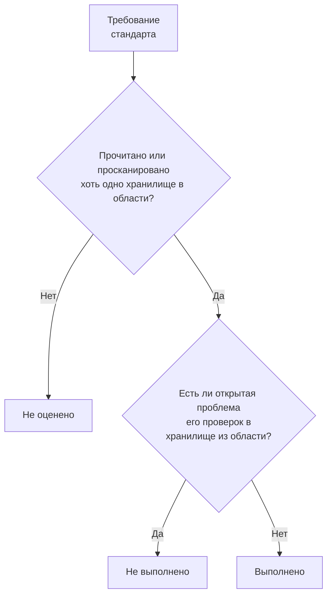

# Соответствие требованиям в Безопасности данных

Безопасность данных оценивает девять стандартов соответствия по тому, что нашли её сканирования. Каждый стандарт охватывает хранилища, к которым относятся его правила (GDPR — хранилища с персональными данными, PCI DSS — хранилища, где найдены данные карт, SOC 2 — все хранилища), а каждое его требование выполняется или не выполняется по проверкам, которые служат для него доказательствами. **Безопасность данных → Соответствие требованиям** показывает оценку каждого стандарта, сколько хранилищ он охватывает и каждое требование с числом открытых проблем, из-за которых оно не выполняется. Оценка — это доказательство для аудита, а не сертификат: она говорит о том, что OneUptime видит в хранилищах, которые читает.

:::cards
- [Стандарты](#стандарты): Девять стандартов и хранилища, которые охватывает каждый из них.
- [Как оценивается стандарт](#как-оценивается-стандарт): Выполненные, невыполненные и неоценённые требования.
- [Требования и их проверки](#требования-и-их-проверки): Каждое требование и проверки, которые служат для него доказательствами.
- [Реестр обработки](#реестр-обработки): Статья 30 GDPR, составленная по вашим хранилищам.
:::

## Стандарты

| Стандарт | Полное название | Хранилища в области действия |
| --- | --- | --- |
| GDPR | Общий регламент ЕС по защите данных | Хранилища с персональными данными. |
| CCPA | Закон Калифорнии о защите конфиденциальности потребителей с поправками CPRA | Хранилища с личной информацией. |
| HIPAA | Правило безопасности HIPAA | Хранилища с медицинскими данными. |
| PCI DSS | PCI DSS v4.0 | Хранилища, в которых найдены номера карт. |
| SOC 2 | Критерии доверия к сервисам SOC 2 | Все хранилища данных. |
| ISO 27001 | ISO/IEC 27001:2022 | Все хранилища данных. |
| NIST CSF | Структура кибербезопасности NIST 2.0 | Все хранилища данных. |
| LGPD | Общий закон Бразилии о защите данных | Хранилища с персональными данными людей в Бразилии. |
| DPDP | Закон Индии о защите цифровых персональных данных 2023 года | Хранилища с персональными данными людей в Индии. |

## Какие хранилища охватывает стандарт

Область действия для хранилища зависит от найденных в нём данных, поэтому она меняется по мере того, как сканирования находят больше:

- **SOC 2, ISO 27001 и NIST CSF** — стандарты безопасности: они охватывают каждое хранилище, что бы в нём ни было.
- **GDPR, CCPA, HIPAA и PCI DSS** охватывают хранилища, в которых есть тип данных, который они защищают. Персональные данные добавляют GDPR и CCPA, медицинские данные — ещё и HIPAA, а номера карт, коды безопасности карт и сроки действия карт — PCI DSS. Хранилище, где есть только секреты или деловые документы, не входит ни в один из них.
- **LGPD и DPDP** — собственные законы стран: они охватывают хранилища с персональными данными людей в Бразилии или в Индии, что определяется по типам данных, относящимся к этой стране, например бразильскому CPF или индийскому номеру Aadhaar.

[Типы конфиденциальных данных](/docs/data-security/data-types#встроенные-типы-данных) перечисляет каждый тип данных с его страной.

## Как оценивается стандарт

- **Требование выполняется**, когда ни одна открытая проблема сопоставленных с ним проверок не находится в хранилище из области действия стандарта, и **не выполняется**, когда такая проблема есть.
- **Оно не оценивается**, пока ни у одного хранилища в области не прочитана конфигурация и не просканировано содержимое.
- **Два требования выполняет сама Безопасность данных**: статья 30 GDPR, записи о деятельности по обработке, и A.5.12 ISO 27001, классификация информации. Они выполняются, как только каждое хранилище в области прочитано или просканировано, и не выполняются, пока хоть одно из них не прочитано.
- **Оценка** — это доля выполненных требований среди оценённых требований стандарта в целых процентах. У стандарта, у которого ничего не оценено, оценки нет.

Учитываются только открытые проблемы. Проблема, риск которой принят или которая отмечена как не проблема, не делает свои требования невыполненными, поэтому принятый риск — это решение, которое ваш аудит видит в проблеме: кто его принял, почему и до какого срока.

## Требования и их проверки

### GDPR

| Требование | Что требует | Проверки |
| --- | --- | --- |
| Ст. 5(1)(c) | Минимизация данных | `production-data-in-non-production`, `stale-sensitive-data`, `sensitive-data-in-telemetry`, `sensitive-data-to-ai`, `sensitive-data-in-ai-store` |
| Ст. 5(1)(e) | Ограничение хранения | `stale-sensitive-data` |
| Ст. 25 | Защита данных при проектировании и по умолчанию | `production-data-in-non-production`, `stale-sensitive-data`, `sensitive-data-in-telemetry`, `sensitive-data-to-ai`, `sensitive-data-in-ai-store` |
| Ст. 28 | Обработчики | `sensitive-data-to-ai` |
| Ст. 30 | Записи о деятельности по обработке | Выполняет сама Безопасность данных |
| Ст. 32 | Безопасность обработки | `public-read`, `public-write`, `public-access-not-blocked`, `internet-reachable`, `open-to-all-addresses`, `snapshot-public`, `snapshot-shared-externally`, `shared-with-external-accounts`, `not-encrypted-at-rest`, `no-customer-managed-key`, `encryption-in-transit-not-enforced`, `weak-tls`, `no-backups`, `no-point-in-time-recovery`, `deletion-protection-off`, `deleted-data-not-recoverable`, `access-not-logged`, `shared-key-access`, `object-acls-enabled`, `many-readers`, `secrets-stored`, `plaintext-passwords`, `secrets-in-telemetry` |
| Ст. 44-49 | Передача в третьи страны | `residency-violation` |

### CCPA

| Требование | Что требует | Проверки |
| --- | --- | --- |
| 1798.100(c) | Сбор ограничен необходимым | `production-data-in-non-production`, `stale-sensitive-data`, `sensitive-data-in-telemetry`, `sensitive-data-to-ai`, `sensitive-data-in-ai-store` |
| 1798.150 | Разумные процедуры безопасности | `public-read`, `public-write`, `public-access-not-blocked`, `internet-reachable`, `open-to-all-addresses`, `snapshot-public`, `snapshot-shared-externally`, `shared-with-external-accounts`, `shared-key-access`, `object-acls-enabled`, `many-readers` |

### HIPAA

| Требование | Что требует | Проверки |
| --- | --- | --- |
| 164.308(a)(7) | План действий в чрезвычайных ситуациях | `no-backups`, `no-point-in-time-recovery`, `deletion-protection-off`, `deleted-data-not-recoverable` |
| 164.312(a)(1) | Управление доступом | `public-read`, `public-write`, `public-access-not-blocked`, `internet-reachable`, `open-to-all-addresses`, `snapshot-public`, `snapshot-shared-externally`, `shared-with-external-accounts`, `shared-key-access`, `object-acls-enabled`, `many-readers` |
| 164.312(a)(2)(iv) | Шифрование и расшифровка | `not-encrypted-at-rest`, `no-customer-managed-key` |
| 164.312(b) | Средства аудита | `access-not-logged` |
| 164.312(e)(1) | Безопасность передачи | `encryption-in-transit-not-enforced`, `weak-tls` |

### PCI DSS

| Требование | Что требует | Проверки |
| --- | --- | --- |
| 3.3.1 | Конфиденциальные данные аутентификации не хранятся после авторизации | `card-security-codes-stored` |
| 3.4.1 | Номера карт маскируются при отображении | `card-numbers-readable`, `sensitive-data-in-telemetry` |
| 3.5.1 | Номера карт нечитаемы везде, где они хранятся | `not-encrypted-at-rest`, `no-customer-managed-key`, `card-numbers-readable` |
| 4.2.1 | Стойкая криптография защищает данные карт при передаче | `encryption-in-transit-not-enforced`, `weak-tls` |
| 7.2 | Доступ определяется и предоставляется по необходимости | `public-read`, `public-write`, `public-access-not-blocked`, `internet-reachable`, `open-to-all-addresses`, `snapshot-public`, `snapshot-shared-externally`, `shared-with-external-accounts`, `shared-key-access`, `object-acls-enabled`, `many-readers` |
| 8.3.2 | Факторы аутентификации нечитаемы при хранении | `plaintext-passwords` |
| 10.2 | Журналы аудита фиксируют доступ к данным карт | `access-not-logged` |

### SOC 2

| Требование | Что требует | Проверки |
| --- | --- | --- |
| A1.2 | Резервное копирование и восстановление | `no-backups`, `no-point-in-time-recovery`, `deletion-protection-off`, `deleted-data-not-recoverable` |
| CC6.1 | Безопасность логического доступа | `public-read`, `public-write`, `public-access-not-blocked`, `internet-reachable`, `open-to-all-addresses`, `snapshot-public`, `snapshot-shared-externally`, `shared-with-external-accounts`, `not-encrypted-at-rest`, `no-customer-managed-key`, `shared-key-access`, `object-acls-enabled`, `many-readers`, `secrets-stored`, `plaintext-passwords`, `secrets-in-telemetry` |
| CC6.7 | Передача информации | `encryption-in-transit-not-enforced`, `weak-tls` |
| CC7.2 | Мониторинг компонентов системы | `access-not-logged` |

### ISO 27001

| Требование | Что требует | Проверки |
| --- | --- | --- |
| A.5.9 | Инвентаризация информации и других связанных активов | `no-owner` |
| A.5.12 | Классификация информации | Выполняет сама Безопасность данных |
| A.5.15 | Управление доступом | `public-read`, `public-write`, `public-access-not-blocked`, `internet-reachable`, `open-to-all-addresses`, `snapshot-public`, `snapshot-shared-externally`, `shared-with-external-accounts`, `shared-key-access`, `object-acls-enabled`, `many-readers` |
| A.5.34 | Конфиденциальность и защита PII | `production-data-in-non-production`, `stale-sensitive-data`, `sensitive-data-in-telemetry`, `sensitive-data-to-ai`, `sensitive-data-in-ai-store` |
| A.8.11 | Маскирование данных | `production-data-in-non-production`, `stale-sensitive-data`, `sensitive-data-in-telemetry`, `sensitive-data-to-ai`, `sensitive-data-in-ai-store` |
| A.8.12 | Предотвращение утечки данных | `secrets-stored`, `secrets-in-telemetry` |
| A.8.13 | Резервное копирование информации | `no-backups`, `no-point-in-time-recovery`, `deletion-protection-off`, `deleted-data-not-recoverable` |
| A.8.15 | Ведение журналов | `access-not-logged` |
| A.8.24 | Использование криптографии | `not-encrypted-at-rest`, `no-customer-managed-key`, `encryption-in-transit-not-enforced`, `weak-tls`, `plaintext-passwords` |

### NIST CSF

| Требование | Что требует | Проверки |
| --- | --- | --- |
| ID.AM-07 | Ведутся реестры данных и метаданных | `no-owner` |
| PR.AA-05 | Разрешения на доступ управляются | `public-read`, `public-write`, `public-access-not-blocked`, `internet-reachable`, `open-to-all-addresses`, `snapshot-public`, `snapshot-shared-externally`, `shared-with-external-accounts`, `shared-key-access`, `object-acls-enabled`, `many-readers` |
| PR.DS-01 | Данные при хранении защищены | `not-encrypted-at-rest`, `no-customer-managed-key`, `secrets-stored`, `secrets-in-telemetry` |
| PR.DS-02 | Данные при передаче защищены | `encryption-in-transit-not-enforced`, `weak-tls` |
| PR.DS-11 | Резервные копии данных создаются и проверяются | `no-backups`, `no-point-in-time-recovery`, `deletion-protection-off`, `deleted-data-not-recoverable` |
| DE.CM-09 | Данные и их использование отслеживаются | `access-not-logged` |

### LGPD

| Требование | Что требует | Проверки |
| --- | --- | --- |
| Ст. 6 | Необходимость и ограничение цели | `production-data-in-non-production`, `stale-sensitive-data`, `sensitive-data-in-telemetry`, `sensitive-data-to-ai`, `sensitive-data-in-ai-store` |
| Ст. 33 | Международная передача данных | `residency-violation` |
| Ст. 46 | Меры безопасности | `public-read`, `public-write`, `public-access-not-blocked`, `internet-reachable`, `open-to-all-addresses`, `snapshot-public`, `snapshot-shared-externally`, `shared-with-external-accounts`, `not-encrypted-at-rest`, `no-customer-managed-key`, `shared-key-access`, `object-acls-enabled`, `many-readers` |

### DPDP

| Требование | Что требует | Проверки |
| --- | --- | --- |
| Разд. 8(5) | Разумные меры защиты | `public-read`, `public-write`, `public-access-not-blocked`, `internet-reachable`, `open-to-all-addresses`, `snapshot-public`, `snapshot-shared-externally`, `shared-with-external-accounts`, `not-encrypted-at-rest`, `no-customer-managed-key`, `shared-key-access`, `object-acls-enabled`, `many-readers` |
| Разд. 8(7) | Удаление, когда цель достигнута | `production-data-in-non-production`, `stale-sensitive-data`, `sensitive-data-in-telemetry`, `sensitive-data-to-ai`, `sensitive-data-in-ai-store` |
| Разд. 16 | Передача за пределы Индии | `residency-violation` |

## Реестр обработки

Статья 30 GDPR требует вести записи о деятельности по обработке. Безопасность данных составляет ту их часть, которая касается того, где хранятся персональные данные: по одной строке на каждое хранилище с персональными данными.

| Столбец | Откуда берётся |
| --- | --- |
| Хранилище, вид, поставщик и регион | Discovery |
| Окружение | Теги или имя хранилища либо то, что задали вы |
| Чувствительность, категории и типы данных | То, что нашли сканирования, или чувствительность, которую задали вы |
| Владельцы | Владельцы хранилища: люди и участники его команд |
| Цель | То, что вы пишете в поле **Цель** хранилища: зачем в нём персональные данные |
| Хранение | То, что вы пишете в поле **Хранение** хранилища: как долго в нём хранятся данные |
| Стандарты | Стандарты, которые его типы данных включают в область действия |

Заполните **Цель** и **Хранение** в разделе **Настройки** каждого хранилища: этих двух вещей не может узнать ни одно сканирование. Реестр и оценки также отдаёт API Безопасности данных по адресам `/data-security/record-of-processing` и `/data-security/compliance` любому, кто может читать хранилища данных (см. [Интеграции Безопасности данных](/docs/data-security/integrations#api-terraform-и-mcp)).

## Дальнейшие шаги

:::cards
- [Проверки и проблемы Безопасности данных](/docs/data-security/checks-and-issues): Проверки за каждым требованием и как их исправить.
- [Потоки данных, доступ и размещение](/docs/data-security/flows-access-residency): Правила размещения данных для передач по GDPR, LGPD и DPDP.
- [Типы конфиденциальных данных](/docs/data-security/data-types): Типы данных, которые включают хранилище в область действия стандарта.
:::
