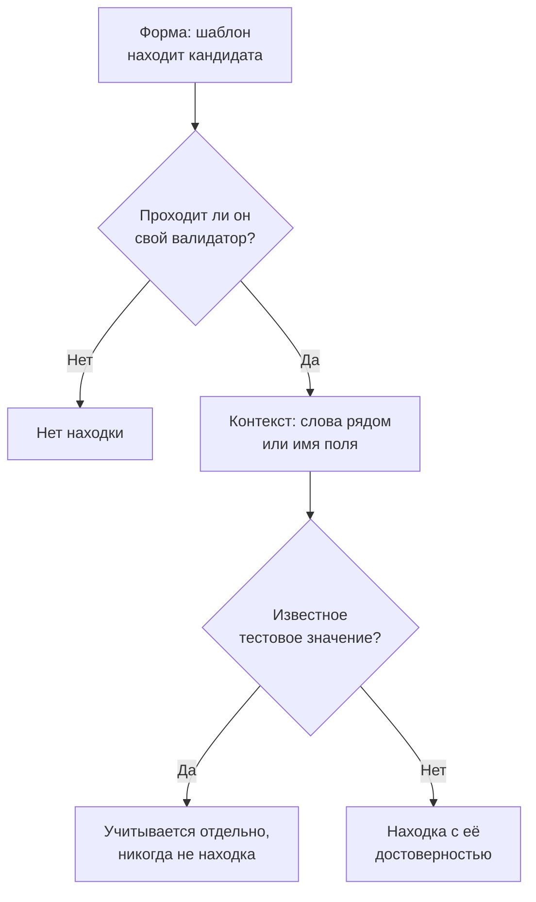

# Типы конфиденциальных данных

Безопасность данных знает 143 вида конфиденциальных данных: номера карт, банковские счета, национальные идентификаторы 43 стран, медицинские идентификаторы, ключи API и токены, а также особые категории персональных данных. У каждого есть категория, чувствительность и, если он относится к одной стране, эта страна. На этой странице сказано, как находится значение, и перечислены все типы данных, чтобы вы могли понять, почему что-то было найдено, и решить, что с этим делать.

:::cards
- [Как находится значение](#как-находится-значение): Форма, валидатор, контекст, тестовые значения, достоверность.
- [Поля и столбцы](#поля-и-столбцы): Как оценивается целый столбец или атрибут.
- [Все типы данных](#встроенные-типы-данных): Все 143, по категориям.
- [Ваши собственные типы данных](#ваши-собственные-типы-данных): Табельные номера, номера полисов и поле «Проверить».
:::

## Как находится значение

Любое сканирование — строки журнала, ячейки CSV, строки базы данных, первых байтов объекта — проходит одни и те же шаги:

1. **Форма.** У каждого типа данных есть шаблоны, которые находят кандидатов: шестнадцать цифр, `AKIA` и шестнадцать букв, слово, `@` и домен. Шаблон никогда не совпадает внутри более длинного токена, поэтому номер карты не находится внутри более длинной последовательности цифр.
2. **Валидатор.** Кандидат должен пройти собственные правила своего типа: контрольную сумму (Luhn для карт, mod 97 для IBAN, Verhoeff для номеров Aadhaar, контрольную цифру большинства национальных идентификаторов), реальную дату, известный префикс, достаточную случайность для секрета. Кандидат, который их не прошёл, вовсе не становится находкой. Заполнители, например `000000000` и `123456789`, не проходят ни один числовой тип.
3. **Контекст.** Слова рядом с кандидатом — по умолчанию до 64 символов перед ним и 32 после него, — которые говорят, что это такое, повышают его достоверность на один уровень, как и поле, имя которого указывает на тип. Слова, которые говорят, что это что-то другое, например номер заказа или трек-номер, понижают её на один уровень. Номер без контрольной суммы и с распространённой формой, например номер паспорта или банковского счёта, учитывается только рядом со словами, которые его называют.
4. **Известные тестовые значения.** Опубликованные тестовые номера карт (например, `4242 4242 4242 4242` от Stripe), примеры IBAN, адреса в `example.com` и других зарезервированных доменах, IP-адреса для документации, образцы идентификаторов, которые печатает государственная документация, ключи тестового режима, например `sk_test_`, и ключи-заполнители учитываются отдельно. Они никогда не дают находку, поэтому хранилище, полное ими, выглядит как тестовое окружение, а не как утечка.
5. **Достоверность.** Всё, что осталось, — это находка, настолько уверенная, насколько позволяют её доказательства.

| Достоверность | Что это значит |
| --- | --- |
| **Высокий** | Значение прошло свой валидатор, и слова вокруг него или поле, в котором оно находится, говорят, что это такое, — или, для поля, большинство его значений относятся к этому типу. |
| **Средний** | Значение прошло свой валидатор, но ничто вокруг не подтверждает его, или имя поля говорит, что в нём хранится, и некоторые значения с этим согласуются. |
| **Низкий** | Форма совпадает, но ничто её не подтверждает. |

Учитываются только находки уровня Высокий и Средний: они делают хранилище конфиденциальным и могут открыть проблему. Находки уровня Низкий перечислены в хранилище в свёрнутом виде, чтобы их оценил человек.

Когда два типа данных претендуют на одни и те же символы, побеждает более уверенная находка: сначала с более высокой достоверностью, затем от детектора, чьи собственные правила доказывают больше, затем с более длинным совпадением.

Длинное значение читается окнами по 64 КБ, которые перекрываются на 4 КБ, поэтому значение находится целиком, где бы оно ни было, а из одного значения читается не больше 4 МБ.

## Поля и столбцы

Столбец, поле JSON или атрибут журнала оценивается целиком. Его имя подсказывает тип данных, а значения из выборки его доказывают. Доля значений, содержащих тип, определяет, насколько уверенна находка:

| Значения, содержащие тип | Достоверность |
| --- | --- |
| 60% или больше | Высокий |
| 25% или больше | Высокий, если имя поля указывает на тип, иначе Средний |
| Меньше | Средний, если имя поля указывает на тип, иначе Низкий: несколько адресов электронной почты в столбце с чем-то другим |

Поле, значения которого в среднем длиннее 80 символов, — это свободный текст: заметки, сообщения, описания, — и от него не ожидается, что оно содержит один тип. Его находки сохраняют ту достоверность, которую каждое совпадение заработало само по себе, и сообщают, что найдены в свободном тексте. Классифицируется до 1000 значений поля и до 16 КБ каждого из них.

Имя поля разбивается на слова — `customerEmail`, `customer_email` и `customer-email` все означают «customer email», — и подсказка имени типа совпадает, когда её слова идут в том же порядке рядом друг с другом: «date of birth» совпадает с `customer_date_of_birth`, но не с `birth_city`. Собственное имя поля — только последняя часть пути через точки, вместе с предыдущей частью, если последняя — общее слово, например `number`, `id` или `value`: `customer.address.city` — не почтовый адрес, а `card.number` — всё ещё номер карты.

Некоторые типы данных нельзя распознать по значениям: никакой шаблон не отличит имя человека от названия улицы или религию от любого другого слова. Они находятся только по имени поля, когда в поле есть значения: Имя человека, Имя пользователя, Пол, Гражданство, Сведения о здоровье, Расовое или этническое происхождение, Религиозные убеждения, Сексуальная ориентация, Политические взгляды, Членство в профсоюзе, Биометрические данные, Генетические данные и Судимость. Имя, имя пользователя, пол или гражданство тогда получают уровень Высокий, когда 60% или больше значений на них похожи, и Средний в остальных случаях.

Поле, имя которого говорит, что в нём хранится пароль, — `password`, `passwordHash`, `pwd`, но не `password_changed_at`, — должно содержать хеш: bcrypt, argon2, scrypt, PBKDF2 или другую схему, которую, скорее всего, использует хранилище. Пустые значения, заполнители, например `********`, и зашифрованные значения откладываются в сторону. Когда среди остальных значений не-хешей больше, чем хешей, в поле хранятся сами пароли, которые не увидит ни один шаблон, и хранилище не проходит проверку [Пароли хранятся в открытом виде](/docs/data-security/checks-and-issues#гигиена-данных).

## Чувствительность

| Чувствительность | Что это значит |
| --- | --- |
| **Ограниченный** | Утечка причинит вред: секреты, номера карт, медицинские записи, государственные идентификаторы. |
| **Конфиденциальный** | Персональные данные и документы с пометкой «конфиденциально». |
| **Внутренний** | Собственные данные компании, не предназначенные для посторонних. |
| **Public** | Ничего конфиденциального не найдено. |

Хранилище настолько конфиденциально, насколько конфиденциален самый чувствительный тип данных, найденный в нём с достоверностью не ниже уровня Средний. Тестовые значения и находки, отмеченные как неконфиденциальные, ничего не значат, а хранилище, в котором ничего не найдено, получает чувствительность «Публичный». Чтобы считать хранилище более или менее конфиденциальным, чем говорят его находки, задайте его чувствительность сами в разделе **Настройки** хранилища: тогда проверки используют её.

## Категории

| Категория | Что она охватывает | Персональные данные |
| --- | --- | --- |
| Секреты и учётные данные | Пароли, ключи API, токены и закрытые ключи, которые открывают доступ к другим системам. | Нет |
| Финансовые данные | Номера карт, банковские счета, IBAN и криптокошельки. | Да |
| Здоровье | Номера медицинских карт, медицинские идентификаторы, диагнозы и рецепты. | Да |
| Государственные идентификаторы | Номера национальных удостоверений личности, налоговые номера, номера паспортов и социального страхования. | Да |
| Особые категории | То, что сильнее всего защищает статья 9 GDPR: этническая принадлежность, религия, сексуальная ориентация, политические взгляды, членство в профсоюзе, биометрические и генетические данные. | Да |
| Контакты и личность | Кто человек и как с ним связаться: адрес электронной почты, телефон, адрес, дата рождения, IP-адрес. | Да |
| Конфиденциальная деловая информация | Документы с пометками «конфиденциально», «только для внутреннего использования» или «адвокатская тайна». | Нет |

Персональные данные — это данные о человеке в том смысле, в каком их понимают GDPR, CCPA, LGPD и DPDP. Хранилище, где лежат только секреты и деловые документы, не входит в область стандартов защиты персональных данных, но всегда входит в область стандартов безопасности (см. [Соответствие требованиям Безопасности данных](/docs/data-security/compliance)).

## Встроенные типы данных

Тип данных, относящийся к одной стране, называет её кодом ISO 3166-1: его читают правила размещения данных и стандарты, привязанные к странам (см. [Размещение данных](/docs/data-security/flows-access-residency#правила-размещения-данных)). ID — это то, по чему тип называют API и находки.

### Контакты и личность

| Тип данных | ID | Что это | Чувствительность | Страна |
| --- | --- | --- | --- | --- |
| Адрес электронной почты | `email-address` | Адрес электронной почты человека. | Конфиденциальный | — |
| Номер телефона | `phone-number` | Номер телефона в международном или национальном формате. | Конфиденциальный | — |
| Имя человека | `person-name` | Имя, фамилия или полное имя человека, найденные по имени поля. | Конфиденциальный | — |
| Почтовый адрес | `postal-address` | Адрес: номер дома, название улицы и тип улицы. | Конфиденциальный | — |
| Почтовый индекс | `postal-code` | Почтовый индекс. Даже сам по себе он сужает место, где живёт человек. | Внутренний | — |
| Дата рождения | `date-of-birth` | Дата рядом со словами, которые говорят, что это чья-то дата рождения. | Конфиденциальный | — |
| IP-адрес | `ip-address` | Публичный адрес IPv4 или IPv6, который GDPR считает персональными данными. | Конфиденциальный | — |
| MAC-адрес | `mac-address` | Аппаратный адрес сетевой карты, который идентифицирует устройство. | Конфиденциальный | — |
| Рекламный идентификатор | `advertising-id` | Мобильный рекламный идентификатор (IDFA, GAID, AAID), который отслеживает одно устройство. | Конфиденциальный | — |
| Точное местоположение | `geolocation` | Широта и долгота, достаточно точные, чтобы найти здание. | Конфиденциальный | — |
| Имя пользователя | `username` | Имя для входа или имя учётной записи человека, найденное по имени поля. | Конфиденциальный | — |
| Пол | `gender` | Гендер или пол человека, найденный по имени поля. | Конфиденциальный | — |
| Гражданство | `nationality` | Национальность или гражданство человека, найденные по имени поля. | Конфиденциальный | — |
| Идентификационный номер транспортного средства | `vehicle-identification-number` | 17-символьный VIN с правильной контрольной цифрой. | Конфиденциальный | — |

### Государственные идентификаторы

| Тип данных | ID | Что это | Чувствительность | Страна |
| --- | --- | --- | --- | --- |
| Номер социального страхования США | `us-ssn` | Номер социального страхования (Social Security number) США. | Ограниченный | US |
| Идентификатор налогоплательщика США (ITIN) | `us-itin` | Индивидуальный идентификационный номер налогоплательщика США. | Ограниченный | US |
| Идентификатор работодателя США (EIN) | `us-ein` | Идентификационный номер работодателя США рядом со словами, которые на это указывают. | Конфиденциальный | US |
| Номер паспорта США | `us-passport` | Номер паспорта США рядом со словами, которые на это указывают. | Ограниченный | US |
| Номер водительского удостоверения США | `us-drivers-license` | Номер водительского удостоверения США рядом со словами, которые на это указывают. | Ограниченный | US |
| Номер National Insurance Великобритании | `uk-nino` | Номер National Insurance Великобритании. | Ограниченный | GB |
| Номер паспорта Великобритании | `uk-passport` | Номер паспорта Великобритании рядом со словами, которые на это указывают. | Ограниченный | GB |
| Номер водительского удостоверения Великобритании | `uk-driving-licence` | 16-символьный номер водительского удостоверения Великобритании. | Ограниченный | GB |
| Номер социального страхования Канады | `ca-sin` | Канадский Social Insurance Number с правильной контрольной цифрой. | Ограниченный | CA |
| CURP Мексики | `mx-curp` | Мексиканский Clave Única de Registro de Población. | Ограниченный | MX |
| RFC Мексики | `mx-rfc` | Мексиканский налоговый идентификатор Registro Federal de Contribuyentes. | Ограниченный | MX |
| CPF Бразилии | `br-cpf` | Бразильский номер Cadastro de Pessoas Físicas. | Ограниченный | BR |
| CNPJ Бразилии | `br-cnpj` | Бразильский регистрационный номер компании (CNPJ). | Конфиденциальный | BR |
| CUIT / CUIL Аргентины | `ar-cuit` | Аргентинский налоговый или трудовой идентификационный код. | Ограниченный | AR |
| RUT Чили | `cl-rut` | Чилийский Rol Único Tributario с правильной контрольной цифрой. | Ограниченный | CL |
| DNI Испании | `es-dni` | Номер испанского национального удостоверения личности с контрольной буквой. | Ограниченный | ES |
| NIE Испании | `es-nie` | Испанский идентификационный номер иностранца с контрольной буквой. | Ограниченный | ES |
| NIF Португалии | `pt-nif` | Португальский налоговый идентификационный номер. | Ограниченный | PT |
| Номер социального страхования Франции (NIR) | `fr-nir` | Французский номер INSEE с двузначным ключом. | Ограниченный | FR |
| Налоговый идентификатор Германии | `de-tax-id` | Немецкий Steuerliche Identifikationsnummer. | Ограниченный | DE |
| Codice fiscale Италии | `it-codice-fiscale` | Итальянский налоговый код с правильным контрольным символом. | Ограниченный | IT |
| BSN Нидерландов | `nl-bsn` | Нидерландский номер гражданина, который проходит проверку по правилу одиннадцати. | Ограниченный | NL |
| Национальный номер Бельгии | `be-national-number` | Бельгийский номер национального реестра. | Ограниченный | BE |
| PESEL Польши | `pl-pesel` | Польский национальный идентификационный номер. | Ограниченный | PL |
| Личный идентификационный номер Швеции | `se-personnummer` | Шведский personnummer с правильной контрольной цифрой. | Ограниченный | SE |
| Национальный идентификационный номер Норвегии | `no-fodselsnummer` | Норвежский fødselsnummer с обеими контрольными цифрами. | Ограниченный | NO |
| Номер CPR Дании | `dk-cpr` | Датский номер гражданской регистрации рядом со словами, которые на это указывают. | Ограниченный | DK |
| Личный идентификационный код Финляндии | `fi-hetu` | Финский henkilötunnus с контрольным символом. | Ограниченный | FI |
| Номер PPS Ирландии | `ie-ppsn` | Ирландский Personal Public Service Number. | Ограниченный | IE |
| Номер AHV Швейцарии | `ch-ahv` | Швейцарский номер социального страхования (AHV / AVS). | Ограниченный | CH |
| CNP Румынии | `ro-cnp` | Румынский личный цифровой код. | Ограниченный | RO |
| EGN Болгарии | `bg-egn` | Болгарский единый гражданский номер. | Ограниченный | BG |
| OIB Хорватии | `hr-oib` | Хорватский личный идентификационный номер. | Ограниченный | HR |
| AMKA Греции | `gr-amka` | Греческий номер социального страхования. | Ограниченный | GR |
| Идентификационный номер Турции | `tr-tckn` | Турецкий номер T.C. Kimlik. | Ограниченный | TR |
| Идентификационный номер Израиля | `il-teudat-zehut` | Израильский номер Teudat Zehut. | Ограниченный | IL |
| Идентификационный номер ЮАР | `za-id` | Южноафриканский идентификационный номер с правильной датой и контрольной цифрой. | Ограниченный | ZA |
| Emirates ID ОАЭ | `ae-emirates-id` | Номер удостоверения личности Объединённых Арабских Эмиратов. | Ограниченный | AE |
| Национальный идентификатор Саудовской Аравии | `sa-national-id` | Саудовский национальный идентификатор или номер iqama. | Ограниченный | SA |
| Номер Aadhaar Индии | `in-aadhaar` | 12-значный номер Aadhaar, который проходит проверку Verhoeff. | Ограниченный | IN |
| PAN Индии | `in-pan` | Индийский Permanent Account Number. | Ограниченный | IN |
| Идентификационный номер резидента Китая | `cn-resident-id` | 18-символьный номер китайского удостоверения личности резидента. | Ограниченный | CN |
| My Number Японии | `jp-my-number` | Японский индивидуальный номер с правильной контрольной цифрой. | Ограниченный | JP |
| Регистрационный номер резидента Южной Кореи | `kr-rrn` | Корейский регистрационный номер резидента. | Ограниченный | KR |
| NRIC / FIN Сингапура | `sg-nric` | Номер удостоверения личности Сингапура или идентификационный номер иностранца. | Ограниченный | SG |
| Номер удостоверения личности Гонконга | `hk-hkid` | Номер удостоверения личности Гонконга с контрольной цифрой. | Ограниченный | HK |
| Национальный идентификатор Тайваня | `tw-national-id` | Тайваньский национальный идентификационный номер. | Ограниченный | TW |
| Национальный идентификатор Таиланда | `th-national-id` | Тайский идентификационный номер гражданина. | Ограниченный | TH |
| Номер MyKad Малайзии | `my-mykad` | Номер малайзийского удостоверения личности. | Ограниченный | MY |
| NIK Индонезии | `id-nik` | Индонезийский идентификационный номер жителя. | Ограниченный | ID |
| Налоговый номер Австралии | `au-tfn` | Австралийский налоговый номер, прошедший проверку контрольной суммы. | Ограниченный | AU |
| Номер IRD Новой Зеландии | `nz-ird` | Новозеландский номер Inland Revenue с правильной контрольной цифрой. | Ограниченный | NZ |
| Российский СНИЛС | `ru-snils` | Российский страховой номер индивидуального лицевого счёта с контрольным числом. | Ограниченный | RU |
| Российский ИНН | `ru-inn` | Российский идентификационный номер налогоплательщика. | Ограниченный | RU |
| Номер паспорта | `passport-number` | Номер паспорта любой страны рядом со словами, которые на это указывают. | Ограниченный | — |

### Финансовые данные

| Тип данных | ID | Что это | Чувствительность | Страна |
| --- | --- | --- | --- | --- |
| Номер карты | `credit-card-number` | Номер платёжной карты, который проходит проверку Luhn и принадлежит платёжной системе. | Ограниченный | — |
| Код безопасности карты | `card-verification-code` | CVV или CVC, который PCI DSS запрещает хранить после авторизации платежа. | Ограниченный | — |
| Срок действия карты | `card-expiration-date` | Срок действия карты рядом со словами, которые на это указывают. | Конфиденциальный | — |
| IBAN | `iban` | Международный номер банковского счёта, который проходит проверку mod-97. | Ограниченный | — |
| Номер банковского счёта | `bank-account-number` | Номер банковского счёта рядом со словами, которые на это указывают. | Ограниченный | — |
| Код SWIFT / BIC | `swift-bic` | Код SWIFT или BIC банка рядом со словами, которые на это указывают. | Внутренний | — |
| Банковский маршрутный номер США | `us-bank-routing-number` | Маршрутный номер ABA с правильной контрольной суммой рядом со словами, которые на это указывают. | Внутренний | US |
| Sort code Великобритании | `uk-sort-code` | Банковский sort code Великобритании рядом со словами, которые на это указывают. | Внутренний | GB |
| IFSC Индии | `in-ifsc` | Индийский Financial System Code, который указывает на отделение банка. | Внутренний | IN |
| BSB Австралии | `au-bsb` | Австралийский номер bank-state-branch рядом со словами, которые на это указывают. | Внутренний | AU |
| Адрес Bitcoin | `bitcoin-address` | Адрес Bitcoin с правильной контрольной суммой. | Конфиденциальный | — |
| Адрес Ethereum | `ethereum-address` | Адрес Ethereum рядом со словами, которые на это указывают. | Конфиденциальный | — |

### Здоровье

| Тип данных | ID | Что это | Чувствительность | Страна |
| --- | --- | --- | --- | --- |
| Номер NHS Великобритании | `uk-nhs-number` | Номер National Health Service Великобритании с правильной контрольной цифрой. | Ограниченный | GB |
| Идентификатор получателя Medicare США | `us-medicare-mbi` | Medicare Beneficiary Identifier США. | Ограниченный | US |
| Номер Medicare Австралии | `au-medicare-number` | Номер австралийской карты Medicare с правильной контрольной цифрой. | Ограниченный | AU |
| Номер медицинской страховки Германии | `de-health-insurance-number` | Немецкий Krankenversichertennummer с правильной контрольной цифрой. | Ограниченный | DE |
| Номер медицинской карты | `medical-record-number` | Номер медицинской карты пациента рядом со словами, которые на это указывают. | Ограниченный | — |
| Идентификатор участника плана медицинского страхования | `health-plan-id` | Номер участника или полиса медицинского страхования рядом со словами, которые на это указывают. | Ограниченный | — |
| Код диагноза (ICD-10) | `diagnosis-code` | Код диагноза ICD-10 рядом со словами, которые на это указывают. | Ограниченный | — |
| Код лекарства (NDC) | `drug-code` | National Drug Code США рядом со словами, которые на это указывают. | Конфиденциальный | — |
| Номер DEA США | `us-dea-number` | Номер Drug Enforcement Administration врача, выписывающего рецепты, с правильной контрольной цифрой. | Конфиденциальный | US |
| Идентификатор поставщика медицинских услуг США (NPI) | `us-npi` | National Provider Identifier. Он указывает на поставщика медицинских услуг, а не на пациента. | Внутренний | US |
| Сведения о здоровье | `health-information` | Диагнозы, заболевания, лекарства и другие сведения о здоровье, найденные по имени поля. | Ограниченный | — |

### Секреты и учётные данные

| Тип данных | ID | Что это | Чувствительность | Страна |
| --- | --- | --- | --- | --- |
| ID ключа доступа AWS | `aws-access-key-id` | Публичная половина ключа доступа AWS. Вместе со своим секретом она подписывает запросы к AWS. | Ограниченный | — |
| Секретный ключ доступа AWS | `aws-secret-access-key` | Секретная половина ключа доступа AWS рядом со словами, которые на это указывают. | Ограниченный | — |
| Ключ API Google | `google-api-key` | Ключ API Google Cloud или Maps. | Ограниченный | — |
| Ключ сервисного аккаунта Google | `google-service-account-key` | Файл ключа сервисного аккаунта Google Cloud с закрытым ключом. | Ограниченный | — |
| Секрет клиента Google OAuth | `google-oauth-client-secret` | Секрет клиента Google OAuth. | Ограниченный | — |
| Ключ учётной записи хранения Azure | `azure-storage-account-key` | Ключ учётной записи хранения Azure или строка подключения, которая его содержит. | Ограниченный | — |
| Токен SAS Azure | `azure-sas-token` | Подпись общего доступа Azure, которая даёт доступ без входа. | Ограниченный | — |
| Секрет клиента Azure | `azure-client-secret` | Секрет клиента приложения Microsoft Entra ID. | Ограниченный | — |
| Токен GitHub | `github-token` | Персональный токен доступа, токен OAuth, токен приложения или детализированный токен GitHub. | Ограниченный | — |
| Токен GitLab | `gitlab-token` | Персональный токен доступа GitLab. | Ограниченный | — |
| Токен Slack | `slack-token` | Токен бота, пользователя или приложения Slack. | Ограниченный | — |
| URL вебхука Slack | `slack-webhook-url` | Входящий вебхук Slack, который позволяет кому угодно публиковать сообщения в канал. | Ограниченный | — |
| Секретный ключ Stripe | `stripe-secret-key` | Боевой секретный или ограниченный ключ Stripe, который может перемещать деньги. | Ограниченный | — |
| Ключ API Twilio | `twilio-api-key` | SID ключа API Twilio вместе с секретом. | Ограниченный | — |
| Ключ API SendGrid | `sendgrid-api-key` | Ключ API SendGrid. | Ограниченный | — |
| Ключ API Mailgun | `mailgun-api-key` | Ключ API Mailgun. | Ограниченный | — |
| Ключ API Mailchimp | `mailchimp-api-key` | Ключ API Mailchimp. | Ограниченный | — |
| Ключ API OpenAI | `openai-api-key` | Ключ API OpenAI, который тратит кредит аккаунта. | Ограниченный | — |
| Ключ API Anthropic | `anthropic-api-key` | Ключ API Anthropic. | Ограниченный | — |
| Токен Hugging Face | `huggingface-token` | Токен Hugging Face. | Ограниченный | — |
| Токен npm | `npm-token` | Токен доступа npm, который может публиковать пакеты. | Ограниченный | — |
| Токен PyPI | `pypi-token` | Токен загрузки PyPI. | Ограниченный | — |
| Токен Docker Hub | `docker-hub-token` | Персональный токен доступа Docker Hub. | Ограниченный | — |
| Токен Shopify | `shopify-token` | Токен доступа или приложения Shopify. | Ограниченный | — |
| Токен Square | `square-token` | Токен доступа или секрет Square. | Ограниченный | — |
| Токен доступа Braintree | `braintree-access-token` | Боевой токен доступа Braintree. | Ограниченный | — |
| Токен DigitalOcean | `digitalocean-token` | Персональный токен доступа DigitalOcean. | Ограниченный | — |
| Ключ API New Relic | `new-relic-api-key` | Пользовательский ключ API New Relic. | Ограниченный | — |
| Ключ API Datadog | `datadog-api-key` | Ключ API или ключ приложения Datadog рядом со словами, которые на это указывают. | Ограниченный | — |
| Токен HashiCorp Vault | `vault-token` | Сервисный токен HashiCorp Vault. | Ограниченный | — |
| Токен Terraform Cloud | `terraform-cloud-token` | Токен API Terraform Cloud или Enterprise. | Ограниченный | — |
| Токен API Atlassian | `atlassian-api-token` | Токен API Atlassian. | Ограниченный | — |
| Ключ API Linear | `linear-api-key` | Ключ API Linear. | Ограниченный | — |
| JSON Web Token | `json-web-token` | Подписанный JWT, часто токен сеанса или доступа. | Ограниченный | — |
| Закрытый ключ | `private-key` | Блок закрытого ключа PEM, OpenSSH или PGP. | Ограниченный | — |
| Пароль в URL | `password-in-url` | URL, который содержит имя пользователя и пароль, например строка подключения к базе данных. | Ограниченный | — |
| Пароль в строке подключения | `connection-string-password` | Значение Password= или Pwd= в строке подключения. | Ограниченный | — |
| Заголовок Authorization | `authorization-header` | Учётные данные Basic или Bearer, скопированные из HTTP-заголовка Authorization. | Ограниченный | — |
| Пароль или секрет | `generic-secret` | Значение, присвоенное паролю, секрету, ключу API или токену, которое выглядит достаточно случайным, чтобы быть настоящим. | Ограниченный | — |
| Закрытый ключ Bitcoin | `bitcoin-private-key` | Закрытый ключ Bitcoin в формате импорта кошелька, с правильной контрольной суммой. | Ограниченный | — |

### Особые категории

| Тип данных | ID | Что это | Чувствительность | Страна |
| --- | --- | --- | --- | --- |
| Расовое или этническое происхождение | `racial-or-ethnic-origin` | Раса или этническая принадлежность, найденные по имени поля. | Ограниченный | — |
| Религиозные убеждения | `religious-belief` | Религия или убеждения, найденные по имени поля. | Ограниченный | — |
| Сексуальная ориентация | `sexual-orientation` | Сексуальная ориентация, найденная по имени поля. | Ограниченный | — |
| Политические взгляды | `political-opinion` | Политические взгляды или членство в партии, найденные по имени поля. | Ограниченный | — |
| Членство в профсоюзе | `trade-union-membership` | Членство в профсоюзе, найденное по имени поля. | Ограниченный | — |
| Биометрические данные | `biometric-data` | Отпечатки пальцев, шаблоны лиц, голосовые отпечатки и другие биометрические данные, найденные по имени поля. | Ограниченный | — |
| Генетические данные | `genetic-data` | Данные ДНК и генома, найденные по имени поля. | Ограниченный | — |
| Судимость | `criminal-record` | Судимости и правонарушения (статья 10 GDPR), найденные по имени поля. | Ограниченный | — |

### Конфиденциальная деловая информация

| Тип данных | ID | Что это | Чувствительность | Страна |
| --- | --- | --- | --- | --- |
| Документ под адвокатской тайной | `privileged-document` | Документ с пометкой об адвокатской тайне или юридической привилегии. | Ограниченный | — |
| Документ с пометкой «конфиденциально» | `confidential-document` | Документ с пометкой «конфиденциально», «строго конфиденциально» или «коммерческая тайна». | Конфиденциальный | — |
| Документ с пометкой «для внутреннего использования» | `internal-document` | Документ с пометкой «только для внутреннего использования» или «не для распространения». | Внутренний | — |

## Ваши собственные типы данных

Добавьте тип данных для того, что есть только у вашей компании: табельного номера, номера полиса, кода проекта. Откройте **Безопасность данных → Настройки → Типы данных** и добавьте его в разделе **Ваши типы данных**. Начиная со следующего сканирования он сканируется точно так же, как встроенные, в бакетах, базах данных и телеметрии.

:::steps
### Опишите, что это

Заполните поля **Имя**, например «Табельный номер», **Категория** и **Чувствительность** — насколько конфиденциально хранилище, в котором он есть. **Описание** объясняет, что это такое, тому, кто будет читать его находку.

### Опишите, как его находить

Введите **Шаблон**: регулярное выражение JavaScript для одного значения, например `EMP-\d{6}`. Добавьте **Имена полей**, в которых он хранится, например `employee id`, и **Ключевые слова**, которые рядом со значением подтверждают, что это именно этот тип. Оставьте шаблон пустым, чтобы находить тип только по именам полей.

### Проверьте его

Вставьте образец текста в **Проверить**, чтобы увидеть, что ваш тип данных в нём находит. Поле выполняет над текстом собственный код сканера в вашем браузере: текст никогда не отправляется в OneUptime, и проверяются только его первые 64 КБ.
:::

В разделе **Дополнительные поля** параметр **Без учёта регистра** сопоставляет шаблон независимо от регистра букв, **Требуется ключевое слово** учитывает значение, только когда рядом есть ключевое слово или имя поля говорит, что это этот тип, а **Контрольная сумма** требует, чтобы значение прошло проверку: **Нет**, **Luhn** (контрольная цифра в номерах карт), **Mod97** (контрольные цифры IBAN) или **Verhoeff** (контрольная цифра номера Aadhaar).

Шаблон проверяется при сохранении: он должен компилироваться, не совпадать с пустым текстом и выполняться за время, линейное по длине текста. Его выполняет механизм сопоставления, который никогда не делает возвратов, поэтому никакой шаблон не может задержать сканирование, как бы он ни был написан. У типа может быть не больше 50 ключевых слов и 50 имён полей.

Значение вашего типа, прошедшее контрольную сумму, само по себе получает уровень Средний, а с ключевым словом рядом — Высокий; если контрольной суммы нет, оно само по себе получает Низкий, а с ключевым словом — Средний. В столбце решает доля совпавших значений, как и для любого типа.

## Неконфиденциальное и никогда не конфиденциальное

Сканирование может найти то, что не является тем, чем выглядит: столбец номеров заказов, которые проходят проверку Luhn, ваш собственный адрес поддержки в каждой строке журнала. Сообщите об этом OneUptime, и он перестанет это учитывать:

- **Отметьте находку как неконфиденциальную.** На странице **Содержимое** хранилища выберите у находки **Отметить как неконфиденциальное** и укажите причину. Она больше не учитывается ни в чувствительности хранилища, ни в его проверках, а хранилище сразу проверяется снова. Находка остаётся в хранилище с отметкой и вашей причиной, чтобы следующий человек видел, что было решено.
- **Добавьте значение в Никогда не конфиденциально** в настройках Безопасности данных, если значение нигде и никогда не должно быть находкой, например `support@yourcompany.com`. Значения сравниваются после того, как сканер их нормализует, без учёта регистра.
- **Выключите встроенный тип данных.** В разделе **Встроенные типы данных** на странице **Безопасность данных → Настройки → Типы данных** у каждого типа данных есть переключатель, который сохраняется в момент переключения. Ни одно сканирование проекта не ищет выключенный тип.

## Дальнейшие шаги

:::cards
- [Проверки и проблемы Безопасности данных](/docs/data-security/checks-and-issues): Что чувствительность хранилища меняет в его проблемах.
- [Конфиденциальные данные в телеметрии](/docs/data-security/telemetry): Типы данных, найденные в ваших журналах, трассировках и промптах.
- [Соответствие требованиям Безопасности данных](/docs/data-security/compliance): Стандарты, в область которых попадает хранилище из-за каждого типа данных.
:::
