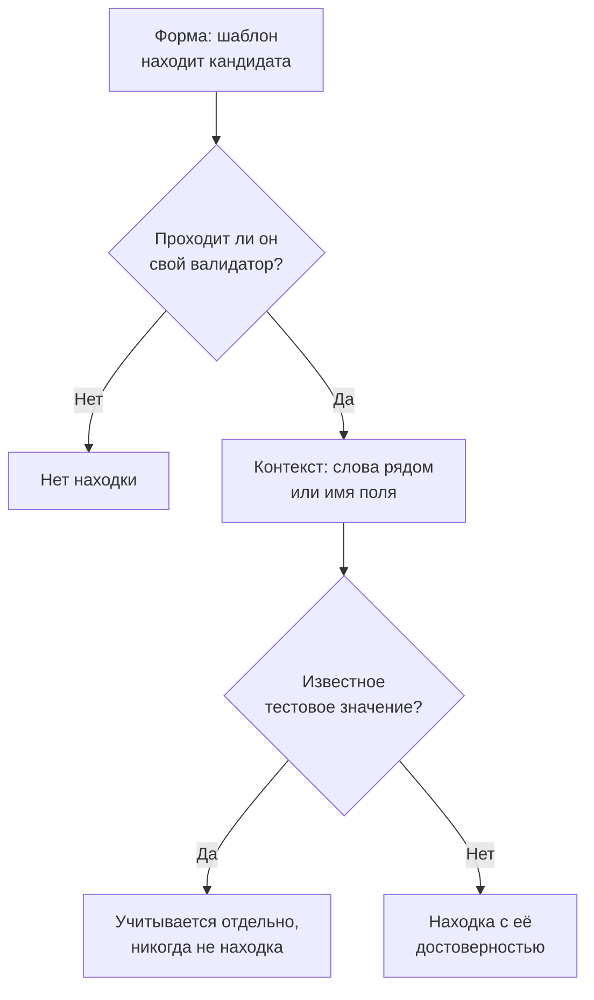

# Типы конфиденциальных данных

Безопасность данных знает 143 вида конфиденциальных данных: номера карт, банковские счета, национальные идентификаторы 43 стран, медицинские идентификаторы, ключи API и токены, а также особые категории персональных данных. У каждого есть категория, чувствительность и, если он относится к одной стране, эта страна. На этой странице сказано, как находится значение, и перечислены все типы данных, чтобы вы могли понять, почему что-то было найдено, и решить, что с этим делать.

:::cards
- [Как находится значение](#как-находится-значение): Форма, валидатор, контекст, тестовые значения, достоверность.
- [Поля и столбцы](#поля-и-столбцы): Как оценивается целый столбец или атрибут.
- [Имена и адреса в свободном тексте](#имена-и-адреса-в-свободном-тексте): Небольшая модель внутри сканера и её оценки.
- [Все типы данных](#встроенные-типы-данных): Все 143, по категориям.
- [Ваши собственные типы данных](#ваши-собственные-типы-данных): Табельные номера, номера полисов и поле «Проверить».
- [Типы данных, которые находит OneUptime AI](#типы-данных-которые-находит-oneuptime-ai): Ваши собственные типы данных, найденные в полях, которые не смог распознать ни один детектор.
- [Вердикты OneUptime AI](#вердикты-oneuptime-ai): Вердикт по каждой находке, которая ждёт вашего решения, с решениями вашей команды в качестве прецедентов.
:::

## Как находится значение



Любое сканирование — строки журнала, ячейки CSV, строки базы данных, первых байтов объекта — проходит одни и те же шаги:

1. **Форма.** У каждого типа данных есть шаблоны, которые находят кандидатов: шестнадцать цифр, `AKIA` и шестнадцать букв, слово, `@` и домен. Шаблон никогда не совпадает внутри более длинного токена, поэтому номер карты не находится внутри более длинной последовательности цифр.
2. **Валидатор.** Кандидат должен пройти собственные правила своего типа: контрольную сумму (Luhn для карт, mod 97 для IBAN, Verhoeff для номеров Aadhaar, контрольную цифру большинства национальных идентификаторов), реальную дату, известный префикс, достаточную случайность для секрета. Кандидат, который их не прошёл, вовсе не становится находкой. Заполнители, например `000000000` и `123456789`, не проходят ни один числовой тип.
3. **Контекст.** Слова рядом с кандидатом — по умолчанию до 64 символов перед ним и 32 после него, — которые говорят, что это такое, повышают его достоверность на один уровень, как и поле, имя которого указывает на тип. Слова, которые говорят, что это что-то другое, например номер заказа или трек-номер, понижают её на один уровень. Номер без контрольной суммы и с распространённой формой, например номер паспорта или банковского счёта, учитывается только рядом со словами, которые его называют.
4. **Известные тестовые значения.** Опубликованные тестовые номера карт (например, `4242 4242 4242 4242` от Stripe), примеры IBAN, адреса в `example.com` и других зарезервированных доменах, IP-адреса для документации, образцы идентификаторов, которые печатает государственная документация, ключи тестового режима, например `sk_test_`, и ключи-заполнители учитываются отдельно. Они никогда не дают находку, поэтому хранилище, полное ими, выглядит как тестовое окружение, а не как утечка.
5. **Достоверность.** Всё, что осталось, — это находка, настолько уверенная, насколько позволяют её доказательства.

| Достоверность | Что это значит |
| --- | --- |
| **Высокий** | Значение прошло свой валидатор, и слова вокруг него или поле, в котором оно находится, говорят, что это такое, — или, для поля, большинство его значений относятся к этому типу. |
| **Средний** | Значение прошло свой валидатор, но ничто вокруг не подтверждает его, или имя поля говорит, что в нём хранится, и некоторые значения с этим согласуются. |
| **Низкий** | Форма совпадает, но ничто её не подтверждает. |

Учитываются только находки уровня Высокий и Средний: они делают хранилище конфиденциальным и могут открыть проблему. Находки уровня Низкий перечислены в хранилище в свёрнутом виде, чтобы их оценил человек: **Подтвердить** на верной находке переводит её на уровень Высокий, и она остаётся такой при следующих сканированиях.

Когда два типа данных претендуют на одни и те же символы, побеждает более уверенная находка: сначала с более высокой достоверностью, затем от детектора, чьи собственные правила доказывают больше, затем с более длинным совпадением.

Значение также читается так, как его пишут люди. Процентные escape-последовательности URL читаются, в том числе кодирующие байты UTF-8 символа, поэтому IP-адрес, адрес электронной почты, например `jane%40example.com` или `jos%C3%A9%40example.com`, или токен либо ключ в строке запроса находится. Строка запроса URL также читается так, как её записывает форма, со знаком плюс вместо каждого пробела, поэтому номер, записанный группами, находится и тогда, когда между группами стоит пробел в процентной кодировке или знак плюс, например `4111+1111+1111+1111` или `DE44%205001%200517%205407%203249%2031`, и так же находятся почтовый индекс, почтовый адрес и дата рождения, например `SW1A+2AA`, `10+Downing+Street` или `dob=12%2F03%2F1985`. Цифры номера читаются в любой письменности, например полноширинные цифры (`４１１１ １１１１ １１１１ １１１１`) или арабско-индийские цифры, сначала каждая письменность отдельно, а затем вместе: номер карты, код безопасности или срок действия карты, номер телефона, номер социального страхования США, IBAN, банковский маршрутный номер, номер банковского счёта, sort code, BSB, BIC, IFSC, номер национального удостоверения личности, медицинский идентификатор (например, номер NHS), почтовый индекс или дата рождения. Такой номер, набранный целиком в полную ширину, как пишет номера японский и китайский текст, тоже читается, а его знак плюс, дефисы, скобки, точки, косые черты и идеографические пробелы — как символы ASCII, например `＋８１ ３－１２３４－５６７８` или `５３６－２２－８７３１`, и так же читается номер, группы которого разделены другим видом тире, которое читается как дефис только между двумя цифрами: знаком долготы, который японский текст набирает вместо дефиса, например `＋８１ ３ー１２３４ー５６７８`, или типографским дефисом, цифровым тире, коротким тире или знаком минуса, например `536–22–8731`. Значение, набранное полноширинными буквами, читается с его буквами, цифрами и знаками как символами ASCII, например адрес электронной почты `ｊａｎｅ＠ｅｘａｍｐｌｅ．ｃｏｍ`, IBAN `ＤＥ８９　３７０４　００４４　０５３２　０１３０　００` или британский почтовый индекс `ＳＷ１Ａ　２ＡＡ`, и так же читаются слова, которые называют номер, например `ＴＥＬ`. Текст без значений, набранных полноширинными буквами, например японская или китайская проза, читается как есть. Адрес электронной почты находится в любой письменности, например `张伟@example.com` или `почта@пример.рф`, а адрес IPv6 — сразу после двоеточия ключа, например `ip:2001:db8::1`. Каждая находка — это значение в том виде, в каком оно записано, поэтому правило очистки скрывает его именно там.

Длинное значение читается окнами по 64 КБ, которые перекрываются на 4 КБ, поэтому значение находится целиком, где бы оно ни было, а из одного значения читается не больше 4 МБ.

## Поля и столбцы

Столбец, поле JSON или атрибут журнала оценивается целиком. Его имя подсказывает тип данных, а значения из выборки его доказывают. Доля значений, содержащих тип, определяет, насколько уверенна находка:

| Значения, содержащие тип | Достоверность |
| --- | --- |
| 60% или больше | Высокий |
| 25% или больше | Высокий, если имя поля указывает на тип, иначе Средний |
| Меньше | Средний, если имя поля указывает на тип, иначе Низкий: несколько адресов электронной почты в столбце с чем-то другим |

Поле, значения которого в среднем длиннее 80 символов, — это свободный текст: заметки, сообщения, описания, — и от него не ожидается, что оно содержит один тип. Его находки сохраняют ту достоверность, которую каждое совпадение заработало само по себе, и сообщают, что найдены в свободном тексте. Классифицируется до 1000 значений поля и до 16 КБ каждого из них.

Имя поля разбивается на слова — `customerEmail`, `customer_email` и `customer-email` все означают «customer email», — и подсказка имени типа совпадает, когда её слова идут в том же порядке рядом друг с другом: «date of birth» совпадает с `customer_date_of_birth`, но не с `birth_city`. Собственное имя поля — только последняя часть пути через точки, вместе с предыдущей частью, если последняя — общее слово, например `number`, `id` или `value`: `customer.address.city` — не почтовый адрес, а `card.number` — всё ещё номер карты.

Некоторые типы данных нельзя распознать по значениям: никакой шаблон не отличит имя человека от названия улицы или религию от любого другого слова. Они находятся только по имени поля, когда в поле есть значения: Имя человека, Имя пользователя, Пол, Гражданство, Сведения о здоровье, Расовое или этническое происхождение, Религиозные убеждения, Сексуальная ориентация, Политические взгляды, Членство в профсоюзе, Биометрические данные, Генетические данные и Судимость. Имя, имя пользователя, пол или гражданство тогда получают уровень Высокий, когда 60% или больше значений на них похожи, и Средний в остальных случаях. В свободном тексте имена людей и почтовые адреса находит также небольшая модель: см. [Имена и адреса в свободном тексте](#имена-и-адреса-в-свободном-тексте). Имя человека находится и в строке запроса URL, в параметре, названном так, как назвали бы такое поле, например `full_name` в `/contacts?full_name=Jos%C3%A9%20Garc%C3%ADa`: его значение читается так, как его записывает URL, получает уровень Высокий, когда похоже на имя, и находится там, где записано, вместе с escape-последовательностями. Параметр, названный просто `name`, остаётся за моделью.

Поле, имя которого говорит, что в нём хранится пароль, — `password`, `passwordHash`, `pwd`, но не `password_changed_at`, — должно содержать хеш: bcrypt, argon2, scrypt, PBKDF2 или другую схему, которую, скорее всего, использует хранилище. Пустые значения, заполнители, например `********`, и зашифрованные значения откладываются в сторону. Когда среди остальных значений не-хешей больше, чем хешей, в поле хранятся сами пароли, которые не увидит ни один шаблон, и хранилище не проходит проверку [Пароли хранятся в открытом виде](/docs/data-security/checks-and-issues#гигиена-данных).

### Поля, которые не смог распознать ни один детектор

Столбец или поле, имя которого не указывает ни на один тип данных, а значения не подходят ни одному детектору, нельзя считать безопасным: это может быть ваш собственный номер клиента или столбец, названный на другом языке. Если в проекте включено **Включить ИИ**, сканирование содержимого сохраняет такие поля, не больше 200 за сканирование, и OneUptime AI спрашивают, какой из типов данных проекта содержит каждое из них, не больше 40 полей хранилища за раз. Ему сообщают имя поля, имена соседних полей и формы его значений — каждая буква записана как `a` или `A`, а каждая цифра как `9`, так что `AB-1234` становится `AA-9999`, — но никогда не значение. О свободном тексте, полях меньше чем с 5 значениями, небольших целых числах и полях с именем идентификатора, времени или статуса не спрашивают.

Сканирование телеметрии так же сохраняет атрибуты, которые не распознал ни один детектор, из логов, спанов, метрик и остальной телеметрии сервиса, не более 50 на сервис за сканирование. Оно никогда не сохраняет собственные атрибуты OneUptime, атрибуты, которые соглашения OpenTelemetry пишут в каждую запись, чтобы сказать, откуда она, например сервис, хост или под, и свободный текст, например тело лога.

Каждый тип, который называет OneUptime AI, — это находка уровня Низкий с отметкой **Предложено OneUptime AI** и с объяснением, которое написано на языке вашего проекта и показывается во всю ширину строки находки. Как и любая находка уровня Низкий, она ни на что не влияет, пока человек не выберет **Подтвердить** на странице **Содержимое** хранилища; **Отметить как неконфиденциальное** отклоняет её. О поле, на которое уже ответили, не спрашивают снова 30 дней, а о поле, которое оценил человек, не спрашивают больше никогда.

## Имена и адреса в свободном тексте

Никакой шаблон не отличит имя человека от любого другого слова. Поэтому свободный текст - заметку поддержки, строку лога, сообщение исключения, промпт - читает ещё и небольшая языковая модель, которая находит имена людей и почтовые адреса. Модель работает внутри сканера, на воркерах OneUptime и на ваших зондах: текст никогда не покидает сканер, во время работы ничего не скачивается, и никакой промпт не составляется. Это не OneUptime AI, и переключатели OneUptime AI её не включают и не выключают: это делает **Находить имена и адреса**.

- **Что она читает.** Поле, значения которого в среднем длиннее 80 символов; поле, имя которого говорит, что в нём человек пишет свободный текст, какими бы короткими ни были его значения, например `delivery_note`, `comentario`, `Lieferhinweis` или `opmerking` (см. [Короткие значения](#короткие-значения)); а в телеметрии - каждый текст лога, сообщение исключения, трассировку стека и разговор с ИИ, какими бы короткими они ни были. Она читает до 100 разных значений поля, всего до 32 КБ текста, и до 16 КБ одного значения. URL в том, что она читает, читается как URL: его процентные escape-последовательности читаются, а `+` между двумя буквами читается как пробел, поэтому имя в `/profile?name=Jos%C3%A9%20Garc%C3%ADa` находится и скрывается так, как оно записано.
- **Что она находит.** **Имя человека** (`person-name`) и **Почтовый адрес** (`postal-address`): место, которое модель читает рядом с номером дома, например `14 Calle Mayor`, вместе с почтовым индексом и городом, которые идут за ним. Город или страна сами по себе - не почтовый адрес.
- **Насколько она уверена.** Имя или адрес, найденные моделью, сами по себе имеют уровень Средний. Уровень Высокий - когда имя поля говорит, что в нём хранятся имена или адреса, или когда об этом говорят слова рядом, например "customer", "Kunde" или "dirección". Уровень Низкий - когда модель не уверена, с оценкой ниже 0,6. Каждая находка сохраняет уровень, который заслужила сама, поэтому одно имя среди тысячи строк лога остаётся на уровне Средний.
- **Тестовые значения.** Заглушки вроде `Jane Doe`, `John Smith`, `Max Mustermann` и `123 Main Street` считаются отдельно, как тестовые значения любого типа.
- **Что она сохраняет.** Её образцы маскируются так же, как имя, найденное по имени поля: первый символ и четыре звёздочки, `M****`. Отпечатки по ним никогда не снимаются. На странице хранилища **Содержимое** у такой находки написано **Найдено в свободном тексте моделью сканера**.
- **Её записи и её правила.** Находка модели показывает записи, в которых она найдена: каждая строка обрезана вокруг имени или адреса, и каждое имя и каждый адрес в ней замаскированы, а **Очистить** доказывает правило на этих записях, как для любой находки: они заново читаются моделью, до 20 секунд её времени каждый раз. Запись, на которую у неё не хватило времени, не показывается, и список говорит, на сколько значений ей не хватило времени. Где модель не может работать, список так и говорит, и ни одно правило для находки не доказывается.

| Модель | Лицензия | Размер | Ревизия | Измеренные языки |
| --- | --- | --- | --- | --- |
| [openmasq/ner-multilingual](https://huggingface.co/openmasq/ner-multilingual): шесть слоёв многоязычного BERT, int8 ONNX | Apache 2.0 | 98 МБ | `8cf7273` | Английский, испанский, немецкий, французский, итальянский, португальский, нидерландский |

### Насколько хорошо она их находит

Её измерили кодом самого сканера на наборе тестов, написанном для неё: 392 придуманных предложения на семи языках - строки логов, заметки поддержки, письма, промпты, - из которых в 168 нет ни имени, ни адреса. Находка верна, когда она пересекается с именем или адресом своего типа. Планку записали до того, как измерили хоть одну модель: точность не ниже 0,90 для каждого типа по всем языкам и 0,85 в каждом языке, полнота не ниже 0,70 и не больше 20 ложных находок на 1000 значений, в которых нет ни того, ни другого. Из четырёх измеренных моделей планку прошли две, и выбрана меньшая. Эти оценки держит тест: изменение модели или сканера, которое снижает любую из них, проваливает его.

| Язык | Имена: точность | Имена: полнота | Адреса: точность | Адреса: полнота |
| --- | --- | --- | --- | --- |
| Английский | 0,96 | 0,96 | 1,00 | 1,00 |
| Испанский | 0,96 | 0,96 | 1,00 | 1,00 |
| Немецкий | 1,00 | 0,93 | 1,00 | 1,00 |
| Французский | 0,96 | 0,96 | 1,00 | 1,00 |
| Итальянский | 0,96 | 0,96 | 1,00 | 1,00 |
| Португальский | 0,93 | 0,89 | 1,00 | 1,00 |
| Нидерландский | 0,96 | 0,89 | 1,00 | 1,00 |
| Все семь | 0,96 | 0,94 | 1,00 | 1,00 |

На 168 предложениях набора, в которых нет ни того, ни другого, она делает 18 ложных находок на 1000. На части открытого бенчмарка [gretelai/synthetic_pii_finance_multilingual](https://huggingface.co/datasets/gretelai/synthetic_pii_finance_multilingual) (Apache 2.0): по 15 финансовых документов на каждом из семи языков, разметка сделана машиной и неполна, поэтому читайте эти цифры рядом с таблицей выше, а не отдельно:

| Язык | Имена: точность | Имена: полнота | Адреса: точность | Адреса: полнота |
| --- | --- | --- | --- | --- |
| Английский | 0,91 | 0,90 | 0,83 | 1,00 |
| Испанский | 0,89 | 0,37 | 0,58 | 0,70 |
| Немецкий | 0,93 | 0,58 | 0,75 | 0,70 |
| Французский | 0,84 | 0,50 | 0,42 | 0,83 |
| Итальянский | 0,73 | 0,61 | 0,79 | 0,69 |
| Нидерландский | 0,91 | 0,49 | 1,00 | 0,89 |
| Шведский | 1,00 | 0,61 | 1,00 | 0,93 |
| Все семь | 0,89 | 0,54 | 0,77 | 0,82 |

Четыре измеренные модели на написанном наборе тестов, одна за другой на одной машине, каждая на одном ядре с нативным кодом onnxruntime. OneUptime запускает выбранную на WebAssembly из onnxruntime, который работает в любом образе, в пять-восемь раз медленнее:

| Модель | Лицензия | Размер | Имена: точность / полнота | Адреса: точность / полнота | Ложных находок на 1000 | Время на 1000 значений по 75 / 1181 символу |
| --- | --- | --- | --- | --- | --- | --- |
| openmasq/ner-multilingual (выбрана) | Apache 2.0 | 98 МБ | 0,963 / 0,939 | 1,000 / 1,000 | 18 | 5,9 с / 82 с |
| Wismut/nym-pii-multilingual-small | MIT | 121 МБ | 0,995 / 0,974 | 0,985 / 1,000 | 12 | 7,4 с / 103 с |
| jkomyno/minilmv2-l6-h384-ner-en-it-q8 | MIT | 34 МБ | 0,704 / 0,929 | 0,839 / 1,000 | 369 | 3,7 с / 68 с |
| balticml/mmbert-small-pii-redaction | Apache 2.0 | 38 МБ | 0,712 / 0,995 | 0,762 / 0,992 | 589 | 7,8 с / 159 с |

### Короткие значения

Короткое поле читается, только если его имя говорит, что в нём человек пишет свободный текст. Правило измерили до того, как выбрать, на 49 столбцах базы данных на семи языках, всего 588 значений: названия товаров, заголовки, метки, должности и названия магазинов, где имя бренда, персонажа или улицы - не находка, и короткие заметки о доставке, комментарии поддержки и замечания клиентов, в которых 91 имя и 28 почтовых адресов. Чтение каждого поля из четырёх и более слов, первое рассмотренное правило, прочитало 108 значений каталога и дало из них 53 ложных имени, например `Ralph Lauren` в названии рубашки поло и `Tom Sawyer` в названии книги:

| Правило | Прочитано значений каталога | Имена: точность | Имена: полнота | Адреса: точность | Ложных находок на 1000 |
| --- | --- | --- | --- | --- | --- |
| Поля из четырёх и более слов (не выбрано) | 108 | 0,62 | 0,99 | 1,00 | 222 |
| Поля, чьё имя говорит о свободном тексте (выбрано) | 0 | 0,98 | 0,99 | 1,00 | 14 |

Выбранное правило по языкам. Тест закрепляет эти оценки и планку, по которой выбрали модель:

| Язык | Имена: точность | Имена: полнота | Адреса: точность | Адреса: полнота |
| --- | --- | --- | --- | --- |
| Английский | 1,00 | 1,00 | 1,00 | 1,00 |
| Испанский | 1,00 | 1,00 | 1,00 | 1,00 |
| Немецкий | 1,00 | 1,00 | 1,00 | 1,00 |
| Французский | 1,00 | 1,00 | 1,00 | 1,00 |
| Итальянский | 1,00 | 1,00 | 1,00 | 1,00 |
| Португальский | 0,86 | 0,92 | 1,00 | 1,00 |
| Нидерландский | 1,00 | 1,00 | 1,00 | 1,00 |
| Все семь | 0,98 | 0,99 | 1,00 | 1,00 |

Считается собственное имя поля: `orders.delivery_note` читается, `notes.author` - нет, как и имя, которое оканчивается на идентификатор, количество, тип, статус или время, например `message_id`. Описание не читается из-за своего имени: описание товара - это текст каталога.

### Где она работает и чего стоит

- **В каждом образе.** Образ App, в котором работают воркеры, и образ зонда несут модель, её словарь и среду выполнения, в том числе изолированные образы и образы Iron Bank: около 114 МБ на диске. Их скачивают при сборке образа из закреплённой ревизии и сверяют с их SHA-256. Во время сканирования ничего не скачивается.
- **Память.** Модель загружается, когда она впервые нужна сканированию, один раз на процесс: около 550 МБ, которые освобождаются после 10 минут без сканирования.
- **Время.** На одном ядре от 30 секунд до минуты на 1000 значений длиной в строку лога и около 9 минут на 1000 значений по 1200 символов. Сканирование содержимого хранилища даёт ей до 2 минут. Ежечасное сканирование телеметрии даёт ей до 1 минуты всего и по 6 секунд на хранилище, каждый час другому набору хранилищ.
- **Очередь.** Модель каждого сканирования содержимого начинает там, где остановилась предыдущая: с первой таблицы или контейнера, свободный текст которых она не прочитала, и с объектов бакета, на которые ей не хватило времени, - они читаются заново раньше всех остальных. То, что она начала и не смогла закончить, не берётся первым снова, так что ничто не занимает её время скан за сканом, и каждая таблица и каждый объект получают свою очередь, сколько бы свободного текста ни было в хранилище данных.
- **Когда её время заканчивается**, сканирование завершается с тем, что модель успела прочитать, а его предупреждения говорят, сколько значений свободного текста она прочитала, но никогда - что именно. Воркер или зонд без модели сканирует как раньше и говорит почему:

```text
Names and street addresses were looked for in 120 of 500 free-text values: this store's 6 seconds of model time ran out.
Names and street addresses in free text were not looked for: the model's model_quantized.onnx is not installed on this probe.
```

Подробности сканирования показывают эти и все остальные предупреждения сканирования содержимого или телеметрии на языке читателя.

**Находить имена и адреса** включено в каждом проекте: сканирования содержимого бакетов, баз данных и наборов данных BigQuery читают свободный текст с помощью модели, на воркерах и на зондах. **Находить имена и адреса в телеметрии**, под ним, выключено: прочитать один раз каждый текст лога, исключение и разговор загруженного проекта из 200 сервисов занимает около 48 минут одного ядра, а минута сканирования в час читает около 4% этого. Включите его, чтобы каждое ежечасное сканирование читало часть из них. Обе настройки находятся в **Безопасность данных → Настройки → Настройки сканирования**, в разделе **Что читает «Безопасность данных»**. **Проверить** работает в вашем браузере, без модели: то, что нашла бы модель, там не показывается. Модель добавила бы около 113 МБ к загрузке, 67 МБ в сжатом виде, и около 440 МБ к памяти вкладки, поэтому она работает только в сканере.

## Чувствительность

| Чувствительность | Что это значит |
| --- | --- |
| **Ограниченный** | Утечка причинит вред: секреты, номера карт, медицинские записи, государственные идентификаторы. |
| **Конфиденциальный** | Персональные данные и документы с пометкой «конфиденциально». |
| **Внутренний** | Собственные данные компании, не предназначенные для посторонних. |
| **Публичный** | Ничего конфиденциального не найдено. |

Хранилище настолько конфиденциально, насколько конфиденциален самый чувствительный тип данных, найденный в нём с достоверностью не ниже уровня Средний. Тестовые значения и находки, отмеченные как неконфиденциальные, ничего не значат, а хранилище, в котором ничего не найдено, получает чувствительность «Публичный». Чтобы считать хранилище более или менее конфиденциальным, чем говорят его находки, задайте его чувствительность сами в разделе **Настройки** хранилища: тогда проверки используют её.

## Категории

| Категория | Что она охватывает | Персональные данные |
| --- | --- | --- |
| Секреты и учётные данные | Пароли, ключи API, токены и закрытые ключи, которые открывают доступ к другим системам. | Нет |
| Финансовые данные | Номера карт, банковские счета, IBAN и криптокошельки. | Да |
| Здоровье | Номера медицинских карт, медицинские идентификаторы, диагнозы и рецепты. | Да |
| Государственные идентификаторы | Номера национальных удостоверений личности, налоговые номера, номера паспортов и социального страхования. | Да |
| Особые категории | То, что сильнее всего защищает статья 9 GDPR: этническая принадлежность, религия, сексуальная ориентация, политические взгляды, членство в профсоюзе, биометрические и генетические данные. | Да |
| Контакты и личность | Кто человек и как с ним связаться: адрес электронной почты, телефон, адрес, дата рождения, IP-адрес. | Да |
| Конфиденциальная деловая информация | Документы с пометками «конфиденциально», «только для внутреннего использования» или «адвокатская тайна». | Нет |

Персональные данные — это данные о человеке в том смысле, в каком их понимают GDPR, CCPA, LGPD и DPDP. Хранилище, где лежат только секреты и деловые документы, не входит в область стандартов защиты персональных данных, но всегда входит в область стандартов безопасности (см. [Соответствие требованиям Безопасности данных](/docs/data-security/compliance)).

## Встроенные типы данных

Тип данных, относящийся к одной стране, называет её кодом ISO 3166-1: его читают правила размещения данных и стандарты, привязанные к странам (см. [Размещение данных](/docs/data-security/flows-access-residency#правила-размещения-данных)). ID — это то, по чему тип называют API и находки.

### Контакты и личность

| Тип данных | ID | Что это | Чувствительность | Страна |
| --- | --- | --- | --- | --- |
| Адрес электронной почты | `email-address` | Адрес электронной почты человека. | Конфиденциальный | — |
| Номер телефона | `phone-number` | Номер телефона в международном или национальном формате. | Конфиденциальный | — |
| Имя человека | `person-name` | Имя, фамилия или полное имя человека, найденные по имени поля или моделью сканера в свободном тексте. | Конфиденциальный | — |
| Почтовый адрес | `postal-address` | Адрес: номер дома, название улицы и тип улицы. | Конфиденциальный | — |
| Почтовый индекс | `postal-code` | Почтовый индекс. Даже сам по себе он сужает место, где живёт человек. | Внутренний | — |
| Дата рождения | `date-of-birth` | Дата рядом со словами, которые говорят, что это чья-то дата рождения. | Конфиденциальный | — |
| IP-адрес | `ip-address` | Публичный адрес IPv4 или IPv6, который GDPR считает персональными данными. | Конфиденциальный | — |
| MAC-адрес | `mac-address` | Аппаратный адрес сетевой карты, который идентифицирует устройство. | Конфиденциальный | — |
| Рекламный идентификатор | `advertising-id` | Мобильный рекламный идентификатор (IDFA, GAID, AAID), который отслеживает одно устройство. | Конфиденциальный | — |
| Точное местоположение | `geolocation` | Широта и долгота, достаточно точные, чтобы найти здание. | Конфиденциальный | — |
| Имя пользователя | `username` | Имя для входа или имя учётной записи человека, найденное по имени поля. | Конфиденциальный | — |
| Пол | `gender` | Гендер или пол человека, найденный по имени поля. | Конфиденциальный | — |
| Гражданство | `nationality` | Национальность или гражданство человека, найденные по имени поля. | Конфиденциальный | — |
| Идентификационный номер транспортного средства | `vehicle-identification-number` | 17-символьный VIN с правильной контрольной цифрой. | Конфиденциальный | — |

### Государственные идентификаторы

| Тип данных | ID | Что это | Чувствительность | Страна |
| --- | --- | --- | --- | --- |
| Номер социального страхования США | `us-ssn` | Номер социального страхования (Social Security number) США. | Ограниченный | US |
| Идентификатор налогоплательщика США (ITIN) | `us-itin` | Индивидуальный идентификационный номер налогоплательщика США. | Ограниченный | US |
| Идентификатор работодателя США (EIN) | `us-ein` | Идентификационный номер работодателя США рядом со словами, которые на это указывают. | Конфиденциальный | US |
| Номер паспорта США | `us-passport` | Номер паспорта США рядом со словами, которые на это указывают. | Ограниченный | US |
| Номер водительского удостоверения США | `us-drivers-license` | Номер водительского удостоверения США рядом со словами, которые на это указывают. | Ограниченный | US |
| Номер National Insurance Великобритании | `uk-nino` | Номер National Insurance Великобритании. | Ограниченный | GB |
| Номер паспорта Великобритании | `uk-passport` | Номер паспорта Великобритании рядом со словами, которые на это указывают. | Ограниченный | GB |
| Номер водительского удостоверения Великобритании | `uk-driving-licence` | 16-символьный номер водительского удостоверения Великобритании. | Ограниченный | GB |
| Номер социального страхования Канады | `ca-sin` | Канадский Social Insurance Number с правильной контрольной цифрой. | Ограниченный | CA |
| CURP Мексики | `mx-curp` | Мексиканский Clave Única de Registro de Población. | Ограниченный | MX |
| RFC Мексики | `mx-rfc` | Мексиканский налоговый идентификатор Registro Federal de Contribuyentes. | Ограниченный | MX |
| CPF Бразилии | `br-cpf` | Бразильский номер Cadastro de Pessoas Físicas. | Ограниченный | BR |
| CNPJ Бразилии | `br-cnpj` | Бразильский регистрационный номер компании (CNPJ). | Конфиденциальный | BR |
| CUIT / CUIL Аргентины | `ar-cuit` | Аргентинский налоговый или трудовой идентификационный код. | Ограниченный | AR |
| RUT Чили | `cl-rut` | Чилийский Rol Único Tributario с правильной контрольной цифрой. | Ограниченный | CL |
| DNI Испании | `es-dni` | Номер испанского национального удостоверения личности с контрольной буквой. | Ограниченный | ES |
| NIE Испании | `es-nie` | Испанский идентификационный номер иностранца с контрольной буквой. | Ограниченный | ES |
| NIF Португалии | `pt-nif` | Португальский налоговый идентификационный номер. | Ограниченный | PT |
| Номер социального страхования Франции (NIR) | `fr-nir` | Французский номер INSEE с двузначным ключом. | Ограниченный | FR |
| Налоговый идентификатор Германии | `de-tax-id` | Немецкий Steuerliche Identifikationsnummer. | Ограниченный | DE |
| Codice fiscale Италии | `it-codice-fiscale` | Итальянский налоговый код с правильным контрольным символом. | Ограниченный | IT |
| BSN Нидерландов | `nl-bsn` | Нидерландский номер гражданина, который проходит проверку по правилу одиннадцати. | Ограниченный | NL |
| Национальный номер Бельгии | `be-national-number` | Бельгийский номер национального реестра. | Ограниченный | BE |
| PESEL Польши | `pl-pesel` | Польский национальный идентификационный номер. | Ограниченный | PL |
| Личный идентификационный номер Швеции | `se-personnummer` | Шведский personnummer с правильной контрольной цифрой. | Ограниченный | SE |
| Национальный идентификационный номер Норвегии | `no-fodselsnummer` | Норвежский fødselsnummer с обеими контрольными цифрами. | Ограниченный | NO |
| Номер CPR Дании | `dk-cpr` | Датский номер гражданской регистрации рядом со словами, которые на это указывают. | Ограниченный | DK |
| Личный идентификационный код Финляндии | `fi-hetu` | Финский henkilötunnus с контрольным символом. | Ограниченный | FI |
| Номер PPS Ирландии | `ie-ppsn` | Ирландский Personal Public Service Number. | Ограниченный | IE |
| Номер AHV Швейцарии | `ch-ahv` | Швейцарский номер социального страхования (AHV / AVS). | Ограниченный | CH |
| CNP Румынии | `ro-cnp` | Румынский личный цифровой код. | Ограниченный | RO |
| EGN Болгарии | `bg-egn` | Болгарский единый гражданский номер. | Ограниченный | BG |
| OIB Хорватии | `hr-oib` | Хорватский личный идентификационный номер. | Ограниченный | HR |
| AMKA Греции | `gr-amka` | Греческий номер социального страхования. | Ограниченный | GR |
| Идентификационный номер Турции | `tr-tckn` | Турецкий номер T.C. Kimlik. | Ограниченный | TR |
| Идентификационный номер Израиля | `il-teudat-zehut` | Израильский номер Teudat Zehut. | Ограниченный | IL |
| Идентификационный номер ЮАР | `za-id` | Южноафриканский идентификационный номер с правильной датой и контрольной цифрой. | Ограниченный | ZA |
| Emirates ID ОАЭ | `ae-emirates-id` | Номер удостоверения личности Объединённых Арабских Эмиратов. | Ограниченный | AE |
| Национальный идентификатор Саудовской Аравии | `sa-national-id` | Саудовский национальный идентификатор или номер iqama. | Ограниченный | SA |
| Номер Aadhaar Индии | `in-aadhaar` | 12-значный номер Aadhaar, который проходит проверку Verhoeff. | Ограниченный | IN |
| PAN Индии | `in-pan` | Индийский Permanent Account Number. | Ограниченный | IN |
| Идентификационный номер резидента Китая | `cn-resident-id` | 18-символьный номер китайского удостоверения личности резидента. | Ограниченный | CN |
| My Number Японии | `jp-my-number` | Японский индивидуальный номер с правильной контрольной цифрой. | Ограниченный | JP |
| Регистрационный номер резидента Южной Кореи | `kr-rrn` | Корейский регистрационный номер резидента. | Ограниченный | KR |
| NRIC / FIN Сингапура | `sg-nric` | Номер удостоверения личности Сингапура или идентификационный номер иностранца. | Ограниченный | SG |
| Номер удостоверения личности Гонконга | `hk-hkid` | Номер удостоверения личности Гонконга с контрольной цифрой. | Ограниченный | HK |
| Национальный идентификатор Тайваня | `tw-national-id` | Тайваньский национальный идентификационный номер. | Ограниченный | TW |
| Национальный идентификатор Таиланда | `th-national-id` | Тайский идентификационный номер гражданина. | Ограниченный | TH |
| Номер MyKad Малайзии | `my-mykad` | Номер малайзийского удостоверения личности. | Ограниченный | MY |
| NIK Индонезии | `id-nik` | Индонезийский идентификационный номер жителя. | Ограниченный | ID |
| Налоговый номер Австралии | `au-tfn` | Австралийский налоговый номер, прошедший проверку контрольной суммы. | Ограниченный | AU |
| Номер IRD Новой Зеландии | `nz-ird` | Новозеландский номер Inland Revenue с правильной контрольной цифрой. | Ограниченный | NZ |
| Российский СНИЛС | `ru-snils` | Российский страховой номер индивидуального лицевого счёта с контрольным числом. | Ограниченный | RU |
| Российский ИНН | `ru-inn` | Российский идентификационный номер налогоплательщика. | Ограниченный | RU |
| Номер паспорта | `passport-number` | Номер паспорта любой страны рядом со словами, которые на это указывают. | Ограниченный | — |

### Финансовые данные

| Тип данных | ID | Что это | Чувствительность | Страна |
| --- | --- | --- | --- | --- |
| Номер карты | `credit-card-number` | Номер платёжной карты, который проходит проверку Luhn и принадлежит платёжной системе. | Ограниченный | — |
| Код безопасности карты | `card-verification-code` | CVV или CVC, который PCI DSS запрещает хранить после авторизации платежа. | Ограниченный | — |
| Срок действия карты | `card-expiration-date` | Срок действия карты рядом со словами, которые на это указывают. | Конфиденциальный | — |
| IBAN | `iban` | Международный номер банковского счёта, который проходит проверку mod-97. | Ограниченный | — |
| Номер банковского счёта | `bank-account-number` | Номер банковского счёта рядом со словами, которые на это указывают. | Ограниченный | — |
| Код SWIFT / BIC | `swift-bic` | Код SWIFT или BIC банка рядом со словами, которые на это указывают. | Внутренний | — |
| Банковский маршрутный номер США | `us-bank-routing-number` | Маршрутный номер ABA с правильной контрольной суммой рядом со словами, которые на это указывают. | Внутренний | US |
| Sort code Великобритании | `uk-sort-code` | Банковский sort code Великобритании рядом со словами, которые на это указывают. | Внутренний | GB |
| IFSC Индии | `in-ifsc` | Индийский Financial System Code, который указывает на отделение банка. | Внутренний | IN |
| BSB Австралии | `au-bsb` | Австралийский номер bank-state-branch рядом со словами, которые на это указывают. | Внутренний | AU |
| Адрес Bitcoin | `bitcoin-address` | Адрес Bitcoin с правильной контрольной суммой. | Конфиденциальный | — |
| Адрес Ethereum | `ethereum-address` | Адрес Ethereum рядом со словами, которые на это указывают. | Конфиденциальный | — |

### Здоровье

| Тип данных | ID | Что это | Чувствительность | Страна |
| --- | --- | --- | --- | --- |
| Номер NHS Великобритании | `uk-nhs-number` | Номер National Health Service Великобритании с правильной контрольной цифрой. | Ограниченный | GB |
| Идентификатор получателя Medicare США | `us-medicare-mbi` | Medicare Beneficiary Identifier США. | Ограниченный | US |
| Номер Medicare Австралии | `au-medicare-number` | Номер австралийской карты Medicare с правильной контрольной цифрой. | Ограниченный | AU |
| Номер медицинской страховки Германии | `de-health-insurance-number` | Немецкий Krankenversichertennummer с правильной контрольной цифрой. | Ограниченный | DE |
| Номер медицинской карты | `medical-record-number` | Номер медицинской карты пациента рядом со словами, которые на это указывают. | Ограниченный | — |
| Идентификатор участника плана медицинского страхования | `health-plan-id` | Номер участника или полиса медицинского страхования рядом со словами, которые на это указывают. | Ограниченный | — |
| Код диагноза (ICD-10) | `diagnosis-code` | Код диагноза ICD-10 рядом со словами, которые на это указывают. | Ограниченный | — |
| Код лекарства (NDC) | `drug-code` | National Drug Code США рядом со словами, которые на это указывают. | Конфиденциальный | — |
| Номер DEA США | `us-dea-number` | Номер Drug Enforcement Administration врача, выписывающего рецепты, с правильной контрольной цифрой. | Конфиденциальный | US |
| Идентификатор поставщика медицинских услуг США (NPI) | `us-npi` | National Provider Identifier. Он указывает на поставщика медицинских услуг, а не на пациента. | Внутренний | US |
| Сведения о здоровье | `health-information` | Диагнозы, заболевания, лекарства и другие сведения о здоровье, найденные по имени поля. | Ограниченный | — |

### Секреты и учётные данные

| Тип данных | ID | Что это | Чувствительность | Страна |
| --- | --- | --- | --- | --- |
| ID ключа доступа AWS | `aws-access-key-id` | Публичная половина ключа доступа AWS. Вместе со своим секретом она подписывает запросы к AWS. | Ограниченный | — |
| Секретный ключ доступа AWS | `aws-secret-access-key` | Секретная половина ключа доступа AWS рядом со словами, которые на это указывают. | Ограниченный | — |
| Ключ API Google | `google-api-key` | Ключ API Google Cloud или Maps. | Ограниченный | — |
| Ключ сервисного аккаунта Google | `google-service-account-key` | Файл ключа сервисного аккаунта Google Cloud с закрытым ключом. | Ограниченный | — |
| Секрет клиента Google OAuth | `google-oauth-client-secret` | Секрет клиента Google OAuth. | Ограниченный | — |
| Ключ учётной записи хранения Azure | `azure-storage-account-key` | Ключ учётной записи хранения Azure или строка подключения, которая его содержит. | Ограниченный | — |
| Токен SAS Azure | `azure-sas-token` | Подпись общего доступа Azure, которая даёт доступ без входа. | Ограниченный | — |
| Секрет клиента Azure | `azure-client-secret` | Секрет клиента приложения Microsoft Entra ID. | Ограниченный | — |
| Токен GitHub | `github-token` | Персональный токен доступа, токен OAuth, токен приложения или детализированный токен GitHub. | Ограниченный | — |
| Токен GitLab | `gitlab-token` | Персональный токен доступа GitLab. | Ограниченный | — |
| Токен Slack | `slack-token` | Токен бота, пользователя или приложения Slack. | Ограниченный | — |
| URL вебхука Slack | `slack-webhook-url` | Входящий вебхук Slack, который позволяет кому угодно публиковать сообщения в канал. | Ограниченный | — |
| Секретный ключ Stripe | `stripe-secret-key` | Боевой секретный или ограниченный ключ Stripe, который может перемещать деньги. | Ограниченный | — |
| Ключ API Twilio | `twilio-api-key` | SID ключа API Twilio вместе с секретом. | Ограниченный | — |
| Ключ API SendGrid | `sendgrid-api-key` | Ключ API SendGrid. | Ограниченный | — |
| Ключ API Mailgun | `mailgun-api-key` | Ключ API Mailgun. | Ограниченный | — |
| Ключ API Mailchimp | `mailchimp-api-key` | Ключ API Mailchimp. | Ограниченный | — |
| Ключ API OpenAI | `openai-api-key` | Ключ API OpenAI, который тратит кредит аккаунта. | Ограниченный | — |
| Ключ API Anthropic | `anthropic-api-key` | Ключ API Anthropic. | Ограниченный | — |
| Токен Hugging Face | `huggingface-token` | Токен Hugging Face. | Ограниченный | — |
| Токен npm | `npm-token` | Токен доступа npm, который может публиковать пакеты. | Ограниченный | — |
| Токен PyPI | `pypi-token` | Токен загрузки PyPI. | Ограниченный | — |
| Токен Docker Hub | `docker-hub-token` | Персональный токен доступа Docker Hub. | Ограниченный | — |
| Токен Shopify | `shopify-token` | Токен доступа или приложения Shopify. | Ограниченный | — |
| Токен Square | `square-token` | Токен доступа или секрет Square. | Ограниченный | — |
| Токен доступа Braintree | `braintree-access-token` | Боевой токен доступа Braintree. | Ограниченный | — |
| Токен DigitalOcean | `digitalocean-token` | Персональный токен доступа DigitalOcean. | Ограниченный | — |
| Ключ API New Relic | `new-relic-api-key` | Пользовательский ключ API New Relic. | Ограниченный | — |
| Ключ API Datadog | `datadog-api-key` | Ключ API или ключ приложения Datadog рядом со словами, которые на это указывают. | Ограниченный | — |
| Токен HashiCorp Vault | `vault-token` | Сервисный токен HashiCorp Vault. | Ограниченный | — |
| Токен Terraform Cloud | `terraform-cloud-token` | Токен API Terraform Cloud или Enterprise. | Ограниченный | — |
| Токен API Atlassian | `atlassian-api-token` | Токен API Atlassian. | Ограниченный | — |
| Ключ API Linear | `linear-api-key` | Ключ API Linear. | Ограниченный | — |
| JSON Web Token | `json-web-token` | Подписанный JWT, часто токен сеанса или доступа. | Ограниченный | — |
| Закрытый ключ | `private-key` | Блок закрытого ключа PEM, OpenSSH или PGP. | Ограниченный | — |
| Пароль в URL | `password-in-url` | URL, который содержит имя пользователя и пароль, например строка подключения к базе данных. | Ограниченный | — |
| Пароль в строке подключения | `connection-string-password` | Значение Password= или Pwd= в строке подключения. | Ограниченный | — |
| Заголовок Authorization | `authorization-header` | Учётные данные Basic или Bearer, скопированные из HTTP-заголовка Authorization. | Ограниченный | — |
| Пароль или секрет | `generic-secret` | Значение, присвоенное паролю, секрету, ключу API или токену, которое выглядит достаточно случайным, чтобы быть настоящим. | Ограниченный | — |
| Закрытый ключ Bitcoin | `bitcoin-private-key` | Закрытый ключ Bitcoin в формате импорта кошелька, с правильной контрольной суммой. | Ограниченный | — |

### Особые категории

| Тип данных | ID | Что это | Чувствительность | Страна |
| --- | --- | --- | --- | --- |
| Расовое или этническое происхождение | `racial-or-ethnic-origin` | Раса или этническая принадлежность, найденные по имени поля. | Ограниченный | — |
| Религиозные убеждения | `religious-belief` | Религия или убеждения, найденные по имени поля. | Ограниченный | — |
| Сексуальная ориентация | `sexual-orientation` | Сексуальная ориентация, найденная по имени поля. | Ограниченный | — |
| Политические взгляды | `political-opinion` | Политические взгляды или членство в партии, найденные по имени поля. | Ограниченный | — |
| Членство в профсоюзе | `trade-union-membership` | Членство в профсоюзе, найденное по имени поля. | Ограниченный | — |
| Биометрические данные | `biometric-data` | Отпечатки пальцев, шаблоны лиц, голосовые отпечатки и другие биометрические данные, найденные по имени поля. | Ограниченный | — |
| Генетические данные | `genetic-data` | Данные ДНК и генома, найденные по имени поля. | Ограниченный | — |
| Судимость | `criminal-record` | Судимости и правонарушения (статья 10 GDPR), найденные по имени поля. | Ограниченный | — |

### Конфиденциальная деловая информация

| Тип данных | ID | Что это | Чувствительность | Страна |
| --- | --- | --- | --- | --- |
| Документ под адвокатской тайной | `privileged-document` | Документ с пометкой об адвокатской тайне или юридической привилегии. | Ограниченный | — |
| Документ с пометкой «конфиденциально» | `confidential-document` | Документ с пометкой «конфиденциально», «строго конфиденциально» или «коммерческая тайна». | Конфиденциальный | — |
| Документ с пометкой «для внутреннего использования» | `internal-document` | Документ с пометкой «только для внутреннего использования» или «не для распространения». | Внутренний | — |

## Ваши собственные типы данных

Добавьте тип данных для того, что есть только у вашей компании: табельного номера, номера полиса, кода проекта. Откройте **Безопасность данных → Настройки → Типы данных** и добавьте его в разделе **Ваши типы данных**. Начиная со следующего сканирования он сканируется точно так же, как встроенные, в бакетах, базах данных и телеметрии.

:::steps
### Опишите, что это

Заполните поля **Имя**, например «Табельный номер», **Категория** и **Чувствительность** — насколько конфиденциально хранилище, в котором он есть. **Описание** объясняет, что это такое, тому, кто будет читать его находку.

### Опишите, как его находить

Введите **Шаблон**: регулярное выражение JavaScript для одного значения, например `EMP-\d{6}`. Добавьте **Имена полей**, в которых он хранится, например `employee id`, и **Ключевые слова**, которые рядом со значением подтверждают, что это именно этот тип. Оставьте шаблон пустым, чтобы находить тип только по именам полей.

### Проверьте его

Вставьте образец текста в **Проверить**, чтобы увидеть, что ваш тип данных в нём находит. Поле выполняет над текстом собственный код сканера в вашем браузере: текст никогда не отправляется в OneUptime, и проверяются только его первые 64 КБ.
:::

В разделе **Дополнительные поля** параметр **Без учёта регистра** сопоставляет шаблон независимо от регистра букв, **Требуется ключевое слово** учитывает значение, только когда рядом есть ключевое слово или имя поля говорит, что это этот тип, а **Контрольная сумма** требует, чтобы значение прошло проверку: **Нет**, **Luhn** (контрольная цифра в номерах карт), **Mod97** (контрольные цифры IBAN) или **Verhoeff** (контрольная цифра номера Aadhaar).

Шаблон проверяется при сохранении: он должен компилироваться, не совпадать с пустым текстом и выполняться за время, линейное по длине текста. Его выполняет механизм сопоставления, который никогда не делает возвратов, поэтому никакой шаблон не может задержать сканирование, как бы он ни был написан. У типа может быть не больше 50 ключевых слов и 50 имён полей.

Значение вашего типа, прошедшее контрольную сумму, само по себе получает уровень Средний, а с ключевым словом рядом — Высокий; если контрольной суммы нет, оно само по себе получает Низкий, а с ключевым словом — Средний. В столбце решает доля совпавших значений, как и для любого типа.

### Описать

Вверху формы нового типа данных **Описать** заполняет форму за вас. Напишите, как выглядят данные, например «наши табельные номера выглядят как EMP-123456, иногда без дефиса», при желании добавьте несколько примеров, по одному на строку, и выберите **Заполнить форму**. OneUptime AI получает ваше предложение и формы ваших примеров, но никогда сами примеры: они остаются в вашем браузере, где **Проверить** показывает, сколько из них находит его шаблон. Прочитайте, что он заполнил, измените что хотите и сохраните: ничего не сохраняется, пока вы этого не сделаете, а шаблон проверяется так же, как написанный вами. Для «Описать» в проекте должно быть включено **Включить ИИ**.

## Типы данных, которые находит OneUptime AI

Поля, которые не смог распознать ни один детектор, часто содержат собственный тип данных вашей компании, хранящийся во многих местах под именами, которые говорят одно и то же: номера полисов страховщика в столбцах с именами `policy_no`, `policyNumber` и `police_nr` во всех его базах данных. Когда в проекте включено **Включить ИИ**, OneUptime AI находит такой тип данных в полях, которые сохранили ваши сканирования, и спрашивает вас о нём только после того, как ваши собственные сканирования его подтвердили.

:::steps
### Он находит группу полей

Три или более поля в двух или более хранилищах образуют группу, когда у большинства их значений одна форма, с разделителями между её частями или без них, а их имена содержат общее слово, которое говорит, что в них хранится. Форма без цифр, дата, время или десятичное число никогда не образуют группу, а слово вроде `id`, `no` или `number` само по себе ничего не говорит.

### Он готовит черновик типа данных

OneUptime AI готовит черновик типа данных для каждой новой группы, не более 3 за раз, по именам полей и формам их значений, никогда по значению. Черновик должен пройти те же проверки, что и сохранённый тип, и находить формы, по которым он подготовлен. Черновик, который этого не делает, запрашивается ещё раз, с указанием причины.

### Ваши следующие сканирования проверяют его

Черновик работает при следующем сканировании каждого хранилища своей группы, до 48 часов или одного интервала сканирования, смотря что дольше. Он не создаёт находок: каждое сканирование считает, сколько значений он нашёл бы, в полях группы и во всех остальных полях тех же хранилищ. Он предлагается, когда находит не менее 80% значений своих полей и не более 1% остальных значений. Поле в другом месте, где он находит почти все значения, содержит те же данные под другим именем: оно называется, а не засчитывается против него.
:::

Каждый черновик одновременно считается и в суженном виде: вне полей своей группы суженный черновик находит значение, только если рядом есть одно из его ключевых слов или имя поля называет его. Черновик, который находит слишком много в других местах, предлагается в суженном виде, если этого достаточно. Черновик, которого недостаточно ни в одном из видов, отбрасывается, и его группа не получает новый черновик 30 дней.

Каждый предложенный тип данных ждёт в разделе **Типы данных на проверку**, вверху страницы **Безопасность данных → Настройки → Типы данных** и на странице **Безопасность данных → ИИ**, вместе с тем, что насчитали ваши сканирования, например «Находит 98% значений в этих полях (полей: 11) и 0,1% значений в других местах тех же хранилищ». **Добавить тип данных** открывает форму типа данных, заполненную им, чтобы изменить и проверить её; сохранение добавляет тип, который сканирования находят со следующего запуска. **Не тип данных** отклоняет его: для этих полей он больше никогда не предлагается. Для добавления нужна роль, которая может создавать типы данных.

## Неконфиденциальное и никогда не конфиденциальное

Сканирование может найти то, что не является тем, чем выглядит: столбец номеров заказов, которые проходят проверку Luhn, ваш собственный адрес поддержки в каждой строке журнала. Сообщите об этом OneUptime, и он перестанет это учитывать:

- **Отметьте находку как неконфиденциальную.** На странице **Содержимое** хранилища выберите у находки **Отметить как неконфиденциальное** и укажите причину. Она больше не учитывается ни в чувствительности хранилища, ни в его проверках, а хранилище сразу проверяется снова. Находка остаётся в хранилище с отметкой и вашей причиной, чтобы следующий человек видел, что было решено.
- **Добавьте значение в Никогда не конфиденциально** в настройках Безопасности данных, если значение нигде и никогда не должно быть находкой, например `support@yourcompany.com`. Значения сравниваются после того, как сканер их нормализует, без учёта регистра.
- **Выключите встроенный тип данных.** В разделе **Встроенные типы данных** на странице **Безопасность данных → Настройки → Типы данных** у каждого типа данных есть переключатель, который сохраняется в момент переключения. Ни одно сканирование проекта не ищет выключенный тип.

## Вердикты OneUptime AI

Когда в проекте включено **Включить ИИ**, а в разделе **Безопасность данных → ИИ** включено **Работать с новыми проблемами**, OneUptime AI после каждого сканирования хранилища выносит вердикт по каждой его находке, которая ждёт решения человека. Находка ждёт, когда сканирование не было в ней уверено — это находка уровня Низкий или одна из подсказок OneUptime AI, — или когда у находки уровня Средний или Высокий есть признак ошибочного совпадения:

- большинство совпадений — известные тестовые значения;
- имя поля указывает на другой тип данных, а не на этот;
- поле идентификатора, например `order_number`, `invoice_no` или `ref_id`, содержит тип, который проверяется алгоритмом Luhn, а эту проверку проходит каждая десятая произвольная последовательность цифр, и имя поля не указывает на этот тип.

Вердикт — **Подтвердить**, **Неконфиденциально** или **Невозможно определить**, с объяснением на языке вашего проекта. Он показывается во всю ширину строки находки на странице **Содержимое** хранилища и на странице **В вашей телеметрии** вместе с решениями вашей команды, на которых он основан, например «Ваша команда отметила `order_number` как неконфиденциальное в 4 хранилищах». **Показать решения** перечисляет каждое из них: его хранилище, его поле и причину, которую указала ваша команда.

### Решения вашей команды как прецеденты

OneUptime AI сообщают прежние решения вашей команды по находкам того же типа данных, не больше десяти. Сначала идут решения по полю с тем же именем в любом хранилище: `order_number`, `orderNumber` и `public.orders.order_number` все означают «order number». Среди них первыми идут решения в том же месте, затем самые новые. Затем идут поля, имена которых или указанные для них причины говорят о том же, например `order_ref` с причиной «Shopify order numbers». Ему сообщают, где была каждая находка, что было решено и какая причина указана, без значений, упомянутых в причине. Ему никогда не сообщают ни значение, ни замаскированный образец, ни запись.

У находки в свободном тексте, например в теле журнала или в сообщении, нет имени поля, по которому её можно сопоставить. Её прецедент — то же место в другом хранилище, например тело журнала другого сервиса.

### Что OneUptime AI решает сам

- **Он никогда не отмечает находку как неконфиденциальную**, что бы ни говорило правило. Это делает человек со своей собственной причиной. Если вердикт — **Неконфиденциально**, **Отметить как неконфиденциальное** открывается с причиной, которую составил OneUptime AI и которую вы можете изменить.
- **Он сам подтверждает находку только там, где так говорит правило ИИ**: правило ИИ Безопасности данных, у которого **Оценка** — **Автоматически**, для этого хранилища и этого типа данных. Для этого также нужно, чтобы ваша команда сама подтвердила похожую находку, или поле, названное по этому типу. Подтверждение записывается в **Хронология** хранилища и в **Сделано ИИ** на странице **Безопасность данных → ИИ**, а **Отменить** его отменяет.

В остальных случаях вердикт ждёт в строке находки. Если в проекте есть правила ИИ, находка получает вердикт, только когда у правила для её хранилища и типа данных включена **Оценка**; правило, ограниченное некоторыми проверками или уровнями серьёзности, касается проблем и не оценивает ни одной находки. После сканирования OneUptime AI оценивает не больше 40 находок хранилища — сначала те, которые он ещё ни разу не оценивал, — а остальные после следующего сканирования. После более позднего сканирования о находке спрашивают снова, только когда изменилось то, на чём основан её вердикт, например появилось новое решение по похожей находке.

## Похожие находки

После того как вы подтвердите находку или отметите её как неконфиденциальную, **Применить к похожим находкам** перечисляет похожие находки, по которым ещё никто не принял решения: тот же тип данных в поле с тем же именем, в этом хранилище и в любом другом хранилище, которое вы можете читать. Каждая из них отмечена. Снимите отметку с тех, которые хотите оценить отдельно, а остальные получат то же решение с вашей причиной как ваше собственное изменение; находка, которую вам нельзя менять, остаётся как была. **Не сейчас** оставляет их все как есть. У находки в свободном тексте никогда нет похожих находок: то, что содержит один текст, ничего не говорит о другом.

## Что ваши решения говорят о сканированиях

Когда ваша команда отмечает находки как неконфиденциальные, OneUptime AI предлагает изменения сканирований в разделе **Ожидает вас** на странице **Безопасность данных → ИИ**:

- **Выключить встроенный тип данных**, когда каждая его находка отмечена как неконфиденциальная: не меньше 3 находок не меньше чем в 2 хранилищах. Находка, которую OneUptime AI только предложил, не учитывается.
- **Исключить место из сканирований хранилища**, когда каждая находка в нём отмечена как неконфиденциальная и их не меньше 2. Это предлагается для столбца базы данных или атрибута телеметрии, которые сканирование может пропускать по отдельности.

Каждое такое предложение всегда ждёт, пока его одобрит человек: сканирование, которое перестаёт искать, пропускает настоящие данные, которые появятся позже. **Никогда не конфиденциально** никогда не предлагается, потому что там хранятся значения, а OneUptime AI никогда их не видит.

## Дальнейшие шаги

:::cards
- [Проверки и проблемы Безопасности данных](/docs/data-security/checks-and-issues): Что чувствительность хранилища меняет в его проблемах.
- [Конфиденциальные данные в телеметрии](/docs/data-security/telemetry): Типы данных, найденные в ваших журналах, трассировках и промптах.
- [Соответствие требованиям Безопасности данных](/docs/data-security/compliance): Стандарты, в область которых попадает хранилище из-за каждого типа данных.
:::
