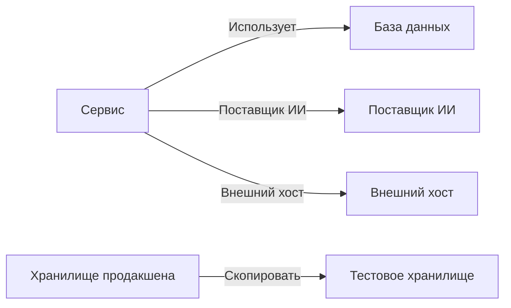

# Потоки данных, доступ и размещение

Знать, что лежит в хранилище, — только половина дела. Безопасность данных также определяет, куда уходят эти данные (какие сервисы используют хранилище, до каких поставщиков ИИ и внешних хостов доходят данные и куда их скопировали), кто имеет доступ к каждому хранилищу и находится ли оно в разрешённых для него регионах. Всё это берётся из сведений, которые у OneUptime уже есть: ваших трассировок, собственных настроек доступа вашего облака и отпечатков того, что нашли сканирования.

:::cards
- [Потоки данных](#потоки-данных): Сервисы, поставщики ИИ, внешние хосты и копии.
- [Кто имеет доступ к хранилищу](#кто-имеет-доступ-к-хранилищу): Каждое разрешение, о котором сообщает ваше облако, и насколько хранилище доступно извне.
- [Правила размещения данных](#правила-размещения-данных): Регионы, в которых может находиться каждый вид данных.
:::

## Потоки данных

| Поток | Что он означает | Откуда он берётся |
| --- | --- | --- |
| **Использует** | Сервис обращается к хранилищу. | Карта сервисов, которую OneUptime каждые десять минут строит по клиентским спанам ваших сервисов. Каждая база данных на ней связывается со своим хранилищем по имени, адресу или эндпоинту, поэтому база данных, которой нет ни в одном другом источнике, становится отдельным хранилищем. |
| **Поставщик ИИ** | Сервис отправляет данные поставщику ИИ. | Вызовы ИИ в трассировках сервиса за последние 7 дней, в которых указан поставщик, к которому они обращаются. |
| **Внешний хост** | Сервис обращается к хосту за пределами ваших систем. | Удалённые сервисы на карте сервисов, по адресу, по которому к ним обращаются. |
| **Скопировать** | Одно хранилище содержит значения другого. | Отпечатки значений, которые нашло каждое сканирование: у двух хранилищ общие данные, когда их отпечатки одного типа данных совпадают наполовину или больше. |

Поток несёт типы данных, которые хранит его источник, и их чувствительность. Поток подтверждён, когда сканирование доказало, что данные там есть, а не только то, что к ним есть путь: копия подтверждена всегда, а поток к поставщику ИИ — когда разговоры с ИИ сервиса содержат данные с чувствительностью «Конфиденциальный» или «Ограниченный». Поток, который не встречался снова 30 дней, удаляется.

Потоки читают две проверки. [Продакшен-данные скопированы в непродакшен-хранилище](/docs/data-security/checks-and-issues#гигиена-данных) не проходит для хранилища, в которое сделана копия. Копия идёт от хранилища продакшена, когда в продакшене только одно из двух, а иначе — от хранилища, которое OneUptime нашёл первым. [Конфиденциальные данные отправляются поставщику ИИ](/docs/data-security/checks-and-issues#ии) не проходит для разговоров с ИИ сервиса, когда в них есть конфиденциальные данные, и называет поставщиков, к которым они обращались.

### Как отпечатки сохраняют приватность

Копия находится без значений ни одного из хранилищ. Для каждого типа данных, который сканирование находит с высокой уверенностью, оно составляет из прочитанных значений скетч MinHash: 128 ячеек, каждая — наименьшее значение одной хеш-функции по этим значениям, от которого сохраняются только младшие 16 бит. Два скетча совпадают примерно в стольких ячейках, насколько пересекаются их наборы значений, поэтому сравнение скетчей показывает, какая часть одного хранилища есть в другом.

- **Значения хешируются собственным ключом проекта** (HMAC-SHA256), поэтому никто без ключа не может проверить известное значение по скетчу, а скетчи двух проектов сравнить нельзя.
- **Из сканирования выходят только 16 бит каждого минимума.** Ни значение, ни его хеш нельзя восстановить из скетча.
- **Скетч относится к типу данных, а не к полю.** У хранилища есть по одному скетчу на каждый тип данных, найденный в нём с высокой уверенностью, и больше ничего.

## Кто имеет доступ к хранилищу

Чтение конфигурации превращает собственные настройки доступа каждого облака (политики бакетов и ACL, назначения ролей Azure, привязки IAM в Google Cloud, общий доступ к снимкам) в единый список тех, кто имеет доступ к хранилищу, на его странице **Кто имеет доступ**:

| Столбец | Что он показывает |
| --- | --- |
| **Субъект** | Кто или что имеет доступ, так, как это называет облако: `*`, ID аккаунта, ARN, адрес электронной почты, сервисный аккаунт. |
| **Тип субъекта** | Публичный, Аккаунт, Роль, Пользователь, Группа, Субъект-служба, Сервисный аккаунт или Сервис. |
| **Уровень доступа** | Чтение, Запись или Администратор. |
| **Предоставлено через** | Что даёт доступ: политика бакета, ACL, назначение роли, привязка IAM или общий доступ к снимку. |
| **Внешний** | Субъект находится за пределами аккаунтов, подписок и проектов, подключённых к OneUptime. |
| **Публичный** | Субъект — любой пользователь интернета. |

Список перечитывается при каждом чтении конфигурации, а разрешение, о котором облако больше не сообщает, удаляется. [Больше 25 субъектов могут читать данные уровня «Ограниченный»](/docs/data-security/checks-and-issues#доступ) подсчитывает читателей в этом списке. Сервисы, которые используют хранилище, — это его потоки **Использует**.

По тому, что прочитано, каждое хранилище получает уровень доступности извне:

| Доступность извне | Что это значит |
| --- | --- |
| **Публичный** | Любой в интернете может его читать. |
| **Другие аккаунты** | К нему имеют доступ аккаунты помимо ваших подключённых. |
| **Доступно из интернета** | Его сетевой эндпоинт принимает подключения из интернета. |
| **Приватный** | Доступ к нему есть только у ваших собственных аккаунтов и сетей. |
| **Неизвестно** | OneUptime не смог прочитать достаточно его конфигурации, чтобы это определить. |

Публичный доступ важнее общего, а общий — важнее доступности из сети: публичный бакет, к которому вдобавок открыт доступ другому аккаунту, считается публичным (Public). Доступность извне повышает [оценку риска](/docs/data-security/checks-and-issues#оценка-риска) проблемы.

## Правила размещения данных

Правило размещения данных говорит, где может находиться определённый вид данных. Добавьте его в **Безопасность данных → Настройки → Правила размещения данных**:

| Поле | Что делает |
| --- | --- |
| **Имя** | Что это за правило, например «Персональные данные ЕС остаются в ЕС». |
| **Разрешённые регионы** | Регионы, в которых эти данные можно хранить и копировать, в том написании, в каком их называет ваше облако. Правило без регионов ничего не проверяет. |
| **Категории данных** | Категории данных, которые охватывает правило. Если поле пустое, оно охватывает все виды персональных данных. |
| **Данные о жителях** | Только данные о людях в этих странах, в виде кодов ISO 3166-1, например `DE` или `IN`. Если поле пустое, оно охватывает данные о людях из любой страны. |
| **Описание** | Для чего нужно правило, например «Данные наших клиентов из ЕС хранятся только в ЕС». |
| **Включено** | Проверяются ли хранилища по этому правилу. |

Хранилище нарушает правило, когда содержит данные, которые охватывает правило, а его собственный регион или регион, куда копируются его данные, не совпадает ни с одним из разрешённых регионов. Копии — это регионы, куда реплицируются данные хранилища: репликация S3, геоизбыточная копия учётной записи хранения, реплики базы данных. Тогда хранилище не проходит проверку [Данные хранятся за пределами регионов, где им разрешено находиться](/docs/data-security/checks-and-issues#размещение-данных) с указанием региона и нарушенного правила.

### Регионы и подстановочные знаки

`*` в разрешённом регионе означает любые символы, регистр не учитывается, а шаблон должен совпадать с регионом целиком:

| Разрешённый регион | Совпадает | Не совпадает |
| --- | --- | --- |
| `eu-*` (AWS) | `eu-west-1`, `eu-central-1` | `us-east-1`, `us-eu-1` |
| `europe-*` (Google Cloud) | `europe-west1`, `europe-north1` | `us-central1` |
| `westeurope` (Azure) | `westeurope` | `northeurope` |

Укажите по одному шаблону для каждого облака, которое вы используете: `eu-*`, `europe-*`, `westeurope` и `northeurope` вместе удерживают данные в Европе во всех трёх облаках.

### Чьи данные находятся в хранилище

OneUptime определяет, чьи данные находятся в хранилище, по самим данным. Тип данных, который относится к одной стране, говорит, что его люди находятся в этой стране: немецкий налоговый номер говорит `DE`, индийский номер Aadhaar — `IN`, британский номер NHS — `GB`. Хранилище перечисляет эти страны как страны субъектов данных, а правило, ограниченное людьми в некоторых странах, охватывает только хранилища с их данными. [Типы конфиденциальных данных](/docs/data-security/data-types#встроенные-типы-данных) называет страну каждого типа данных, у которого она есть.

## Дальнейшие шаги

:::cards
- [Проверки и проблемы Безопасности данных](/docs/data-security/checks-and-issues): Все проверки, которые используют эти потоки, разрешения и правила.
- [Соответствие требованиям в Безопасности данных](/docs/data-security/compliance): Как размещение и доступ учитываются для GDPR, LGPD и DPDP.
- [Топология](/docs/telemetry/topology): Карта сервисов, из которой берутся потоки.
:::
