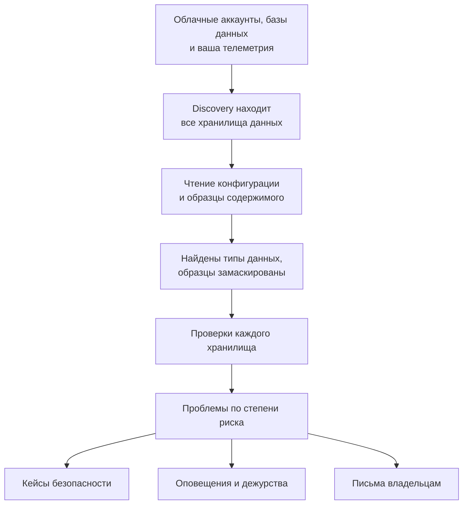

# Безопасность данных

Безопасность данных находит конфиденциальные данные, которые хранит ваша компания, — в облачных бакетах, базах данных и хранилищах аналитических данных, а также в телеметрии, которую вы отправляете в OneUptime, — и сообщает, что не так с тем, как они хранятся. Она сама находит хранилища, читает, как настроено каждое из них, берёт образцы того, что в них лежит, и открывает проблему для каждой неполадки, упорядочивая их по риску.

Она отвечает на четыре вопроса:

:::cards
- [Где наши конфиденциальные данные?](/docs/data-security/data-types): 143 типа данных, от номеров карт и национальных идентификаторов до ключей API, найденные в бакетах, таблицах и телеметрии.
- [Доступны ли они извне?](/docs/data-security/checks-and-issues): 32 проверки каждого хранилища: публичный доступ, шифрование, резервные копии, журналирование, секреты и копии.
- [Кто имеет к ним доступ и куда они уходят?](/docs/data-security/flows-access-residency): Кто может читать каждое хранилище, какие сервисы его используют и до каких поставщиков ИИ и хостов доходят его данные.
- [Соответствуют ли они нашим правилам?](/docs/data-security/compliance): Правила размещения данных и девять стандартов соответствия с оценкой по тому, что нашли сканирования.
:::

## Как это работает

1. **Discovery** находит хранилища, о которых OneUptime уже знает: ваш облачный инвентарь, базы данных, которые отслеживает продукт Database, базы данных, к которым обращаются ваши сервисы на карте сервисов, и телеметрию каждого сервиса. Добавлять хранилище вручную нужно, только когда его нет ни в одном источнике.
2. **Чтение конфигурации** спрашивает у каждого облака, как настроено каждое хранилище: кто имеет к нему доступ, как оно зашифровано, как для него создаются резервные копии и ведутся журналы. Оно читает настройки и никогда не читает данные.
3. **Образцы содержимого** читают немного того, что лежит в хранилище, там, где вы это разрешили: несколько объектов каждого вида в бакете, несколько строк каждой таблицы, самые новые записи телеметрии каждого сервиса.
4. **Классификация** находит конфиденциальные значения в образцах и сохраняет количества и замаскированные образцы, но никогда не сами значения.
5. **Проверки** определяют, что не так с каждым хранилищем и насколько это плохо для данных, которые в нём лежат. Каждая непройденная проверка открывает проблему, которая закрывается сама, как только проверка проходит.

## Чем она отличается

- **Ваша телеметрия — это хранилище данных.** Журналы, трассировки, исключения, записи сеансов и разговоры с ИИ каждого сервиса проверяются, как бакет, каждый час. Адрес электронной почты в строке журнала — это находка, и **Очистить** с этого момента маскирует его при приёме. См. [Конфиденциальные данные в телеметрии](/docs/data-security/telemetry).
- **Потоки берутся из реального трафика.** Карта сервисов показывает, какой сервис использует какую базу данных, вызовы ИИ называют поставщика, к которому обращаются, а копии продакшен-данных находятся сравнением отпечатков. См. [Потоки данных, доступ и размещение](/docs/data-security/flows-access-residency).
- **Доказательства всегда замаскированы.** Находка хранит количества и не больше трёх замаскированных образцов, например `j***@e******.com`, которые маскируются внутри сканера, прежде чем что-либо его покинет. Отключите образцы, и она будет хранить только количества.
- **Сканер — с открытым исходным кодом.** Шаблон, контрольная сумма, контекстные слова и тестовые значения каждого типа данных лежат в исходном коде OneUptime, так что вы можете прочитать, что именно даёт находку. Тот же код выполняется на воркерах OneUptime, на зонде и в поле **Проверить**.
- **Она работает с остальным OneUptime.** Критическая проблема открывает кейс безопасности по хранилищу, и [Security Operations](/docs/telemetry/security-cases) разбирает его, как любую другую угрозу. Она может создать оповещение, которое вызовет дежурного, и отправляет письмо владельцам хранилища. См. [Интеграции Безопасности данных](/docs/data-security/integrations).
- **OneUptime AI помогает исправить.** **Объяснить с ИИ** говорит владельцу хранилища, что не так и как это исправить в его облаке, а **Исправить с ИИ** открывает pull request в коде вашей инфраструктуры.

## Перед началом

- **Роль, которая может её настроить.** Настройки Безопасности данных меняют роли Project Owner, Project Admin и Security Admin. Роль Security Member работает с проблемами и сканирует хранилища, а Security Viewer читает найденное. Другие роли ничего этого не видят, если их команде не выданы её разрешения: в каких бакетах лежат номера карт — это именно то, что хочет знать злоумышленник. См. [Роли](/docs/permissions/reference#роли).
- **Облачный аккаунт для чтения или база данных.** Безопасность данных читает облачный аккаунт через [облачное подключение](/docs/telemetry/cloud-accounts), а базу данных, которую вы обслуживаете сами, — через строку подключения только для чтения. Телеметрии ничего не нужно: она сканируется каждый час.

## Быстрый старт

:::steps
### Подключите облачный аккаунт

Откройте **Облако → Подключить** и выберите своё облако. Если аккаунт уже подключён, выберите вместо этого **Редактировать** в его подключении. [Подключение облачного аккаунта](/docs/telemetry/cloud-accounts) по шагам описывает каждое облако.

### Выберите уровень безопасности данных

В разделе **Дополнительные поля** задайте для **Безопасность данных** значение **Только конфигурация**, чтобы проверять, как настроено каждое хранилище, или **Конфигурация и образцы содержимого**, чтобы также находить конфиденциальные данные внутри них. Команда, которую показывает форма, меняется вместе с вашим выбором: выполните её в оболочке своего облака, как сказано в форме. [Настройка Безопасности данных](/docs/data-security/setup) перечисляет, что именно даёт каждый уровень, а [Подключение облачного аккаунта](/docs/telemetry/cloud-accounts#безопасность-данных) показывает команду каждого уровня.

### Просмотрите проблемы

Откройте **Безопасность данных**. Хранилища появляются в разделе **Хранилища данных** по мере того, как их находит Discovery, каждые 15 минут, а конфигурация подключения читается в течение часа. Проблемы открываются в разделе **Проблемы**, как только завершается чтение или сканирование, каждая со своей оценкой риска, а **Обзор** показывает пять самых рискованных. Каждая проблема говорит, что не так, почему это важно и как это исправить, с командами для вашего облака.
:::

## Что считается хранилищем данных

| Где | Хранилища | Образцы содержимого |
| --- | --- | --- |
| AWS | AWS S3 Bucket, AWS RDS Instance, AWS Aurora Cluster, AWS RDS Snapshot, AWS DynamoDB Table, AWS Redshift Cluster, AWS DocumentDB Cluster, AWS OpenSearch Domain, AWS ElastiCache Cluster, AWS EFS File System | AWS S3 Bucket |
| Azure | Azure Storage Account, Azure SQL Database, Azure Cosmos DB Account, Azure PostgreSQL Server, Azure MySQL Server | Azure Storage Account |
| Google Cloud | Google Cloud Storage Bucket, Google Cloud SQL Instance, Google BigQuery Dataset, Google Firestore Database, Google Spanner Instance, Google Bigtable Instance | Google Cloud Storage Bucket, Google BigQuery Dataset |
| Ваши собственные базы данных | PostgreSQL, MySQL, MongoDB, SQL Server, Oracle, Redis, Elasticsearch | PostgreSQL, MySQL |
| OneUptime | Журналы, трассировки, исключения, записи сеансов, разговоры с ИИ | Журналы, трассировки, исключения, записи сеансов, разговоры с ИИ |

Каждое хранилище получает проверки, которые подходят к его виду. Хранилище, из содержимого которого нельзя взять образцы, всё равно проверяется: публичный бакет или незашифрованная база данных — это проблема, что бы в них ни лежало.

Хранилище архивируется вместе с его историей, как только источник перестаёт его перечислять, а его открытые проблемы устраняются: оно остаётся в разделе **Архивные хранилища** в конце меню Безопасности данных. Оно возвращается само, если источник снова его перечислит, а проблема, проверка которой всё ещё не проходит, открывается снова.

**Хронология** хранилища показывает, что с ним происходило и кто это сделал: когда его нашли или добавили, каждое изменение его настроек и владельцев, когда его архивировали или оно вернулось, и каждый случай доступности извне, закрытый из проблемы или плейбука.

## Как часто она работает

| Что | Когда |
| --- | --- |
| Поиск новых хранилищ | Каждые 15 минут |
| Чтение конфигурации облачного подключения | Раз в день, а также в течение часа после того, как CloudTrail зафиксирует изменение доступа, шифрования, резервного копирования или общего доступа хранилища AWS |
| Образцы содержимого хранилища | Каждые 24 часа или так часто, как задано в **Интервал сканирования (часы)** |
| Образцы телеметрии каждого сервиса | Каждый час, за последний час |
| Повторная проверка каждого хранилища | После каждого чтения и сканирования, после любого изменения того, от чего зависит проверка, и раз в день |

**Сканировать сейчас** в хранилище сразу берёт образцы его содержимого, а **Проверить сейчас** заново читает его конфигурацию.

## Дальнейшие шаги

:::cards
- [Настройка Безопасности данных](/docs/data-security/setup): Три уровня, разрешения, которые даёт каждый из них, и сканирование ваших собственных баз данных.
- [Типы конфиденциальных данных](/docs/data-security/data-types): Как находится значение и все типы данных, которые знает Безопасность данных.
- [Проверки и проблемы Безопасности данных](/docs/data-security/checks-and-issues): Каждая проверка, оценка риска и что происходит с проблемой.
- [Интеграции Безопасности данных](/docs/data-security/integrations): Кейсы безопасности, оповещения, владельцы, рабочие процессы и OneUptime AI.
:::
