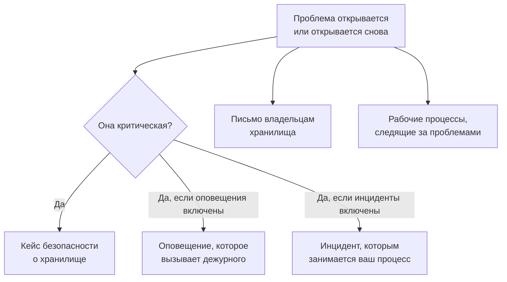

# Интеграции Безопасности данных

У Безопасности данных нет собственной системы вызова дежурных или очереди безопасности. Она передаёт то, что находит, тем частям OneUptime, которые уже этим занимаются: критическая проблема становится кейсом безопасности и может вызвать дежурного или объявить инцидент, а о каждой новой проблеме владельцам хранилища приходит письмо. Рабочие процессы, OneUptime AI, API, Terraform и MCP-сервер имеют доступ ко всему, что она хранит.

:::cards
- [Security Operations](#security-operations): Кейс безопасности для каждого хранилища с критической проблемой.
- [Оповещения и дежурства](#оповещения-и-дежурства): Вызывайте дежурного, когда открывается критическая проблема.
- [Инциденты](#инциденты): Объявите инцидент при нарушении безопасности, которым должен заниматься ваш процесс реагирования на инциденты.
- [Владельцы](#владельцы): Кто владеет каждым хранилищем (назначенные вручную или правилами) и какое письмо они получают.
- [OneUptime AI](#oneuptime-ai): Объясните проблему, откройте pull request с исправлением или спросите «Спросить ИИ» о своих данных.
- [Устранение доступности извне](#устранение-доступности-извне): Заблокируйте публичный доступ или прекратите общий доступ из проблемы или плейбука.
:::

## Как это работает

Каждое из этих действий выполняется, когда оценка открывает проблему или открывает её снова. Каждое выполняется по мере возможности: проблема уже открыта и есть в своей хронологии, поэтому неудавшаяся интеграция записывается в журнал и пропускается, но никогда не повторяется так, чтобы получился второй кейс или второй вызов. Что сделало каждое из них, записывается в **Хронология** проблемы, а на её странице есть ссылки на кейс, оповещение и инцидент, которые она запустила.

| Настройка | По умолчанию | Что делает |
| --- | --- | --- |
| **Открывать кейсы безопасности** | Включено | Критическая проблема открывает кейс безопасности, сгруппированный по хранилищу. |
| **Создавать оповещения** | Выключено | Критическая проблема создаёт оповещение, которое вызывает дежурного. |
| **Серьёзность оповещения** | Пусто | Серьёзность этих оповещений. Если поле пустое, это самая высокая серьёзность проекта. |
| **Объявлять инциденты** | Выключено | Критическая проблема объявляет инцидент, которым занимается ваш процесс реагирования на инциденты. |
| **Серьёзность инцидента** | Пусто | Серьёзность этих инцидентов. Если поле пустое, это самая высокая серьёзность проекта. |
| **Уведомить владельцев** | Включено | О каждой новой проблеме владельцам её хранилища приходит письмо. |

## Security Operations

Каждое хранилище — отдельная сущность в Security Operations с типом **Хранилище данных**. Когда **Открывать кейсы безопасности** включено, критическая проблема отправляется в Security Operations как обнаружение, относящееся к хранилищу:

- его источник — **Безопасность данных**, а его правило названо по проверке, например `Data Security: public-read`;
- оно критическое, поэтому кейс, который оно открывает, получает критический приоритет проекта;
- оно группируется по хранилищу: вторая критическая проблема в том же хранилище присоединяется к открытому кейсу о нём, а не открывает новый.

Дальше с кейсом работают как с любым другим: его назначают, дополняют заметками, закрывают, а плейбуки проекта на него реагируют. Обнаружения хранилища учитываются в его риске на странице [Риск сущностей](/docs/telemetry/security-entity-risk), как и у любой сущности. См. [Кейсы безопасности и плейбуки](/docs/telemetry/security-cases).

## Оповещения и дежурства

Когда **Создавать оповещения** включено, критическая проблема создаёт оповещение, название которого состоит из «Data Security:», заголовка проблемы и хранилища. Оповещение вызывает дежурного по своим правилам, как любое другое оповещение (см. [Оповещения](/docs/alerts/index) и [Дежурства](/docs/on-call/index)). У проблемы одновременно не больше одного открытого оповещения, как бы часто она ни оценивалась. **Серьёзность оповещения** задаёт серьёзность оповещения; если поле пустое, это самая высокая серьёзность проекта.

Оповещение завершается вместе со своей проблемой: как только проблема перестаёт быть открытой — её проверка проходит или человек отмечает её как устранённую, принимает её риск или говорит, что это не проблема, — оповещение устраняется, и **Хронология** проблемы сообщает об этом. Проблема, которая открывается снова, создаёт новое оповещение.

Оповещения по умолчанию выключены, потому что большинство команд хотят сначала видеть находку безопасности данных в кейсе безопасности. Включите их, когда из-за публичного бакета с номерами карт кого-то нужно разбудить.

## Инциденты

Когда **Объявлять инциденты** включено, критическая проблема объявляет инцидент, названный так же, как её оповещение, — для нарушения безопасности, которым должен заниматься ваш процесс реагирования на инциденты: дежурства, каналы рабочего пространства, страницы статуса и постмортем (см. [Инциденты](/docs/incidents/index)). У проблемы одновременно не больше одного открытого инцидента. **Серьёзность инцидента** задаёт серьёзность инцидента; если поле пустое, это самая высокая серьёзность проекта.

Безопасность данных никогда не устраняет инцидент, даже когда его проблема устранена: у инцидента могут быть страница статуса и постмортем, поэтому его закрывает тот, кто его ведёт. Кейс безопасности — другой путь к инциденту: **Объявить инцидент** в кейсе открывает инцидент, связанный с ним (см. [Объявление инцидента](/docs/telemetry/security-cases#объявление-инцидента)).

## Владельцы

Владельцы хранилища — это люди и команды на странице **Владельцы** хранилища. Проблема адресована именно им: они получают письмо, а **У этого конфиденциального хранилища нет владельца** не проходит для конфиденциального хранилища без владельцев.

Когда **Уведомить владельцев** включено, каждая оценка, которая открывает проблемы в хранилище, отправляет его владельцам одно письмо — людям, которые им владеют, и участникам команд-владельцев, не больше 50, — с темой, где сказано, сколько новых проблем у хранилища, например «Data Security: 2 new issues on orders-db». В нём перечислены серьёзность и заголовок каждой новой проблемы и чувствительность хранилища, а также есть ссылка на хранилище. Образцов в нём никогда нет.

### Правила владельца и правила меток

Правила задают владельцев и метки за вас по мере того, как находятся хранилища:

| Правило | Где | Что делает |
| --- | --- | --- |
| **Правила владельца** | **Безопасность данных → Правила → Правила владельца** | Добавляет пользователей и команды-владельцев в каждое подходящее хранилище |
| **Правила меток** | **Безопасность данных → Правила → Правила меток** | Добавляет метки в каждое подходящее хранилище |

Правило подходит хранилищу по его меткам, по шаблону его имени или описания или по **Шаблон облачного тега**: шаблону, который сравнивается с каждым облачным тегом хранилища, записанным как `key=value`. `^team=payments$` подходит каждому хранилищу с тегом `team=payments`, а `^env=` — каждому хранилищу с тегом `env`. Новое хранилище получает правила проекта в момент, когда его находят, а **Уведомить владельцев** правила владельца определяет, сообщают ли владельцам, которых оно добавляет. [Правила меток и владельцев](/docs/configuration/label-and-owner-rules) описывает, как подходит каждое правило и когда выполняются правила.

## Рабочие процессы

**Хранилище данных** и **Проблема безопасности данных** — триггеры рабочих процессов, у каждого есть **При создании**, **При обновлении**, **При создании или обновлении** и **При удалении**. Выберите их на панели **Добавить триггер** в разделе **Ресурсы OneUptime**.

- **Проблема безопасности данных → При создании** выполняется, когда проблема открывается впервые. Прочитайте её серьёзность в блоке **Если / Иначе** и публикуйте критические проблемы в канал или открывайте тикет в своём трекере.
- **Проблема безопасности данных → При обновлении**, где в **Отслеживаемые поля** выбран её статус, выполняется, когда проблему устраняют, принимают или она открывается снова.
- **Хранилище данных → При создании** выполняется, когда обнаружение находит хранилище, например чтобы сообщать команде о каждом новом бакете.

Поля, которые передаёт каждый триггер, см. в [Триггеры рабочих процессов](/docs/workflows/triggers).

## OneUptime AI

Два действия в проблеме просят помощи у OneUptime AI. Оба отправляют OneUptime AI заголовок и серьёзность проблемы, имя, вид, регион и облачный ID хранилища, его чувствительность и типы данных, доказательства, почему проверка важна, и исправление для облака хранилища, но никогда не образцы находки. Оба работают в рамках переключателей и ограничений OneUptime AI проекта.

- **Объяснить с ИИ** пишет для владельца хранилища, что не так, что может случиться, и точные шаги исправления в его облаке. Объяснение сохраняется в **Хронология** проблемы. Запросить его может любой, у кого есть доступ к Безопасности данных на чтение.
- **Исправить с ИИ** просит OneUptime AI исправить проблему в коде вашей инфраструктуры (Terraform, CloudFormation, Bicep и т. п.) минимальным изменением, с которым проверка проходит, и открыть pull request. Для этого нужен репозиторий с кодом инфраструктуры хранилища, подключённый в разделе **Код**: выберите его в **Репозиторий**, если у проекта их несколько. Pull request появляется в разделе **Код** (см. [Код](/docs/ai/ai-agent)). Запросить его может роль Security Member и выше.

### Спросить ИИ

**Спросить ИИ** тоже читает Безопасность данных. На любой странице Безопасности данных спросите, в каких хранилищах есть номера карт, что исправить в первую очередь или к каким хранилищам дала бы доступ роль в случае её утечки; на странице хранилища или проблемы он сначала читает эту запись. Он отвечает с помощью трёх инструментов чтения, которые работают с вашими собственными разрешениями:

| Инструмент | Что читает |
| --- | --- |
| `query_data_stores` | Хранилища, самые рискованные первыми, по чувствительности, типу данных, доступности извне, поставщику или имени — или одно хранилище с тем, что и где в нём найдено, кто имеет к нему доступ, и его открытыми проблемами |
| `query_data_security_issues` | Проблемы, самые рискованные первыми, по статусу, серьёзности, хранилищу или проверке — или одна проблема с её доказательствами и исправлением для её облака |
| `query_data_store_access` | Кто имеет доступ к хранилищу или все хранилища, к которым имеет доступ один субъект |

Они читают типы данных, расположения и количества, но никогда не образцы находки, замаскированные или нет. «Спросить ИИ» ничего не меняет в Безопасности данных.

## Устранение доступности извне

Доступность облачного хранилища извне устраняют два изменения, каждое через облачное подключение хранилища, в котором включено **Реагирование безопасности данных** (см. [Настройка Безопасности данных](/docs/data-security/setup#позвольте-безопасности-данных-закрывать-доступ-извне)):

- **Заблокировать публичный доступ** — для бакета S3, учётной записи хранения Azure или бакета Cloud Storage.
- **Отозвать общий доступ** — для снимка RDS или для общих ручных снимков базы данных RDS, кластера Aurora или кластера DocumentDB.

Человек запускает одно из них из открытой проблемы, которую оно устраняет, с помощью **Исправить отсюда** (см. [Проверки и проблемы Безопасности данных](/docs/data-security/checks-and-issues#исправить-отсюда)). Плейбук Security Operations запускает их как шаги категории **Локализация** — **Блокировать публичный доступ к хранилищам данных** и **Отзывать общий доступ к хранилищам данных**: для каждого хранилища данных, к которому относится кейс, но не больше 10, и каждый такой шаг начинается с включённым **Нужно одобрение**. Хранилище, отмеченное как **Публичный намеренно**, никогда не блокируется. В любом случае лента хранилища сообщает, что было сделано, и хранилище сразу проверяется снова, поэтому проблема устраняется, если изменение применилось.

## API, Terraform и MCP

Всё, что хранит Безопасность данных, — это записи API OneUptime, которые читаются с теми же разрешениями, что и в панели управления (см. [Справочник API](/docs/api-reference/api-reference)):

| Записи | Путь API |
| --- | --- |
| Хранилища данных, их хронологии, их находки и кто имеет к ним доступ | `/data-store`, `/data-store-feed`, `/data-store-finding`, `/data-store-access` |
| Проблемы, их хронологии и потоки данных | `/data-security-issue`, `/data-security-issue-feed`, `/data-security-flow` |
| Сканирования | `/data-security-scan` |
| Пользовательские типы данных, настройки проверок и правила размещения данных | `/data-security-custom-data-type`, `/data-security-check-setting`, `/data-security-residency-rule` |
| Настройки проекта | `/data-security-setting` |
| Владельцы, правила владельца и правила меток | `/data-store-owner-user`, `/data-store-owner-team`, `/data-store-owner-rule`, `/data-store-label-rule` |

Некоторые ответы вычисляются по запросу, а не хранятся. Каждый из них — это `POST`:

| Путь | Что делает |
| --- | --- |
| `/data-security/overview` | Показатели страницы «Обзор»: хранилища по чувствительности и категории, открытые проблемы по серьёзности, самые рискованные проблемы и проблемы за последние 30 дней |
| `/data-security/compliance` | Оценка и требования каждого стандарта соответствия |
| `/data-security/record-of-processing` | Реестр обработки GDPR, по строке на каждое хранилище с персональными данными |
| `/data-store/<id>/scan-now` | **Сканировать сейчас**: сразу делает выборку содержимого хранилища |
| `/data-store/<id>/check-now` | **Проверить сейчас**: заново читает конфигурацию хранилища и выполняет его проверки |
| `/data-store-finding/<id>/scrub` | **Очистить** для находки в телеметрии |
| `/data-security-issue/<id>/explain` | **Объяснить с ИИ** для проблемы |
| `/data-security-issue/<id>/fix-with-ai` | **Исправить с ИИ** для проблемы |
| `/data-store/<id>/response-actions` | Какие действия реагирования хранилище может выполнить сейчас, а если не может, то почему |
| `/data-store/<id>/respond` | **Заблокировать публичный доступ** или **Отозвать общий доступ** для хранилища с указанием проблемы, из которой запущено действие |

У [провайдера Terraform](/docs/terraform/index) есть ресурс для каждого вида записей, которые вы создаёте (хранилища данных, которые вы добавляете сами, пользовательские типы данных, настройки проверок, правила размещения данных, правила владельца и правила меток), названный по записи, например `oneuptime_residency_rule`.

У [MCP-сервера](/docs/ai/mcp-server) есть инструменты создания, получения, вывода списка, обновления, удаления и подсчёта для этих записей: Data Store, Data Store Finding, Data Store Access Entry, Data Flow, Data Security Issue, Data Security Scan, Custom Data Type, Check Setting, Residency Rule и Data Security Setting. Тогда ИИ-ассистент может спросить с вашими разрешениями, в каких хранилищах есть номера карт или что открыто в бакете.

## Дальнейшие шаги

:::cards
- [Кейсы безопасности и плейбуки (SOAR)](/docs/telemetry/security-cases): Работайте с кейсами, которые открывает Безопасность данных.
- [Правила меток и владельцев](/docs/configuration/label-and-owner-rules): Как правила подходят ресурсам и когда они выполняются.
- [Триггеры рабочих процессов](/docs/workflows/triggers): Запускайте рабочий процесс, когда открывается проблема или находится хранилище.
- [Проверки и проблемы Безопасности данных](/docs/data-security/checks-and-issues): Что означает каждая проблема и как её исправить.
:::
