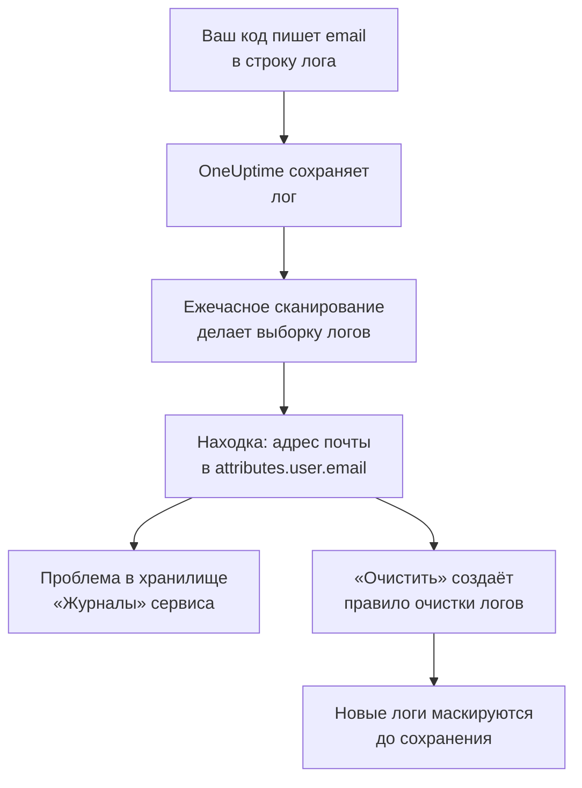

# Конфиденциальные данные в телеметрии

Телеметрия содержит всё, что пишет ваш код: адрес электронной почты в строке лога, номер карты в атрибуте спана, токен в трассировке стека, вопрос клиента в промпте. Безопасность данных считает логи, трассировки, исключения и разговоры с ИИ каждого сервиса, а также сеансы каждого RUM-приложения отдельными хранилищами данных. Каждый час она берёт из них выборку, находит в них конфиденциальные данные так же, как в бакете, а **Очистить** превращает находку в правило очистки, которое с этого момента маскирует эти данные при приёме.

Ничего настраивать не нужно: телеметрия каждого сервиса сканируется каждый час, если в настройках проекта не выключено **Сканировать телеметрию**.

:::cards
- [Что читается](#что-читается): Атрибуты, тела, сообщения и промпты каждого сигнала.
- [Как сканирование делает выборку](#как-сканирование-делает-выборку): Самые новые записи каждого сервиса, каждый час.
- [Очистить](#очистить): Маскируйте находку при приёме одним щелчком.
- [Что считается очищенным](#что-считается-очищенным): Когда правило очистки уже охватывает находку.
:::

## Как это работает

Находка, которую охватывает правило очистки, помечается как очищенная: то, что осталось от этих данных, — старые данные, которые ждут окончания срока хранения, а не утечка, которая продолжается. Две проверки телеметрии учитывают только то, что не охватывает ни одно правило, поэтому их проблема устраняется, как только очищена каждая находка (см. [Проверки телеметрии](/docs/data-security/checks-and-issues#телеметрия)).

## Что читается

| Хранилище | Что читается | На что указывает находка |
| --- | --- | --- |
| Журналы | Каждый атрибут и тело | `attributes.<key>`, `body` |
| Трассировки | Каждый атрибут спана и атрибуты каждого события спана | `attributes.<key>`, `events.<event>.<key>` |
| Исключения | Сообщение, трассировка стека и атрибуты | `message`, `stackTrace`, `attributes.<key>` |
| Разговоры с ИИ | Промпты и ответы каждого вызова ИИ под ключами, куда их помещают соглашения GenAI, и все остальные атрибуты | Ключ, в котором они находятся, например `gen_ai.input.messages` или `gen_ai.prompt[].content` |
| Записи сеансов | Атрибуты спанов и логов RUM-приложения, атрибуты его сеансов, признаки, которые `identify()` присвоил его пользователям, и переданная ему ссылка на пользователя | `spans.attributes.<key>`, `logs.attributes.<key>`, `sessions.attributes.<key>`, `sessions.identifiedUserTraits.<key>`, `sessions.identifiedUserLabel` |

Нумерованные ключи сводятся в одно расположение: `gen_ai.prompt.3.content` — это `gen_ai.prompt[].content`, поэтому двадцать сообщений чата дают одну находку, а не двадцать. Атрибуты, которые OneUptime добавляет сам и которые начинаются с `oneuptime.`, не читаются.

### Почему запись сеанса никогда не читается

Запись сеанса хранит текст страниц, которые видели люди. Для её просмотра нужно отдельное разрешение, а находка, прочитанная из неё, показала бы замаскированный текст страниц каждому, у кого есть доступ к Безопасности данных. Поэтому у сеанса читаются только атрибуты: спаны, логи и сведения о сеансе, которые хранятся рядом с записью. Рекордер уже маскирует то, что записывает в браузере, а правила очистки логов применяются и к записям (см. [Запись сеансов](/docs/telemetry/session-replay)).

### Разговоры с ИИ

Промпт вызова ИИ несёт весь чат до самого нового сообщения человека, поэтому из каждого значения вызова ИИ читается до 16 384 символов. Когда в разговорах с ИИ есть конфиденциальные данные, из этого следуют ещё две вещи: поставщик ИИ, которому шли вызовы, становится потоком этих данных, а для хранилища не проходит проверка [Конфиденциальные данные отправляются поставщику ИИ](/docs/data-security/checks-and-issues#ии).

Разговоры [корпоративного инструмента ИИ](/docs/telemetry/ai-company-tools) не учитываются. Читать их могут только роли Project Owner и Project Admin, а находка попадает туда, где её видит каждый, у кого есть доступ к Безопасности данных, поэтому спаны этих сервисов никогда не читаются, а их разговоры с ИИ отмечаются как непрочитанные.

## Как сканирование делает выборку

Каждый час читаются самые новые записи каждого сигнала за последний час, и они классифицируются поле за полем, как в любом другом хранилище (см. [Поля и столбцы](/docs/data-security/data-types#поля-и-столбцы)):

| Ограничение | Значение |
| --- | --- |
| Записей каждого сервиса и сигнала | **Размер выборки телеметрии**, по умолчанию 500, не больше 1 000 |
| Сервисов или RUM-приложений, читаемых для каждого сигнала | 200 самых загруженных |
| Записей за одно чтение | 5 000, общие для всех сервисов; 500 для вызовов ИИ |
| Символов тела лога, сообщения исключения или трассировки стека | 8 192 |
| Символов значения атрибута | 4 096 |
| Символов значения вызова ИИ | 16 384 |
| Атрибутов одной записи | 128; 64 для вызова ИИ |
| Событий одного спана и атрибутов одного события | 16 и 32 |
| Расположений одного хранилища | 500 |

Каждое значение обрезается ещё в базе данных, поэтому ни одно длинное значение её не покидает, а каждое чтение останавливается через 30 секунд. Неудачное чтение становится предупреждением в тех хранилищах, для которых оно выполнялось; сканирование переходит к следующему.

Чтобы что-то исключить, добавьте это в **Исключения сканирования** хранилища: расположение целиком (`attributes.http.url`), всё, что под ним (`attributes.http`), или просто ключ атрибута (`http.url`).

## Очистить

**Очистить** в находке создаёт правило очистки, которое с этого момента скрывает этот тип данных в этом расположении, или указывает на включённое правило, которое уже это делает:

:::steps
### Откройте находку

Откройте хранилище телеметрии (например, **Журналы** сервиса) и находку.

### Нажмите «Очистить»

Нажмите **Очистить**. OneUptime создаёт правило очистки логов для логов и логов RUM-приложения и правило очистки трассировок для спанов, исключений и вызовов ИИ — для той части записи, где находится находка.

### Исправьте и код

Правило маскирует новые данные до того, как они сохранятся. Уже сохранённые данные остаются до окончания срока хранения, поэтому исправьте код, который их пишет: в находке указаны сервис и атрибут.
:::

Правило называется по тому, что оно скрывает, например «Data Security: Email address in attributes.user.email», и отображается вместе с другими вашими правилами очистки (см. [Фильтры отбрасывания и правила очистки](/docs/telemetry/drop-filters-and-scrub-rules#очищать-конфиденциальные-данные)). Это одно из следующих правил:

| Находка | Правило, которое создаёт «Очистить» |
| --- | --- |
| Адрес электронной почты, номер карты, номер социального страхования США, номер телефона или IP-адрес | Встроенный шаблон этого типа. Номера карт, номера социального страхования и номера телефонов маскируются, остальное скрывается полностью. |
| Значение под ключом, который выглядит конфиденциальным, например `password` или `token` | Правило **Sensitive Attribute Keys**, которое полностью скрывает значение каждого такого атрибута |
| Любой другой тип данных, который может найти шаблон | Правило **Пользовательское регулярное выражение**, созданное из собственных шаблонов типа данных, которое полностью скрывает каждое значение такого вида |

Некоторые находки нельзя очистить правилом, и **Очистить** объясняет почему:

- Тип данных, найденный только по именам полей, например имя человека: его не может найти ни один шаблон. Переименуйте атрибут в ключ, который скрывает правило конфиденциальных ключей, или перестаньте его отправлять.
- Тип данных, который отличается от других значений только словами вокруг него, например банковский маршрутный номер: правило скрыло бы гораздо больше, чем этот тип данных.
- Гриф документа: если скрыть слово, документ от этого не скроется.
- Один из ваших собственных типов данных: добавьте пользовательское правило очистки с его шаблоном сами.
- Собственные сведения сеанса (`sessions.*`): при приёме записей сеансов правила очистки не применяются.

**Очистить** создаёт правило от вашего имени и с вашими разрешениями: эту кнопку могут нажать роли Project Owner и Project Admin, а также команда, которой разрешено создавать правила очистки логов, а для спанов, исключений и вызовов ИИ — правила очистки трассировок.

## Что считается очищенным

Находка помечается как очищенная, только если при приёме к ней применилось бы включённое правило и это правило нашло бы её тип данных:

- **Нужные записи.** Правила логов охватывают логи и логи RUM-приложения. Правила трассировок охватывают спаны, исключения и вызовы ИИ: исключение — это копия события исключения из его спана, поэтому правила, которые очищают события, очищают и его.
- **Нужная часть.** **Поля для очистки** правила включают ту часть записи, где находится находка, или правило оставляет их по умолчанию.
- **Шаблон, который находит тип.** Встроенный **Тип шаблона** находит свой тип данных: **Адрес электронной почты** находит адреса электронной почты, **Номер кредитной карты** — номера карт, **SSN (номер социального страхования)** — номера социального страхования США, **Номер телефона** — номера телефонов, а **IP-адрес** — IP-адреса. **Sensitive Attribute Keys** охватывает каждое значение под ключом, который выглядит конфиденциальным, каким бы ни было это значение.
- **Ваши собственные пользовательские шаблоны никогда не учитываются.** **Пользовательское регулярное выражение** охватывает находку, только если это в точности тот шаблон, который **Очистить** создаёт для её типа. Находка хранит только замаскированные образцы, на которых нельзя опробовать ни один шаблон, поэтому OneUptime не может доказать, что ваш шаблон скрывает данные, а находка, ошибочно названная очищенной, — это утечка, на которую никто не смотрит.

Правило, которое выключено или ничего не очищает, никогда не учитывается. Охват пересчитывается после каждого сканирования, поэтому правило, которое вы добавили или удалили вручную, в течение часа меняет то, что помечено как очищенное.

## Дальнейшие шаги

:::cards
- [Фильтры отбрасывания и правила очистки](/docs/telemetry/drop-filters-and-scrub-rules): Все параметры правил очистки и правила, которые вы пишете сами.
- [Проверки и проблемы Безопасности данных](/docs/data-security/checks-and-issues): Две проверки телеметрии и проверки ИИ.
- [Потоки данных, доступ и размещение](/docs/data-security/flows-access-residency): Поставщики ИИ и хосты, в которые ваши сервисы отправляют данные.
:::
