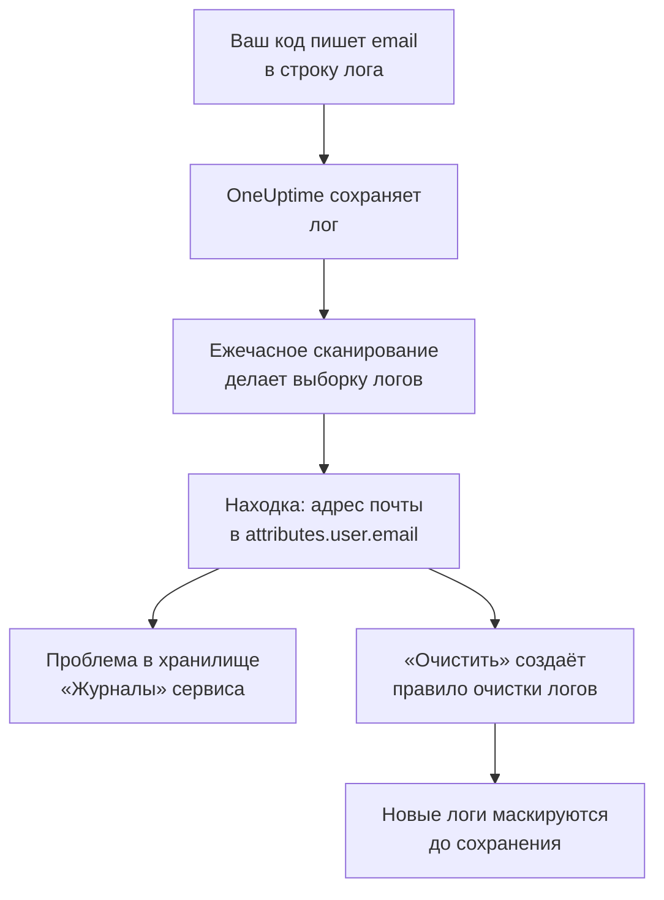

# Конфиденциальные данные в телеметрии

Телеметрия содержит всё, что пишет ваш код: адрес электронной почты в строке лога, номер карты в атрибуте спана, токен в трассировке стека, вопрос клиента в промпте, IP-адрес пользователя в метке метрики. Безопасность данных считает логи, трассировки, метрики, исключения и разговоры с ИИ каждого сервиса, а также сеансы каждого RUM-приложения отдельными хранилищами данных. Каждый час она берёт из них выборку, находит в них конфиденциальные данные так же, как в бакете, а **Очистить** превращает находку в правило, которое с этого момента маскирует эти данные при приёме.

Ничего настраивать не нужно: телеметрия каждого сервиса сканируется каждый час, если в настройках проекта не выключено **Сканировать телеметрию**. Чтобы исключить логи, трассировки или другой сигнал одного сервиса, выключите **Сканировать содержимое** в разделе **Настройки** этого хранилища: начиная со следующего сканирования из него ничего не читается.

:::cards
- [Что читается](#что-читается): Атрибуты, тела, сообщения и промпты каждого сигнала.
- [Как сканирование делает выборку](#как-сканирование-делает-выборку): Самые новые записи каждого сервиса, каждый час.
- [Очистить](#очистить): Маскируйте находку при приёме одним щелчком.
- [Отбросить эту метрику](#отбросить-эту-метрику): Перестаньте сохранять метрики, имена которых содержат конфиденциальные данные.
- [Что считается очищенным](#что-считается-очищенным): Когда правило очистки уже охватывает находку.
:::

## Как это работает

Находка, которую охватывает правило очистки, помечается как очищенная: то, что осталось от этих данных, — старые данные, которые ждут окончания срока хранения, а не утечка, которая продолжается. Две проверки телеметрии учитывают только то, что не охватывает ни одно правило, поэтому их проблема устраняется, как только очищена каждая находка (см. [Проверки телеметрии](/docs/data-security/checks-and-issues#телеметрия)).

## Что читается

| Хранилище | Что читается | На что указывает находка |
| --- | --- | --- |
| Журналы | Каждый атрибут и тело | `attributes.<key>`, `body` |
| Трассировки | Каждый атрибут спана и атрибуты каждого события спана | `attributes.<key>`, `events.<event>.<key>` |
| Исключения | Сообщение, трассировка стека и атрибуты | `message`, `stackTrace`, `attributes.<key>` |
| Разговоры с ИИ | Промпты и ответы каждого вызова ИИ под ключами, куда их помещают соглашения GenAI, и все остальные атрибуты | Ключ, в котором они находятся, например `gen_ai.input.messages` или `gen_ai.prompt[].content` |
| Записи сеансов | Атрибуты спанов и логов RUM-приложения, атрибуты его сеансов, признаки, которые `identify()` присвоил его пользователям, и переданная ему ссылка на пользователя | `spans.attributes.<key>`, `logs.attributes.<key>`, `sessions.attributes.<key>`, `sessions.identifiedUserTraits.<key>`, `sessions.identifiedUserLabel` |
| Метрики | Каждый атрибут точки данных, включая атрибуты её ресурса, и имена метрик | `attributes.<key>`, `attributes.resource.<key>`, `name` |

Нумерованные ключи сводятся в одно расположение: `gen_ai.prompt.3.content` — это `gen_ai.prompt[].content`, поэтому двадцать сообщений чата дают одну находку, а не двадцать. Атрибуты, которые OneUptime добавляет сам и которые начинаются с `oneuptime.`, не читаются.

### Метрики

Атрибуты метрики — это метки её рядов. Они одинаковы во всех точках данных одного ряда, поэтому в метрике, которая пишет тысячу точек в минуту, может быть всего три значения, а метка, через которую утекает адрес электронной почты пользователя, добавляет ряд, а не точку. Поэтому выборка из метрики делается по её рядам, а не по точкам:

- **По точке каждого ряда.** Каждая метрика читается за самую новую минуту, в которую она писала за последний час: по одной точке данных из каждого из не более чем 100 рядов этой минуты, как бы часто ни отправлялась метрика, так что загруженный ряд никогда не вытесняет спокойный. Значение классифицируется один раз, сколько бы рядов его ни повторяло, поэтому находка считает различные значения на своём месте.
- **Сначала новые метрики, затем остальные по очереди.** Какие метрики писал сервис и когда каждая из них впервые писала за последний день, берётся из поминутной сводки, которую ведёт таблица метрик, и никогда из самих точек. Каждое сканирование читает самые загруженные метрики сервиса, у которых вероятнее всего много рядов. Затем идут метрики, которые он начал писать за последние 2 часа, поскольку новая утечка обычно приходит из нового кода, а затем следующие из остальных его метрик, в фиксированном порядке, с того места, где остановилось прошлое сканирование. Новые метрики занимают не больше половины этих мест, так что остальные всегда сохраняют свои.
- **Каждая метрика за известное время.** Сканирование даёт каждому сервису 10 своих чтений, меньше, если в проекте больше 10 сервисов. Чтения, которые сервис не использует, потому что у него меньше метрик, по одному переходят к сервисам, у которых метрики ещё ждут своей очереди, так что ни одно не пропадает и ни один сервис не получает меньше своей доли. 5 самых загруженных метрик сервиса занимают 5 его чтений, а остальные по очереди читают его другие метрики: у сервиса из M метрик, который получает r чтений по очереди, каждая метрика читается хотя бы раз за M ÷ r часов с округлением вверх. Это 60 часов у сервиса из 300 метрик, который получает только свои 5, и 11 часов, когда его проект делят ещё два сервиса из 300 метрик, потому что каждый тогда получает 28 или 29. Пока сервис каждый час начинает новые метрики, это время не больше чем вдвое дольше.
- **У каждой метрики свой диапазон.** Метрики читаются вместе, каждая по своему диапазону первичного ключа таблицы. Метрика, в самой новой минуте которой больше 16 384 точек, например метрика, у которой в метке стоит адрес электронной почты каждого пользователя, читается отдельно, и чтение останавливается на её первых точках, поэтому она обходится не дороже любой другой метрики.

Находка называет атрибут, например `attributes.user.email`, или `name` для данных в имени метрики. Её записи — это точки данных, в которых она найдена: каждая показывает свою метрику и замаскированное значение атрибута и открывает эту метрику в разделе **Метрики** с группировкой по этому атрибуту. Если конфиденциальные данные есть в имени метрики, имя тоже маскируется, а запись вместо этого открывает метрики сервиса.

### Почему запись сеанса никогда не читается

Запись сеанса хранит текст страниц, которые видели люди. Для её просмотра нужно отдельное разрешение, а находка, прочитанная из неё, показала бы замаскированный текст страниц каждому, у кого есть доступ к Безопасности данных. Поэтому у сеанса читаются только атрибуты: спаны, логи и сведения о сеансе, которые хранятся рядом с записью. Рекордер уже маскирует то, что записывает в браузере, а правила очистки логов применяются и к записям (см. [Запись сеансов](/docs/telemetry/session-replay)).

### Разговоры с ИИ

Промпт вызова ИИ несёт весь чат до самого нового сообщения человека, поэтому из каждого значения вызова ИИ читается до 16 384 символов. Когда в разговорах с ИИ есть конфиденциальные данные, из этого следуют ещё две вещи: поставщик ИИ, которому шли вызовы, становится потоком этих данных, а для хранилища не проходит проверка [Конфиденциальные данные отправляются поставщику ИИ](/docs/data-security/checks-and-issues#ии).

Разговоры [корпоративного инструмента ИИ](/docs/telemetry/ai-company-tools) не учитываются. Читать их могут только роли Владелец проекта и Администратор проекта, а находка попадает туда, где её видит каждый, у кого есть доступ к Безопасности данных, поэтому спаны этих сервисов никогда не читаются, а их разговоры с ИИ отмечаются как непрочитанные.

## Как сканирование делает выборку

Каждый час читаются самые новые записи каждого сигнала за последний час, и они классифицируются поле за полем, как в любом другом хранилище (см. [Поля и столбцы](/docs/data-security/data-types#поля-и-столбцы)):

| Ограничение | Значение |
| --- | --- |
| Записей каждого сервиса и сигнала | **Размер выборки телеметрии**, по умолчанию 500, не больше 1 000 |
| Сервисов или RUM-приложений, читаемых для каждого сигнала | 200 самых загруженных |
| Записей за одно чтение | 5 000, общие для всех сервисов; 500 для вызовов ИИ |
| Символов тела лога, сообщения исключения или трассировки стека | 8 192 |
| Символов значения атрибута | 4 096 |
| Символов значения вызова ИИ | 16 384 |
| Атрибутов одной записи | 128; 64 для вызова ИИ |
| Событий одного спана и атрибутов одного события | 16 и 32 |
| Расположений одного хранилища | 500 |
| Метрик за одно сканирование | 100, общие для всех сервисов, не меньше одной для каждого; 10 для каждого сервиса: половина из самых загруженных, половина из новых и остальных по очереди, а чтения, которые сервис не использует, по очереди переходят к другим |
| Новая метрика | Метрика, первая точка которой за последние 24 часа пришла за последние 2 часа |
| Рядов одной метрики | По одной точке данных каждого, из её самой новой минуты, не больше 100 |

Каждое значение обрезается ещё в базе данных, поэтому ни одно длинное значение её не покидает, а каждое чтение останавливается через 30 секунд. Неудачное чтение становится предупреждением в тех хранилищах, для которых оно выполнялось; сканирование переходит к следующему.

Чтобы что-то исключить, добавьте это в **Исключения сканирования** хранилища: расположение целиком (`attributes.http.url`), всё, что под ним (`attributes.http`), или просто ключ атрибута (`http.url`).

## Очистить

**Очистить** в находке создаёт правило, которое с этого момента скрывает этот тип данных в этом расположении, или указывает на включённое правило, которое уже это делает:

:::steps
### Откройте находку

Откройте проблему — в разделе **Где найдено** перечислены все находки за ней — или **Безопасность данных > В вашей телеметрии**, где **Показать записи** открывает рядом со списком записи, в которых найдена находка.

### Нажмите «Очистить»

Нажмите **Очистить**. OneUptime создаёт правило очистки логов для логов и логов RUM-приложения, правило очистки трассировок для спанов, исключений и вызовов ИИ — для той части записи, где находится находка, — и правило конвейера метрик для атрибута метрики.

### Исправьте и код

Правило маскирует новые данные до того, как они сохранятся. Уже сохранённые данные остаются до окончания срока хранения, поэтому исправьте код, который их пишет: в находке указаны сервис и атрибут.
:::

Правило называется по тому, что оно скрывает, например «Data Security: Email address in attributes.user.email», и отображается вместе с другими вашими правилами очистки (см. [Фильтры отбрасывания и правила очистки](/docs/telemetry/drop-filters-and-scrub-rules#очищать-конфиденциальные-данные)). Это одно из следующих правил:

| Находка | Правило, которое создаёт «Очистить» |
| --- | --- |
| Адрес электронной почты, номер карты, номер социального страхования США, номер телефона или IP-адрес | Встроенный шаблон этого типа. Номера карт, номера социального страхования и номера телефонов маскируются, остальное скрывается полностью. |
| Значение под ключом, который выглядит конфиденциальным, например `password` или `token` | Правило **Чувствительные ключи атрибутов**, которое полностью скрывает значение каждого такого атрибута |
| Любой другой тип данных, который может найти шаблон | Правило **Пользовательское регулярное выражение**, созданное из собственных шаблонов типа данных, которое полностью скрывает каждое значение такого вида |
| Любой тип данных в атрибуте метрики | Правило конвейера метрик **Скрыть атрибут** для сервиса, которое заменяет на `[REDACTED]` значения атрибута, имеющие вид этого типа данных, или каждое значение атрибута, если этот тип данных не находит ни один шаблон |

Некоторые находки нельзя очистить правилом, и **Очистить** объясняет почему. Атрибут метрики очистить можно всегда, ведь его правило может скрыть каждое значение атрибута:

- Тип данных, найденный только по именам полей, например имя человека: его не может найти ни один шаблон. Переименуйте атрибут в ключ, который скрывает правило конфиденциальных ключей, или перестаньте его отправлять.
- Тип данных, который отличается от других значений только словами вокруг него, например банковский маршрутный номер: правило скрыло бы гораздо больше, чем этот тип данных.
- Гриф документа: если скрыть слово, документ от этого не скроется.
- Один из ваших собственных типов данных: добавьте пользовательское правило очистки с его шаблоном сами.
- Собственные сведения сеанса (`sessions.*`): при приёме записей сеансов правила очистки не применяются.
- Имя метрики (`name`): его задаёт код, который создаёт метрику, а правило конвейера может только переименовать метрику целиком. Переименуйте метрику и отправляйте то, что меняется в её имени, как атрибут. До тех пор **Отбросить эту метрику** может прекратить сохранение этих метрик.

**Очистить** создаёт правило от вашего имени и с вашими разрешениями: эту кнопку могут нажать роли Владелец проекта и Администратор проекта, а также команда, которой разрешено создавать правила очистки логов, для спанов, исключений и вызовов ИИ — правила очистки трассировок, а для метрик — правила конвейера метрик.

## Отбросить эту метрику

Ни одно правило не убирает данные из имени метрики, поэтому, пока код, который задаёт имя метрики, не исправлен, данные продолжают поступать. **Отбросить эту метрику** для находки в имени метрики прекращает сохранять метрики, имена которых их содержат, ценой их данных, поэтому это происходит только по вашему запросу:

- **Метрики одного сервиса.** Создаётся правило конвейера метрик **Отбросить** для сервиса находки: каждая новая точка данных метрики, имя которой содержит этот тип данных, отбрасывается до сохранения. Его фильтр — шаблон, который **Очистить** использует для этого типа, поэтому тип, который не находит ни один шаблон, например имя человека, отбросить нельзя, и диалог объясняет почему.
- **Сказано до того, как сделано.** Диалог сообщает, что эти точки данных теряются навсегда, сколько метрик сервиса, записанных за последний день, имеют такое имя, что их читает и поэтому перестаёт получать новые данные, что уже сохранённое остаётся, пока не истечёт срок хранения, и как всё отменить. Ничего не отбрасывается, пока вы не отметите, что понимаете это.
- **Что их читает и что с этим будет.** Диалог называет, каждый ссылкой, каждый монитор, каждую панель с её виджетами, которые читают эти метрики, каждый метрический SLO сервиса и каждое правило записи метрик, которое их читает. Мониторы больше не могут оповещать об их значениях, виджеты не показывают новых данных, SLO не учитывают новые события из них, а выходные метрики правил записи их больше не включают. То, чего вы не видите, учитывается в числе, но никогда не называется.
- **От вашего имени и с записью.** Правило создаётся с вашим собственным разрешением на создание правил конвейера метрик: его могут создать роли Владелец проекта и Администратор проекта, а также команда, которой разрешено создавать правила конвейера метрик. Журналы аудита записывают, кто его создал.
- **Отменяется удалением правила.** Правило называется по тому, что оно отбрасывает, например «Data Security: drop metrics named with Email address», и находится вместе с другими вашими правилами конвейера метрик в разделе **Метрики → Настройки → Правила пайплайнов**. Удалите или выключите его, и эти метрики снова сохраняются с этого момента. Отброшенное за это время не возвращается.

Затем находка получает отметку **Отброшено** и считается очищенной: больше ничего из этих данных не сохраняется.

## Что считается очищенным

Находка помечается как очищенная, только если при приёме к ней применилось бы включённое правило и это правило нашло бы её тип данных:

- **Нужные записи.** Правила логов охватывают логи и логи RUM-приложения. Правила трассировок охватывают спаны, исключения и вызовы ИИ: исключение — это копия события исключения из его спана, поэтому правила, которые очищают события, очищают и его.
- **Нужная часть.** **Поля для очистки** правила включают ту часть записи, где находится находка, или правило оставляет их по умолчанию.
- **Шаблон, который находит тип.** Встроенный **Тип шаблона** находит свой тип данных: **Адрес электронной почты** находит адреса электронной почты, **Номер кредитной карты** — номера карт, **SSN (номер социального страхования)** — номера социального страхования США, **Номер телефона** — номера телефонов, а **IP-адрес** — IP-адреса. **Чувствительные ключи атрибутов** охватывает каждое значение под ключом, который выглядит конфиденциальным, каким бы ни было это значение.
- **Ваши собственные пользовательские шаблоны никогда не учитываются.** **Пользовательское регулярное выражение** охватывает находку, только если это в точности тот шаблон, который **Очистить** создаёт для её типа. Находка хранит только замаскированные образцы, на которых нельзя опробовать ни один шаблон, поэтому OneUptime не может доказать, что ваш шаблон скрывает данные, а находка, ошибочно названная очищенной, — это утечка, на которую никто не смотрит.
- **Атрибут метрики.** Правило конвейера метрик **Скрыть атрибут** или **Удалить атрибут** для ключа этого атрибута, заданное для сервиса находки или для всего проекта, охватывает её, если у правила нет фильтра или его фильтр в точности тот, который создаёт **Очистить**. Фильтр, который вы написали сами, никогда не учитывается — по той же причине.
- **Имя метрики.** Правило конвейера метрик **Отбросить** для сервиса находки или для всего проекта охватывает её, если у правила в точности тот фильтр, который создаёт **Отбросить эту метрику**, или нет никакого фильтра, и тогда оно не сохраняет ни одной метрики сервиса. Такое правило без фильтра охватывает все находки в этих метриках.

Правило, которое выключено или ничего не очищает, никогда не учитывается. Охват пересчитывается после каждого сканирования, поэтому правило, которое вы добавили или удалили вручную, в течение часа меняет то, что помечено как очищенное.

## Дальнейшие шаги

:::cards
- [Фильтры отбрасывания и правила очистки](/docs/telemetry/drop-filters-and-scrub-rules): Все параметры правил очистки и правила, которые вы пишете сами.
- [Проверки и проблемы Безопасности данных](/docs/data-security/checks-and-issues): Две проверки телеметрии и проверки ИИ.
- [Потоки данных, доступ и размещение](/docs/data-security/flows-access-residency): Поставщики ИИ и хосты, в которые ваши сервисы отправляют данные.
:::
