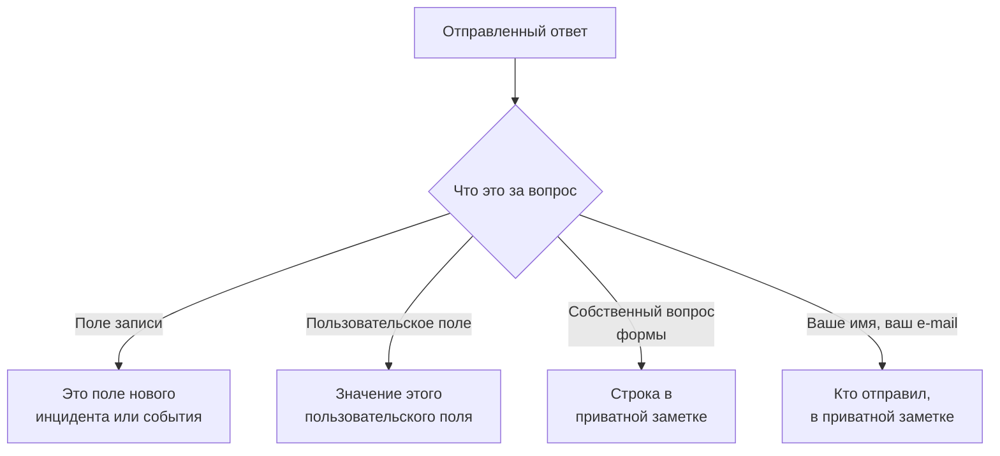

# Создание формы

На странице формы **Конструктор** вы решаете, что она спрашивает и как выглядит её страница. Вопросы находятся слева, в том порядке, в каком их показывает публичная страница; **Добавить вопрос** справа перечисляет всё, что можно добавить. Над вопросами, в свёрнутом виде, находится [брендинг](#брендинг) формы: её логотип и значок сайта. Именованные наборы ответов, с которых можно начать форму, — каждый из них также может сделать вопрос обязательным, необязательным или скрытым для своего случая, — находятся на её странице **Шаблоны**: см. [Шаблоны](#шаблоны).

:::cards
- [Конструктор](#конструктор): Добавляйте, редактируйте, перемещайте и сохраняйте вопросы.
- [Что можно добавить](#что-можно-добавить): Ваши собственные вопросы, поля записи, пользовательские поля и отправитель.
- [Скрытые вопросы](#скрытые-вопросы): На них отвечает шаблон, а не отправитель.
- [Шаблоны](#шаблоны): Одна форма и одна ссылка для каждого случая, о котором часто сообщает ваша команда.
:::

## Куда попадает каждый ответ

Каждый ответ также сохраняется вместе с отправкой, на странице формы **Отправки**. Поле, о котором форма не спрашивает или которое осталось пустым, заполняется из [настроек «При отправке»](/docs/forms/on-submit) формы.

## Конструктор

:::steps
### Добавьте вопрос

Выберите, что добавить, в **Добавить вопрос**. Новый вопрос вставляется после выбранного или в конец и становится выбранным.

### Редактируйте его на месте

Выберите карточку, чтобы отредактировать её: сам вопрос, текст подсказки, тип ответа и варианты, обязателен ли он или скрыт, а также кнопки дублирования и удаления. **Готово** закрывает карточку.

### Поставьте его на место

Перетащите карточку за ручку, чтобы переместить её, или используйте **Переместить вверх** и **Переместить вниз** на выбранной карточке — на телефоне или с клавиатуры.

### Сохраните форму

**Сохранить изменения** сохраняет все изменения сразу. Пока вы не сохранили, конструктор показывает **Несохранённые изменения** и предлагает **Отменить изменения**, а браузер спрашивает подтверждение, прежде чем вы покинете страницу.
:::

- **Заголовок формы** показывает её название и описание так, как это сделает публичная страница. **Изменить название и описание** изменяет их.
- **Вопросы** — это карточки. Каждая показывает вопрос так, как его увидят люди, со значком, показывающим, с чем он связан, — **Инцидент · Серьёзность**, **Пользовательское поле · Region**, **Отправитель · Электронная почта** или тип ответа для собственного вопроса формы. Красная звёздочка отмечает обязательный вопрос, а значок **Скрыто** — [скрытый](#скрытые-вопросы).
- **Ограничения.** В форме может быть до 50 вопросов. Те, кто может читать форму, но не редактировать её, видят конструктор в режиме только для чтения.

## Брендинг

**Брендинг**, в свёрнутом виде над вопросами, определяет, как выглядит страница формы: ваш логотип вверху страницы, над названием формы, и ваш значок сайта на вкладке браузера, пока форма открыта. Пока вы не загрузите свои, форма показывает логотип и значок сайта OneUptime.

В свёрнутом виде раздел перечисляет **Логотип** и **Favicon** — отмеченные как заданные, как только у формы появляются свои, — и показывает, какие из элементов OneUptime ещё действуют. Разверните его, чтобы увидеть оба так, как их показывает страница: логотип в том виде, в каком он стоит вверху страницы, и значок сайта на вкладке браузера рядом с названием формы, которое служит заголовком вкладки.

**Изменить брендинг** изменяет их в одном диалоге:

| Поле | Что это |
| --- | --- |
| **Логотип** | Показывается вверху страницы формы, над её названием, вместо логотипа OneUptime. Изображение PNG, JPEG, GIF, WebP или SVG размером не более 512 КБ. Удалите его, чтобы вернуть логотип OneUptime. |
| **Logo Alt Text** | Что сообщает логотип, — это зачитывают программы чтения с экрана: обычно название вашей организации. Запрашивается, как только есть логотип. Оставьте поле пустым, и программы чтения с экрана пропустят логотип — название формы всё равно идёт следом. Удаление логотипа очищает и это поле. |
| **Favicon** | Значок на вкладке браузера, пока форма открыта, вместо значка сайта OneUptime. Изображение PNG, JPEG, GIF, WebP, SVG или ICO размером не более 128 КБ; лучше всего подходит квадратный PNG, SVG или ICO. Удалите его, чтобы вернуть значок сайта OneUptime. |

Логотип сохраняет высоту логотипа OneUptime, который он заменяет, а широкий логотип подгоняется под ширину страницы. Каждое изображение проверяется при сохранении — из панели управления, API, Terraform или рабочего процесса: оно должно быть загружено в проекте самой формы, быть одного из перечисленных типов и не превышать своего ограничения. Логотип, который не является одним из этих изображений, отклоняется с "The logo must be a PNG, JPEG, GIF, WebP or SVG image.", слишком большой — с "The logo must be 512 KB or smaller.", а логотип, загрузка которого пропала или была сделана в другом проекте, — с "The logo's file could not be found. Upload the logo again." Значок сайта отклоняется так же: с "The favicon must be a PNG, JPEG, GIF, WebP, SVG or ICO image.", "The favicon must be 128 KB or smaller." и "The favicon's file could not be found. Upload the favicon again."

**Предпросмотр** показывает логотип так, как это делает страница. Те, кто может читать форму, но не редактировать её, видят её брендинг без **Изменить брендинг**. Логотип и значок сайта попадают на страницу формы только внутри самой формы — см. [Доступ и безопасность](/docs/forms/sharing-and-security#что-защищает-форму).

## Что можно добавить

**Добавить вопрос** перечисляет четыре группы: собственные **Вопросы** формы, **Поля инцидента** или **Поля планового обслуживания** того, что создаёт форма, **Пользовательские поля** и **Отправитель**.

### Собственные вопросы формы

| Тип ответа | Что указывает отправитель |
| --- | --- |
| **Краткий ответ** | Одну строку текста. |
| **Абзац** | Несколько строк текста. |
| **Форматированный текст** | Текст с форматированием и ссылками. |
| **Число** | Число. |
| **Раскрывающийся список** | Один вариант из списка. |
| **Множественный выбор** | Любое количество вариантов из списка. |
| **Флажок** | Флажок, например для подтверждения. |
| **Дата** | День. |
| **Дата и время** | День и время. |

Раскрывающийся список или множественный выбор показывает заданные вами **Варианты**, у каждого из которых может быть цвет (кнопка рядом с вариантом открывает набор именованных цветов, а **Свой цвет** задаёт точный код), — от одного до 100. При переключении вопроса между **Раскрывающийся список** и **Множественный выбор** варианты сохраняются; вопрос, который становится одним из этих типов, начинается с двух вариантов, которые можно переименовать, а вопрос, который перестаёт им быть, их теряет. **Дублировать** копирует собственный вопрос формы сразу под ним.

Ответы на эти вопросы сохраняются вместе с отправкой и перечисляются в приватной заметке того, что создаёт форма, — они не заполняют никакое поле. Чтобы заполнить поле, добавьте само поле из следующих двух групп.

### Поля того, что создаёт форма

Поля инцидента или события планового обслуживания, на которые может ответить отправитель. Ответ становится значением поля.

| Поле инцидента | Чем отвечают |
| --- | --- |
| **Заголовок** | Одна строка, до 500 символов. |
| **Описание** | Форматированный текст, до 20 000 символов. |
| **Серьёзность** | Одна из ваших серьёзностей инцидентов. |
| **Мониторы** | Любые из предлагаемых вами мониторов — затронутые мониторы инцидента. |
| **Метки** | Любые из предлагаемых вами меток. |
| **Начало воздействия** | Дата и время: когда началась проблема, как её помнит отправитель. |

| Поле планового обслуживания | Чем отвечают |
| --- | --- |
| **Заголовок** | Одна строка, до 100 символов. |
| **Описание** | Форматированный текст, до 20 000 символов. |
| **Начинается** | Дата и время. Всегда запрашивается и всегда обязательно. |
| **Заканчивается** | Дата и время после **Начинается**. Всегда запрашивается и обязательно. |
| **Мониторы** | Любые из предлагаемых вами мониторов. |
| **Страницы состояния** | Любые из предлагаемых вами страниц статуса. |
| **Метки** | Любые из предлагаемых вами меток. |

Каждое поле можно запросить только один раз; список отмечает поля, которые уже есть в форме, как **Добавлено**. Поле, о котором форма не спрашивает — или которое осталось пустым, — заполняется из [настроек «При отправке»](/docs/forms/on-submit) формы.

**Предлагаемые варианты.** Публичная страница не должна показывать незнакомцам весь ваш проект, поэтому поле, на которое отвечают выбором записей, предлагает только те, которые выберете вы. **Мониторы**, **Метки** и **Страницы состояния** перечисляют ровно те варианты, которые вы предлагаете, и не запрашиваются, пока вы не предложите хотя бы один. **Серьёзность** предлагает все серьёзности инцидентов, если вы её не ограничите, поскольку серьёзности не секретны. Ответы вне предлагаемых вариантов отклоняются.

### Пользовательские поля

Ваши пользовательские поля инцидентов — или планового обслуживания, для формы обслуживания, — каждое из которых становится вопросом, ответ на который становится значением поля. Вопрос берёт тип и варианты из пользовательского поля и начинается с его названия в качестве вопроса и его описания в качестве подсказки, которые можно изменить.

Форма запрашивает только те пользовательские поля, которые вы в неё добавили, что бы ни было указано в **Показывать при создании**: каждое поле, которое запрашивает форма, показывает своё название, описание и варианты любому, у кого есть ссылка. Когда пользовательское поле удаляется, его вопрос остаётся в форме, но больше не запрашивается, и его карточка сообщает об этом — удалите вопрос. Поле, снова созданное с тем же названием, — это новое поле: добавьте его заново.

Пользовательское поле, которое копирует своё значение из пользовательского поля монитора, сообщает об этом на своей карточке: когда у инцидента или события есть мониторы, сходящиеся в значении для него, это значение заменяет ответ отправителя.

### Отправитель

**Ваше имя** и **Ваш email** спрашивают, кто отправляет форму. Они сохраняются вместе с отправкой и указываются в приватной заметке, чтобы ваша команда могла связаться с человеком, и никогда не показываются в самом инциденте или событии. OneUptime никогда не пишет отправителю. Уберите их или сделайте необязательными, чтобы принимать анонимные отправки.

E-mail должен быть одним обычным адресом, например `ada@example.com`, — не именем с адресом в угловых скобках и не списком адресов. Имя и e-mail — каждое до 100 символов.

## Вопросы новой формы

Новая форма начинается с вопросов, которые она почти всегда должна задавать, чтобы работать сразу после создания: **Заголовок**, обязательный; **Описание**; для формы обслуживания — **Начинается** и **Заканчивается**; а также **Ваше имя** и **Ваш email**, обязательные. Их формулировки — на языке вашей панели управления. Изменяйте, скрывайте или удаляйте их как угодно — кроме начала и конца события обслуживания, без которых событие нельзя запланировать. Когда ваши собственные вопросы говорят всё, скройте **Описание**, вместо того чтобы оставлять поле, в котором никто не должен писать: см. [Скрытые вопросы](#скрытые-вопросы).

## Обязательные вопросы

**Обязательно** означает, что форму нельзя отправить без ответа. Ответ, состоящий только из пробелов, табуляций или переносов строк, считается отсутствием ответа, а обязательный **Флажок** должен быть отмечен. Сервер повторно проверяет каждый обязательный вопрос при отправке формы, поэтому запрос, сделанный в обход страницы, тоже должен им соответствовать.

Необязательный вопрос можно оставить пустым: тогда его поле заполняется из настроек «При отправке», как если бы форма о нём не спрашивала.

## Скрытые вопросы

Включите **Скрыто** на карточке, и вопрос перестанет показываться в форме. Его никто не задаёт, поэтому он никогда не обязателен, и отправка не может на него ответить — запрос для него даже не читается. На него отвечает только [шаблон](#шаблоны), с которого начинается отправка, и он остаётся без ответа, если отправитель не начинает ни с какого шаблона или начинает с шаблона, где этот ответ пуст. Шаблон также может всё же задать скрытый вопрос для своего случая: см. [Как шаблон задаёт каждый вопрос](#как-шаблон-задаёт-каждый-вопрос).

Скрывайте вопрос, когда ответ на него должна определять ваша команда, а не отправитель:

- **Описание инцидента**, когда добавленные вами вопросы говорят всё. Скрытое, оно больше никого не приглашает что-то там писать; дайте каждому шаблону стандартный текст, который вы отправляете в его случае, или позвольте инцидентам начинаться без описания.
- **Пользовательское поле, которое читают ваши рабочие процессы или правила**, например тип уведомления, задаваемый каждым шаблоном.
- **Собственный вопрос формы**, ответ на который нужен только вашей команде в приватной заметке.

Скрытый вопрос сохраняет своё место, подпись и настройки, так что его можно снова показать в любой момент. Поле, без которого цель формы не может быть создана, — **Начинается** и **Заканчивается** события обслуживания, — скрыть нельзя. Ответ на скрытый вопрос проверяется и сохраняется точно так же, как введённый ответ, и хранится вместе с отправкой.

## Шаблоны

Страница формы **Шаблоны** содержит именованные наборы ответов, с которых можно начать форму, — по одному на каждый случай, о котором часто сообщает ваша команда, например **Сбой приложения**, **Плановые работы** или **Сервис восстановлен**, — так что одна форма и одна ссылка подходят для всех.

:::steps
### Добавьте шаблон

Нажмите **Добавить шаблон**. Редактор состоит из двух частей. **Вопросы** перечисляет каждый вопрос формы с тем, как его задаёт этот шаблон, — см. [Как шаблон задаёт каждый вопрос](#как-шаблон-задаёт-каждый-вопрос). **Ответы** перечисляет их снова, включая скрытые и без обязательных: заполните то, на что должен отвечать шаблон, а остальное оставьте отправителю. Ответ на вопрос, который шаблон не задаёт, отмечен под ним — он используется как есть.

### Выберите шаблон по умолчанию

**По умолчанию** делает его шаблоном, с которым открывается форма. Шаблоном по умолчанию может быть только один шаблон, а форма, у которой единственный шаблон является шаблоном по умолчанию, — это просто предзаполненная форма.

### Поделитесь его ссылкой

**Скопировать ссылку** копирует собственную ссылку шаблона, которая открывает форму, заполненную по нему. См. [Доступ и безопасность](/docs/forms/sharing-and-security#ссылка-для-каждого-шаблона).
:::

Каждый шаблон показывает, что он заполняет и какие вопросы задаёт по-своему, например **Дата планового обслуживания · Скрыто**, и имеет **Редактировать**, **Дублировать** — копия сразу после него с названием вроде **Сбой приложения 2**, — **Переместить вверх** и **Переместить вниз** для порядка, в котором их показывает форма, и **Удалить**.

На публичной странице форма с шаблонами показывает их над своими вопросами, под **Начать с шаблона**. Выбор шаблона заполняет форму и задаёт вопросы так, как их задаёт этот шаблон; отправитель по-прежнему может изменить любой ответ перед отправкой, а выбор другого шаблона начинает форму заново с него. Страница открывается с шаблоном, указанным в её ссылке, иначе — с шаблоном по умолчанию, иначе — без шаблона. **Предпросмотр** тоже перечисляет шаблоны и открывается на шаблоне по умолчанию.

> [!IMPORTANT]
> Каждый, кто открывает ссылку, видит название каждого шаблона и его ответы на вопросы, которые он задаёт, — так страница заполняется сама. Ответы шаблона на вопросы, которые он не задаёт, никогда не покидают сервер, поэтому всё внутреннее держите в скрытом вопросе.

Каждый ответ каждого шаблона проверяется по своему вопросу при сохранении шаблонов — вариант, который предлагает вопрос, запись, которую предлагает форма, подходящий текст, — так же, как и каждый вопрос, который шаблон задаёт по-своему, а сохранение отклоняется с сообщением, где указаны шаблон и проблема, откуда бы оно ни пришло: из панели управления, API или Terraform. Название шаблона — до 100 символов и уникально в пределах формы, а у формы может быть до 50 шаблонов. Если позже вы измените вопросы, ответ шаблона на удалённый вопрос или на вопрос, которому он больше не подходит, просто не используется, а при следующем сохранении этого шаблона удаляется. Сохранение остальных шаблонов из-за этого никогда не отклоняется: то, что шаблон уже содержал, повторно не проверяется.

### Как шаблон задаёт каждый вопрос

Разным случаям нужны разные вопросы: при сбое нужно затронутое приложение, а не окно обслуживания, при плановых работах нужно окно. Вместо того чтобы создавать форму для каждого случая, позвольте каждому шаблону задавать вопросы формы по-своему. В **Вопросы** шаблона у каждого вопроса есть одна из этих настроек:

| Настройка | Когда кто-то начинает с шаблона |
| --- | --- |
| **По умолчанию для формы** | Вопрос задаётся так, как его задаёт форма, — обязательным, необязательным или скрытым, как указано на его карточке в конструкторе. Селектор показывает, каким именно, например **По умолчанию для формы (Скрыто)**, и следует за карточкой, когда вы её меняете. |
| **Обязательно** | Вопрос задаётся, и форму нельзя отправить без ответа. |
| **Необязательно** | Вопрос задаётся, и его можно оставить пустым. |
| **Скрыто** | Вопрос не задаётся. Собственный ответ шаблона, если он есть, и есть ответ — как для вопроса, который скрывает форма. |

Так одна форма инцидента может обслуживать оба случая:

| Вопрос | Сбой приложения | Плановые работы |
| --- | --- | --- |
| Название приложения | Обязательно | Обязательно |
| Затронутые объекты | Обязательно | Необязательно |
| Дата планового обслуживания | Скрыто | Обязательно |

Каждый вопрос начинается с **По умолчанию для формы**, как и каждый вопрос, который вы позже добавите в форму, в каждом шаблоне. **Начинается** и **Заканчивается** события обслуживания всегда запрашиваются и всегда обязательны: ни один шаблон не может их изменить. Шаблон может скрыть все остальные вопросы и ответить на них сам: тогда его ссылка — это форма из одной кнопки, **Отправить**, — удобно для случая вроде **Сервис восстановлен**.

Страница следует за шаблоном, который выбирает отправитель: выбор другого шаблона перерисовывает форму с его вопросами, и **Предпросмотр** делает то же самое. Сервер проверяет каждую отправку по вопросам, которые задаёт указанный в ней шаблон, кто бы её ни отправил: на вопрос, который шаблон делает обязательным, нужно ответить, а вопрос, который он скрывает, из запроса не читается — используется собственный ответ шаблона. Отправка, в которой не указан шаблон или указан шаблон, удалённый с тех пор, проверяется по собственным настройкам формы. Вопрос, который скрывает форма, показывается публичной странице, только когда его задаёт шаблон.

## Когда конструктор помечает вопрос

Карточка, с которой что-то не так, сообщает, что именно, жёлтым цветом:

| Карточка сообщает | Что не так |
| --- | --- |
| **Это пользовательское поле удалено, поэтому вопрос не задаётся. Удалите вопрос.** | Публичная страница пропускает вопрос. |
| **Выберите хотя бы один вариант, иначе вопрос не будет задан.** | Поле, на которое отвечают выбором записей, ничего не предлагает: выберите мониторы, метки или страницы статуса, которые оно предлагает. |
| **Добавьте хотя бы один вариант.** | В раскрывающемся списке или множественном выборе не из чего выбирать. |
| **Напишите вопрос.** | У вопроса нет текста. |

Форму нельзя сохранить, пока у вопроса есть одна из трёх последних проблем: **Сохранить изменения** сообщает, какой вопрос и что не так, а предпросмотр пропускает такой вопрос. При сохранении вопросы также проверяются целиком, и сохранение отклоняется с сообщением о проблеме, когда, например, два вопроса запрашивают одно и то же поле или форма обслуживания не спрашивает, когда обслуживание начинается и заканчивается, — откуда бы ни пришли вопросы: из конструктора, API, Terraform или рабочего процесса.

## Предпросмотр

**Предпросмотр** открывает форму точно так, как её видят люди по ссылке, — тот же логотип, те же вопросы, поля, варианты и проверки, список шаблонов и только те вопросы, которые задаёт выбранный шаблон, — и позволяет её заполнить. Ничего из введённого там не отправляется: **Отправить** только проверяет ваши ответы, а **Заполнить снова** начинает заново. Предпросмотр показывает вопросы такими, какие они в конструкторе, сохранённые или нет, и сообщает, когда пропускает помеченный вопрос.

## Что видит отправитель

Публичная страница показывает логотип формы — логотип OneUptime, пока вы не загрузите свой, — затем название и описание формы, её шаблоны, если они есть, вопросы, которые она задаёт, — так, как их задаёт выбранный шаблон, или те, которые она не скрывает, когда шаблон не выбран, — и **Отправить**, а вкладка браузера показывает название формы и её значок сайта. Страница отображается на языке отправителя, если он есть в OneUptime, — на языке, который он последним выбрал в OneUptime в этом браузере, или же на языке, который запрашивает его браузер, — а иначе на английском. Ваши вопросы, варианты и подсказки показываются так, как вы их написали.

После отправки страница сообщает "Спасибо — ваш ответ отправлен." и показывает номер созданного — "Ваш номер обращения: INC-42.", — а затем сообщение с благодарностью формы, если вы написали его на странице **Поделиться**. **Отправить ещё один ответ** открывает пустую форму. Отправитель не получает ни письма, ни способа вернуться к инциденту или событию.

## Ограничения размера

| Ответ | Ограничение |
| --- | --- |
| **Заголовок** инцидента | 500 символов без учёта пробелов по краям. |
| **Заголовок** события обслуживания | 100 символов. |
| **Описание** | 20 000 символов. |
| Любой другой текстовый ответ | 10 000 символов. |
| Ответ с множественным выбором | 100 вариантов. |
| **Ваше имя**, **Ваш email** | По 100 символов. |

Отправка, которая нарушает ограничение, пропускает обязательный ответ или даёт ответ, не подходящий к вопросу, отклоняется с сообщением, где сказано, что именно, и ничего не создаётся. Ответы на вопросы, которые форма не задаёт, игнорируются.

## Дальнейшие шаги

:::cards
- [Что создаёт отправка](/docs/forms/on-submit): Как ответы и настройки «При отправке» превращаются в инцидент или событие обслуживания.
- [Доступ и безопасность](/docs/forms/sharing-and-security): Как делиться ссылкой, ссылка для каждого шаблона и что их защищает.
- [Настройки и автоматизация инцидентов](/docs/incidents/settings): Пользовательские поля и шаблоны инцидентов.
:::
