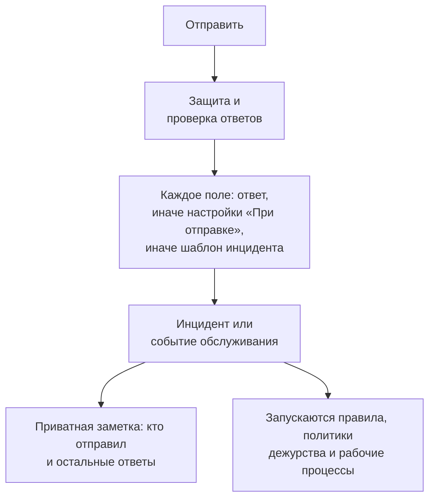

# Что создаёт отправка

Каждая отправка через форму создаёт одну запись в вашем проекте: **инцидент** или **событие планового обслуживания**. Страница формы **При отправке** показывает, что именно, и как заполняется каждое поле новой записи — из ответа, из значения по умолчанию, из настройки, которая действует всегда, или из шаблона инцидента. **Изменить настройки** изменяет значения по умолчанию и то, что действует всегда.

:::cards
- [Как отправка становится инцидентом](#как-отправка-становится-инцидентом): Каждое поле нового инцидента и откуда берётся его значение.
- [Как отправка становится событием планового обслуживания](#как-отправка-становится-событием-планового-обслуживания): То же самое для запроса на обслуживание.
- [Настройки «При отправке»](#настройки-при-отправке): Значения по умолчанию, что прикрепляется всегда, владельцы и публикация.
- [Приватная заметка](#приватная-заметка): Кто отправил и ответы, которых нет ни в одном поле.
:::

## Что происходит при отправке

Отправка, не прошедшая проверку, ничего не создаёт. См. [Что защищает форму](/docs/forms/sharing-and-security#что-защищает-форму).

## Что создаёт каждая отправка

Карточка **Что создаёт каждая отправка** хранит выбор, который вы сделали при создании формы:

- **Инцидент** — каждая отправка объявляет инцидент, так что ваша дежурная команда сразу узнаёт о нём. Используйте для сообщений о проблемах.
- **Плановое обслуживание** — каждая отправка планирует событие обслуживания. Используйте для запросов на изменения и обслуживание.

Выбор другого варианта требует подтверждения, потому что форма меняется вместе с ним:

- Заголовок, описание, мониторы и метки остаются связанными: они есть у записей обоих видов.
- Любой другой связанный вопрос — серьёзность, выбор страницы статуса, пользовательское поле прежнего вида — становится собственным вопросом формы с той же формулировкой, а ответ на него перечисляется в приватной заметке.
- Настройки «При отправке» начинаются заново, поскольку настройки инцидента и события различаются.
- Форма, которая теперь создаёт события обслуживания, спрашивает, когда обслуживание начинается и заканчивается.

Вопросы сохраняются сразу, вместе с изменением. Проверьте их на странице **Конструктор**.

## Как отправка становится инцидентом

Карточка перечисляет каждое поле нового инцидента и то, откуда берётся его значение:

| Поле | Откуда берётся |
| --- | --- |
| **Заголовок** | Ответ на вопрос **Заголовок**. Если форма его не задаёт или он оставлен пустым: **Название по умолчанию**, иначе название формы. |
| **Описание** | Ответ на вопрос **Описание**. Если он не задаётся или оставлен пустым — описание шаблона инцидента, если у формы есть шаблон. |
| **Серьёзность** | Выбор отправителя, если форма о нём спрашивает. Иначе настройка формы **Серьёзность**, иначе серьёзность шаблона инцидента. |
| **Мониторы** | Мониторы, выбранные отправителем, вместе с теми, которые настройки прикрепляют всегда. Если нет ни тех, ни других, — мониторы шаблона инцидента. |
| **Метки** | Метки, выбранные отправителем, вместе с теми, которые настройки добавляют всегда. Если нет ни тех, ни других, — метки шаблона инцидента. |
| **Начало воздействия** | Ответ на **Начало воздействия**, если форма его задаёт. |
| **Инцидент Шаблон** | Настройка формы **Инцидент Шаблон**. Она заполняет всё, что ответы и настройки оставляют незаданным. |
| **Политики дежурств** | Политики, указанные в настройках, выполняются для каждого инцидента, который объявляет форма. Если их нет, — политики шаблона инцидента. |
| **Владельцы** | Люди и команды, указанные в настройках, вместе с владельцами шаблона. Они получают уведомление о каждом инциденте. |
| **Пользовательские поля** | Ответ на каждый вопрос пользовательского поля — кроме случая, когда поле копирует своё значение из пользовательского поля монитора и у мониторов инцидента такое значение есть; остальное заполняет шаблон. |
| **Страницы состояния** | Никогда не показывается на страницах статуса, и подписчики не получают уведомлений, пока кто-то из вашей команды его не опубликует. |
| **Остальные ответы** | Перечисляются в приватной заметке к инциденту вместе с тем, кто его отправил. |

> [!IMPORTANT]
> **Нет серьёзности — нет инцидента.** Инциденту нужна серьёзность. Если форма о ней не спрашивает, её настройки ни одну не указывают — или указанная была удалена — и её шаблон тоже ни одну не задаёт, строка **Серьёзность** предупреждает вас, а каждая отправка отклоняется с "Эта форма не может создать инцидент, потому что у неё не задана серьёзность. Сообщите об этом команде, которая поделилась формой." Выберите серьёзность в **Изменить настройки** или шаблон, который её задаёт.

### Шаблон инцидента

Выберите **Инцидент Шаблон** в настройках, и каждый инцидент, который объявляет форма, будет объявляться по нему — так же, как сервер применяет шаблон везде, — см. [Как применяется шаблон](/docs/incidents/settings#как-применяется-шаблон). Сначала идут ответы и настройки формы, а шаблон заполняет всё остальное: начальное состояние, описание, серьёзность, затронутые ресурсы, политики дежурства, владельцев, метки, значения пользовательских полей и смену статуса монитора.

> [!WARNING]
> **Помните о мониторах.** Объявление инцидента по монитору через форму влияет на монитор точно так же, как объявление инцидента по нему вручную: активный мониторинг монитора приостанавливается до устранения инцидента, а **Изменить статус монитора на** шаблона сразу меняет статус монитора — на каждой странице статуса, где он указан, даже пока сам инцидент скрыт. С формой это может сделать любой, у кого есть ссылка. Прикрепляйте мониторы через форму, только если каждая отправка должна их приостанавливать.

### Как выглядит инцидент

Инцидент, объявленный через форму, — это обычный инцидент с несколькими собственными настройками:

- **Скрыт со страниц статуса.** **Видно на странице статуса** выключено, как и **Уведомить подписчиков страницы статуса**. Пока дежурный его не опубликует, ничего об инциденте не попадает ни на страницу статуса, ни к подписчику — кроме смены статуса монитора шаблоном, описанной выше.
- **Никем не объявлен.** Отправитель не является пользователем OneUptime, поэтому ни один пользователь не записывается как объявивший инцидент.
- **Его владельцы получают уведомление.** Владельцы, указанные в настройках и шаблоне, добавляются, как только появляются каналы инцидента в Slack и Microsoft Teams, и получают уведомление — уведомление инцидента **Инцидент создан** ждёт, пока они станут его владельцами, чтобы прийти им, а не владельцам проекта.
- **Приватная заметка фиксирует отправку** — см. [Приватная заметка](#приватная-заметка).

Всё, что запускается для нового инцидента, запускается и для этих: правила приватности, владельцев, меток, дежурства и сценариев, политики дежурства и рабочие процессы **On Create Incident**. Правила дежурства срабатывают на инциденты формы так же, как на любые другие, — в том числе по их заголовку и описанию, которые написал отправитель.

:::steps
#### Прочитайте, что написал отправитель

Заголовок и описание появляются на страницах статуса после публикации инцидента.

#### Опубликуйте инцидент

Включите **Видно на странице статуса** на странице инцидента **Настройки**.

#### Уведомите подписчиков, если им нужно знать

Поскольку инцидент был объявлен с выключенным **Уведомить подписчиков страницы статуса**, его публикация не отправляет уведомление «инцидент создан». Чтобы уведомить подписчиков, опубликуйте публичную заметку с отмеченным **Уведомить подписчиков страницы статуса** — см. [Опубликуйте публичную заметку](/docs/incidents/notes-owners-and-feed#опубликуйте-публичную-заметку).
:::

## Как отправка становится событием планового обслуживания

| Поле | Откуда берётся |
| --- | --- |
| **Заголовок** | Ответ на вопрос **Заголовок**. Если форма его не задаёт или он оставлен пустым: **Название по умолчанию**, иначе название формы. |
| **Описание** | Ответ на вопрос **Описание**. |
| **Начинается**, **Заканчивается** | Ответы на **Начинается** и **Заканчивается**, которые задаёт и требует каждая форма обслуживания. Конец должен быть позже начала. |
| **Мониторы** | Мониторы, выбранные отправителем, вместе с теми, которые настройки прикрепляют всегда. |
| **Страницы состояния** | Страницы статуса, выбранные отправителем, вместе с теми, которые указаны в настройках. |
| **Метки** | Метки, выбранные отправителем, вместе с теми, которые настройки добавляют всегда. |
| **Владельцы** | Люди и команды, указанные в настройках. Они владеют каждым событием, которое планирует форма. |
| **Показывать на страницах состояния** | **Нет**, если настройки это не включают. |
| **Уведомить подписчиков** | **Нет**, если настройки это не включают. |
| **Пользовательские поля** | Ответ на каждый вопрос пользовательского поля — кроме случая, когда поле копирует своё значение из пользовательского поля монитора и у мониторов события такое значение есть. |
| **Остальные ответы** | Перечисляются в приватной заметке к событию вместе с тем, кто его отправил. |

Событие начинается в состоянии проекта **Scheduled** и движется дальше, как любое другое: становится текущим, когда начинается, и завершается, когда заканчивается.

Отправка — это чей-то запрос, а запрос проверяют перед публикацией. Поэтому, если вы это не измените, событие не появляется на своих страницах статуса, пока кто-то из вашей команды его не покажет, а его подписчики не получают уведомлений, когда оно создаётся, начинается или заканчивается. **Показывать на страницах состояния** и **Уведомить подписчиков** на шаге настроек **Публикация** меняют это для каждого события, которое планирует форма, — включайте их, только если доверяете всем, у кого есть ссылка.

## Настройки «При отправке»

**Изменить настройки** открывает настройки по шагам: **Далее** переходит дальше, а **Сохранить изменения** находится на последнем шаге. Каждый шаг уже заполнен, поэтому список шагов рядом с формой открывает любой из них, включая последний: измените настройку на её шаге, затем откройте последний шаг и сохраните.

| Шаг | Форма инцидента | Форма обслуживания |
| --- | --- | --- |
| **Значения по умолчанию** | **Название по умолчанию**, **Серьёзность**, **Инцидент Шаблон** | **Название по умолчанию** |
| **Всегда привязывать** | **Мониторы**, **Метки**, **Политики дежурств** | **Мониторы**, **Страницы состояния**, **Метки** |
| **Владельцы** | **Владельцы** | **Владельцы** |
| **Публикация** | — | **Показывать на страницах состояния**, **Уведомить подписчиков** |

**Владельцы** — это один селектор для людей и команд: **Добавить владельца** открывает один список поиска с обоими, а каждый выбор показывается в виде метки, которую можно удалить. Всё, что указано в настройках, должно принадлежать проекту формы, а владельцы должны быть его участниками. Запись, удалённая после того, как её выбрали, пропускается при создании отправки, а остальное по-прежнему применяется.

## Приватная заметка

Каждая отправка оставляет приватную заметку к тому, что она создала:

> Submitted through the form **Report a Problem** by Ada Lovelace (<ada@example.com>).
>
> **Which office are you in?**\
> Berlin

В ней указаны форма и отправитель — "Submitted anonymously through the form **Report a Problem**.", если форма не спрашивала, кто это, — затем, если отправка началась с одного из шаблонов формы, указано, с какого: "Started from the template **Application Outage**.", — а потом перечислены ответы на собственные вопросы формы, каждый под своим вопросом, в порядке формы. Ответы на связанные вопросы уже есть в записи: её заголовок, серьёзность, пользовательские поля. Будучи приватной, заметка никогда не попадает на страницу статуса, но публикуется в каналы записи в Slack и Microsoft Teams, как любая другая заметка.

Адрес — это ссылка, которая пишет ровно на этот адрес, — в панели управления, в Slack и в письме владельцам.

## Скрытые вопросы и шаблоны

На [скрытый вопрос](/docs/forms/building#скрытые-вопросы) отвечает [шаблон](/docs/forms/building#шаблоны), с которого началась отправка, — никогда не запрос, — и его ответ попадает ровно туда, куда попал бы введённый: скрытое **Описание** становится описанием инцидента, скрытое пользовательское поле — его значением, скрытый собственный вопрос формы — строкой в приватной заметке. Отправка, начатая без шаблона, оставляет скрытые вопросы без ответа, и их поля заполняются из настроек «При отправке», как для любого вопроса, оставленного пустым. Шаблон, удалённый, пока у кого-то была открыта форма, не мешает этой отправке: она создаётся так, как человек ответил, без скрытых ответов шаблона.

Шаблон может задавать вопросы формы [по-своему](/docs/forms/building#как-шаблон-задаёт-каждый-вопрос), и сервер проверяет отправку по вопросам так, как их задаёт указанный в ней шаблон. На вопрос, который шаблон скрывает, отвечает шаблон, как на скрытый вопрос, даже если форма его задаёт; вопрос, который шаблон задаёт, читается из запроса, даже если форма его скрывает; а на вопрос, который шаблон делает обязательным, нужно ответить, иначе отправка отклоняется и ничего не создаётся.

Ответы, которые шаблон заполнил на странице, становятся ответами отправителя, как только он отправляет форму: сервер берёт ответы, которые запрос передаёт на вопросы страницы, что бы ни было в шаблоне.

## Текст, который пишет отправитель

Отправка попадает прямо туда, где текст может действовать сам по себе, — в каналы Slack и Microsoft Teams, в браузер каждого дежурного, в письма владельцам, — и никто не читает её заранее. Поэтому перед созданием записи:

| Что пишет отправитель | Что сохраняется |
| --- | --- |
| Упоминание, например \<!channel\>, \<!here\> или \<@U0123ABC\>, в заголовке, описании или любом текстовом ответе | **Упоминания никого не уведомляют.** Всё, что Slack читает как упоминание, получает невидимый символ после открывающей скобки. Текст везде читается так же, но ни один чат-инструмент на него не реагирует. |
| Изображение в описании или в ответе **Форматированный текст** | **Изображения становятся ссылками.** Каждое изображение становится ссылкой на тот же адрес, поэтому ничего не загружается с выбранного отправителем адреса, пока дежурный по ней не нажмёт. |
| Блок кода с языком `mermaid` в любом написании | **Диаграммы становятся кодом.** Он сохраняется как обычный код, поэтому показывает свой текст, а не рисует диаграмму. |
| Синтаксис изображения или блок диаграммы в заголовке | **Заголовок — это обычный текст.** Они тоже получают невидимый символ, поэтому, куда бы ни попал заголовок, — в эпизод, сообщение чата, шаблон заметки, — он ничего не загружает и ничего не рисует. Невидимые символы учитываются в ограничении длины заголовка. |

Всё остальное — ссылки, остальная разметка Markdown, выбор в раскрывающихся списках, числа, даты, отмеченный флажок — сохраняется так, как это указал отправитель, а отправка сохраняет имя и e-mail отправителя в том виде, в каком они были введены.

## Дальнейшие шаги

:::cards
- [Создание формы](/docs/forms/building): Вопросы, которые заполняют эти поля, скрытые вопросы и шаблоны.
- [Настройки и автоматизация инцидентов](/docs/incidents/settings): Шаблоны инцидентов и пользовательские поля.
- [Заметки, владельцы и лента инцидента](/docs/incidents/notes-owners-and-feed): Приватные заметки, публичные заметки и владельцы.
- [Доступ и безопасность](/docs/forms/sharing-and-security): Кто может отправлять и как часто.
:::
