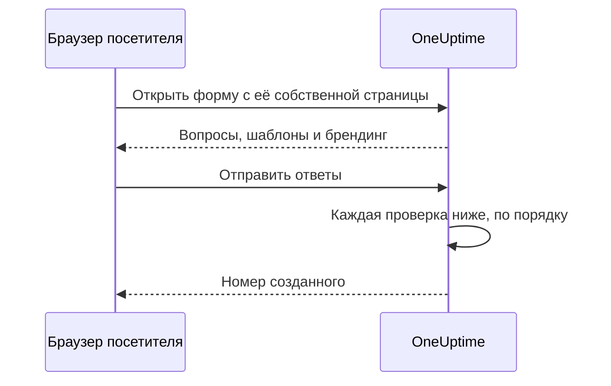

# Доступ и безопасность

Форма открыта для любого, у кого есть её ссылка, и каждая отправка может вызвать вашу дежурную команду или поставить окно обслуживания в ваш календарь. Эта страница описывает страницу формы **Поделиться** — ссылку, отключение формы, сообщение после отправки и список разрешённых IP — и все остальные проверки, которые запрос проходит по пути.

:::cards
- [Как делиться ссылкой](#как-делиться-ссылкой): Скопируйте её, откройте и сбросьте, если она распространилась слишком широко.
- [Ссылка для каждого шаблона](#ссылка-для-каждого-шаблона): Одна закладка на каждый случай, одна форма за всеми.
- [Что защищает форму](#что-защищает-форму): Каждая проверка, которую проходит запрос, по порядку.
- [Устранение неполадок](#устранение-неполадок): Что означает каждое сообщение на странице формы и что делать.
:::

## Страница «Поделиться»

| Карточка | Что в ней |
| --- | --- |
| **Статус** | **Принимает отправки** — работает ли ссылка формы. |
| **Ссылка для доступа** | Ссылка с **Скопировать ссылку**, **Открыть форму** и **Сбросить ссылку**. |
| **После отправки** | **Сообщение с благодарностью**, которое люди видят после отправки, под номером созданного формой. |
| **Доступ** | **Список разрешённых IP**. |

## Как делиться ссылкой

Карточка **Ссылка для доступа** показывает ссылку формы, например `https://oneuptime.com/accounts/form/<share-key>`:

- **Скопировать ссылку** копирует её.
- **Открыть форму** открывает форму в новой вкладке так, как её видят люди.
- **Сбросить ссылку** выдаёт форме новую ссылку после вашего подтверждения. Старая ссылка сразу перестаёт работать и показывает сообщение о недоступности, поэтому всем, с кем вы ею делились, нужна новая. Используйте это, когда ссылка распространилась шире, чем следовало.

Любой, у кого есть ссылка, может открыть форму и отправить её — без учётной записи OneUptime и без входа в систему. Вход ничего не меняет: OneUptime знает, кто отправил форму, только по имени и e-mail, введённым в неё. Поэтому относитесь к ссылке как к телефонному номеру вашей дежурной команды. Делитесь ею там, где её найдут те, кто должен ею пользоваться, — на странице интранета, в сценарии поддержки, в закреплённом сообщении чата, — а не на публичном сайте, если только вы не хотите получать отправки от кого угодно.

Ссылка содержит собственный случайный ключ, а не ID формы. В самостоятельно размещённой установке она отдаётся с вашего собственного хоста OneUptime и работает только по адресу, который задают `HTTP_PROTOCOL` и `HOST`: если открыть её по другому имени сервера или по его IP-адресу, запросы формы отклоняются как пришедшие с другого сайта.

Ссылки на старые формы инцидентов, `/accounts/incident-form/<share-key>`, открывают ту же форму по её новому адресу.

### Ссылка для каждого шаблона

У каждого из [шаблонов](/docs/forms/building#шаблоны) формы есть своя ссылка: ссылка формы с `?template=` и id шаблона, например `https://oneuptime.com/accounts/form/<share-key>?template=<template-id>`. **Скопировать ссылку** на странице формы **Шаблоны** копирует её. Она открывает форму, заполненную по этому шаблону, так что команда может сохранить по закладке на каждый случай, а вы поддерживаете одну форму. Когда отправитель выбирает другой шаблон, адрес в его браузере меняется вслед за ним, поэтому ссылка, которую он копирует, — это форма в том виде, в каком он её видит.

Ссылка шаблона — это ссылка формы: она работает, пока у формы включено **Принимает отправки**, а **Сбросить ссылку** отзывает её вместе с остальными. Ссылка, в которой указан удалённый вами шаблон, открывает форму так, будто шаблон не указан, — с шаблоном по умолчанию, если он есть.

### Отключение формы

Чтобы перестать принимать отправки, не удаляя форму, выключите **Принимает отправки**. Тогда ссылка показывает "Эта форма недоступна. Возможно, она отключена или ссылка устарела.", а карточка **Ссылка для доступа** напоминает, что форма отключена. Включите её снова, и та же ссылка снова заработает.

### Сообщение с благодарностью

После отправки страница сообщает "Спасибо — ваш ответ отправлен." и показывает номер созданного, а затем ваше **Сообщение с благодарностью** в формате Markdown. Используйте его, чтобы сказать, что будет дальше и куда обращаться, если что-то срочно. Без него страница показывает только стандартное сообщение.

Изображение в описании формы или в сообщении с благодарностью показывается всем, кто открывает ссылку, пока у формы включено **Принимает отправки**. Отключите форму или уберите изображение, и оно снова станет приватным, если только его не содержит что-то ещё, что видят все.

## Что защищает форму

Каждый запрос проходит эти проверки в следующем порядке:

1. Запрос должен прийти с собственной страницы формы, а не с другого сайта, — см. [Запросы с других сайтов](#запросы-с-других-сайтов).
2. Он должен укладываться в ограничения частоты.
3. Форма должна существовать, принимать отправки (**Принимает отправки**) и принадлежать проекту на тарифе, включающем формы.
4. Он должен прийти с адреса из **Список разрешённых IP**, если у формы он есть.
5. Отправка должна пройти капчу, если в экземпляре включена капча.
6. Каждый ответ должен укладываться в ограничения размера и подходить к своему вопросу — см. [Создание формы](/docs/forms/building#ограничения-размера).
7. То, что получается из ответов и настроек, должно быть возможно создать: инциденту нужна серьёзность, событию — конец позже начала.
8. Отправка должна укладываться в почасовую квоту формы — см. [Ограничения частоты](#ограничения-частоты).

Логотип и значок сайта формы — это часть формы: они отправляются внутри ответа, который её открывает, в base64, только после того, как запрос прошёл первые четыре проверки, и никогда не по собственному адресу. Никто не может получить их без формы, и ни один файл нельзя получить по его id через форму; сами файлы остаются приватными. Форма показывает только изображения, загруженные в её собственном проекте: файл из другого проекта отклоняется при сохранении формы и никогда не отправляется на её страницу.

### Список разрешённых IP

Чтобы ограничить форму вашими собственными сетями:

:::steps
1. Откройте страницу формы **Поделиться**.
2. На карточке **Доступ** нажмите **Изменить список разрешённых IP**.
3. Введите по одной сети в строке и сохраните. После этого карточка перечисляет их под **Список разрешённых IP**.
:::

Каждая строка — одно из следующего:

| Запись | Пример | Примечание |
| --- | --- | --- |
| Адрес IPv4 | `203.0.113.7` | |
| Адрес IPv6 | `2001:db8::7` | Совпадает, как бы он ни был записан: заглавными буквами или с полностью выписанными нулями. |
| Диапазон IPv4 в нотации CIDR | `10.0.0.0/8` | Диапазоны IPv6 не поддерживаются — указывайте каждый адрес IPv6 на отдельной строке. |

Адрес IPv4 нужно записывать как IPv4: записанный в стиле IPv6, например `::ffff:203.0.113.7`, он отклоняется. Список проверяется при каждом сохранении — из панели управления, API, Terraform или рабочего процесса, — и строка, которая никогда не может совпасть, отклоняется с сообщением, где она указана. Оставьте список пустым, чтобы разрешить все сети. Как только в нём есть запись, запрос, адрес которого не удаётся определить, отклоняется.

В OneUptime Cloud для задания списка разрешённых IP нужен тариф **Scale** — как при создании формы со списком через API, так и при её редактировании, — как и для списка разрешённых IP [публичного дашборда](/docs/dashboards/sharing). Очистка списка работает на любом тарифе.

### Запросы с других сайтов

Браузер сообщает серверу, какая страница отправила запрос. Когда страница другого сайта заставляет браузер посетителя открыть или отправить форму, запрос отклоняется с "This form can only be used from its own page." — до того, как его учтёт какое-либо ограничение частоты, и независимо от ссылки, поэтому ответ ничего не говорит о том, какие формы существуют.

Запрос отклоняется, если его заголовок `Sec-Fetch-Site` присутствует и содержит что-либо, кроме `same-origin` или `none`, или если его заголовок `Origin` присутствует и не является вашим адресом OneUptime — `HTTP_PROTOCOL` и `HOST`, с портом, если он указан в `HOST`. Отправка также должна передаваться как JSON (`application/json`); отправка, переданная как поля формы веб-страницы или как обычный текст, отклоняется с "The request must be a JSON object holding the form's answers in "data".". Для чтения формы также нужен заголовок, который страница формы добавляет к каждому своему запросу, — `X-OneUptime-Form: 1`: страница не может заставить браузер добавить заголовок без скрипта, а скрипт другого сайта, который его добавляет, выдаёт себя своим `Origin`.

### Ограничения частоты

Открытие формы и её отправка ограничиваются по сетевому адресу, а отправка — ещё и по форме:

- **Открытие формы** — по форме с одного адреса и по адресу для всех форм, с запасом на целый офис, открывающий ссылку одновременно. При превышении любого из них страница показывает "Слишком много запросов. Повторите попытку позже." Если ограничитель частоты недоступен, формы всё равно открываются.
- **Отправка, по адресу** — по форме с одного адреса и по адресу для всех форм. При превышении любого из них отправитель видит "Слишком много отправок из вашей сети. Подождите несколько минут и повторите попытку." Все, кто находится за одним адресом, — офисная сеть, VPN-шлюз — делят эти ограничения, и каждая отправка учитывается, даже та, что затем отклоняется из-за неверного ответа.
- **Отправка, по форме** — сколько записей одна форма может создать за час со всех адресов вместе, так что даже отправки со множества адресов одновременно могут вызвать вас лишь ограниченное число раз в час. Учитывается только отправка, прошедшая все остальные проверки, непосредственно перед созданием её записи. При превышении все видят "Сейчас эта форма получает слишком много ответов. Повторите попытку позже.", пока окно не закончится. **Сбросить ссылку** начинает новую ссылку со свежей квотой.

Каждое ограничение отвечает `429` с заголовком `Retry-After` в секундах, а страница сообщает отправителю, когда попробовать снова. Окна фиксированные, а не скользящие. Если ограничитель частоты недоступен, отправки отклоняются, а не пропускаются без учёта: API отвечает `503`, а отправитель видит "Сейчас ответы не принимаются. Повторите попытку через несколько минут."

В самостоятельно размещённой установке эти переменные окружения приложения OneUptime меняют ограничения:

| Переменная | По умолчанию | Что задаёт |
| --- | --- | --- |
| `FORM_RATE_LIMIT_WINDOW_SECONDS` | `60` | Окно для открытия форм, в секундах. |
| `FORM_RATE_LIMIT_PER_FORM_AND_IP_PER_WINDOW` | `120` | Сколько раз один адрес может открыть одну форму за окно. |
| `FORM_RATE_LIMIT_PER_IP_PER_WINDOW` | `600` | Сколько раз один адрес может открывать формы за окно, для всех форм. |
| `FORM_SUBMIT_RATE_LIMIT_WINDOW_SECONDS` | `900` | Окно для ограничений отправки по адресу, в секундах. |
| `FORM_SUBMIT_RATE_LIMIT_PER_FORM_AND_IP_PER_WINDOW` | `10` | Отправки в одну форму с одного адреса за окно. |
| `FORM_SUBMIT_RATE_LIMIT_PER_IP_PER_WINDOW` | `30` | Отправки с одного адреса за окно, для всех форм. |
| `FORM_SUBMIT_RATE_LIMIT_PER_FORM_WINDOW_SECONDS` | `3600` | Окно для ограничения по форме, в секундах. |
| `FORM_SUBMIT_RATE_LIMIT_PER_FORM_PER_WINDOW` | `60` | Записи, которые одна форма может создать за окно, со всех адресов вместе. |

Каждая переменная также читает своё старое имя с `INCIDENT_FORM_` вместо `FORM_` в начале — например `INCIDENT_FORM_SUBMIT_RATE_LIMIT_PER_FORM_PER_WINDOW`, — так что установка, где настраивали формы инцидентов, сохраняет свои ограничения; если заданы оба имени, побеждает новое. Ни `config.env`, ни значения Helm-чарта их не передают: добавьте их сами в окружение контейнера `app` — через `app.extraEnv` или общий для чарта `extraEnv` в Helm-чарте либо в `docker-compose.override.yml` для Docker Compose. `TRUSTED_PROXY_HOPS` определяет, какой адрес учитывают ограничения по адресу.

### Капча

Когда в вашем экземпляре OneUptime включена hCaptcha, форма показывает капчу, а отправка, не прошедшая её, отклоняется. Отдельной настройки для каждой формы нет. Самостоятельно размещённая установка включает капчу с помощью `CAPTCHA_ENABLED`, `CAPTCHA_SITE_KEY` и `CAPTCHA_SECRET_KEY` — тех же настроек, что защищают регистрацию. Без неё нагрузку несут ограничения частоты и список разрешённых IP.

## Устранение неполадок

:::details Ссылка сообщает, что форма недоступна
"Эта форма недоступна. Возможно, она отключена или ссылка устарела." Страница даёт один и тот же ответ независимо от причины, поэтому никогда не сообщает незнакомцу, существует ли форма:

- **Принимает отправки** выключено на странице **Поделиться**.
- Ссылка была заменена с помощью **Сбросить ссылку**. Поделитесь новой.
- Форма была удалена.
- В OneUptime Cloud проект находится на тарифе ниже **Growth** или его подписка не оплачена.
- Ссылка была обрезана при копировании.
:::

:::details Форму можно открыть только из разрешённой сети
"Эту форму можно открыть только из разрешённой сети." Адреса отправителя нет в **Список разрешённых IP** формы: добавьте его сеть или очистите список. В самостоятельно размещённой установке за прокси или балансировщиком нагрузки проверьте `TRUSTED_PROXY_HOPS` — если значение слишком мало, OneUptime видит адрес вашего прокси вместо адреса отправителя. Страница сообщает то же самое, если форма была открыта по адресу, отличному от адреса вашего OneUptime: откройте ссылку в точности так, как её показывает карточка **Ссылка для доступа**.
:::

:::details Слишком много отправок
"Слишком много отправок из вашей сети. Подождите несколько минут и повторите попытку." Все, кто находится за одним адресом, делят ограничения по адресу, что важно во время крупного сбоя, когда о нём сообщают многие одновременно. Страница сообщает, когда попробовать снова. "Сейчас эта форма получает слишком много ответов. Повторите попытку позже." — это, наоборот, квота формы: она не связана с сетью отправителя, и сообщения снова принимаются, когда окно заканчивается. Если отправки не настоящие, потому что ссылка распространилась шире, чем следовало, **Сбросить ссылку** сразу останавливает старую ссылку.
:::

:::details Отправки сейчас не принимаются
"Сейчас ответы не принимаются. Повторите попытку через несколько минут." Ограничитель частоты был недоступен, поэтому отправки отклоняются, а не пропускаются без учёта. Открытие формы по-прежнему работает. В самостоятельно размещённой установке проверьте, что Valkey — кэш, в котором ведёт подсчёт ограничитель частоты, — работает и доступен из приложения OneUptime.
:::

:::details Эта форма не может создать инцидент, потому что у неё нет серьёзности
Форма не спрашивает о серьёзности, её настройки ни одну не указывают — или указанная была удалена — и её шаблон инцидента тоже ни одну не задаёт. Выберите серьёзность на странице формы **При отправке**. См. [Нет серьёзности — нет инцидента](/docs/forms/on-submit#как-отправка-становится-инцидентом).
:::

:::details Отправка отклоняется
Сообщение говорит, что не так: отсутствует обязательный ответ или он состоит только из пробелов, ответ слишком длинный или не подходит к своему вопросу, адрес e-mail не является одним обычным адресом либо окно обслуживания заканчивается раньше, чем начинается. "Проверка captcha не пройдена. Повторите попытку." означает, что капча не пройдена или истекла: пройдите её снова. В самостоятельно размещённой установке, где каждая отправка не проходит капчу, проверьте, что заданы и `CAPTCHA_SITE_KEY`, и `CAPTCHA_SECRET_KEY`.
:::

:::details Вопроса нет в форме
Конструктор помечает вопросы, которые он не включает в публичную форму, — например, пользовательское поле, которое было удалено, — а **Предпросмотр** сообщает, когда пропускает такой вопрос. См. [Когда конструктор помечает вопрос](/docs/forms/building#когда-конструктор-помечает-вопрос). Вопрос со значком **Скрыто** пропускается намеренно: на него отвечают только шаблоны. См. [Скрытые вопросы](/docs/forms/building#скрытые-вопросы). Вопрос также может быть в форме для одного шаблона и отсутствовать для другого: каждый шаблон может скрыть вопрос или задать вопрос, который скрывает форма. Откройте **Редактировать** шаблона и проверьте его **Вопросы**. См. [Как шаблон задаёт каждый вопрос](/docs/forms/building#как-шаблон-задаёт-каждый-вопрос).
:::

:::details Шаблон не заполняет вопрос
Ответ шаблона используется, только пока он всё ещё подходит к своему вопросу: вариант, который вопрос по-прежнему предлагает, запись, которую форма по-прежнему предлагает, текст не слишком длинный. Отредактируйте шаблон, снова ответьте на вопрос и сохраните его. См. [Шаблоны](/docs/forms/building#шаблоны).
:::

:::details Инцидента или события нет на странице статуса
Так задумано: инциденты из формы объявляются скрытыми, а события обслуживания остаются скрытыми, если настройки формы в **Публикация** не говорят иного. См. [Что создаёт отправка](/docs/forms/on-submit).
:::

:::details Никого не вызвали
Инцидент формы выполняет политики дежурства, указанные в её настройках и шаблоне, и то, что добавляют ваши правила дежурства, как любой другой инцидент. Если ничего из этого нет, никого не вызывают. Добавьте политику дежурства на странице формы **При отправке** или напишите правило дежурства, которое срабатывает на её инциденты, — например, по метке, которую форма всегда добавляет.
:::

## Дальнейшие шаги

:::cards
- [Обзор форм](/docs/forms/index): Для чего нужны формы, права доступа и API.
- [Создание формы](/docs/forms/building): Вопросы, скрытые вопросы и шаблоны.
- [Что создаёт отправка](/docs/forms/on-submit): Инцидент или событие, которое создаёт каждая отправка.
:::
