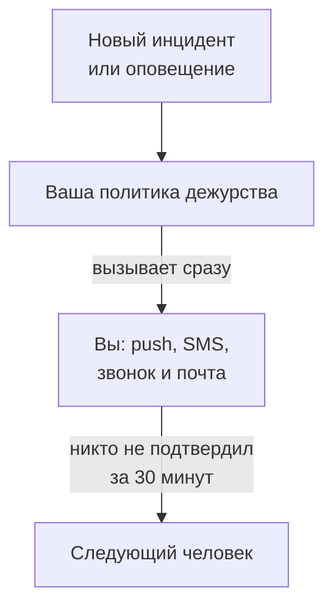

# Получать оповещения звонком, SMS или push

К концу этого руководства каждый новый инцидент и каждое оповещение в вашем проекте будут вызывать вас на телефон push-уведомлением, SMS или звонком; следующий человек будет вызван, если никто не подтвердит вызов в течение 30 минут; а подтверждённый вами тестовый вызов покажет, что всё работает. Руководство следует пошаговой настройке **Оповещать нужного человека, когда что-то ломается** и занимает около 10 минут.

## Что понадобится

- Проект, которым вы владеете: включить SMS и звонки может только его владелец, а создать политику дежурства — владелец или администратор.
- Ваш мобильный телефон.
- Коллеги, которых нужно вызывать, добавленные в проект как участники: как это сделать, показано на странице [Приглашение пользователей](/docs/permissions/inviting-people).

:::tabs
@tab OneUptime Cloud
Push-уведомления бесплатны на всех тарифах. SMS и звонки оплачиваются с баланса проекта, который изначально равен 0.00 USD, а при добавлении номера телефона отправляется SMS, поэтому сначала баланс должен быть больше 1.00 USD. Сумма пополнения списывается с карты проекта. Тариф Free рассчитан на одного человека и одно правило эскалации: вызывают только вас, и вызов повторяется, а не переходит к кому-то другому.
@tab Свой сервер
Ваш сервер должен уметь отправлять письма и SMS и совершать звонки. Его главный администратор настраивает их по адресу `/admin/setup`, с проверкой для каждого канала, как показано в разделе [Руководство по самостоятельному хостингу](/docs/installation/self-hosting-guide). Push-уведомления доходят до приложения через push-ретранслятор OneUptime, и настраивать ничего не нужно.
:::

## Шаги

:::steps
### Откройте пошаговую настройку

На странице **Главная** вашего проекта нажмите **Настройте политику дежурств** в списке **Добро пожаловать в OneUptime 👋**. На главной странице нового проекта сначала появляется вопрос **Что вы хотите сделать первым делом?**: отметьте **Оповещать нужного человека, когда что-то ломается** и нажмите **Продолжить**. Если этого шага нет или он уже выполнен, нажмите `Ctrl+K` (`Cmd+K` на Mac), введите `get paged` и выберите **Оповещать нужного человека, когда что-то ломается**.

### Установите приложение на телефон

Установите OneUptime On-Call из App Store или Google Play и войдите в свою учётную запись: приложение зарегистрирует ваш телефон для push-уведомлений. Вернувшись к настройке, нажмите **Проверить снова**: в разделе **Как с вами связаться?** пункт **Мобильное приложение или браузер** теперь показывает ваш телефон.

### Включите SMS и звонки

В новых проектах SMS и телефонные звонки выключены. Если вы владелец проекта, нажмите **Включить SMS и звонки**; остальным сообщается, кто может это сделать. Если в OneUptime Cloud баланс составляет 1.00 USD или меньше, нажмите **Пополнить баланс**, введите от 20 до 1 000 USD в поле **Сумма (USD)** и нажмите **Пополнить**.

### Добавьте свой номер телефона

Введите номер мобильного телефона с кодом страны в поле **Ваш номер телефона**, например `+15551234567`, и нажмите **Прислать код по SMS**. Введите код из SMS и нажмите **Подтвердить**: этот же номер используется и для вызовов звонком. Нажмите **Продолжить**. Чтобы получать вызовы только через приложение и почту, не указывайте номер и сразу нажмите **Продолжить**.

### Выберите, кого ещё вызывать

В разделе **Кто ещё дежурит?** вы уже указаны в списке **Вызываются первыми**. Нажмите **Добавить участников команды**, чтобы вместе с вами вызывались и другие, затем нажмите **Сохранить и продолжить**. В проекте, где ещё нет политики дежурства, этот шаг создаёт политику `Default on-call policy`, которая вызывает их при каждом новом инциденте и оповещении. В проекте, где политика уже есть, выберите её в поле **Политика дежурства** и вместо этого добавьте людей в поле **Добавить в первое правило эскалации**. Если с кем-то пока нельзя связаться, шаг остаётся открытым на вопросе **Дойдёт ли до них вызов?**: нажмите для этого человека **Отправить напоминание о настройке**, затем **Продолжить**.

### Решите, что будет, если никто не ответит

В разделе **Что, если никто не ответит?** оставьте **Вызвать другого человека**, выберите, кого именно, в поле **Вызываются следующими**, а значение `30` в поле **Сколько минут ждать** сохраните или измените. Нажмите **Сохранить и продолжить**. На тарифе Free шаг вместо этого предлагает **Снова вызвать тех же людей** со значением `2` в поле **Сколько раз повторить вызов**.

### Отправьте тестовый вызов

В разделе **Отправить тестовый вызов** нажмите **Проверить эту политику**. Выберите **Серьёзность** и нажмите **Отправить тестовый вызов**. Первое правило эскалации политики вызывается так же, как его вызвал бы настоящий инцидент, и в каждом сообщении есть пометка TEST. Инцидент не создаётся, а страница статуса и подписчики ничего не узнают.

### Подтвердите тестовый вызов

Откройте ссылку из SMS или письма и подтвердите вызов там либо нажмите 1 во время звонка. Приложение показывает, что вызов пришёл, но подтвердить тест не может. Затем нажмите **Готово** в диалоге и **Продолжить**.
:::

## Проверьте, что всё работает

- Шаг проверки показывает, кто подтвердил вызов, каким способом и как быстро.
- Настройка завершается сводкой **Вызовы настроены**, построенной по сохранённым данным: **Кого вызывают**, **Если никто не отвечает** и **Протестировано**. Проблема в самой политике, например человек, с которым она не может связаться, указывается в разделе **Требует внимания**.
- На странице **Главная** список отмечает пункт **Настройте политику дежурств** как выполненный. Если это был последний шаг, список исчезает.

Если политика вызывает кого-то ещё, можно посмотреть и на эскалацию: нажмите **Открыть политику дежурства** в сводке, затем **Проверить эту политику**. Включите **Пройти все уровни эскалации**, отправьте тест и не подтверждайте первый вызов: следующего человека вызовут не позже чем через 2 минуты.

## Что может пойти не так

:::details Нет кнопки «Прислать код по SMS»
Отправка SMS выключена или невозможна, и шаг объясняет почему. Кнопку **Включить SMS и звонки** видит только владелец проекта или тот, кто управляет биллингом. В OneUptime Cloud поле скрыто, если баланс составляет 1.00 USD или меньше. На своём сервере, который не может отправлять SMS, главный администратор видит **Настроить SMS и звонки**: эта кнопка открывает Admin Dashboard, где добавляется Twilio, как показано в разделе [Интеграция с Twilio](/docs/self-hosted/twilio-integration).
:::

:::details «Пополнить баланс» сообщает, что способ оплаты не найден
Сумма пополнения списывается с карты проекта. Добавьте карту в разделе **Настройки проекта → Биллинг и счета → Биллинг** кнопкой **Добавить способ оплаты**, затем снова пополните баланс. А пока вызовы по-прежнему приходят вам через приложение и почту.
:::

:::details Свой сервер: номер отклонён, потому что не настроена учётная запись Twilio
Заранее о том, что сервер не может отправлять SMS, предупреждают только главного администратора. Попросите его настроить SMS и звонки по адресу `/admin/setup`. А пока нажмите **Продолжить**: вызовы по-прежнему приходят вам через приложение и почту.
:::

:::details Код или тестовый вызов так и не приходит
Сначала проверьте код страны в номере. После тестового вызова закройте диалог кнопкой **Готово** и нажмите **Мне ничего не пришло**: появится подсказка, что проверить, а **Открыть мои способы уведомления** покажет все способы, которыми с вами можно связаться. На своём сервере отправьте тестовое SMS со страницы `/admin/setup` и выполните на сервере `npm run doctor`.
:::

## Дальнейшие шаги

:::cards
- [Расписания дежурств](/docs/on-call/schedules): Дежурить по очереди, чтобы каждый вызов шёл тому, кто сейчас дежурит. В Cloud — с тарифа Growth.
- [Правила эскалации](/docs/on-call/escalation-rules): Добавить в политику уровни, команды и расписания.
- [Как со мной связаться](/docs/notifications/on-call-rules): Выбрать, какой способ связи сработает первым и когда.
- [Опубликовать страницу статуса](/docs/guides/status-page): Рассказывать клиентам, что происходит, на своём домене.
:::
