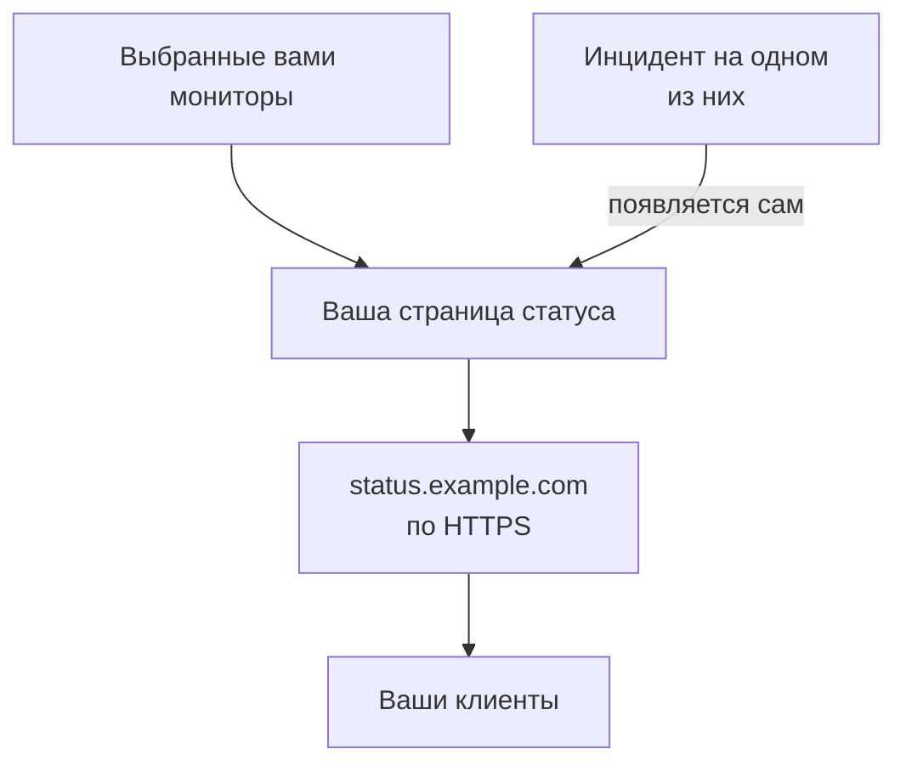

# Опубликовать страницу статуса

К концу этого руководства ваши клиенты будут открывать страницу статуса по вашему собственному адресу, например `status.example.com`, через HTTPS. На ней показаны выбранные вами мониторы с их статусом и аптаймом, а инцидент на любом из них появляется там сам. Руководство следует пошаговой настройке **Опубликуйте страницу статуса**, а затем добавляет ваш домен в разделе **Пользовательские домены** этой страницы: это займёт около 15 минут плюс время, которое нужно вашему DNS-провайдеру.

## Что понадобится

- Хотя бы один монитор: страница статуса показывает мониторы. Если их ещё нет, пошаговая настройка сначала предложит **Настроить монитор**.
- Роль владельца или администратора проекта: для страницы нужно право создавать страницы статуса, а для вашего домена — право добавлять и подтверждать домены проекта.
- Домен, которым вы управляете, и доступ к его DNS-записям у вашего DNS-провайдера.

:::tabs
@tab OneUptime Cloud
Пользовательский домен и бесплатный SSL-сертификат для него входят во все тарифы. На тарифе Free одна страница статуса на проект: если она у вас уже есть, откройте её раздел **Пользовательские домены** и начните с шага, который добавляет ваш домен. Новая страница статуса публична; чтобы сделать её приватной, нужен тариф Growth.
@tab Свой сервер
Вашему серверу нужно собственное имя хоста с A-записью, указывающей на него, например `oneuptime.example.com`, которое отвечает на портах 80 и 443. Укажите его как `STATUS_PAGE_CNAME_RECORD` в `config.env` (`statusPage.cnameRecord` в Helm-чарте) вместо стоящего там примера. Для бесплатных сертификатов нужен ещё `LETS_ENCRYPT_ACCOUNT_KEY` (`letsEncrypt.accountKey`): закрытый ключ, созданный с помощью openssl и закодированный в base64. После их изменения перезапустите OneUptime. Диалог **Добавить пользовательский домен** сначала проверяет сервер и перечисляет, чего ещё не хватает.
:::

## Шаги

:::steps
### Откройте пошаговую настройку

На странице **Главная** вашего проекта нажмите **Опубликуйте страницу статуса** в списке **Добро пожаловать в OneUptime 👋**. На главной странице нового проекта сначала появляется вопрос **Что вы хотите сделать первым делом?**: отметьте **Сообщать клиентам через страницу статуса** и нажмите **Продолжить**. Если этого шага нет или он уже выполнен, нажмите `Ctrl+K` (`Cmd+K` на Mac), введите `status page` и выберите **Опубликуйте страницу статуса**.

### Назовите её и выберите, что она показывает

В разделе **Назовите её и выберите, что она показывает** оставьте предложенное значение в поле **Название страницы статуса** или введите своё. В разделе **Что она показывает** отметьте мониторы, которые должны видеть ваши клиенты, или нажмите **Выбрать все**. Нажмите **Создать страницу статуса**. С этого момента страница публично доступна по своей ссылке и показывает только отмеченные мониторы.

### Посмотрите, что видят ваши клиенты

В разделе **Вот что видят ваши клиенты** откройте адрес под заголовком **Публичная ссылка**: ваши мониторы перечислены там со своим статусом. Вернувшись к настройке, нажмите **Всё верно**.

### Откройте «Пользовательские домены»

Настройка завершается сводкой. В разделе **Сделайте её своей (необязательно)** нажмите **Ваш собственный домен**. Откроется раздел **Пользовательские домены** страницы статуса.

### Добавьте свой домен

Нажмите **Добавить пользовательский домен**. В поле **Домен** введите адрес, который будут открывать ваши клиенты, например `status.example.com`, и нажмите **Продолжить**. Откроется диалог **Настройка DNS** с записями, которые нужно добавить.

### Добавьте DNS-записи

У своего DNS-провайдера добавьте каждую запись, которую перечисляет диалог **Настройка DNS**, с полями **Тип**, **Имя** и **Значение**: CNAME-запись, которая направляет адрес на OneUptime, и, когда проект впервые использует этот домен, TXT-запись, которая показывает, что домен принадлежит проекту. Если провайдер сам дописывает домен к каждому имени, введите только часть перед ним, например `status`, а для самого домена — `@`.

### Проверьте записи

Не закрывайте диалог **Настройка DNS** и нажмите **Проверить сейчас**. Под каждой записью он показывает, что запросил и что получил в ответ. Сначала проверяется TXT-запись: пока она не найдена, домен не добавляется, поэтому нажимайте **Проверить сейчас** снова, пока она не найдётся. Как только CNAME-запись найдена, диалог пишет **Ваша CNAME-запись подтверждена.**, и выпускается бесплатный SSL-сертификат, обычно в течение 15 минут.
:::

## Проверьте, что всё работает

- Откройте `https://status.example.com`, подставив свой адрес: ваша страница статуса открывается без предупреждения о сертификате.
- На странице **Пользовательские домены** в столбце **Статус** домена написано **Сертификат выпущен, обновляется автоматически.** Какое-то время после того, как страница уже открывается, там может быть написано **Выпускается бесплатный сертификат, обычно в течение 15 минут.**
- На странице **Главная** список отмечает пункт **Опубликуйте страницу статуса** как выполненный: он считается выполненным, как только страница статуса показывает монитор. Если это был последний шаг, список исчезает.

Больше ничего делать не нужно: OneUptime сам продлевает сертификат. Как только домен появляется в списке, OneUptime проверяет его CNAME-запись каждые 15 минут и подтверждает домен, когда запись начинает работать, даже если вы закроете диалог **Настройка DNS**.

## Что может пойти не так

:::details Домена нет в списке после закрытия диалога «Настройка DNS»
Диалог **Настройка DNS** закрыли до того, как была найдена TXT-запись, поэтому домен так и не был добавлен. Нажмите **Добавить пользовательский домен**, введите тот же адрес, нажмите **Продолжить**, а затем нажимайте **Проверить сейчас**, пока диалог не найдёт обе записи.
:::

:::details Домен остаётся в состоянии «Ожидание DNS»
Откройте диалог **Настройка DNS** из строки домена и нажмите **Проверить сейчас**: диалог покажет, что он нашёл. Проверьте, что имя записи — это полный адрес, например `status.example.com`, и что её значение совпадает с тем, что показывает **Настройка DNS**. Если имя отвечает адресом, у него есть A-запись или его проксирует ваш DNS-провайдер: замените A-запись или переключите имя в режим «только DNS». Для корневого домена, например `example.com`, используйте запись ALIAS, ANAME или flattened CNAME вашего провайдера.
:::

:::details Столбец «Статус» пишет, что бесплатный сертификат выпустить не удалось
CAA-запись на вашем домене, которая не включает `letsencrypt.org`, блокирует сертификат. Если сервер свой, Let's Encrypt должен достучаться до него на порту 80. Устраните причину: OneUptime сам продолжает попытки, а **Проверить сейчас** в диалоге **Настройка DNS** заказывает сертификат снова, не чаще одного раза в 15 минут на домен.
:::

:::details Свой сервер: он не готов к пользовательским доменам
Диалог **Добавить пользовательский домен** пишет **Этот сервер пока не готов к пользовательским доменам** и выводит по строке на каждый недостающий пункт с тем, что нужно изменить: это настройки из раздела [Что понадобится](#что-понадобится). Без `LETS_ENCRYPT_ACCOUNT_KEY` подтверждённый домен показывает **Подтверждено. Используется HTTPS вашего прокси.**: обеспечьте HTTPS для него на своём прокси. Подробности — в разделе [Оформление и домены страницы статуса](/docs/status-pages/branding-and-domains#перед-началом).
:::

## Дальнейшие шаги

:::cards
- [Оформление и домены страницы статуса](/docs/status-pages/branding-and-domains): Ваш логотип, цвета, ссылки в заголовке и нижний колонтитул.
- [Подписчики и объявления](/docs/status-pages/subscribers): Дать клиентам подписаться и публиковать объявления.
- [Обзор планового обслуживания](/docs/scheduled-maintenance/index): Сообщать клиентам о плановых работах до их начала.
- [Получать оповещения звонком, SMS или push](/docs/guides/paging): Получать вызов, когда один из этих мониторов падает.
:::
