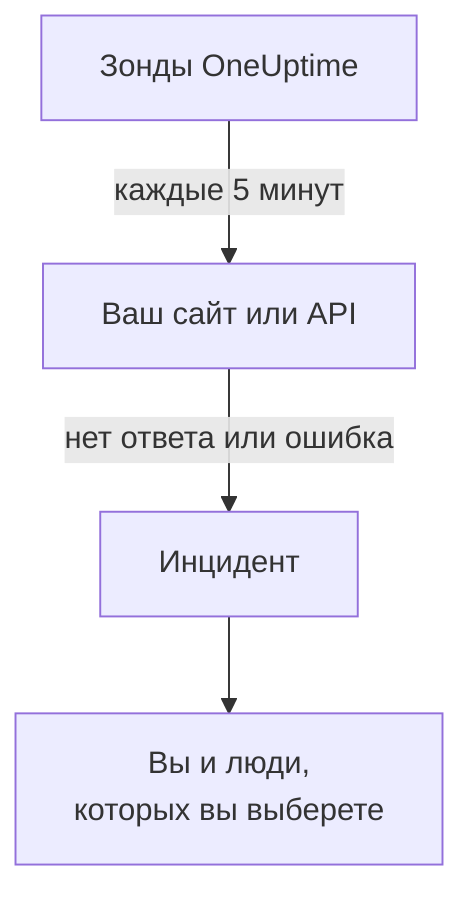

# Узнавать, когда ваш сайт или API падает

К концу этого руководства OneUptime будет проверять ваш сайт или API каждые 5 минут, открывать инцидент, когда он перестаёт отвечать или отвечает ошибкой, и сообщать вам об этом, а подтверждённый вами тестовый вызов покажет, что сообщение до вас доходит. Руководство следует пошаговой настройке **Узнавать, когда мой сайт или API недоступен** и занимает около 5 минут.

## Что понадобится

- Проект OneUptime, в котором вам можно создавать мониторы: это разрешено владельцу, администратору и участнику. Чтобы создать учётную запись и проект, пройдите первую часть раздела [Быстрый старт](/docs/introduction/quickstart#создайте-проект).
- Адрес для проверки, например `https://example.com`. Для API выберите эндпоинт, который отвечает на простой запрос `GET` без ключа, например эндпоинт проверки работоспособности: при ответе вроде `401` он считается недоступным.

:::tabs
@tab OneUptime Cloud
Адрес проверяют зонды в нескольких регионах, поэтому он должен быть доступен из интернета. На тарифе Free доступно 10 активных мониторов.
@tab Свой сервер
Адрес проверяет собственный зонд вашего сервера, поэтому он должен быть доступен оттуда. Чтобы вы получали письма, сервер должен уметь отправлять почту: его главный администратор настраивает это по адресу `/admin/setup`, как показано в разделе [Руководство по самостоятельному хостингу](/docs/installation/self-hosting-guide). Главный администратор не становится владельцем того, что создаёт, поэтому, чтобы получать письма, он добавляет себя на странице **Владельцы** монитора.
:::

## Шаги

:::steps
### Откройте пошаговую настройку

На странице **Главная** нового проекта сначала появляется вопрос **Что вы хотите сделать первым делом?**: отметьте **Узнавать, когда мой сайт или API недоступен** и нажмите **Продолжить**. Затем нажмите **Создайте первый монитор** в списке **Добро пожаловать в OneUptime 👋**. Если в списке нет этого пункта, нажмите `Ctrl+K` (`Cmd+K` на Mac), введите `website down` и выберите **Узнавать, когда мой сайт или API недоступен**.

### Введите адрес

В разделе **Что нам проверить?** введите адрес в поле **Адрес сайта или API**. Для эндпоинта API отметьте **Это эндпоинт API**. Нажмите **Начать проверку**: зонды сразу проверят адрес, и появится надпись о том, что они обнаружили. Нажмите **Продолжить**.

### Выберите, кого уведомлять

В разделе **Кого нужно уведомить?** то, что вы увидите, зависит от проекта:

- Если в проекте ещё нет ни политики дежурства, ни правила дежурства, вы уже указаны в списке **Кого вызывают**. Нажмите **Добавить участников команды**, чтобы добавить людей, которые уже есть в проекте, затем нажмите **Сохранить и продолжить**. Так создаётся политика `Default on-call policy`, которая вызывает их при каждом новом инциденте и оповещении в проекте.
- Если политика или правило дежурства уже есть, кого вызывать, решают собственные правила проекта: нажмите **Продолжить**.
- Если вы участник, которому нельзя настраивать вызовы, вы увидите, что будете получать письма как владелец монитора: нажмите **Продолжить**.

### Отправьте себе тест

В разделе **Отправьте тест** нажмите **Отправить мне тестовый вызов**. Выберите **Серьёзность** и нажмите **Отправить тестовый вызов**. Тест приходит к вам так же, как пришёл бы настоящий вызов, и в каждом сообщении есть пометка TEST. Инцидент не создаётся.

### Подтвердите тестовый вызов

Откройте ссылку из письма и подтвердите вызов там. Подойдёт и подтверждённый номер телефона, если для проекта включены SMS и звонки: откройте ссылку из SMS или нажмите 1 во время звонка. Затем нажмите **Готово** в диалоге и **Продолжить**.
:::

## Проверьте, что всё работает

- Настройка завершается сводкой, построенной по сохранённым данным: **Проверено**, **Если он недоступен**, **Кого уведомляют** и **Протестировано**.
- Нажмите **Открыть монитор**, затем **Показать цепочку** на его карточке **Когда он упадёт**: появится цепочка от монитора до людей, до которых она доходит, а если цепочку ничто не прервёт, там будет написано **Цепочку ничто не прерывает.**
- На странице **Главная** список отмечает пункт **Создайте первый монитор** как выполненный, как только приходит результат первой проверки. Если это был последний шаг, список исчезает.

Чтобы позже проверять ещё один адрес, снова откройте настройку и нажмите **Проверить другой адрес**.

## Что может пойти не так

:::details Результат первой проверки так и не приходит
Если надпись говорит, что адрес не проверяется ни из одного места, у монитора нет зонда; если она всё время говорит, что проверка идёт, его зонд не подключён. Откройте **Мониторы → Настройки → Зонды**, чтобы увидеть статус каждого зонда. На своём сервере главный администратор проверяет зонд сервера по адресу `/admin/setup`. Затем откройте монитор, добавьте к нему подключённый зонд и снова откройте настройку.
:::

:::details Сайт работает, но монитор говорит, что он недоступен
Монитор считает недоступностью отсутствие ответа или ответ вне диапазона от 200 до 399. Брандмауэр, который блокирует зонды, выглядит как отсутствие ответа: в OneUptime Cloud разрешите адреса со страницы [IP-адреса](/docs/configuration/ip-addresses), а на своём сервере — машину, на которой работает зонд. Чтобы изменить это правило, см. [Мониторинг веб-сайта](/docs/monitor/website-monitor) или [Мониторинг API](/docs/monitor/api-monitor).
:::

:::details Тестовый вызов не получается подтвердить
Не пришло ничего, через что его можно подтвердить; на своём сервере это обычно значит, что сервер пока не может отправлять почту: шаг сообщает об этом, а его главный администратор видит **Настроить почту**. Настройте почту, затем нажмите **Отправить ещё один тест** или нажмите **Пропустить тест** и вернитесь позже. После теста закройте диалог кнопкой **Готово** и нажмите **Мне ничего не пришло**: появится подсказка, что проверить.
:::

## Дальнейшие шаги

:::cards
- [Получать оповещения звонком, SMS или push](/docs/guides/paging): Получать вызовы на телефон и вызывать следующего человека, если никто не отвечает.
- [Опубликовать страницу статуса](/docs/guides/status-page): Показывать монитор клиентам на своём домене.
- [Критерии и статусы](/docs/monitor/criteria-and-statuses): Точно решить, когда монитор считается недоступным.
:::
