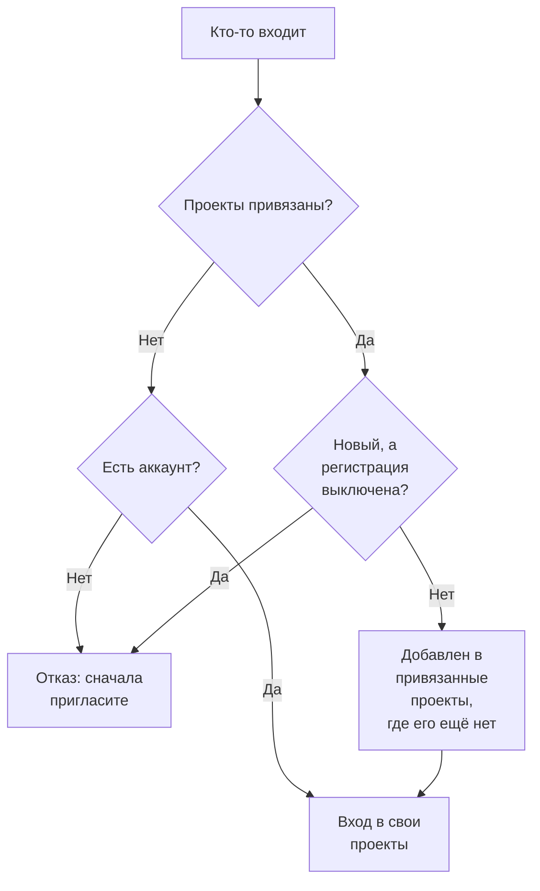

# Глобальный SSO

Глобальный SSO позволяет **администратору экземпляра** OneUptime (мастер-администратору) настроить поставщика удостоверений SAML 2.0 или OpenID Connect (OIDC) **один раз**, на уровне экземпляра, и подключить его к любому проекту на сервере. Вместо того чтобы каждый Владелец проекта настраивал собственного поставщика удостоверений, мастер-администратор настраивает одного, который обслуживает весь экземпляр.

> [!NOTE]
> Глобальный SSO, включая переключатель "Require SSO to Sign In" для всего экземпляра, входит во все редакции OneUptime: он есть на любом самостоятельно размещённом экземпляре, в том числе в Community Edition, и лицензия для него не нужна. Это администрирование экземпляра, поэтому к OneUptime Cloud он не относится. Что входит в каждую редакцию, см. [Редакция Enterprise](/docs/self-hosted/enterprise).

:::cards
- [Настройка поставщика](#настройка-глобального-sso): Создайте его, передайте поставщику удостоверений URL из OneUptime и проверьте его.
- [Как входят пользователи](#как-входят-пользователи): Только существующие участники или новички, которых добавляют в привязанные вами проекты.
- [Обязательный SSO](#обязательный-sso): Требуйте SSO для одного проекта или для всего экземпляра и его страницы входа.
- [Выключение поставщика](#выключение-или-удаление-поставщика): Что прекращается и какие изменения OneUptime отклоняет.
:::

## Глобальный SSO и SSO проекта

|                   | SSO проекта                                           | Глобальный SSO                                          |
| ----------------- | ----------------------------------------------------- | ------------------------------------------------------- |
| Кто настраивает   | Владелец проекта или Администратор проекта (Настройки проекта) | Мастер-администратор экземпляра (Admin Dashboard)      |
| Область действия  | Один проект                                           | Весь экземпляр, можно подключить к любому проекту       |
| Результат входа   | Доступ к этому одному проекту                         | Доступ ко всем проектам, доступным пользователю         |

Собственный поставщик отдельного проекта описан в разделе [SSO](/docs/identity/sso).

## Настройка глобального SSO

:::steps
### Откройте список поставщиков

Войдите как мастер-администратор и откройте Admin Dashboard через **Настройки администратора** в меню пользователя. Затем перейдите в **Настройки** > **Единый вход**. Там перечислены поставщики SAML экземпляра, затем его поставщики OpenID Connect, а в конце — карточка **Требовать SSO**.

### Создайте поставщика

:::tabs
@tab SAML
- Нажмите **Добавить поставщика SAML**.
- Введите **Имя**, значения **URL входа** и **Издатель** из вашего поставщика удостоверений и вставьте **Публичный сертификат**. Всё остальное уже заполнено в разделе **Дополнительные поля**: **Метод подписи** (`RSA-SHA256`), **Метод дайджеста** (`SHA256`) и описание (`Sign in with` и имя). Меняйте их, только если этого требует ваш IdP. После сохранения откроется страница поставщика.
@tab OpenID Connect
- Нажмите **Добавить поставщика OIDC**.
- Введите **Имя**, **URL издателя**, а также **Client ID** и **Client Secret** приложения, которое вы зарегистрировали в своём IdP. Можно также вставить в поле **URL издателя** URL обнаружения IdP. Всё остальное уже заполнено в разделе **Дополнительные поля**: **URL обнаружения** (издатель, за которым следует `/.well-known/openid-configuration`), **Области** (`openid email profile`), имена утверждений `email` и `name` и описание (`Sign in with` и имя). Меняйте их, только если этого требует ваш IdP. После сохранения откроется страница поставщика.
:::

### Скопируйте URL из OneUptime в поставщика удостоверений

:::tabs
@tab SAML
На странице поставщика карточка **URL-адреса поставщика удостоверений** показывает **ACS URL (Assertion Consumer Service / Reply URL)** и **Issuer (Entity ID)**. Вставьте оба значения в своего поставщика удостоверений (Okta, Microsoft Entra ID, OneLogin, JumpCloud и другие).
@tab OpenID Connect
На странице поставщика карточка **URL поставщика удостоверений** показывает **Redirect URI (Callback URL)**. Добавьте его в разрешённые URI перенаправления вашего поставщика удостоверений.
:::

### Включите поставщика

Новый поставщик создаётся выключенным. Нажмите **Изменить конфигурацию** на странице поставщика и включите **Включено**.

Включение глобального поставщика только добавляет его к вариантам единого входа на странице входа — оно никогда не делает SSO обязательным и никого не блокирует, поэтому его можно спокойно включить, проверить и при необходимости снова выключить. Но пока весь экземпляр требует SSO, страница входа предлагает только включённых поставщиков: проверьте поставщика, прежде чем требовать SSO.

### Проверьте поставщика

Используйте ссылку в карточке **Проверить этого поставщика SSO** (**Проверить этого поставщика OIDC** для OpenID Connect), чтобы выполнить полный вход через вашего поставщика удостоверений. **Проверить вход** в строке поставщика на странице **Единый вход** начинает тот же вход в новой вкладке. Привязывать проекты заранее не нужно: проверка выполняет вход в проекты, в которых вы уже состоите. Чтобы ссылка работала, поставщик должен быть включён.
:::

## Как входят пользователи

Поведение глобального поставщика зависит от того, привязаны ли к нему проекты:

- **Проекты не привязаны (все проекты / сначала приглашение):** Пользователи могут входить через поставщика и попадать во **все проекты, в которых они уже состоят**. Новые пользователи **не** создаются автоматически — пользователя сначала нужно пригласить в проект. Используйте этот вариант для SSO в масштабе всей компании, когда членство управляется в другом месте.

- **Проекты привязаны (автоматическая подготовка учётных записей):** Откройте поставщика и используйте таблицу **Привязанные проекты**, чтобы привязать один или несколько проектов, каждый с набором команд по умолчанию. Пользователи, которые входят, **автоматически добавляются** в эти проекты и при первом входе включаются в команды по умолчанию. Привязанный проект начинается с команды участников; выберите другие команды, если новые пользователи должны начинать с другим доступом. Добавляйте по одному проекту с командами за раз, чтобы сформировать список; чтобы изменить привязку, удалите её и добавьте заново.

Тот, кто уже состоит в привязанном проекте, сохраняет там свои команды.

Это поведение меняют два вопроса поставщика, свёрнутые в разделе **Дополнительные поля**. Каждый начинается с первого ответа:

| Вопрос | Ответы |
| --- | --- |
| **Люди без учётной записи** | **Получают её при первом входе**: они присоединяются к привязанным проектам; если привязанных нет, их сначала нужно пригласить. **Сначала нужно пригласить**: людей нужно пригласить в проект, прежде чем они смогут входить через этого поставщика, даже когда проекты привязаны. |
| **Где этот вход считается входом через SSO** | **Все проекты**: проекты, требующие SSO, принимают вход через этого поставщика. **Только привязанные проекты**: вход через этого поставщика удовлетворяет требованию SSO только в привязанных к нему проектах, поэтому люди, которые уже вошли, могут потерять доступ к другим проектам. |

С ответом **Все проекты** вход через поставщика удовлетворяет требованию SSO во всех проектах, где состоит человек, а привязанные проекты определяют только то, куда добавляются новички.

## Выход и из поставщика удостоверений

Выход из OneUptime оставляет человека вошедшим у поставщика удостоверений, поэтому на общем компьютере следующий, кто войдёт через этого поставщика, войдёт под тем, кто ушёл. У поставщика OpenID Connect нажмите **Изменить конфигурацию** и включите **Выходить и из поставщика удостоверений** в разделе **Дополнительные поля**: тогда выход из OneUptime завершает и сеанс у поставщика, а поставщик возвращает браузер на страницу входа OneUptime. По умолчанию выключено, так как на личном ноутбуке это выводило бы человека и из всех других приложений, которые используют поставщика.

Зарегистрируйте у своего поставщика URI перенаправления после выхода, который показывает карточка **URL поставщика удостоверений**, как разрешённый post-logout redirect URI. Поставщик, в документе обнаружения которого нет `end_session_endpoint`, например Google, не может это включить.

## Обязательный SSO

Настройка глобального поставщика никого не заставляет им пользоваться; вход с паролем по-прежнему работает. Чтобы требовать SSO, включите требование для проекта или для всего экземпляра:

- **Для проекта:** проект может требовать SSO и при желании требовать _конкретного_ поставщика (проекта или глобального). Если также включено **Управлять входом через SSO**, люди, у которых все проекты так управляют входом, не получают в OneUptime ни пароля, ни ключа доступа, ни двухфакторной аутентификации. См. [Обязательный SSO для проекта](/docs/identity/sso#обязательный-sso-для-проекта).
- **Для всего экземпляра:** в карточке **Требовать SSO** внизу **Admin** > **Настройки** > **Единый вход** есть переключатель **Требовать SSO для входа**, который делает SSO обязательным для всех пользователей экземпляра. Перед включением он просит подтверждения и сохраняется, как только вы подтвердите. Мастер-администраторы остаются исключением, чтобы их нельзя было заблокировать.

Пока весь экземпляр требует SSO:

- Страница входа предлагает только SSO: кнопку для каждого включённого глобального поставщика — без пароля, ключа доступа, входа по ссылке из письма, входа через Google или Microsoft и регистрации. Поиск по адресу электронной почты, который находит собственного поставщика проекта, остаётся, только пока такой поставщик есть хотя бы у одного проекта.
- OneUptime отклоняет пароль, ключ доступа, вход по ссылке из письма, вход через Google или Microsoft и регистрацию с сообщением "This server requires single sign-on (SSO). Sign in with SSO instead." Войти по-прежнему можно только по паролю или ключу доступа мастер-администратора. Учётную запись люди получают, войдя через SSO или по приглашению.
- Все, кроме мастер-администраторов, не могут задать пароль, ключ доступа, ключ безопасности, приложение-аутентификатор, резервные коды или двухфакторную аутентификацию, а сброс пароля не отправляет им ссылку. В боковом меню **Профиль пользователя** у них нет раздела **Безопасность**, а страница **Обзор** называет поставщиков, через которых они входят. То, что они настроили раньше, остаётся сохранённым, но не используется, пока требование не выключат.
- Карточка **Требовать SSO** показывает, у скольких из них всё ещё сохранены пароль или двухфакторная аутентификация, с которыми они снова смогли бы войти, если бы SSO перестал быть обязательным. **Удалить настройки входа** после подтверждения удаляет их пароли, ключи доступа, ключи безопасности, приложения-аутентификаторы и резервные коды, выключает двухфакторную аутентификацию и завершает сеансы, в которые они вошли без SSO. Это нельзя отменить, мастер-администраторы сохраняют свои настройки, а проекты каждого человека записывают это в свои журналы аудита.
- На странице **Аутентификация** человека в разделе **Пользователи** кнопка **Удалить настройки входа** делает то же самое для одного этого человека, а **Задать пароль** и **Отправить ссылку для сброса пароля** предупреждают, что пароль не позволит ему войти. Свои собственные настройки там удалить нельзя, а при удалении настроек другого мастер-администратора нужно подтвердить, что он мастер-администратор.
- Тот, кто уже вошёл с паролем, входит через SSO, чтобы открыть проект. Он попадает на страницу единого входа проекта, где предлагаются собственные поставщики проекта и глобальные поставщики, выполняющие вход в него. Карточка **Требовать SSO** показывает, сколько пользователей всё ещё вошли без SSO, а **Завершить их сеансы** завершает их сеансы сразу на всех устройствах. Главные администраторы остаются в системе.
- Мастер-администраторы входят со своим паролем по адресу `/accounts/admin-login`, на который страница входа не ссылается. Карточка **Требовать SSO** показывает полный адрес под переключателем как **Вход для главных администраторов**: сохраните его, чтобы выключить требование, если ваш поставщик удостоверений перестанет работать.

Чтобы включить **Требовать SSO для входа**, нужен поставщик SSO, который выполняет вход, чтобы никто из-за этого не потерял доступ:

- Для всего экземпляра он нужен каждому проекту, который сам SSO не требует: один из собственных включённых поставщиков SAML или OIDC проекта или включённый глобальный поставщик, который выполняет вход в этот проект. Пока у проекта его нет, включение переключателя отклоняется, а сообщение называет проекты (или, если их много, первые несколько и их общее число). Сначала включите глобального поставщика или поставщика в этих проектах. Проекту, который требует конкретного поставщика, нужен именно он: пока он выключен, удалён или не выполняет вход в проект, сообщение называет этот проект отдельно — сначала включите этого поставщика или потребуйте там другого.
- Для проекта то же самое требуется от этого проекта и от поставщика, которого он требует, если требует.
- Сохранение, которое отправляет **Требовать SSO для входа** включённым, когда он уже включён, — вместе с другими настройками или из API, — проверяется так же, для экземпляра или для проекта, как и сохранение, которое указывает поставщика, которого проект уже требует.
- Для нового проекта, у которого ещё нет собственного поставщика: пока экземпляр требует SSO, для создания проекта нужен включённый глобальный поставщик, который выполняет вход во все проекты, иначе никто, включая создателя, не смог бы его открыть. Без него создание проекта отклоняется, а сообщение просит администратора сервера включить такого поставщика. Мастер-администраторы по-прежнему могут создавать проекты. Проекту, создаваемому с уже включённым **Требовать SSO для входа**, нужно то же самое, кто бы его ни создавал.

Выключение никогда не отклоняется.

## Выключение или удаление поставщика

Выключение глобального поставщика, его удаление или ограничение привязанными проектами завершает выполненные через него входы там, где он больше не выполняет вход. Там, где SSO обязателен, люди, вошедшие через него, должны снова войти через SSO при следующем запросе, открытые у них страницы сразу перестают получать обновления в реальном времени, а клиент MCP, который кто-то подключил после входа через этого поставщика, перестаёт работать в проекте.

Повторное включение поставщика не возвращает эти входы: люди снова входят через него. Поставщик, который уже был выключен на момент обновления, считается выключенным при обновлении.

Новый сертификат или секрет клиента, другие URL или новое имя сохраняют вход для всех.

### Каждый проект, требующий SSO, сохраняет путь внутрь

Проект, который требует SSO сам или потому, что этого требует весь экземпляр, всегда сохраняет поставщика, через которого в него можно войти. Поэтому следующие изменения отклоняются, пока они оставили бы такой проект совсем без поставщика или лишили бы его требуемого поставщика:

- выключение глобального поставщика, его удаление или ограничение привязанными проектами;
- для поставщика, ограниченного привязанными проектами: привязка первого проекта (до этого он выполняет вход во все проекты), выключение привязки, её перенос в другой проект или к другому поставщику или её удаление.

Сообщение называет проекты или первые несколько и их общее число. Сначала включите для них другого поставщика, собственного или глобального, или выключите там **Требовать SSO для входа**. Проект, который требует именно этого поставщика, называется отдельно: сначала потребуйте там другого поставщика или выключите **Требовать SSO для входа**.

Изменения, которые позволяют поставщику выполнять вход для большего числа людей, — включение его или привязки, снятие ограничения — никогда не отклоняются. Они сразу доходят до всех серверов приложений, так же как выключение **Требовать SSO для входа**: люди могут сразу входить через поставщика. Только когда в тот же самый момент сохраняется другое изменение того же поставщика, серверу приложений может понадобиться до минуты, чтобы это учесть.

Два изменения того, кто может входить, проверяются одно за другим. Если в тот же момент сохраняется другое и это занимает больше времени, чем обычно, — включение **Требовать SSO для входа** для всего экземпляра читает все проекты, — изменение отклоняется с сообщением "Another change to who can sign in with SSO is being saved. Try again in a moment.": сохраните его снова. Проект, создаваемый в этот момент, тоже ждёт изменения, а если ждёт слишком долго, отклоняется с сообщением "The server's SSO settings are being changed. Create the project again in a moment."

## Устранение неполадок

:::details "You must be invited to a project on this OneUptime instance before you can sign in with SSO"
У человека ещё нет аккаунта OneUptime, а поставщик его не создаёт: либо к нему не привязаны проекты, либо для **Люди без учётной записи** выбрано **Сначала нужно пригласить**. Пригласите человека в проект или привяжите проект к поставщику.
:::

:::details "This SSO provider does not grant access to any project you are a member of"
Для **Где этот вход считается входом через SSO** выбрано **Только привязанные проекты**, а человек не состоит ни в одном проекте, привязанном к поставщику. Привяжите один из его проектов или добавьте его в привязанный проект.
:::

:::details "You are not a member of any project on this OneUptime instance"
У человека есть аккаунт, но он не состоит ни в одном проекте, а поставщику некуда его добавить. Пригласите человека в проект или привяжите к поставщику проект с командами по умолчанию.
:::

:::details "Issuer URL does not match"
Для поставщика SAML издатель в ответе вашего поставщика удостоверений не совпадает со значением **Издатель**, сохранённым у поставщика. Скопируйте его заново из поставщика удостоверений; значения должны совпадать в точности.
:::

:::details "SAML Audience does not match"
Для поставщика SAML audience ответа — не **Issuer (Entity ID)** поставщика: ваш поставщик удостоверений создал ответ для другого приложения. В поставщике удостоверений задайте entity ID приложения равным **Issuer (Entity ID)** со страницы поставщика. "SAML Recipient does not match" и "SAML Destination does not match" означают то же самое для его reply URL: задайте его равным **ACS URL (Assertion Consumer Service / Reply URL)**.
:::

:::details "SAML response was already used"
Каждый ответ вашего поставщика удостоверений выполняет вход только один раз и только в течение нескольких минут после выдачи: после этого он отклоняется с "SAML response has expired". Войдите снова. Если ответы продолжают истекать, проверьте часы этого сервера и вашего поставщика удостоверений.
:::

:::details "This server requires single sign-on (SSO). Sign in with SSO instead."
Весь экземпляр требует SSO, а это был вход с паролем, ключом доступа, по ссылке из письма, через Google или Microsoft либо регистрация. Вместо этого войдите с помощью одной из кнопок SSO на странице входа. Мастер-администратор входит со своим паролем по адресу `/accounts/admin-login`; чтобы все снова могли входить с паролем, он выключает **Требовать SSO для входа** на странице **Единый вход**.
:::

## Дальнейшие шаги

:::cards
- [SSO](/docs/identity/sso): Настройте собственного поставщика SAML или OIDC для проекта.
- [SCIM](/docs/identity/scim): Пусть поставщик удостоверений сам добавляет и удаляет людей.
- [Пользователи, команды и разрешения](/docs/permissions/index): Что разрешают новичкам команды, в которые они попадают.
:::
