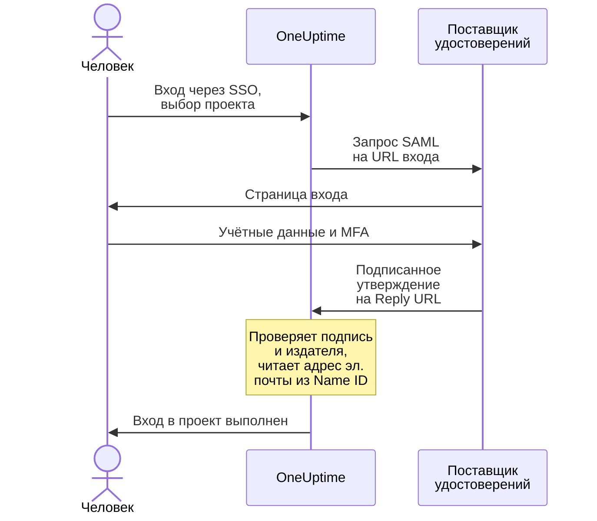

# SSO

Единый вход (SSO) позволяет участникам вашего проекта входить в OneUptime через поставщика удостоверений (IdP) вашей организации по SAML 2.0 или OpenID Connect. Вы управляете доступом, паролями и многофакторной аутентификацией в одном месте и можете требовать SSO от всех в проекте.

> [!NOTE]
> **Редакция:** SSO, включая "Require SSO to sign in", входит во все редакции OneUptime: самостоятельно размещённые установки получают его в Community Edition, лицензия не нужна. В OneUptime Cloud он доступен начиная с плана **Scale**. Что входит в каждую редакцию, см. [Редакция Enterprise](/docs/self-hosted/enterprise).

:::cards
- [Настройка поставщика SAML](#настройка-sso): Создайте его в OneUptime и передайте своему IdP два URL.
- [Руководства для поставщиков удостоверений](#руководства-для-поставщиков-удостоверений): Keycloak, Microsoft Entra ID и Okta, шаг за шагом.
- [OpenID Connect](#openid-connect-oidc): Вход через приложение OIDC.
- [Обязательный SSO](#обязательный-sso-для-проекта): Сделайте SSO единственным способом войти в проект.
:::

## Как работает вход через SAML

Поставщик SAML связывает один проект с одним приложением в вашем поставщике удостоверений. Тот, кто входит, выбирает проект на странице OneUptime **Вход через SSO**, входит у вашего IdP и возвращается уже авторизованным.



OneUptime читает из утверждения, которое присылает ваш IdP, всего несколько вещей:

| Из утверждения | Что с этим делает OneUptime |
| --- | --- |
| Подпись | Проверяет её по полю **Публичный сертификат** поставщика. Ответ должен быть подписан и не должен быть зашифрован. |
| Issuer | Должен в точности совпадать с полем **Издатель** поставщика. |
| Audience | Это должен быть **Идентификатор (Entity ID)** поставщика. Ответ, который ваш IdP создал для другого приложения, отклоняется. |
| Recipient и Destination | Это должен быть **URL ответа** поставщика — адрес, на который был отправлен ответ. |
| `NotBefore` и `NotOnOrAfter` | Ответ принимается, только пока они это позволяют, и не позже чем через 10 минут после выдачи, с запасом в 3 минуты для часов, которые расходятся. |
| Name ID | Адрес электронной почты человека. Это должен быть действительный адрес электронной почты. |
| Атрибуты имени | Имя человека, которое используется, когда OneUptime создаёт его аккаунт: отображаемое имя (`displayName` или `http://schemas.microsoft.com/identity/claims/displayname`) либо имя и фамилия (`firstName` и `lastName` или утверждения `givenname` и `surname`, которые Microsoft Entra ID отправляет по умолчанию). Необязательно. |
| `http://schemas.microsoft.com/identity/claims/objectidentifier` | Идентификатор объекта человека, который Microsoft Entra ID отправляет по умолчанию. Первый вход через этого поставщика привязывает к нему аккаунт, а последующий вход, в котором указан адрес электронной почты этого аккаунта, но другой идентификатор объекта, отклоняется. Необязательно. |

Каждый ответ выполняет вход только один раз. Отправленный повторно, например при возврате назад в браузере после входа, он отклоняется: войдите снова.

Те, кто входит впервые, попадают в команды из поля **Команды** поставщика, а эти команды определяют, что они могут делать: см. [Роли и команды для пользователей SSO](#роли-и-команды-для-пользователей-sso).

> [!NOTE]
> В OneUptime Cloud, когда кто-то впервые входит в проект через одного из его поставщиков SAML или OIDC, OneUptime не выполняет вход, а отправляет ему ссылку по электронной почте. Человек открывает её, подтверждает, что единый вход проекта может выполнять за него вход, и продолжает вход. Ссылка действует 24 часа. Это происходит один раз для каждого проекта и повторяется, если человек покидает проект и возвращается. Тот, кого вы приглашаете и чьим входом управляет SSO, такого письма не получает, есть у него уже аккаунт OneUptime или нет: если он выберет одного из поставщиков проекта на странице, которую открывает его приглашение, вход выполняется сразу, потому что ссылка в приглашении уже доказала, что почтовый ящик принадлежит ему. Самостоятельно размещённые установки выполняют вход сразу. В OneUptime Cloud любой вход, который не проходит сразу, получает этот же ответ, есть у адреса аккаунт или нет: тот, у кого ещё нет аккаунта, тоже получает письмо, и аккаунт создаётся, когда человек подтверждает вход, а заблокированный аккаунт или администратор OneUptime письма не получает. Самостоятельно размещённая установка вместо этого отказывает обоим одним и тем же сообщением.

В OneUptime Cloud тот, кто попадает в проект через SSO, занимает место, как и приглашённый вами человек. Если ваш план включает фиксированное число мест и все они заняты, новые люди не смогут войти в проект через SSO, пока не освободится место.

## Настройка SSO

Вам нужно разрешение на добавление поставщиков SSO — **Владелец проекта**, **Администратор проекта** или **Create Project SSO** — а в OneUptime Cloud ещё и план **Scale**. Настройка на стороне поставщика удостоверений описана в [руководствах для поставщиков удостоверений](#руководства-для-поставщиков-удостоверений).

:::steps
1. **Откройте настройки проекта**

   - Откройте свой проект OneUptime
   - Перейдите в **Настройки проекта** > **Безопасность** > **SSO**

2. **Создайте конфигурацию SSO**

   - Нажмите **Добавить поставщика SAML**
   - Введите **Имя** конфигурации SSO (например, "Keycloak SAML" или "Okta SAML")
   - Введите **URL входа** из вашего поставщика удостоверений
   - Введите **Издатель** (Entity ID) из вашего поставщика удостоверений
   - Вставьте **Публичный сертификат** из вашего поставщика удостоверений
   - На шаге **Вход** поле **Команды** изначально содержит команду участников вашего проекта: те, кто входит впервые, попадают в эти команды. Принимаются только команды, в которые вы сами могли бы кого-то пригласить: команда, дающая больше доступа, чем есть у вас, указывается под полем **Команды**
   - Всё остальное уже заполнено в разделе **Дополнительные поля**: **Метод подписи** (`RSA-SHA256`), **Метод дайджеста** (`SHA256`) и описание ("Sign in with" и имя). Меняйте их, только если этого требует ваш поставщик удостоверений

3. **Получите метаданные SSO из OneUptime**
   - После сохранения открывается диалог **Конфигурация SSO**. Его можно открыть снова кнопкой **Просмотреть конфигурацию SSO**
   - Скопируйте **Идентификатор (Entity ID)**, например `https://oneuptime.com/<project-id>/<provider-id>` — он нужен в конфигурации вашего IdP
   - Скопируйте **URL ответа (URL службы получения утверждений)**, например `https://oneuptime.com/identity/idp-login/<project-id>/<provider-id>` — он нужен в конфигурации вашего IdP
   - Новый поставщик создаётся выключенным. Когда эти два значения будут у вашего IdP, отредактируйте поставщика и включите **Включено**

4. **Проверьте поставщика**
   - Откройте ссылку в карточке **Ссылка для входа через SSO** и выберите поставщика на открывшейся странице. Вас перенаправят на страницу входа вашего поставщика удостоверений, а затем обратно в OneUptime, уже с выполненным входом
   - Когда всё работает, можно [требовать SSO](#обязательный-sso-для-проекта) для проекта
:::

## Руководства для поставщиков удостоверений

Выберите своего поставщика удостоверений. Каждое руководство получает значения IdP, создаёт поставщика в OneUptime, а затем передаёт IdP **Идентификатор (Entity ID)** и **URL ответа** из OneUptime.

:::tabs
@tab Keycloak
Keycloak — популярное решение с открытым исходным кодом для управления удостоверениями и доступом. Вам нужен работающий экземпляр Keycloak с realm и права администратора и в Keycloak, и в OneUptime.

:::steps
1. **Соберите значения вашего realm**

   - **URL входа**: `https://<your-keycloak-domain>/auth/realms/<your-realm>/protocol/saml`
   - **Издатель**: `https://<your-keycloak-domain>/auth/realms/<your-realm>`
   - **Сертификат**: сертификат подписи realm. Откройте `https://<your-keycloak-domain>/auth/realms/<your-realm>/protocol/saml/descriptor` и скопируйте значение `X509Certificate` или откройте **Realm settings** > **Keys** и нажмите **Certificate** у ключа RS256

   Keycloak 17 и новее отдаёт эти URL без префикса `/auth`. Поместите сертификат между его собственными строками, вот так:

   ```text
   -----BEGIN CERTIFICATE-----
   MIICnzCCAYcCBgFyPZ8QFzANBgkqhkiG.......
   -----END CERTIFICATE-----
   ```

2. **Создайте поставщика в OneUptime**

   Перейдите в **Настройки проекта** > **Безопасность** > **SSO**, нажмите **Добавить поставщика SAML** и заполните:
   - **Имя**: понятное имя (например, `my-project-oneuptime`)
   - **URL входа** и **Издатель**: значения выше
   - **Публичный сертификат**: сертификат между его собственными строками `BEGIN CERTIFICATE` и `END CERTIFICATE`
   - **Метод подписи** и **Метод дайджеста**: уже заданы в разделе **Дополнительные поля** (`RSA-SHA256` и `SHA256`)

   Сохраните и скопируйте **Идентификатор (Entity ID)** и **URL ответа (URL службы получения утверждений)** из открывшегося диалога.

3. **Создайте клиент Keycloak**

   В Keycloak откройте **Clients** в своём realm и создайте клиент или отредактируйте существующий:
   - **Client Protocol** (тип клиента): `saml`
   - **Client ID**: **Идентификатор (Entity ID)** из OneUptime
   - **Root URL** и **Valid Redirect URIs**: ваш URL OneUptime
   - **Assertion Consumer Service POST Binding URL**: **URL ответа (URL службы получения утверждений)** из OneUptime

4. **Настройте параметры клиента**

   - Установите **Name ID Format** в `email` и включите **Force Name ID Format**, чтобы Keycloak всегда отправлял адрес электронной почты как Name ID
   - На вкладке клиента **Keys** выключите **Client signature required** (в **Signing keys config**): OneUptime не подписывает свои запросы на вход

5. **Включите поставщика и проверьте его**

   В OneUptime отредактируйте поставщика и включите **Включено**, затем откройте ссылку в карточке **Ссылка для входа через SSO** и выберите поставщика. Вас должно перенаправить на страницу входа Keycloak и обратно в OneUptime.
:::
@tab Microsoft Entra ID
Microsoft Entra ID (ранее Azure AD / Active Directory) — облачная служба удостоверений Microsoft. Вам нужен клиент (tenant), поддерживающий корпоративные приложения с SAML SSO, и права администратора и в Entra ID, и в OneUptime. В OneUptime Cloud, если OneUptime есть в галерее приложений Microsoft Entra, добавьте его оттуда: в таком приложении уже есть утверждения, которые читает OneUptime, и шаблоны URL OneUptime.

:::steps
1. **Создайте корпоративное приложение в Entra ID**

   - Войдите в [Microsoft Entra admin center](https://entra.microsoft.com)
   - Перейдите в **Identity** > **Applications** > **Enterprise applications** и нажмите **+ New application**
   - Из галереи: найдите OneUptime, выберите его и нажмите **Create**
   - Иначе: нажмите **+ Create your own application**, введите имя (например, "OneUptime"), выберите **Integrate any other application you don't find in the gallery (Non-gallery)** и нажмите **Create**

2. **Скопируйте значения SAML из Entra ID**

   - В приложении перейдите в **Single sign-on** и выберите **SAML**
   - В разделе **SAML Certificates** скачайте **Certificate (Base64)**, откройте файл в текстовом редакторе и скопируйте его содержимое
   - В разделе **Set up OneUptime** скопируйте **Login URL** и **Microsoft Entra Identifier** (**Azure AD Identifier** в старых клиентах)

3. **Создайте поставщика в OneUptime**

   Перейдите в **Настройки проекта** > **Безопасность** > **SSO**, нажмите **Добавить поставщика SAML** и заполните:
   - **Имя**: понятное имя (например, `Azure AD SAML`)
   - **URL входа**: **Login URL**
   - **Издатель**: **Microsoft Entra Identifier**
   - **Публичный сертификат**: сертификат Base64 вместе со строками `BEGIN CERTIFICATE` и `END CERTIFICATE`
   - **Метод подписи** и **Метод дайджеста**: уже заданы в разделе **Дополнительные поля** (`RSA-SHA256` и `SHA256`)

   Сохраните и скопируйте **Идентификатор (Entity ID)** и **URL ответа (URL службы получения утверждений)** из открывшегося диалога.

4. **Передайте Entra ID URL из OneUptime**

   В разделе **Basic SAML Configuration** нажмите **Edit** и задайте:
   - **Identifier (Entity ID)**: **Идентификатор (Entity ID)** из OneUptime
   - **Reply URL (Assertion Consumer Service URL)**: **URL ответа** из OneUptime

   Нажмите **Save**.

5. **Отправляйте адрес электронной почты как Name ID**

   В разделе **Attributes & Claims** нажмите **Edit**. В приложении из галереи всё это уже задано: проверьте.
   - Задайте **Unique User Identifier (Name ID)** равным адресу электронной почты пользователя: `user.mail` или `user.userprincipalname`, если это и есть адрес электронной почты
   - Задайте **Name identifier format** равным `Email address`
   - Оставьте утверждения Entra ID по умолчанию: новые аккаунты получают имя человека из `givenname` и `surname`, а аккаунт привязывается к идентификатору объекта человека, `objectidentifier`. При желании добавьте утверждение с именем `http://schemas.microsoft.com/identity/claims/displayname` и исходным атрибутом `user.displayname`, чтобы новые аккаунты вместо этого получали отображаемое имя. Остальные утверждения OneUptime игнорирует

6. **Назначьте пользователей и группы**

   В разделе приложения **Users and groups** нажмите **+ Add user/group**, выберите пользователей и группы, которым нужен доступ через SSO, и нажмите **Assign**.

7. **Включите поставщика и проверьте его**

   В OneUptime отредактируйте поставщика и включите **Включено**, затем откройте ссылку в карточке **Ссылка для входа через SSO** и выберите поставщика. Вас должно перенаправить на страницу входа Microsoft и обратно в OneUptime.
:::
@tab Okta
Okta — широко используемая платформа удостоверений с SAML SSO. Вам нужна организация Okta с правами администратора и права администратора в OneUptime. В OneUptime Cloud, если OneUptime есть в Okta Integration Network, добавьте его оттуда: такое приложение выполняет вход людей со страницы OneUptime **Вход через SSO** и с их панели Okta, создаёт им аккаунт при первом входе и запрашивает два идентификатора вместо URL OneUptime.

:::steps
1. **Добавьте OneUptime в Okta**

   - В Okta Admin Console перейдите в **Applications** > **Applications**
   - Из Okta Integration Network: нажмите **Browse App Catalog**, найдите OneUptime и нажмите **Add Integration**. Okta запрашивает **OneUptime Project ID** и **OneUptime SSO Provider ID** раньше, чем OneUptime может их показать: пока введите `0` в оба поля, вы замените их на шаге 4. Нажмите **Done** и переходите к шагу 2
   - Иначе нажмите **Create App Integration**, выберите **SAML 2.0** и нажмите **Next**, введите "OneUptime" в поле **App name** и нажмите **Next**
   - Okta запрашивает URL OneUptime раньше, чем показывает свои. Пока введите адрес своего OneUptime (например, `https://oneuptime.com`) в поля **Single sign-on URL** и **Audience URI (SP Entity ID)**: оба значения вы замените на шаге 4
   - Задайте **Name ID format** равным `EmailAddress` и **Application username** равным `Email`
   - Нажмите **Next**, выберите **I'm an Okta customer adding an internal app** и нажмите **Finish**

2. **Скопируйте значения SAML из Okta**

   На вкладке приложения **Sign On** в разделе **SAML Signing Certificates** найдите активный сертификат:
   - Нажмите **Actions** > **View IdP metadata** и скопируйте **URL входа** (Identity Provider Single Sign-On URL) и **Издатель** (Identity Provider Issuer)
   - Нажмите **Actions** > **Download certificate**, откройте файл `.cert` в текстовом редакторе и скопируйте его содержимое

3. **Создайте поставщика в OneUptime**

   Перейдите в **Настройки проекта** > **Безопасность** > **SSO**, нажмите **Добавить поставщика SAML** и заполните:
   - **Имя**: понятное имя (например, `Okta SAML`)
   - **URL входа** и **Издатель**: значения из Okta
   - **Публичный сертификат**: сертификат вместе со строками `BEGIN CERTIFICATE` и `END CERTIFICATE`
   - **Метод подписи** и **Метод дайджеста**: уже заданы в разделе **Дополнительные поля** (`RSA-SHA256` и `SHA256`)

   Сохраните и скопируйте **Идентификатор (Entity ID)** и **URL ответа (URL службы получения утверждений)** из открывшегося диалога.

4. **Передайте Okta URL из OneUptime**

   Для приложения из Okta Integration Network на вкладке **General** нажмите **Edit** в разделе **App Settings** и задайте:
   - **OneUptime Project ID** и **OneUptime SSO Provider ID**: два идентификатора, входящие в **Идентификатор (Entity ID)** из OneUptime, `https://oneuptime.com/<project-id>/<provider-id>`

   Нажмите **Save** и убедитесь, что на вкладке **Sign On** параметр **Application username format** равен `Email`.

   Для собственного приложения на вкладке **General** нажмите **Edit** в разделе **SAML Settings**, затем **Next** и задайте:
   - **Single sign-on URL**: **URL ответа (URL службы получения утверждений)** из OneUptime
   - **Audience URI (SP Entity ID)**: **Идентификатор (Entity ID)** из OneUptime

   При желании добавьте attribute statements `firstName` со значением `user.firstName` и `lastName` со значением `user.lastName`, чтобы новые аккаунты получали имя человека. Нажмите **Next**, затем **Finish**.

5. **Назначьте людей**

   На вкладке **Assignments** нажмите **Assign** > **Assign to People** или **Assign to Groups**, выберите, кто получит доступ через SSO, нажмите **Assign** для каждого, затем **Done**.

6. **Включите поставщика и проверьте его**

   В OneUptime отредактируйте поставщика и включите **Включено**, затем откройте ссылку в карточке **Ссылка для входа через SSO** и выберите поставщика. Вас должно перенаправить на страницу входа Okta и обратно в OneUptime.
:::
@tab Другие
SSO в OneUptime использует SAML 2.0 и работает с любым совместимым поставщиком удостоверений:

:::steps
1. Получите у своего поставщика удостоверений **URL входа** (его конечную точку SSO), **Издатель** (его Entity ID) и **Публичный сертификат** (его сертификат подписи X.509). Если ваш IdP показывает их только после создания приложения, создайте приложение, указав адрес своего OneUptime в качестве временных URL.
2. Создайте в OneUptime поставщика с этими значениями и скопируйте **Идентификатор (Entity ID)** и **URL ответа (URL службы получения утверждений)** из диалога **Конфигурация SSO** (или через **Просмотреть конфигурацию SSO**).
3. В приложении SAML вашего поставщика удостоверений задайте **Assertion Consumer Service URL / Reply URL** и **Entity ID / Audience URI** равными значениям из OneUptime, а **Name ID Format** — адресу электронной почты.
4. **Метод подписи** (`RSA-SHA256`) и **Метод дайджеста** (`SHA256`) уже заданы в разделе **Дополнительные поля**; меняйте их, только если ваш поставщик удостоверений подписывает иначе
5. Включите **Включено** у поставщика и проверьте его по ссылке в карточке **Ссылка для входа через SSO**.
:::
:::

## OpenID Connect (OIDC)

Проект также может входить через поставщика OpenID Connect, например Google Workspace, Okta, Microsoft Entra ID, Auth0 или Keycloak. Вам нужно разрешение на добавление поставщиков OIDC (**Владелец проекта**, **Администратор проекта** или **Create Project OIDC**), а в OneUptime Cloud ещё и план **Scale**.

:::steps
1. Зарегистрируйте у своего поставщика удостоверений приложение (клиент OIDC), которому разрешён поток authorization code с PKCE, и скопируйте его **URL издателя**, **Client ID** и **Client Secret**.
2. В OneUptime перейдите в **Настройки проекта** > **Безопасность** > **SSO**. Под поставщиками SAML нажмите **Добавить поставщика OIDC**.
3. Введите **Имя** (его видят люди на странице входа), **URL издателя**, **Client ID** и **Client Secret**. Вместо этого в **URL издателя** можно вставить URL обнаружения поставщика.
4. На шаге **Вход** поле **Команды** изначально содержит команду участников вашего проекта: те, кто входит впервые, попадают в эти команды. Всё остальное уже заполнено в разделе **Дополнительные поля**: **URL обнаружения** (издатель, за которым следует `/.well-known/openid-configuration`), **Области** (`openid email profile`), имена утверждений `email` и `name` и описание ("Sign in with" и имя). Меняйте их, только если этого требует ваш поставщик. Принимаются только команды, в которые вы сами могли бы кого-то пригласить: команда, дающая больше доступа, чем есть у вас, указывается под полем **Команды**.
5. Сохраните. Откроется диалог **Конфигурация OIDC** с **Redirect URI**: добавьте его в разрешённые URI перенаправления вашего приложения. Новый поставщик создаётся выключенным, поэтому затем отредактируйте его и включите **Включено**.
6. Прежде чем требовать SSO для проекта, откройте ссылку в карточке **Ссылка для входа через SSO** и выберите поставщика, чтобы войти через него.
:::

## Выход и из поставщика удостоверений

Выход из OneUptime оставляет человека вошедшим у поставщика удостоверений, поэтому на общем компьютере, например на экране NOC или в киоске, следующий, кто выберет поставщика на странице входа, войдёт под тем, кто ушёл. Включите у поставщика SAML или OIDC **Выходить и из поставщика удостоверений** в разделе **Дополнительные поля**, чтобы выход из OneUptime завершал и сеанс у поставщика. По умолчанию выключено: на личном ноутбуке это выводило бы человека и из всех других приложений, которые используют поставщика. Это действует для тех, кто входит в браузере после включения; мобильное приложение выходит только из OneUptime.

:::tabs
@tab SAML
Укажите URL выхода вашего поставщика удостоверений как **URL выхода** поставщика в разделе **Дополнительные поля**: без него переключатель не включить. Затем передайте поставщику удостоверений **URL Single Logout** из диалога **Конфигурация SSO** и сертификат, которым OneUptime подписывает свои запросы на выход, по ссылке **Скачать сертификат подписи** в том же диалоге.

| Поставщик удостоверений | URL выхода | Куда указать URL Single Logout и сертификат |
| --- | --- | --- |
| Okta | **Identity Provider Single Logout URL** в **View SAML setup instructions** на вкладке **Sign On** | На вкладке **General** измените **SAML Settings**, нажмите **Show Advanced Settings** и выберите **Allow application to initiate Single Logout**. Укажите в **Single Logout URL** URL Single Logout, а в **SP Issuer** — идентификатор (Entity ID), и загрузите сертификат как **Signature Certificate**. |
| Microsoft Entra ID | **Logout URL** в **Set up OneUptime** | В **Basic SAML Configuration** укажите URL Single Logout в **Logout Url (Optional)**. Entra ID сертификат не нужен. |
| Keycloak | Конечная точка SAML реалма, та же, что URL входа | На вкладке **Advanced** клиента укажите URL Single Logout в **Logout Service Redirect Binding URL**. Оставьте **Front channel logout** включённым. Пока **Client signature required** выключен, как настроено выше, Keycloak сертификат не нужен. |

После выхода там поставщик удостоверений возвращает браузер на URL Single Logout, который открывает страницу входа или сообщает, что поставщик удостоверений не подтвердил выход. Когда человек выходит у поставщика удостоверений или из другого приложения, которое его использует, поставщик удостоверений, отправляющий своим приложениям запросы на выход, как Keycloak и Microsoft Entra ID, выводит его и из OneUptime. OneUptime принимает только запрос, подписанный поставщиком удостоверений.
@tab OpenID Connect
Браузер, как только OneUptime завершит его сеанс, переходит к выходу у поставщика, а поставщик возвращает его на страницу входа OneUptime. Зарегистрируйте эту страницу у своего поставщика: диалог **Конфигурация OIDC** показывает её как URI перенаправления после выхода, который поставщики называют post-logout redirect URI. Поставщик, в документе обнаружения которого нет `end_session_endpoint`, например Google, не может это включить.

| Поставщик удостоверений | Где зарегистрировать URI перенаправления после выхода |
| --- | --- |
| Okta | На вкладке **General** интеграции нажмите **Edit** в **General Settings** и добавьте его в **Sign-out redirect URIs**. |
| Microsoft Entra ID | В регистрации приложения в разделе **Authentication** добавьте его в **Redirect URIs** платформы **Web**. **Front-channel logout URL** — другая настройка, которую OneUptime не использует. |
| Auth0 | В **Settings** приложения добавьте его в **Allowed Logout URLs**. Тенанту, созданному до 14 ноября 2023 года, нужно ещё включить **RP-Initiated Logout End Session Endpoint Discovery** в настройках **Advanced**, чтобы его документ обнаружения называл `end_session_endpoint`. |
| Keycloak | В настройках клиента добавьте его в **Valid post logout redirect URIs** (Keycloak 19 и новее). |

Поставщик, у которого он не зарегистрирован, после выхода из OneUptime показывает свою страницу ошибки вместо того, чтобы вернуть человека; из OneUptime человек всё равно вышел.
:::

## Повторный вход для подтверждения, что это вы

Прежде чем кто-то изменит способ входа или удалит свою учётную запись, OneUptime просит его [подтвердить, что это он](/docs/introduction/your-account#подтверждение-что-это-вы). Тот, кто входит только через ваш поставщик удостоверений, без пароля или ключа доступа в OneUptime, подтверждает с помощью **Войти снова**: OneUptime отправляет его к поставщику и просит, чтобы тот заставил его войти снова. Это засчитывается, только когда поставщик сообщает, что вход был в этот момент или позже, с запасом в минуту на расхождение двух часов. Поставщик, который сразу снова впускает его с уже имеющимся сеансом или не сообщает, когда был вход, ничего не подтверждает, и человеку предлагают попросить вас это изменить.

:::tabs
@tab SAML
OneUptime отправляет `ForceAuthn="true"` и узнаёт, когда человек вошёл, из `AuthnInstant` утверждения.

| Поставщик удостоверений | Что настроить |
| --- | --- |
| Okta | На вкладке **General** отредактируйте **SAML Settings**, нажмите **Show Advanced Settings** и установите **Honor Force Authentication** в **Yes**. Со значением **No** Okta игнорирует запрос. OneUptime напоминает об этом рядом с поставщиком Okta. |
| Microsoft Entra ID | Ничего: Entra ID выполняет запрос, и его `AuthnInstant` — это время, когда человек вошёл. |
| Keycloak | Ничего: Keycloak выполняет запрос, хотя версии 26.8.2 и более ранние могут пропустить его, когда вход перезапускают на странице входа Keycloak; это исправлено в 26.8.3 и 27.0.0. Его `AuthnInstant` — это время ответа, а не время входа человека, поэтому OneUptime не может проверить, что Keycloak спросил его снова, и сообщает об этом рядом с поставщиком. Подключите Keycloak через OpenID Connect, чтобы OneUptime проверял это сам. |
| Google Workspace | Настраивать нечего. Google не сообщает, выполняет ли он запрос. Его `AuthnInstant` — это последний вход человека в Google, поэтому тот, кто всё ещё вошёл в Google, сначала выходит из Google. |
@tab OpenID Connect
OneUptime отправляет `prompt=login` и `max_age=0` (в Microsoft Entra ID — только `prompt=login`) и узнаёт, когда человек вошёл, из `auth_time` ID-токена.

| Поставщик удостоверений | Что настроить |
| --- | --- |
| Okta | Ничего: Okta выполняет оба и всегда отправляет `auth_time`. |
| Microsoft Entra ID | В **Token configuration** регистрации приложения нажмите **Add optional claim**, выберите **ID** и добавьте `auth_time`: Entra ID отправляет его только как необязательное утверждение. Он выполняет `prompt=login`. OneUptime не отправляет ему `max_age`: Microsoft не документирует этот параметр, и, по сообщениям, с ним Entra ID отвечает уже истёкшим ID-токеном. |
| Keycloak | Оставьте у клиента клиентскую область `basic`: она передаёт `auth_time`. Keycloak 25 и новее дают эту область каждому клиенту. |
| Google Workspace | Включите **Session age claims** для OAuth-клиента в **Google Auth Platform** > **Settings** > **Advanced Settings**; приложение должно быть опубликовано и проверено. Google не принимает ни один из этих запросов, поэтому OneUptime вместо этого запрашивает у него `auth_time`, а тот, кто всё ещё вошёл в Google, сначала выходит из Google. |
:::

## Роли и команды для пользователей SSO

OneUptime не переносит роли или группы из вашего поставщика удостоверений. То, что человек может делать, определяется командами, в которых он состоит: поставщик добавляет новичков в команды из своего поля **Команды**, а команды и их разрешения вы настраиваете в OneUptime, как описано в разделе [Пользователи, команды и разрешения](/docs/permissions/index). Чтобы состав команд следовал за вашим поставщиком удостоверений, используйте [SCIM](/docs/identity/scim). Каждая команда, в которую человек входит при входе в систему, записывается на странице **Журналы аудита** этой команды как изменение, сделанное человеком, который вошёл.

Команды поставщика определяют, что могут делать люди, входящие через него, поэтому поставщик сохраняется только с командами, в которые тот, кто его сохраняет, мог бы кого-то пригласить. Каждое сохранение проверяет их заново: поставщика, команды которого дают больше доступа, чем есть у вас, может изменить только тот, чей доступ их охватывает, например Владелец проекта. Поставщики, сохранённые до появления этой проверки, продолжают выполнять вход в свои команды. Любой, кто может редактировать поставщика, по-прежнему может его выключить, чтобы его можно было сразу остановить.

## Домены

**Вход через SSO** запрашивает адрес электронной почты и предлагает поставщиков, которые обслуживают домен этого адреса. Он не читает учётные записи: адрес с учётной записью в вашем проекте и адрес вовсе без учётной записи получают один и тот же ответ, поэтому страница ничего не говорит о том, у кого есть учётная запись. Чтобы поставщика предлагали там, в нём указывают домены, которые он обслуживает:

1. Добавьте свой домен в разделе **Настройки проекта** > **Расширенный** > **Домены**, нажмите **Подтвердить домен** в его строке и добавьте показанную TXT-запись в DNS домена. Как только запись найдена, домен подтверждён.
2. Измените поставщика и выберите домен в поле **Домены** на шаге **Вход**. В списке только подтверждённые домены проекта.

После этого **Вход через SSO** предлагает поставщика любому адресу в этом домене, кто бы его ни ввёл. Домен должен совпадать точно: `acme.com` не охватывает `eu.acme.com`, поэтому добавьте каждый домен, с которым люди входят.

Поставщики, настроенные до появления доменов, при обновлении OneUptime получили подтверждённые домены своего проекта: каждый домен, который проект подтвердил, если только его не подтвердил и другой проект. Выберите такой домен сами, если он ваш. Домен, который добавили, но так и не подтвердили, не достался ни одному поставщику.

Поставщик, у которого нет подтверждённого домена, там никому не предлагается. Его столбец **Домены** показывает **Нет подтверждённого домена**, а уведомление над вашими поставщиками называет его и говорит, что делать. Пока у проекта нет подтверждённого домена, кнопка **Подтвердить домен** в уведомлении открывает **Домены**.

Тот, чья почта на другом домене, например подрядчик, тоже не найдёт там поставщика. Поделитесь с ним ссылкой для входа через SSO вашего проекта: скопируйте её из карточки **Ссылка для входа через SSO** под вашими поставщиками. Она показывает поставщиков проекта и не спрашивает адрес электронной почты, поэтому ничего не говорит о том, у кого есть учётная запись. Вход, начатый в вашем поставщике удостоверений, тоже работает, какой бы ни был домен.

## Обязательный SSO для проекта

Настроенный поставщик не мешает никому входить с паролем. Чтобы сделать SSO единственным способом войти в проект, используйте переключатель **Требовать SSO для входа** в разделе **Настройки проекта** > **Безопасность** > **SSO**, под вашими поставщиками:

:::steps
1. Сначала проверьте поставщика по ссылке в карточке **Ссылка для входа через SSO**.
2. Включите **Требовать SSO для входа**. OneUptime спрашивает, прежде чем что-либо сохранить: с этого момента все в проекте, включая вас, должны входить через SSO, чтобы открыть его, а все, кто вошёл с паролем, теряют доступ к проекту, пока не войдут через SSO.
3. Нажмите **Требовать SSO**, чтобы подтвердить. Переключатель сохраняется сразу; отдельной кнопки сохранения нет.
:::

Чтобы включить **Требовать SSO для входа**, нужен поставщик, который выполняет вход в проект: один из собственных включённых поставщиков SAML или OIDC проекта или включённый глобальный поставщик, который выполняет вход в этот проект. Без него OneUptime отказывает и просит сначала включить поставщика для проекта и проверить его. Если вы выбираете поставщика, которого требует проект, это должен быть один из них, и то же самое проверяется, когда позже вы требуете другого поставщика.

Сохранение, которое отправляет **Требовать SSO для входа** включённым, когда он уже включён, или указывает поставщика, которого проект уже требует, проверяется так же — API, Terraform и другие инструменты часто отправляют все настройки при каждом сохранении. Поэтому, пока у проекта нет поставщика, выполняющего вход, или требуемый поставщик с тех пор выключен, такое сохранение отклоняется теми же словами, что бы ещё оно ни меняло: сначала включите поставщика, потребуйте другого или выключите **Требовать SSO для входа**.

Новый проект подчиняется тому же правилу. У него ещё нет собственного поставщика, поэтому для его создания с уже включённым **Требовать SSO для входа** — это может только мастер-администратор — нужен включённый глобальный поставщик, который выполняет вход во все проекты, а без него создание отклоняется теми же словами. Создайте проект, настройте и проверьте его поставщика, а затем включите переключатель.

Пока весь сервер требует SSO (**Admin** > **Настройки** > **Единый вход** > **Требовать SSO для входа**), для создания любого проекта тоже нужен такой глобальный поставщик, иначе никто, включая создателя, не смог бы открыть проект. Без него создание проекта отклоняется, а сообщение просит администратора сервера включить такого поставщика. Мастер-администраторы по-прежнему могут создавать проекты.

Выключение **Требовать SSO для входа** сохраняется, как только вы переключаете его, и сразу снова впускает участников с паролем — если только кто-то не включит его снова в тот же самый момент; тогда серверу приложений может понадобиться до минуты, чтобы это учесть. Изменять его могут Владельцы проекта, Администраторы проекта и участники с разрешением **Edit Project**; остальные видят переключатель заблокированным вместе с разрешением, которое им понадобилось бы.

> [!NOTE]
> В OneUptime Cloud для того, чтобы требовать SSO, нужен план **Scale**, а выключить это требование можно на любом плане. Ниже Scale раздел **Настройки проекта** > **Безопасность** > **SSO** показывает предложение перейти на план; проект, который пробный период Scale оставил с обязательным SSO, также находит там **Требовать SSO для входа**, под этим предложением, чтобы его можно было выключить. Чтобы снова включить его, нужен **Scale**.

### Управление входом участников через SSO

Обязательный SSO держит данные проекта за вашим поставщиком удостоверений, но ваши участники всё ещё могут задать в OneUptime пароль, ключи доступа и двухфакторную аутентификацию, которых ваш проект никогда не запрашивает. Пока включено **Требовать SSO для входа**, второй переключатель под ним, **Управлять входом через SSO**, это прекращает.

Входом человека управляет SSO, когда каждый проект, в котором он состоит, включая любой проект, в который его пригласили, требует SSO и в нём включено **Управлять входом через SSO**. Тогда он не может задать пароль, ключ доступа, ключ безопасности, приложение-аутентификатор, резервные коды или двухфакторную аутентификацию, **Забыли пароль?** не отправляет ему ссылку, а его **Профиль пользователя** называет его поставщика удостоверений вместо этих настроек. Сам вход не меняется: пароль по-прежнему впускает его в OneUptime, а ваш проект, как и раньше, требует SSO.

Правило проверяется каждый раз, поэтому:

- **Человек в проекте, который не управляет входом**: как только он становится участником проекта или получает приглашение в проект, который не требует SSO или в котором не включено **Управлять входом через SSO**, он получает свои настройки обратно, а его **Профиль пользователя** называет этот проект причиной. Если он покинет этот проект, его входом снова будут управлять. Учётная запись может принадлежать многим организациям, поэтому одна организация никогда не решает за проекты другой.
- **Проекты с разными поставщиками**: человеком, который состоит в двух проектах, каждый из которых управляет входом со своим поставщиком удостоверений, управляют, а его профиль называет обоих поставщиков.
- **Мастер-администраторы** всегда сохраняют свои настройки.
- **То, что люди настроили раньше**, сохраняется и не используется вашим проектом, пока это не удалят: Владельцы проекта (см. ниже) или администратор сервера на странице **Аутентификация** человека в Admin Dashboard кнопкой **Удалить настройки входа**.

**Управлять входом через SSO** сохраняется, как только вы переключаете его, ничего не удаляет, а его выключение сразу возвращает всем их настройки. Его может менять тот, кто может менять **Требовать SSO для входа**, на тех же планах. Когда **Требовать SSO для входа** выключено, он скрыт и ничего не меняет.

### Удаление того, что участники сохранили раньше

Пока включено **Управлять входом через SSO**, Владельцы проекта видят под ним, у скольких участников вашего проекта в OneUptime всё ещё сохранены пароль или двухфакторная аутентификация. **Удалить настройки входа** после подтверждения удаляет их пароли вместе со всеми ссылками для сброса или входа, ключи доступа, ключи безопасности, приложения-аутентификаторы и резервные коды, выключает двухфакторную аутентификацию и завершает сеансы, в которые они вошли без SSO. Это нельзя отменить.

Учётная запись может принадлежать многим организациям, поэтому вы можете удалить настройки только тех людей, за которых отвечает ваша организация. Ваша организация — это проекты, которыми вы владеете: настройки человека удаляются, только если каждый проект, в котором он состоит, включая любой проект, в который его пригласили, — это проект, где вы **Владелец проекта** и в котором включено **Управлять входом через SSO**. Все остальные сохраняют свои настройки:

- человек, который состоит в проекте или приглашён в проект, которым вы не владеете или который не управляет входом через SSO;
- человек, который только приглашён в ваш проект и ещё не присоединился к нему;
- мастер-администраторы и вы сами: свои настройки меняйте в разделе **Профиль пользователя**.

Каждый человек, чьи настройки удалены, получает письмо о том, что было удалено и что теперь он входит через SSO, а журналы аудита ваших проектов записывают удаление от вашего имени. Удалять может только **Владелец проекта**, вошедший в панель управления: никогда с помощью ключа API.

## Выключение или удаление поставщика

| Что вы меняете | Люди, вошедшие через этого поставщика |
| --- | --- |
| Выключаете или удаляете его | Снова входят через SSO при следующем запросе там, где SSO обязателен |
| Новый сертификат или секрет клиента, другие URL, новое имя или другие команды | Остаются в системе |
| Включаете его | Могут сразу входить через него |

Выключение или удаление поставщика SAML или OIDC завершает выполненные через него входы. В проекте, который требует SSO сам или потому, что этого требует весь сервер:

- Все, кто вошёл через него, должны снова войти через SSO при следующем запросе, а открытые у них страницы сразу перестают получать обновления в реальном времени.
- Клиент MCP, который кто-то подключил после входа через этого поставщика, перестаёт работать в проекте. Подключите его снова после входа через SSO.
- Повторное включение поставщика не возвращает эти входы: люди снова входят через него.

Любые другие изменения поставщика сохраняют вход для всех: новый сертификат или секрет клиента, другие URL, новое имя или другие команды. Входы были проверены, когда выполнялись, а следующий вход использует новые настройки.

Пока проект требует SSO, OneUptime сохраняет путь внутрь: нельзя выключить или удалить последнего поставщика, через которого можно войти в проект, — с учётом глобальных поставщиков, выполняющих вход в него, — или поставщика, которого требует проект. Сначала выключите **Требовать SSO для входа**.

Включение поставщика позволяет сразу входить через него.

Когда весь сервер требует SSO (**Admin** > **Настройки** > **Единый вход** > **Требовать SSO для входа**), каждый проект так же сохраняет путь внутрь, даже тот, который сам SSO не требует: сначала включите для него другого поставщика.

Глобальные поставщики подчиняются тому же правилу: изменение глобального поставщика или привязанных к нему проектов, после которого проект, требующий SSO, остался бы без поставщика, отклоняется с указанием проекта. См. [Глобальный SSO](/docs/identity/global-sso#выключение-или-удаление-поставщика).

Там, где ни проект, ни сервер не требуют SSO, выключение поставщика останавливает новые входы через него. Те, кто уже вошёл, остаются в системе, как и те, кто вошёл с паролем.

## Поставщики ниже плана Scale

Поставщик SAML или OIDC, который остался у проекта, продолжает выполнять вход после окончания пробного периода Scale или перехода на более низкий план. Поэтому ниже Scale страница **SSO** показывает поставщиков проекта под предложением перейти на план (**Оставшиеся поставщики SAML**, **Оставшиеся поставщики OIDC**):

- **Выключить** сразу останавливает поставщика. OneUptime сначала спрашивает.
- **Удалить** удаляет его.

Чтобы добавить поставщика, изменить его или снова включить, нужен **Scale**. Кто что может делать — так же, как на Scale: чтобы выключить поставщика, нужно разрешение на его редактирование, чтобы удалить — разрешение на его удаление.

Пока проект всё ещё требует SSO, его страница **SSO** также показывает **Требовать SSO для входа**: выключите его, прежде чем выключать последнего поставщика. До тех пор последнего поставщика, через которого можно войти, нельзя выключить или удалить, чтобы никто не потерял доступ к проекту.

Страница **Единый вход** страницы статуса так же показывает её собственных поставщиков, на вкладках **SAML** и **OIDC**. Пока страница статуса всё ещё требует SSO, обе вкладки также показывают **Требовать SSO для входа**: выключите его, прежде чем выключать поставщиков, иначе её частные пользователи вообще не смогут войти.

## Устранение неполадок

:::details "SSO Config not found"
Поставщик выключен, или ссылка ведёт на поставщика, которого больше нет. Новый поставщик создаётся выключенным: отредактируйте его и включите **Включено**.
:::

:::details "No teams added."
Человек ещё не состоит в проекте, а в поле **Команды** поставщика нет команд, в которые его можно добавить. Отредактируйте поставщика и выберите хотя бы одну команду, например команду участников вашего проекта.
:::

:::details "Issuer URL does not match"
Издатель в утверждении вашего IdP не совпадает с полем **Издатель** поставщика. Скопируйте его заново из IdP — URL realm в Keycloak, **Microsoft Entra Identifier** или Identity Provider Issuer в Okta, — чтобы они совпадали в точности.
:::

:::details "SAML Audience does not match"
Audience ответа — не **Идентификатор (Entity ID)** этого поставщика: ваш IdP создал ответ для другого приложения. В вашем IdP задайте entity ID приложения равным **Идентификатор (Entity ID)** из **Просмотреть конфигурацию SSO** — **Client ID** в Keycloak, **Identifier (Entity ID)** в Entra ID, **Audience URI (SP Entity ID)** в Okta. IdP, настроенный только с адресом OneUptime в качестве entity ID, например `https://oneuptime.com`, продолжает работать.
:::

:::details "SAML Recipient does not match"
Recipient ответа — не **URL ответа** этого поставщика: ответ был отправлен для другого адреса. В вашем IdP задайте reply URL приложения равным **URL ответа (URL службы получения утверждений)** из **Просмотреть конфигурацию SSO** — **Assertion Consumer Service POST Binding URL** в Keycloak, **Reply URL (Assertion Consumer Service URL)** в Entra ID, **Single sign-on URL** в Okta. У "SAML Destination does not match" та же причина и то же решение.
:::

:::details "SAML response has expired"
Ответ пришёл в OneUptime позже, чем позволяет ваш IdP, или более чем через 10 минут после выдачи: войдите снова. Если это повторяется, часы вашего IdP или сервера OneUptime идут неверно; OneUptime допускает расхождение между ними до 3 минут. "SAML response is not valid yet" — та же проблема в обратную сторону.
:::

:::details "SAML response was already used"
Каждый ответ вашего IdP выполняет вход только один раз. Если после входа вернуться назад в браузере или перезагрузить страницу, через которую вас провёл ваш IdP, тот же ответ отправится повторно: войдите снова, из OneUptime или из вашего IdP.
:::

:::details "This account is linked to someone else."
Microsoft Entra ID выполнил вход пользователя с адресом электронной почты аккаунта, который через этого поставщика привязан к другому идентификатору объекта: этот адрес теперь принадлежит в Entra ID другому человеку, или учётная запись этого человека в Entra ID была создана заново. OneUptime отклоняет вход, чтобы тот, к кому адрес перейдёт следующим, не смог воспользоваться аккаунтом. Если аккаунт принадлежит этому человеку, удалите его из проекта и добавьте снова: при следующем входе аккаунт будет привязан к его новому идентификатору объекта.
:::

:::details Вход завершается ошибкой подписи или сертификата
Вставьте текущий сертификат подписи IdP в поле **Публичный сертификат** вместе со строками `BEGIN CERTIFICATE` и `END CERTIFICATE`. Для Entra ID скачайте сертификат **Base64**, а не необработанный; для Okta — активный сертификат подписи; для Keycloak — сертификат нужного realm.
:::

:::details "Encrypted SAML Responses are not supported"
OneUptime не расшифровывает утверждения. Выключите шифрование утверждений для приложения в вашем IdP, чтобы он отправлял незашифрованное подписанное утверждение.
:::

:::details "SAML response did not include a valid email address"
OneUptime читает адрес электронной почты из Name ID. Задайте Name ID равным адресу электронной почты пользователя: **Name ID Format** `email` с **Force Name ID Format** в Keycloak, **Unique User Identifier (Name ID)** в Entra ID или **Name ID format** `EmailAddress` и **Application username** `Email` в Okta. Адрес должен совпадать с аккаунтом человека в OneUptime.
:::

:::details Entra ID: AADSTS700016
**Identifier (Entity ID)** в Entra ID не совпадает со значением OneUptime. Скопируйте его заново из **Просмотреть конфигурацию SSO**; оба значения должны быть идентичны.
:::

:::details Okta: 404 или несовпадение audience
**Single sign-on URL** в Okta должен в точности совпадать с **URL ответа** из OneUptime, а **Audience URI** — с **Идентификатор (Entity ID)** из OneUptime. Убедитесь, что оба заменили временные значения.
:::

:::details Пользователь не назначен приложению
Entra ID и Okta выполняют вход только для людей, назначенных приложению. Назначьте пользователя или группу, в которой он состоит.
:::

:::details Keycloak: цикл перенаправлений
Убедитесь, что **Valid Redirect URIs** и **Assertion Consumer Service POST Binding URL** заданы, как описано выше, у клиента в нужном realm.
:::

## Дальнейшие шаги

:::cards
- [Глобальный SSO](/docs/identity/global-sso): Один поставщик удостоверений для всех проектов на самостоятельно размещённом экземпляре.
- [SCIM](/docs/identity/scim): Пусть поставщик удостоверений сам добавляет и удаляет людей.
- [Пользователи, команды и разрешения](/docs/permissions/index): Что разрешают новичкам команды, в которые они попадают.
:::
