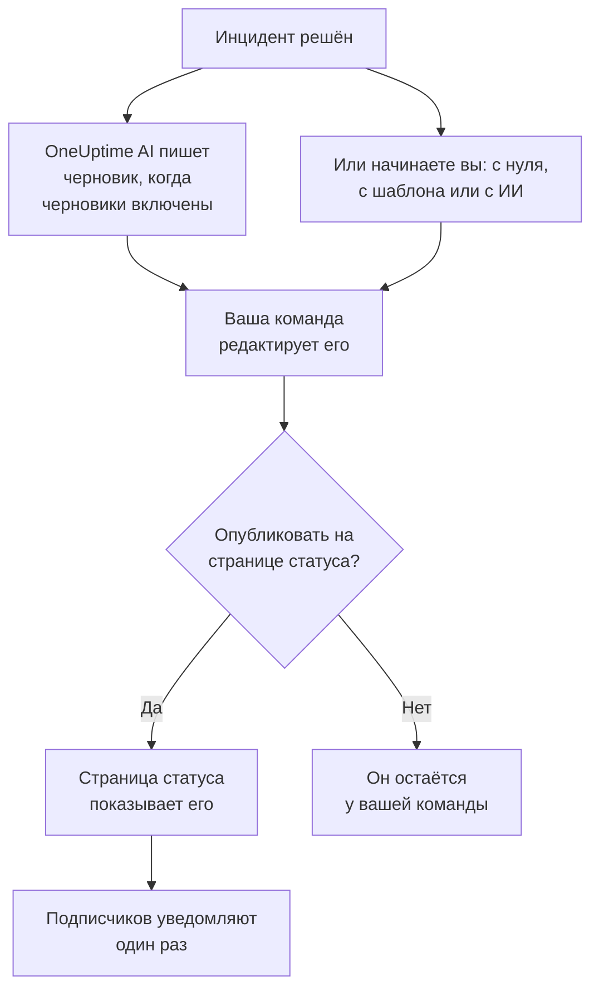

# Постмортемы

Постмортем — это разбор после инцидента: что произошло, почему, во что это обошлось вашим пользователям и что теперь меняется. В OneUptime вы пишете его прямо в инциденте. Он может начинаться с вашего собственного шаблона или с черновика от OneUptime AI, и его можно опубликовать на странице статуса как завершающее обновление инцидента.

:::cards
- [Написание постмортема](#написание-постмортема): На странице инцидента «Постмортем», за пять шагов.
- [Начало с шаблона или черновика ИИ](#начало-с-шаблона-или-черновика-ии): Ваша структура или та, которую заполняет OneUptime AI.
- [Публикация на странице статуса](#публикация-на-странице-статуса): Покажите его клиентам и уведомите подписчиков один раз.
- [Постмортемы эпизодов](#постмортемы-эпизодов): Один разбор для группы инцидентов.
:::

## Как складывается постмортем

Постмортем состоит из трёх частей, и все они находятся в инциденте: заметка, написанная в Markdown; её вложения, например снимки экрана и отчёты; и то, показан ли он на вашей странице статуса. Всё это находится на странице инцидента **Постмортем**, в разделе **Расследование** его бокового меню.

## Написание постмортема

:::steps
### Откройте постмортем

Откройте инцидент и нажмите **Постмортем** в разделе **Расследование** его бокового меню. Карточка **Заметка разбора инцидента** показывает заметку, вложения и то, показан ли постмортем на странице статуса.

### Нажмите «Редактировать заметку ретроспективы»

Диалог **Редактировать заметку ретроспективы** открывается на первом шаге, **Постмортем**.

### Напишите заметку и приложите файлы

Заполните поле **Заметка разбора инцидента** в Markdown: что произошло, последствия, как это было решено и последующие действия. Добавьте снимки экрана, отчёты или хронологии в **Вложения разбора инцидента**.

### Решите, публиковать ли его

Нажмите **Далее**. На шаге **Страница статуса** переключатель **Опубликовать на странице статуса** изначально выключен, поэтому постмортем остаётся у вашей команды. Чтобы показать его клиентам, см. [Публикация на странице статуса](#публикация-на-странице-статуса).

### Сохраните постмортем

Нажмите **Сохранить изменения**. Карточка показывает заметку и вложения.
:::

Каждое изменение заметки записывается в ленту инцидента и публикуется в канале инцидента в Slack или Microsoft Teams, если он есть. Пока постмортем не опубликован, ни один подписчик страницы статуса о нём не узнаёт.

Чтобы написать постмортем, нужна роль Project Owner, Project Admin, Project Member, Incident Admin или Incident Member либо пользовательская роль с разрешением Edit Incident. Любой, кто может читать инцидент, может читать и его постмортем.

## Начало с шаблона или черновика ИИ

Две кнопки на карточке заполняют заметку за вас: **Generate with AI** и, когда в проекте есть шаблон постмортема, **Применить шаблон**. Обе открывают тот же редактор, что и **Редактировать заметку ретроспективы**, с заполненной заметкой и остальным постмортемом без изменений. Ничего не сохраняется, пока вы не нажмёте **Сохранить изменения**, поэтому сначала прочитайте заметку и исправьте её.

### Применение шаблона

**Применить шаблон** появляется, когда в проекте есть шаблон постмортема. Шаблоны создаются в **Инциденты → Настройки → Шаблоны постмортема**: см. [Шаблоны постмортема](/docs/incidents/settings#шаблоны-постмортема). В OneUptime Cloud для шаблонов нужен план Growth.

Нажмите **Применить шаблон**, выберите шаблон в **Выберите шаблон** в диалоге **Применить шаблон ретроспективы** и нажмите **Применить шаблон**. Если в проекте один шаблон, он уже выбран.

### Генерация с помощью ИИ

Нажмите **Generate with AI**. Диалог **Generate Postmortem with AI** предлагает структуру в **Выберите шаблон**: **Standard Postmortem**, **Detailed Technical Postmortem** или **Brief Postmortem**, а затем ваши собственные шаблоны постмортемов. **Template Preview** показывает структуру, и её можно изменить перед генерацией.

Нажмите **Generate with AI** внизу диалога. OneUptime AI читает инцидент (его описание, первопричину и устранение, хронологию состояний, публичные и приватные заметки, сообщения в его канале Slack или Microsoft Teams и то, что говорилось на [его звонках](/docs/workspace-connections/video-calls#расшифровки-звонков)) и пишет постмортем по вашей структуре. Затем с результатом открывается редактор.

Для генерации нужен ИИ, включённый для проекта в **Настройки проекта → ИИ → AI Features**, и провайдер LLM: см. [Провайдеры LLM](/docs/ai/llm-provider). Также нужна роль Project Owner или Project Admin либо пользовательская роль с разрешением Edit Incident: другие роли могут писать постмортем, но не генерировать его.

### Черновик от OneUptime AI при решении инцидента

Когда включено **Готовить черновик постмортема, когда инцидент решён**, OneUptime AI пишет черновик постмортема каждый раз, когда инцидент решается, сохраняет его как заметку и публикует в ленте инцидента, чтобы ваша команда его проверила. Переключатель находится в **Инциденты → ИИ → Настройки**, и для новых проектов он включён.

- Он никогда не заменяет уже написанную заметку.
- Он никогда не пишет в уже опубликованный постмортем, где черновик попал бы на страницу статуса без проверки.
- Ему нужен ИИ, включённый для проекта, и он останавливается до конца дня, как только проект достигает своих дневных лимитов ИИ. См. [Автоматический постмортем](/docs/ai/ai-sre#автоматический-постмортем).
- Если к моменту решения инцидента расшифровка его звонка ещё не пришла, он ждёт, пока OneUptime AI её прочитает, чтобы черновик учёл сказанное на звонке: до шести часов, пока Zoom или Google Meet готовит расшифровку. См. [Запись и расшифровка каждого звонка](/docs/workspace-connections/video-calls#запись-и-расшифровка-каждого-звонка).

#### Какие инциденты получают черновик и по какому шаблону

Без правил каждый решённый инцидент получает черновик по стандартной структуре OneUptime AI. **Правила постмортема** в **Дополнительные настройки** на той же странице меняют это:

- Правило соответствует варианту **Все инциденты** или **Только инциденты, соответствующие условиям** по мониторам, уровням серьёзности, меткам, меткам мониторов, заголовку и описанию — как правило расследования.
- Его **Шаблоны** — это шаблоны постмортема, которым может следовать черновик. Без шаблонов черновик следует стандартной структуре; с одним — этому шаблону; с несколькими — тому, который OneUptime AI сочтёт наиболее подходящим для инцидента. Запись черновика в ленте называет шаблон, которому он следовал.
- Решает первое включённое правило, соответствующее инциденту, считая от верха списка: перетащите правило, чтобы изменить его место. Инцидент, которому не соответствует ни одно правило, не получает черновика, как и любой инцидент, пока правила не удаётся прочитать.
- **Готовить черновик постмортема, когда инцидент решён** остаётся единственным переключателем, который выключает черновики. Правила решают только о черновиках, которые OneUptime AI пишет сам: **Generate with AI** предлагает любую структуру, что бы они ни говорили.
- Создание, редактирование и изменение порядка правил требуют роли Project Owner или Project Admin. В OneUptime Cloud для шаблонов нужен план Growth: ниже него правила по-прежнему решают, какие инциденты получают черновик, а каждый черновик следует стандартной структуре.

## Публикация на странице статуса

Опубликованный постмортем — это завершающее обновление инцидента для ваших клиентов: страница статуса показывает заметку, выделенную в хронологии инцидента, с вложениями для скачивания.

:::steps
### Откройте шаг «Страница статуса»

Нажмите **Редактировать заметку ретроспективы**, затем **Далее**, чтобы перейти к шагу **Страница статуса**.

### Включите «Опубликовать на странице статуса»

Включите **Опубликовать на странице статуса**. Появятся ещё два поля: **Уведомить подписчиков**, которое включено, и **Разбор инцидента опубликован в**, где стоит текущее время.

### Решите, кого уведомить и какое время показать

Выключите **Уведомить подписчиков**, чтобы опубликовать постмортем без уведомления подписчиков. Измените **Разбор инцидента опубликован в**, чтобы рядом с постмортемом показывалось другое время.

### Опубликуйте его

Нажмите **Сохранить изменения**. Теперь карточка показывает **Разбор инцидента виден на странице статуса?**, **Уведомить подписчиков**, **Статус уведомления подписчика** и **Разбор инцидента опубликован в**.
:::

Что решает, увидят ли его клиенты и узнают ли о нём:

- **Инцидент должен быть на странице статуса.** Страница статуса показывает постмортем только у инцидента, который она показывает: **Видно на странице статуса** включено, и инцидент не приватный.
- **В заметке должно что-то быть.** Постмортем, опубликованный с пустой заметкой, не показывается, и никого не уведомляют.
- **Подписчиков уведомляют один раз**, когда страница статуса впервые показывает постмортем. Повторное сохранение или правка опубликованного постмортема обновляет страницу, никого не уведомляя. Если снять публикацию и опубликовать снова, их уведомят снова. Постмортем, опубликованный, пока его инцидент скрыт, отправляется, когда инцидент становится видимым.
- **«Уведомить подписчиков» читается в момент отправки уведомления.** Если включить его после публикации постмортема, ничего не отправится.

**Статус уведомления подписчика** показывает, отправлено ли уведомление, и предлагает **Повторить**, если отправка не удалась. Все случаи описаны в разделе [Постмортем](/docs/status-pages/subscribers#постмортем), см. также [Повторить и отправить повторно](/docs/status-pages/subscribers#повторить-и-отправить-повторно).

**Разбор инцидента опубликован в** — это также момент, когда постмортем считается опубликованным для измерения **Время до постмортема**: см. [Готовые измерения](/docs/incidents/settings#готовые-измерения).

## Постмортемы эпизодов

У эпизода инцидентов тоже есть страница **Постмортем** в разделе **Расследование**: один разбор для всех инцидентов эпизода. Нажмите **Редактировать ретроспективу**, чтобы написать его. **Применить шаблон** и **Generate with AI** работают так же, как в инциденте, а ИИ читает эпизод и входящие в него инциденты.

Постмортем эпизода — это только заметка: у него нет вложений, и ни одна страница статуса его не показывает. OneUptime AI не пишет черновик сам, когда эпизод решается. Для генерации нужна роль Project Owner или Project Admin либо пользовательская роль с разрешением Edit Incident Episode.

У оповещений и событий планового обслуживания постмортема нет.

## Через API

Постмортем — это набор полей инцидента, которые читаются и записываются через `/api/incident`, как и остальной инцидент:

| Поле | Что это |
| --- | --- |
| `postmortemNote` | Заметка в Markdown. |
| `showPostmortemOnStatusPage` | Опубликован ли постмортем на ваших страницах статуса. Изначально `false`. |
| `notifySubscribersOnPostmortemPublished` | Уведомляются ли подписчики при публикации. Изначально `true`. |
| `postmortemPostedAt` | Время, которое страница статуса показывает рядом с ним. |

Запись `showPostmortemOnStatusPage` со значением `true` поверх написанной `postmortemNote` публикует постмортем, как это делает диалог.

## Устранение неполадок

:::details На карточке нет «Применить шаблон»
В проекте ещё нет шаблона постмортема, или ваша роль не может их читать. Создайте шаблон в **Инциденты → Настройки → Шаблоны постмортема**. В OneUptime Cloud для шаблонов нужен план Growth.
:::

:::details Generate with AI сообщает, что ИИ выключен или что у вас нет разрешения
Включите ИИ в **Настройки проекта → ИИ → AI Features**. Для генерации нужна роль Project Owner или Project Admin либо пользовательская роль с разрешением Edit Incident, даже тому, кто может редактировать постмортем.
:::

:::details Постмортем не показывается на странице статуса
Проверьте три вещи: **Опубликовать на странице статуса** включено, заметка не пустая, и инцидент показывается на странице статуса (**Видно на странице статуса** включено, и он не приватный).
:::

:::details Подписчиков не уведомили о постмортеме
При публикации было выключено **Уведомить подписчиков**, или инцидент скрыт: тогда уведомление отправится, как только инцидент станет видимым. **Статус уведомления подписчика** на карточке подскажет, что именно произошло.
:::

:::details Черновик ИИ не появился, когда инцидент был решён
У инцидента уже была заметка, постмортем уже был опубликован, ему не соответствовало ни одно правило постмортема, или выключено **Готовить черновик постмортема, когда инцидент решён**. ИИ должен быть включён для проекта, и проект не должен достичь своих дневных лимитов ИИ. Если расшифровка звонка инцидента ещё в пути, черновик появится, когда OneUptime AI её прочитает.
:::

## Дальнейшие шаги

:::cards
- [Обзор инцидентов](/docs/incidents/index): Другие страницы инцидента, от объявления до решения.
- [Настройки и автоматизация инцидентов](/docs/incidents/settings): Шаблоны постмортема и измерение времени до постмортема.
- [Подписчики и объявления](/docs/status-pages/subscribers): Всё, что страница статуса сообщает своим подписчикам.
- [AI SRE](/docs/ai/ai-sre): Что OneUptime AI делает сам после инцидента.
:::
