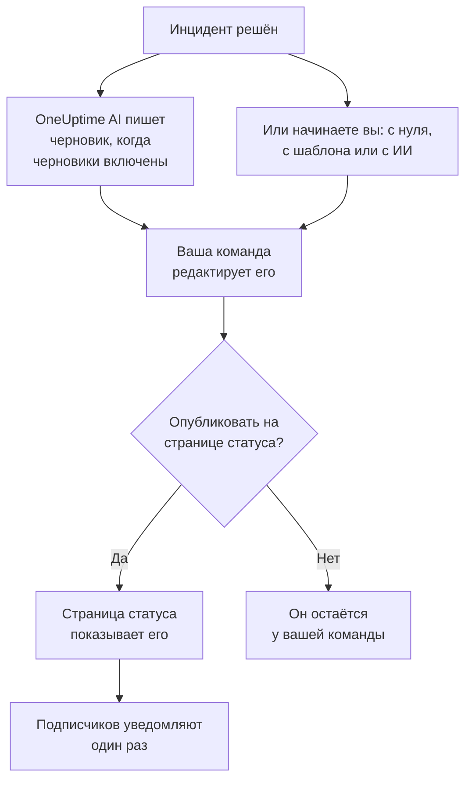

# Постмортемы

Постмортем — это разбор после инцидента: что произошло, почему, во что это обошлось вашим пользователям и что теперь меняется. В OneUptime вы пишете его прямо в инциденте. Он может начинаться с вашего собственного шаблона или с черновика от OneUptime AI, и его можно опубликовать на странице статуса как завершающее обновление инцидента. У каждого постмортема есть и статус, а **Инциденты → Постмортемы** собирает постмортемы всех инцидентов, чтобы было видно, какие ещё не готовы.

:::cards
- [Написание постмортема](#написание-постмортема): На странице инцидента «Постмортем», за пять шагов.
- [Начало с шаблона или черновика ИИ](#начало-с-шаблона-или-черновика-ии): Ваша структура или та, которую заполняет OneUptime AI.
- [Публикация на странице статуса](#публикация-на-странице-статуса): Покажите его клиентам и уведомите подписчиков один раз.
- [Где сейчас каждый постмортем](#где-сейчас-каждый-постмортем): Не начат, Черновик, Завершено или ваш собственный статус.
- [Все постмортемы в одном списке](#все-постмортемы-в-одном-списке): Фильтры по владельцу, серьёзности и статусу, чтобы найти ещё не готовые.
- [Постмортемы эпизодов](#постмортемы-эпизодов): Один разбор для группы инцидентов.
:::

## Как складывается постмортем

Постмортем состоит из трёх частей, и все они находятся в инциденте: заметка, написанная в Markdown; её вложения, например снимки экрана и отчёты; и то, показан ли он на вашей странице статуса. Всё это находится на странице инцидента **Постмортем**, в разделе **Расследование** его бокового меню. У постмортема есть и статус, который показывает, насколько он продвинулся, и владельцы: владельцы инцидента.

## Написание постмортема

:::steps
### Откройте постмортем

Откройте инцидент и нажмите **Постмортем** в разделе **Расследование** его бокового меню. Карточка **Постмортем** показывает **Статус** и **Владельцы** постмортема, заметку, вложения и то, показан ли постмортем на странице статуса. **Добавить владельцев** рядом с владельцами прямо там делает человека или команду вашего проекта владельцем инцидента.

### Нажмите «Написать постмортем»

Диалог **Написать постмортем** открывается на первом шаге, **Постмортем**. Когда постмортем уже написан, кнопка карточки называется **Редактировать заметку ретроспективы** и открывает те же шаги.

### Напишите заметку и приложите файлы

Заполните поле **Заметка разбора инцидента** в Markdown: что произошло, последствия, как это было решено и последующие действия. Добавьте снимки экрана, отчёты или хронологии в **Вложения разбора инцидента**.

### Решите, публиковать ли его

Нажмите **Далее**. На шаге **Страница статуса** переключатель **Опубликовать на странице статуса** изначально выключен, поэтому постмортем остаётся у вашей команды. Чтобы показать его клиентам, см. [Публикация на странице статуса](#публикация-на-странице-статуса).

### Сохраните постмортем

Нажмите **Сохранить изменения**. Карточка показывает заметку и вложения. Статус постмортема меняется с **Не начат** на **Черновик**: см. [Как движется постмортем](#как-движется-постмортем).
:::

Каждое изменение заметки записывается в ленту инцидента и публикуется в канале инцидента в Slack или Microsoft Teams, если он есть. Пока постмортем не опубликован, ни один подписчик страницы статуса о нём не узнаёт.

Чтобы написать постмортем, нужна роль Project Owner, Project Admin, Project Member, Incident Admin или Incident Member либо пользовательская роль с разрешением Edit Incident. Любой, кто может читать инцидент, может читать и его постмортем.

## Начало с шаблона или черновика ИИ

Две кнопки заполняют заметку за вас. Пока ничего не написано, они стоят рядом с **Написать постмортем**: **Начать с шаблона**, когда в проекте есть шаблон постмортема, и **Generate with AI**. Когда постмортем написан, они находятся в меню **⋯** рядом с **Редактировать заметку ретроспективы** как **Применить шаблон** и **Generate with AI**. Обе открывают тот же редактор, с заполненной заметкой и остальным постмортемом без изменений. Ничего не сохраняется, пока вы не нажмёте **Сохранить изменения**, поэтому сначала прочитайте заметку и исправьте её.

### Применение шаблона

**Применить шаблон** появляется, когда в проекте есть шаблон постмортема. Шаблоны создаются в **Инциденты → Настройки → Шаблоны постмортема**: см. [Шаблоны постмортема](/docs/incidents/settings#шаблоны-постмортема). В OneUptime Cloud для шаблонов нужен план Growth.

Нажмите **Начать с шаблона** или **Применить шаблон** в меню **⋯**, выберите шаблон в **Выберите шаблон** в диалоге **Применить шаблон ретроспективы** и нажмите **Применить шаблон**. Если в проекте один шаблон, он уже выбран.

### Генерация с помощью ИИ

Нажмите **Generate with AI**. Диалог **Generate Postmortem with AI** предлагает структуру в **Выберите шаблон**: **Standard Postmortem**, **Detailed Technical Postmortem** или **Brief Postmortem**, а затем ваши собственные шаблоны постмортемов. **Template Preview** показывает структуру, и её можно изменить перед генерацией.

Нажмите **Generate with AI** внизу диалога. OneUptime AI читает инцидент (его описание, первопричину и устранение, хронологию состояний, публичные и приватные заметки, сообщения в его канале Slack или Microsoft Teams и то, что говорилось на [его звонках](/docs/workspace-connections/video-calls#расшифровки-звонков)) и пишет постмортем по вашей структуре. Затем с результатом открывается редактор.

Для генерации нужен ИИ, включённый для проекта в **Настройки проекта → ИИ → AI Features**, и провайдер LLM: см. [Провайдеры LLM](/docs/ai/llm-provider). Также нужна роль Project Owner или Project Admin либо пользовательская роль с разрешением Edit Incident: другие роли могут писать постмортем, но не генерировать его.

### Черновик от OneUptime AI при решении инцидента

Когда включено **Готовить черновик постмортема, когда инцидент решён**, OneUptime AI пишет черновик постмортема каждый раз, когда инцидент решается, сохраняет его как заметку и публикует в ленте инцидента, чтобы ваша команда его проверила. Переключатель находится в **Инциденты → ИИ → Настройки**, и для новых проектов он включён.

- Он никогда не заменяет уже написанную заметку.
- Он никогда не пишет в уже опубликованный постмортем, где черновик попал бы на страницу статуса без проверки.
- Ему нужен ИИ, включённый для проекта, и он останавливается до конца дня, как только проект достигает своих дневных лимитов ИИ. См. [Автоматический постмортем](/docs/ai/ai-sre#автоматический-постмортем).
- Если к моменту решения инцидента расшифровка его звонка ещё не пришла, он ждёт, пока OneUptime AI её прочитает, чтобы черновик учёл сказанное на звонке: до шести часов, пока провайдер готовит расшифровку. См. [Запись и расшифровка каждого звонка](/docs/workspace-connections/video-calls#запись-и-расшифровка-каждого-звонка).

#### Какие инциденты получают черновик и по какому шаблону

Без правил каждый решённый инцидент получает черновик по стандартной структуре OneUptime AI. **Правила постмортема** в **Дополнительные настройки** на той же странице меняют это:

- Правило соответствует варианту **Все инциденты** или **Только инциденты, соответствующие условиям** по мониторам, уровням серьёзности, меткам, меткам мониторов, заголовку и описанию — так же, как правило ИИ.
- Его **Шаблоны** — это шаблоны постмортема, которым может следовать черновик. Без шаблонов черновик следует стандартной структуре; с одним — этому шаблону; с несколькими — тому, который OneUptime AI сочтёт наиболее подходящим для инцидента. Запись черновика в ленте называет шаблон, которому он следовал.
- Его **Поставщик LLM** в разделе **Дополнительные поля** — провайдер, с которым OneUptime AI пишет черновик и выбирает для него шаблон. Если ничего не выбрано, это провайдер проекта по умолчанию, а если его нет — глобальный. Запись черновика в ленте называет провайдера, которого выбрало правило, или того, который использовался вместо него, и почему. См. [Какого провайдера LLM использует правило](/docs/ai/ai-sre#какого-провайдера-llm-использует-правило).
- Решает первое включённое правило, соответствующее инциденту, считая от верха списка: перетащите правило, чтобы изменить его место. Инцидент, которому не соответствует ни одно правило, не получает черновика, как и любой инцидент, пока правила не удаётся прочитать.
- **Готовить черновик постмортема, когда инцидент решён** остаётся единственным переключателем, который выключает черновики. Правила решают только о черновиках, которые OneUptime AI пишет сам: **Generate with AI** предлагает любую структуру, что бы они ни говорили.
- Создание, редактирование и изменение порядка правил требуют роли Project Owner или Project Admin. В OneUptime Cloud для шаблонов нужен план Growth: ниже него правила по-прежнему решают, какие инциденты получают черновик, а каждый черновик следует стандартной структуре.

## Публикация на странице статуса

Опубликованный постмортем — это завершающее обновление инцидента для ваших клиентов: страница статуса показывает заметку, выделенную в хронологии инцидента, с вложениями для скачивания.

:::steps
### Откройте шаг «Страница статуса»

Нажмите **Редактировать заметку ретроспективы**, затем **Далее**, чтобы перейти к шагу **Страница статуса**.

### Включите «Опубликовать на странице статуса»

Включите **Опубликовать на странице статуса**. Появятся ещё два поля: **Уведомить подписчиков**, которое включено, и **Разбор инцидента опубликован в**, где стоит текущее время.

### Решите, кого уведомить и какое время показать

Выключите **Уведомить подписчиков**, чтобы опубликовать постмортем без уведомления подписчиков. Измените **Разбор инцидента опубликован в**, чтобы рядом с постмортемом показывалось другое время.

### Опубликуйте его

Нажмите **Сохранить изменения**. Теперь карточка показывает **Разбор инцидента виден на странице статуса?**, **Уведомить подписчиков**, **Статус уведомления подписчика** и **Разбор инцидента опубликован в**.
:::

Что решает, увидят ли его клиенты и узнают ли о нём:

- **Инцидент должен быть на странице статуса.** Страница статуса показывает постмортем только у инцидента, который она показывает: **Видно на странице статуса** включено, и инцидент не приватный.
- **В заметке должно что-то быть.** Постмортем, опубликованный с пустой заметкой, не показывается, и никого не уведомляют.
- **Подписчиков уведомляют один раз**, когда страница статуса впервые показывает постмортем. Повторное сохранение или правка опубликованного постмортема обновляет страницу, никого не уведомляя. Если снять публикацию и опубликовать снова, их уведомят снова. Постмортем, опубликованный, пока его инцидент скрыт, отправляется, когда инцидент становится видимым.
- **«Уведомить подписчиков» читается в момент отправки уведомления.** Если включить его после публикации постмортема, ничего не отправится.

**Статус уведомления подписчика** показывает, отправлено ли уведомление, и предлагает **Повторить**, если отправка не удалась. Все случаи описаны в разделе [Постмортем](/docs/status-pages/subscribers#постмортем), см. также [Повторить и отправить повторно](/docs/status-pages/subscribers#повторить-и-отправить-повторно).

**Разбор инцидента опубликован в** — это также момент, когда постмортем считается опубликованным для измерения **Время до постмортема**: см. [Готовые измерения](/docs/incidents/settings#готовые-измерения).

## Где сейчас каждый постмортем

Постмортем каждого инцидента находится в одном из статусов постмортема проекта; статус показан в поле **Статус** вверху карточки **Постмортем**. В новом проекте их четыре. Постмортем в статусе **Не начат** или **Черновик** ещё не готов; в статусе **Завершено** или **Не нужен** — нет:

| Статус | Что он значит | Ещё не готов |
| --- | --- | --- |
| **Не начат** | Этот постмортем ещё никто не написал. | Да |
| **Черновик** | Постмортем пишется. | Да |
| **Завершено** | Постмортем написан и готов. | Нет |
| **Не нужен** | Этому инциденту постмортем не нужен. | Нет |

### Как движется постмортем

OneUptime сам переводит постмортем в другой статус в трёх случаях:

- Постмортем нового инцидента начинается в статусе **Не начат**, или **Черновик**, если инцидент объявлен с заметкой, или **Завершено**, если эта заметка сразу опубликована.
- Первая заметка постмортема в статусе **Не начат** переводит его в **Черновик**, кто бы её ни написал: человек, шаблон или OneUptime AI.
- Публикация на странице статуса переводит его в **Завершено**, если он ещё не готов.

Назад он не движется никогда: если очистить заметку или снять постмортем со страницы статуса, его статус останется прежним. Статус, который кто-то выбрал в том же сохранении, всегда сохраняется.

### Перевести вручную

Нажмите на статус — на странице **Постмортем** инцидента или в его строке списка постмортемов — и выберите статус в **Перевести постмортем в**. Постмортем переходит сразу. Переводить постмортем могут те же роли, что его пишут, а все, кто может читать инцидент, видят, где сейчас его постмортем.

### Собственные статусы

Если в вашем процессе есть свой этап, например проверка, добавьте для него статус. Откройте **Инциденты → Настройки → Статусы постмортема**, нажмите **Создать: Статус постмортема** и задайте название, например **На проверке**, цвет и описание. Новый статус встаёт прямо над **Завершено**; перетащите статус, чтобы изменить его положение.

Положение статуса определяет, чем он считается, и это видно в столбце **Считается**: выше **Черновик** — **Не начат**, начиная с **Черновик** и ниже — **Идёт сейчас**, начиная с **Завершено** и ниже — **Готово**, и постмортем больше не ожидается. **На проверке** между ними ещё не готов; **Не нужен** под **Завершено** — готов.

**Не начат**, **Черновик** и **Завершено** встроенные, потому что OneUptime сам переводит в них постмортемы: их можно переименовать и перекрасить, но нельзя удалить или архивировать, и они сохраняют свой порядок. Статус, который больше не нужен, архивируйте из меню **⋯** его строки: в него больше нельзя перевести постмортем, постмортемы в нём остаются, пока их кто-нибудь не переведёт, а список по-прежнему фильтрует по нему. **Статусы постмортема в архиве**, свёрнутый под таблицей, показывает такие статусы, а **Извлечь из архива** возвращает статус. Создавать, изменять и удалять статусы может роль Project Owner, Project Admin или Incident Admin либо пользовательская роль с соответствующим разрешением на статусы постмортема.

## Все постмортемы в одном списке

**Инциденты → Постмортемы** показывает постмортем каждого инцидента проекта, сначала самые новые, со столбцами **Инцидент**, **Заголовок**, **Статус постмортема**, **Серьёзность**, **Владельцы** и **Объявлен**. **Просмотр** в строке открывает страницу **Постмортем** инцидента.

Над списком плитка для каждого статуса считает постмортемы в нём. Нажмите на плитку, чтобы оставить в списке только их, и нажмите ещё раз, чтобы снова показать все.

Фильтруйте список фильтрами над ним: **Владелец** — человек или команда; **Серьёзность**; **Статус постмортема**; **Состояние инцидента**; **Метки**; и **Затронутые ресурсы**. Чтобы увидеть, какие постмортемы команда ещё должна по самым серьёзным инцидентам, выберите команду в **Владелец**, серьёзность в **Серьёзность** и **Не начат** и **Черновик** в **Статус постмортема**. Фильтры хранятся в адресе страницы, поэтому список можно добавить в закладки или отправить коллегам.

Чтобы изменить сразу много, выберите их и откройте **Массовые действия**: **Изменить статус постмортема** переводит их все в один статус, например **Не нужен** для инцидентов, которым постмортем не нужен, а **Add Owner** и **Remove Owner** меняют их владельцев.

## Постмортемы эпизодов

У эпизода инцидентов тоже есть страница **Постмортем** в разделе **Расследование**: один разбор для всех инцидентов эпизода. Нажмите **Редактировать ретроспективу**, чтобы написать его. **Применить шаблон** и **Generate with AI** работают так же, как в инциденте, а ИИ читает эпизод и входящие в него инциденты.

Постмортем эпизода — это только заметка: у него нет вложений, и ни одна страница статуса его не показывает. OneUptime AI не пишет черновик сам, когда эпизод решается. Для генерации нужна роль Project Owner или Project Admin либо пользовательская роль с разрешением Edit Incident Episode. Статуса у него тоже нет, и в список постмортемов он не попадает.

У оповещений и событий планового обслуживания постмортема нет.

## Через API

Постмортем — это набор полей инцидента, которые читаются и записываются через `/api/incident`, как и остальной инцидент:

| Поле | Что это |
| --- | --- |
| `postmortemNote` | Заметка в Markdown. |
| `showPostmortemOnStatusPage` | Опубликован ли постмортем на ваших страницах статуса. Изначально `false`. |
| `notifySubscribersOnPostmortemPublished` | Уведомляются ли подписчики при публикации. Изначально `true`. |
| `postmortemPostedAt` | Время, которое страница статуса показывает рядом с ним. |
| `postmortemStatusId` | Статус постмортема: один из статусов проекта, доступных через `/api/incident-postmortem-status`. |

Запись `showPostmortemOnStatusPage` со значением `true` поверх написанной `postmortemNote` публикует постмортем, как это делает диалог. Это также переводит постмортем в **Завершено**, если та же запись не задаёт `postmortemStatusId`.

## Устранение неполадок

:::details На карточке нет «Применить шаблон»
В проекте ещё нет шаблона постмортема, или ваша роль не может их читать. Создайте шаблон в **Инциденты → Настройки → Шаблоны постмортема**. В OneUptime Cloud для шаблонов нужен план Growth.
:::

:::details Generate with AI сообщает, что ИИ выключен или что у вас нет разрешения
Включите ИИ в **Настройки проекта → ИИ → AI Features**. Для генерации нужна роль Project Owner или Project Admin либо пользовательская роль с разрешением Edit Incident, даже тому, кто может редактировать постмортем.
:::

:::details Постмортем не показывается на странице статуса
Проверьте три вещи: **Опубликовать на странице статуса** включено, заметка не пустая, и инцидент показывается на странице статуса (**Видно на странице статуса** включено, и он не приватный).
:::

:::details Подписчиков не уведомили о постмортеме
При публикации было выключено **Уведомить подписчиков**, или инцидент скрыт: тогда уведомление отправится, как только инцидент станет видимым. **Статус уведомления подписчика** на карточке подскажет, что именно произошло.
:::

:::details Черновик ИИ не появился, когда инцидент был решён
У инцидента уже была заметка, постмортем уже был опубликован, ему не соответствовало ни одно правило постмортема, или выключено **Готовить черновик постмортема, когда инцидент решён**. ИИ должен быть включён для проекта, и проект не должен достичь своих дневных лимитов ИИ. Если расшифровка звонка инцидента ещё в пути, черновик появится, когда OneUptime AI её прочитает.
:::

:::details Статус постмортема не изменился, когда написали заметку
Сам движется только постмортем в статусе **Не начат** или в вашем статусе выше **Черновик**, и только с первой заметкой. Постмортем, который уже в работе или готов, остаётся на месте, как и статус, который кто-то выбрал в том же сохранении. Переведите его сами через статус: см. [Перевести вручную](#перевести-вручную).
:::

## Дальнейшие шаги

:::cards
- [Обзор инцидентов](/docs/incidents/index): Другие страницы инцидента, от объявления до решения.
- [Настройки и автоматизация инцидентов](/docs/incidents/settings): Шаблоны постмортема и измерение времени до постмортема.
- [Подписчики и объявления](/docs/status-pages/subscribers): Всё, что страница статуса сообщает своим подписчикам.
- [AI SRE](/docs/ai/ai-sre): Что OneUptime AI делает сам после инцидента.
:::
