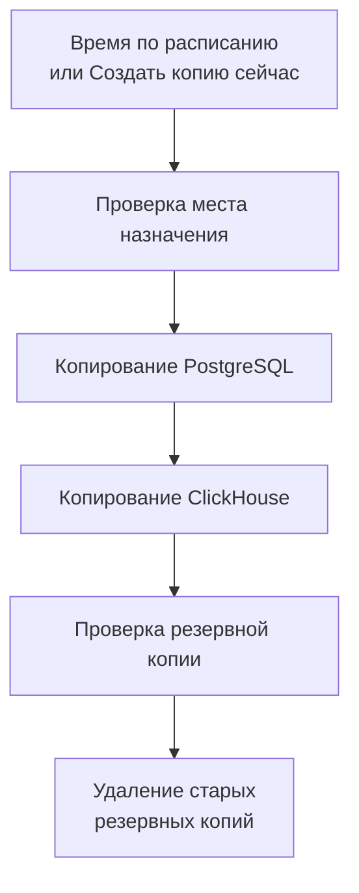

# Резервные копии

Создавайте резервные копии самостоятельно размещённого OneUptime в собственном хранилище по расписанию и восстанавливайте их из Admin Dashboard. Резервная копия содержит PostgreSQL — ваши проекты, мониторы, инциденты, страницы статуса и пользователей — и ClickHouse — ваши логи, трассировки и метрики. Резервные копии хранятся столько дней, сколько вы выберете, более старые удаляются автоматически, и любую копию можно восстановить на месте. Резервное копирование входит в Редакцию Enterprise.

:::cards
- [Настроить резервное копирование](#настроить-резервное-копирование): Выберите место назначения, проверьте его и задайте расписание.
- [Места назначения](#места-назначения): Что нужно каждому рекомендуемому месту назначения.
- [Восстановить резервную копию](#восстановить-резервную-копию): Что заменяется и как текущие данные остаются в безопасности.
- [Переехать на новый сервер](#переехать-на-новый-сервер): Восстановите резервные копии одной установки на другой.
:::

## Как работает резервное копирование



- **Согласованность.** PostgreSQL выгружается в одной транзакции, поэтому дамп — это база данных в том виде, в каком она была в один момент, пока OneUptime продолжает работать. ClickHouse копирует каждую таблицу в том виде, в каком она была, когда он прочитал её части.
- **Сразу в место назначения.** Вывод `pg_dump` передаётся в хранилище потоком по мере записи, а ClickHouse сам записывает свою резервную копию в хранилище. На диск сервера ничего не записывается, каким бы ни был объём данных.
- **Проверка.** Прежде чем копия будет засчитана, `pg_restore` читает дамп обратно из места назначения, и там же находится запись ClickHouse о его копии. SHA-256 дампа хранится вместе с копией, и восстановление проверяет его, прежде чем что-либо заменить. Резервная копия, которая завершилась ошибкой или была отменена, удаляет то, что записала, поэтому в месте назначения хранятся только целые копии.
- **Шифрование.** Резервные копии передаются в хранилище по HTTPS, если вы не указали эндпоинт `http://`. Amazon S3, Google Cloud Storage, Azure Blob Storage и Cloudflare R2 шифруют всё, что хранят; в другом хранилище включите шифрование бакета в состоянии покоя. Учётные данные места назначения хранятся в зашифрованном виде и больше никогда не показываются.
- **По одной.** Во всей установке одновременно выполняется только одно резервное копирование или восстановление. Остальные ждут своей очереди.

Каждая резервная копия — это отдельная папка в папке места назначения (`oneuptime/backups/`, если вы не выберете другую), названная по времени начала в UTC:

```text
oneuptime/backups/20261024T020000Z-3f2a9c1b/manifest.json
oneuptime/backups/20261024T020000Z-3f2a9c1b/postgres.dump
oneuptime/backups/20261024T020000Z-3f2a9c1b/clickhouse/
```

`manifest.json` записывается последним: в нём указано, что содержит копия и какая версия OneUptime её создала.

## Перед началом

- **Редакция Enterprise** с лицензией, включающей резервное копирование. Резервные копии создаются во время пробного и льготного периодов. Без лицензии новые резервные копии не создаются, а восстановление и удаление резервных копий по-прежнему работают. См. [Редакция Enterprise](/docs/self-hosted/enterprise).
- **Главный администратор.** Резервное копирование настраивается в Admin Dashboard.
- **Бакет или контейнер только для резервных копий** и учётные данные, которым разрешено читать, записывать, перечислять и удалять в нём.
- **Место назначения, доступное и для ClickHouse.** ClickHouse сам записывает свою резервную копию в хранилище, поэтому его сеть должна иметь доступ к хранилищу, как и сеть OneUptime.
- **Для восстановления PostgreSQL — пользователь базы данных, которому разрешено создавать базы данных.** Восстановление записывает данные в новую базу рядом с рабочей. PostgreSQL, поставляемый с OneUptime, подключается как суперпользователь, которому это разрешено.

## Настроить резервное копирование

:::steps
### Откройте страницу резервных копий

В Admin Dashboard перейдите в **Настройки → Резервные копии** и нажмите **Настроить резервное копирование**.

### Выберите, куда сохранять резервные копии

Выберите одно из рекомендуемых мест назначения. Что нужно каждому из них, описано в разделе [Места назначения](#места-назначения).

### Заполните подключение

Заполните то, что требует место назначения. Папка, регион и настройки, которые большинство оставляет как есть, находятся в разделе **Дополнительные поля**, а **Руководство по настройке** открывает раздел этого места назначения на этой странице.

### Проверьте место назначения

Нажмите **Проверить место назначения**. OneUptime записывает, читает, перечисляет и удаляет небольшой тестовый файл, проверяет, что `pg_dump` может скопировать ваш PostgreSQL, и просит ClickHouse записать тестовую резервную копию определений своих таблиц. Ничего не сохраняется, а проверка, которая не прошла, сообщает, что нужно изменить.

### Выберите, когда создавать копии

Выберите **Как часто** и время в поле **Время (UTC)**, а для еженедельных копий — **День недели**. **Хранить резервные копии (дней)** равно 30, если вы его не измените. Выключите **Также копировать ClickHouse**, чтобы копировать только PostgreSQL.

### Начните резервное копирование

Нажмите **Начать резервное копирование**. Первая резервная копия создаётся в следующее время по расписанию, а **Создать копию сейчас** сразу запускает копирование.
:::

После этого страница показывает, как идут дела с резервными копиями: когда была создана последняя, каков её размер и сколько она заняла времени, и когда будет создана следующая. Выполняющаяся копия показывает текущий шаг, а **Показать шаги** показывает каждый шаг по мере выполнения.

## Места назначения

| Место назначения | Хранилище | Вход с помощью |
| --- | --- | --- |
| [Amazon S3](#amazon-s3) | Amazon S3 | Ключа доступа |
| [Cloudflare R2](#cloudflare-r2) | S3-совместимое хранилище | API-токена R2 |
| [Backblaze B2](#backblaze-b2) | S3-совместимое хранилище | Ключа приложения |
| [Wasabi](#wasabi) | S3-совместимое хранилище | Ключа доступа |
| [MinIO](#minio) | S3-совместимое хранилище | Ключа доступа |
| [Google Cloud Storage](#google-cloud-storage) | Google Cloud Storage | Ключа HMAC |
| [Azure Blob Storage](#azure-blob-storage) | Azure Blob Storage | Токена SAS или ключа доступа |
| [Другое S3-совместимое хранилище](#другое-s3-совместимое-хранилище) | S3-совместимое хранилище | Ключа доступа |

Ключу для Amazon S3 или другого S3-совместимого хранилища нужны `s3:PutObject`, `s3:GetObject`, `s3:ListBucket`, `s3:DeleteObject` и `s3:AbortMultipartUpload` на папку, и ничего больше:

```json
{
  "Version": "2012-10-17",
  "Statement": [
    {
      "Effect": "Allow",
      "Action": "s3:ListBucket",
      "Resource": "arn:aws:s3:::my-backups"
    },
    {
      "Effect": "Allow",
      "Action": [
        "s3:PutObject",
        "s3:GetObject",
        "s3:DeleteObject",
        "s3:AbortMultipartUpload"
      ],
      "Resource": "arn:aws:s3:::my-backups/oneuptime/backups/*"
    }
  ]
}
```

### Amazon S3

| Поле | Что ввести |
| --- | --- |
| **Бакет** | Бакет, в который записываются резервные копии. Используйте его только для них. |
| **Регион** | Регион бакета. Изначально `us-east-1`. |
| **Идентификатор ключа доступа** | Ключ доступа с разрешениями, указанными выше. |
| **Секретный ключ доступа** | Секрет ключа. |
| **Папка** | В разделе **Дополнительные поля**. Если оставить пустым, копии сохраняются в `oneuptime/backups/`. |

Amazon S3 шифрует каждый хранимый файл, и OneUptime запрашивает это (SSE-S3) для каждого записываемого файла.

### Cloudflare R2

Укажите в поле **Эндпоинт** адрес S3 API вашего аккаунта, `https://<account-id>.r2.cloudflarestorage.com`, из настроек бакета в R2. Затем укажите **Бакет**, а также **Идентификатор ключа доступа** и **Секретный ключ доступа** API-токена R2, которому разрешено читать и записывать объекты в нём. Чтение резервных копий из R2 бесплатно.

### Backblaze B2

Укажите в поле **Эндпоинт** S3-эндпоинт бакета, показанный на его странице Buckets в Backblaze, например `https://s3.us-west-004.backblazeb2.com`. Затем укажите **Бакет**, а идентификатор и сам ключ приложения — в полях **Идентификатор ключа доступа** и **Секретный ключ доступа**. Регион определяется по эндпоинту.

### Wasabi

Укажите в поле **Эндпоинт** URL сервиса региона бакета, например `https://s3.us-east-1.wasabisys.com`, затем **Бакет** и ключ доступа. Регион определяется по эндпоинту.

### MinIO

Укажите в поле **Эндпоинт** адрес S3 API вашего сервера MinIO, например `https://minio.example.com:9000`, затем **Бакет** и ключ доступа, политика которого разрешает читать, записывать, перечислять и удалять в нём. И OneUptime, и ClickHouse должны иметь доступ к этому адресу.

### Google Cloud Storage

Укажите **Бакет**, а также **Ключ доступа HMAC** и **Секрет HMAC** сервисного аккаунта с ролью Storage Object Admin для бакета. Создайте ключ в настройках Cloud Storage, на вкладке «Совместимость». OneUptime и ClickHouse обращаются к бакету через S3-совместимый API Cloud Storage.

### Azure Blob Storage

Укажите **Учётная запись хранения** и **Контейнер** и выберите в поле **Способ входа** способ входа: **Токен SAS** с правами «Чтение», «Добавление», «Создание», «Запись», «Удаление» и «Список» для контейнера или **Ключ доступа** учётной записи хранения. Токен SAS можно ограничить контейнером, поэтому это более безопасный вариант. **Облако** и **Папка** находятся в разделе **Дополнительные поля**.

### Другое S3-совместимое хранилище

Для Ceph, DigitalOcean Spaces, Hetzner Object Storage и любого хранилища с S3 API укажите его S3-адрес в поле **Эндпоинт**, затем **Бакет** и ключ доступа. **Регион** в разделе **Дополнительные поля** нужен, только если хранилище его требует. Если оставить его пустым, регион определяется по эндпоинту, иначе используется `us-east-1`.

## Расписание и хранение

| Настройка | Что она делает |
| --- | --- |
| **Как часто** | **Каждый час**, **Каждые 6 часов**, **Каждые 12 часов**, **Каждый день** или **Каждую неделю**. Ежедневное копирование подходит для большинства установок. |
| **Время (UTC)** | Час начала резервного копирования в UTC, рядом показано ваше местное время. Интервалы в 6 или 12 часов отсчитываются от него: при `02:00` копии каждые 6 часов создаются в 02:00, 08:00, 14:00 и 20:00. Ежечасные копии создаются в начале каждого часа. |
| **День недели** | День, в который создаются еженедельные копии. |
| **Хранить резервные копии (дней)** | От 1 до 3650 дней. 30, если вы не измените. |
| **Также копировать ClickHouse** | Включено, если вы его не выключите. PostgreSQL копируется всегда. |

После каждого резервного копирования копии, начатые более **Хранить резервные копии (дней)** назад, удаляются — в месте назначения и из списка, — кроме самой новой успешной копии, которая сохраняется, каким бы ни был её возраст. Поэтому выключенное резервное копирование или истёкшая лицензия никогда не оставят вас без копии для восстановления.

**Выключить резервное копирование по расписанию** в меню карточки состояния останавливает расписание. **Создать копию сейчас** по-прежнему работает, и ни одна копия не удаляется. **Включить** снова запускает расписание.

## Восстановить резервную копию

:::warning Что заменяет восстановление
Восстановление заменяет текущие данные данными резервной копии. Всё, что изменилось с момента создания копии, будет потеряно, если сначала не создать копию текущих данных.
:::

:::steps
### Выберите резервную копию

В таблице **Резервные копии** нажмите **Восстановить** у копии, к которой нужно вернуться. Сначала OneUptime проверяет копию: что её файлы находятся в месте назначения и не изменены, какая версия OneUptime её создала и может ли этот сервер её восстановить.

### Выберите, что восстановить

Отметьте **PostgreSQL: проекты, мониторы, инциденты, пользователи**, **ClickHouse: логи, трассировки, метрики** или оба пункта. В диалоге показано, сколько проектов, пользователей и мониторов содержит копия и сколько их сейчас.

### Сохраните текущие данные

Флажок **Сначала создать копию текущих данных** установлен: восстановление начинается с резервной копии заменяемых данных, чтобы к ним можно было вернуться. Снимайте его, только если у вас есть другая копия, потому что без неё восстановление нельзя отменить.

### Подтвердите

Введите `restore` и нажмите **Восстановить**.
:::

Восстановление выполняется шаг за шагом, и страница показывает каждый шаг:

| Шаг | Что происходит |
| --- | --- |
| **Проверка резервной копии** | Файлы копии на месте, и эта установка может её восстановить. |
| **Копирование текущих данных** | Резервная копия текущих данных, если вы не сняли флажок. |
| **Восстановление PostgreSQL** | Копия восстанавливается в новую базу данных рядом с рабочей и проверяется. |
| **Восстановление ClickHouse** | Рабочая телеметрия откладывается в сторону, а телеметрия из копии восстанавливается на её место. |
| **Переключение на восстановленные данные** | Восстановленная база данных за мгновение получает имя рабочей. |
| **Обновление восстановленных данных** | На восстановленных данных выполняются миграции базы данных этой версии. |
| **Очистка** | То, что было отложено, удаляется. |

До переключения OneUptime продолжает работать на текущих данных, и ничего из того, что он использует, до этого момента не меняется. Восстановление, которое завершилось ошибкой или было отменено до переключения, оставляет всё как было, а восстановление, завершившееся ошибкой во время переключения, возвращает отложенное на место. Телеметрия, поступающая во время восстановления ClickHouse, не сохраняется. После восстановления PostgreSQL может потребоваться снова войти: используйте учётную запись, которая есть в резервной копии.

:::details Восстановление сообщает, что копия создана с другим ENCRYPTION_SECRET
Учётные данные, которые хранит OneUptime, например ключ места назначения, зашифрованы с помощью `ENCRYPTION_SECRET`. Перед восстановлением задайте `ENCRYPTION_SECRET`, с которым была создана копия, иначе эти учётные данные потом не удастся прочитать.
:::

## Переехать на новый сервер

:::steps
### Установите OneUptime на новый сервер

Установите Редакцию Enterprise той версии, которая создала резервные копии, или более новой.

### Настройте то же место назначения

В разделе **Настройки → Резервные копии** настройте место назначения, где лежат ваши резервные копии. Страница найдёт уже имеющиеся там копии и покажет их, готовые к восстановлению. **Найти резервные копии** в меню карточки состояния ищет снова.

### Восстановите самую новую копию

Восстановите её, как описано выше. Копия, созданная более старой версией OneUptime, обновляется до этой версии. Копию, созданную более новой версией, можно восстановить после обновления.
:::

## Когда резервное копирование не удаётся

Карточка состояния показывает **Последнее резервное копирование не удалось** с ошибкой, а **Показать шаги** показывает шаг, на котором копирование остановилось, и причину. Кроме того, каждый главный администратор получает письмо — не чаще одного раза в 12 часов, пока резервное копирование продолжает завершаться ошибкой. О неудачном восстановлении письмо приходит всегда.

## Устранение неполадок

:::details ClickHouse не может связаться с местом назначения
ClickHouse подключается к хранилищу сам. Откройте его сети доступ к адресу места назначения, как и сети OneUptime, затем снова проверьте место назначения.
:::

:::details pg_dump отсутствует или устарел
Образ Enterprise содержит `pg_dump` и `pg_restore` 16, 17 и 18, которые копируют PostgreSQL 18 и все более ранние версии. В другом образе установите клиентские инструменты PostgreSQL или задайте в `BACKUP_POSTGRES_BIN_DIR` каталог, где они находятся. `pg_dump` должен быть не старше вашего сервера PostgreSQL.
:::

:::details Для восстановления PostgreSQL нужно одно изменение
Восстановление создаёт базу данных, и пользователю базы данных OneUptime должно быть это разрешено. Выполните на PostgreSQL от имени суперпользователя следующую команду, подставив свой `DATABASE_USERNAME` вместо `oneuptime`, затем снова запустите восстановление:

```sql
ALTER USER oneuptime CREATEDB;
```
:::

:::details Резервная копия находится в прежнем месте назначения
После смены места назначения копии, созданные в прежнем, остаются в списке с пометкой **В прежнем месте назначения**. Снова настройте то место назначения, чтобы восстановить одну из них, или удалите её из списка: её файлы останутся на месте.
:::

## Дальнейшие шаги

:::cards
- [Редакция Enterprise](/docs/self-hosted/enterprise): Лицензии и возможности Редакции Enterprise.
- [Обновление](/docs/installation/upgrading): Создавайте резервную копию перед каждым обновлением.
- [Docker Compose](/docs/installation/docker-compose): Запустите OneUptime на одном сервере.
:::
