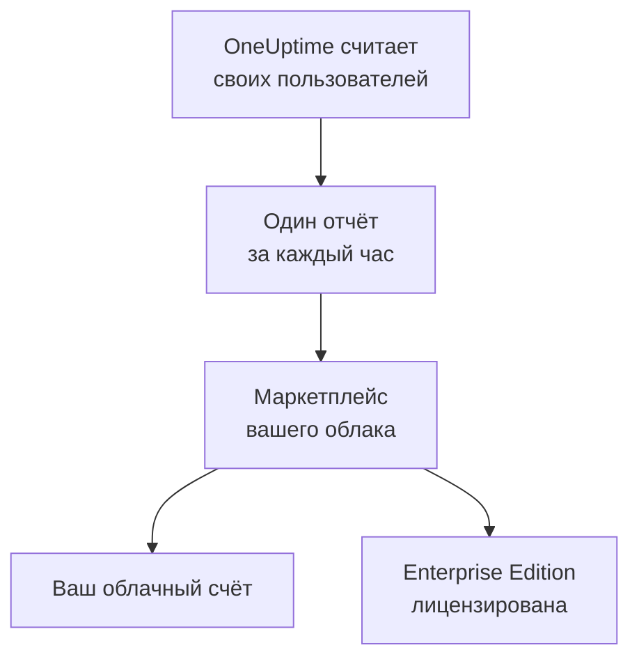

# Облачные маркетплейсы

Запускайте OneUptime Enterprise, купленный в AWS Marketplace, Microsoft Marketplace или Google Cloud Marketplace, в собственном кластере Kubernetes. Маркетплейс почасово берёт плату за каждого пользователя вашей установки через ваш облачный счёт, а подписка лицензирует Enterprise Edition: активировать лицензионный ключ не нужно.

:::cards
- [Установка OneUptime](#установка-oneuptime): В Amazon EKS, Azure Kubernetes Service или Google Kubernetes Engine.
- [Как начисляется плата](#как-начисляется-плата): USD 0.10 за пользователя в час, отчёт отправляется каждый час.
- [Обновление](#обновление): Как новый релиз попадает в ваш кластер.
- [Устранение неполадок](#устранение-неполадок): Когда метка редакции предупреждает о проблемах с маркетплейсом.
:::

## Как это работает

OneUptime считает своих пользователей каждые 15 минут и за каждый час отправляет маркетплейсу, в котором вы его купили, один отчёт — с наибольшим числом пользователей, которое он видел за этот час. Маркетплейс добавляет этот час в ваш облачный счёт. Каждый отчёт, принятый маркетплейсом, также сообщает OneUptime, что ваша подписка активна, и благодаря этому Enterprise Edition остаётся лицензированной.



| | AWS | Microsoft | Google Cloud |
| --- | --- | --- | --- |
| Листинг | Пока не опубликован: [свяжитесь с нами](https://oneuptime.com/enterprise/demo) | [OneUptime Enterprise](https://marketplace.microsoft.com/en-us/product/oneupitme.oneuptime-enterprise) | Пока не опубликован: [свяжитесь с нами](https://oneuptime.com/enterprise/demo) |
| Работает на | Amazon EKS | Azure Kubernetes Service (AKS) | Google Kubernetes Engine (GKE) |
| Установка через | Helm, из реестра листинга | Портал Azure | Консоль Google Cloud |
| OneUptime отправляет отчёты через | Роль IAM своего сервисного аккаунта Kubernetes | Управляемое удостоверение, которое Azure выдаёт установке | Секрет для отчётов, который Google Cloud Marketplace создаёт для развёртывания |
| Новые релизы | Вы обновляетесь через Helm | Промежуточные выпуски устанавливаются автоматически | Вы обновляетесь вручную |

## Перед началом работы

- **Кластер Kubernetes** в облаке маркетплейса: не менее 3 узлов по 4 vCPU и 16 GiB памяти, StorageClass по умолчанию и поддержка сервисов типа `LoadBalancer`. OneUptime запускает в кластере собственные PostgreSQL, ClickHouse и Valkey; подберите их размеры по странице [Подбор размеров и планирование ёмкости](/docs/installation/sizing).
- **Доменное имя** для OneUptime, например `oneuptime.example.com`, которое можно направить на балансировщик нагрузки кластера.
- **Исходящий HTTPS** из кластера к маркетплейсу, чтобы OneUptime мог отправлять отчёты о пользователях: `metering.marketplace.<region>.amazonaws.com` и `sts.<region>.amazonaws.com` в AWS, `marketplaceapi.microsoft.com` в Azure, `servicecontrol.googleapis.com` и `oauth2.googleapis.com` в Google Cloud.

## Установка OneUptime

### AWS Marketplace

В AWS OneUptime отправляет отчёты о пользователях через роль IAM, которую EKS выдаёт его сервисному аккаунту Kubernetes (роли IAM для сервисных аккаунтов). AWS Marketplace принимает данные об использовании из EKS, только если они подписаны именно так.

:::steps
1. Оформите подписку на OneUptime Enterprise в AWS Marketplace, затем выберите **Continue to Configuration**, укажите версию и выберите **Continue to Launch**.
2. Подключите к кластеру поставщика IAM OIDC, если его ещё нет, и создайте командами ниже сервисный аккаунт `oneuptime` с ролью IAM, у которой есть политика `AWSMarketplaceMeteringFullAccess`. Выполните их вместо команды `eksctl` из шага 1 раздела **General launch instructions** на странице запуска: та команда подключает роль, которую вам пришлось бы сначала создать самим.
3. Авторизуйте Helm в реестре листинга и установите чарт командами из шага 2 раздела **General launch instructions**. В команде `helm install` задайте для `serviceAccount.name` значение `oneuptime`, для `host` — ваше доменное имя, а для `httpProtocol` — `https`, если перед OneUptime стоит сертификат.
4. [Откройте OneUptime](#откройте-oneuptime).
:::

```bash
eksctl utils associate-iam-oidc-provider --cluster <cluster> --approve
eksctl create iamserviceaccount --name oneuptime --namespace oneuptime --cluster <cluster> \
  --attach-policy-arn arn:aws:iam::aws:policy/AWSMarketplaceMeteringFullAccess \
  --approve --override-existing-serviceaccounts
```

Сохраните значения из шага 3 в файле и передавайте его при каждом `helm upgrade`:

```yaml title="values.yaml"
host: oneuptime.example.com
httpProtocol: https
serviceAccount:
  name: oneuptime
```

### Microsoft Marketplace

В Azure OneUptime — это приложение Kubernetes: AKS устанавливает его как расширение кластера и выдаёт ему управляемое удостоверение, через которое он отправляет отчёты о пользователях.

:::steps
1. Откройте OneUptime Enterprise в Microsoft Marketplace на портале Azure или откройте свой кластер AKS и выберите **Extensions + applications** > **Add**, затем выберите план и нажмите **Create**.
2. Выберите подписку и группу ресурсов, а также решите, установить приложение в существующий кластер AKS или создать новый.
3. На шаге **OneUptime** введите имя установки, своё доменное имя и его протокол.
4. Нажмите **Review + create**, затем **Create**. Установка занимает несколько минут; она завершена, когда **Extensions + applications** показывает её состояние подготовки как **Succeeded**.
5. [Откройте OneUptime](#откройте-oneuptime).
:::

Пользовательские счётчики работают в кластерах AKS, но не в Kubernetes с поддержкой Azure Arc, поэтому OneUptime Enterprise из Microsoft Marketplace устанавливается только в AKS.

### Google Cloud Marketplace

В Google Cloud маркетплейс запускает средство развёртывания, которое устанавливает OneUptime в выбранное вами пространство имён вместе с секретом для отчётов, с помощью которого OneUptime передаёт данные о пользователях.

:::steps
1. Откройте OneUptime Enterprise в Google Cloud Marketplace в консоли Google Cloud и нажмите **Configure**.
2. Выберите кластер GKE и пространство имён, затем введите имя установки, своё доменное имя и его протокол.
3. Нажмите **Deploy**. Развёртывание занимает несколько минут; оно завершено, когда приложение отображается как готовое в разделе **Kubernetes Engine** > **Applications**.
4. [Откройте OneUptime](#откройте-oneuptime).
:::

## Откройте OneUptime

Сначала OneUptime выполняет миграцию своей базы данных, что на новой установке занимает несколько минут. Затем направьте своё доменное имя на его балансировщик нагрузки:

```bash
kubectl get service --namespace <namespace>
```

У сервиса, имя которого заканчивается на `-nginx`, есть `EXTERNAL-IP`: создайте для своего доменного имени DNS-запись, которая указывает на этот адрес. Откройте доменное имя и зарегистрируйтесь. Первая учётная запись новой установки становится её главным администратором, который может открыть Admin Dashboard по адресу `/admin`.

В течение часа метка редакции покажет Enterprise Edition, лицензированную через ваш маркетплейс. Главные администраторы видят метку редакции в шапке Admin Dashboard и в подвале Dashboard.

## Как начисляется плата

| Что | Как это работает |
| --- | --- |
| Цена | USD 0.10 за пользователя в час, около USD 73 за пользователя в месяц. |
| Кто учитывается | Все, у кого есть учётная запись OneUptime в этой установке. Подписчики страниц статуса и люди, которые входят на частную страницу статуса, не учитываются. |
| Когда | OneUptime считает пользователей каждые 15 минут и за каждый час отправляет один отчёт — с наибольшим числом пользователей, которое он видел за этот час. Час, когда OneUptime не работал, не оплачивается. |
| Где | В вашем счёте AWS, Azure или Google Cloud, через маркетплейс. |
| Что не входит | Сам кластер: облачный провайдер, как обычно, выставляет счёт за его узлы, диски и балансировщики нагрузки. |

Каждая установка оплачивается отдельно, поэтому staging-установка тоже оплачивается. Чтобы получить годовую цену, скидки за объём или цену для установок вне продакшена, запросите у [sales@oneuptime.com](mailto:sales@oneuptime.com) частное предложение, которое вы принимаете в маркетплейсе.

Если отчёт не удаётся отправить из-за проблем с сетью или сбоя маркетплейса, OneUptime отправляет его снова при следующем запуске. Каждый отчёт содержит ключ своего часа, поэтому один и тот же час никогда не оплачивается дважды.

## Как устроено лицензирование

Ваша подписка в маркетплейсе — это ваша лицензия. Каждый отчёт, принятый маркетплейсом, лицензирует все корпоративные функции для всех пользователей на следующие 72 часа. Лицензионный ключ от OneUptime тоже работает в этой установке: установка использует ту из двух лицензий, которая лучше.

| Что происходит | Что показывает метка редакции |
| --- | --- |
| Маркетплейс принимает ежечасные отчёты | Enterprise Edition, лицензированную через ваш маркетплейс. |
| Ни один отчёт не принимался 72 часа | **Enterprise Edition (Marketplace Reports Failing)**: все корпоративные функции продолжают работать в течение 30-дневного льготного периода. |
| Маркетплейс сообщает, что у установки нет подписки, или льготный период закончился | **Enterprise Edition (Marketplace Subscription Ended)**: корпоративные функции останавливаются, как при [истечении лицензии](/docs/self-hosted/enterprise#когда-лицензия-истекла-или-отсутствует). |

Маркетплейс отклоняет отменённую или приостановленную подписку, а также установку, отличную от той, что вы купили. Мониторинг, оповещения, инциденты, дежурства и страницы статуса продолжают работать в любом случае, и ничего не удаляется. Оформите подписку снова, и следующий принятый отчёт снова лицензирует Enterprise Edition, без перезапуска.

## Обновление

| Маркетплейс | Как новый релиз попадает в ваш кластер |
| --- | --- |
| AWS Marketplace | Каждый релиз — это новая версия листинга. Выполните `helm upgrade` с чартом из реестра листинга, новой версией и своим файлом значений. |
| Microsoft Marketplace | AKS сам устанавливает новые промежуточные и исправляющие выпуски. Новая основная версия ждёт, пока вы её не примете. Автоматические обновления можно отключить на странице установки в **Extensions + applications**. |
| Google Cloud Marketplace | Google Cloud Marketplace оставляет развёртывание на той версии, которую установил, и никогда его не обновляет. Прежде чем переводить развёртывание на новую версию, свяжитесь со [службой поддержки](https://oneuptime.com/support). |

OneUptime выполняет миграцию своей базы данных при запуске нового релиза. Прочитайте [заметки к обновлению](/docs/installation/upgrading), прежде чем переходить на новую основную версию.

Обновляйтесь через маркетплейс. Установка из маркетплейса не сверяется с релизами OneUptime на GitHub: обновляйтесь до тех версий, которые предлагает ваш маркетплейс.

## Настройки и масштабирование

Ваш счёт не зависит от масштаба: OneUptime оплачивается за каждого пользователя. Больше реплик или более крупные узлы меняют только то, что облачный провайдер выставляет вам за кластер.

| Маркетплейс | Где хранятся ваши настройки |
| --- | --- |
| AWS Marketplace | В вашем файле значений. Работают все настройки [Helm-чарта](https://artifacthub.io/packages/helm/oneuptime/oneuptime), кроме встроенных операторов. |
| Microsoft Marketplace | В параметрах конфигурации установки: на её странице в **Extensions + applications** или через `az k8s-extension update --configuration-settings`. Каждый параметр — это значение чарта, например `autoscaling.enabled=true`. |
| Google Cloud Marketplace | В полях формы развёртывания. Всё остальное меняйте через `kubectl` в собственных ресурсах развёртывания. |

- **Масштабируйте OneUptime** параметрами чарта для реплик и автомасштабирования (`deployment.replicaCount`, `autoscaling.enabled` и собственные переопределения каждого сервиса), а узлы — автомасштабировщиком своего кластера.
- **Оставьте настройки маркетплейса такими, как их задаёт листинг**: `enterpriseMarketplace` и, в AWS, `serviceAccount`. Без них OneUptime не может отправлять отчёты, и Enterprise Edition не лицензируется.
- **Операторы KEDA, CloudNativePG и Altinity ClickHouse не входят в комплект**, потому что маркетплейс поставляет только образы из своего листинга. Для высокодоступных хранилищ данных направьте OneUptime на управляемые сервисы через `externalPostgres`, `externalRedis` и `externalClickhouse`.

Оплата не зависит от числа запущенных реплик: отчёты отправляет только один запуск за раз, и на каждый час приходится один отчёт.

## Устранение неполадок

:::details Метка редакции показывает Enterprise Edition (Marketplace Reports Failing)
OneUptime не может отправлять отчёты маркетплейсу. Каждая строка, которую он пишет об этом в лог, начинается с `OneUptime Enterprise marketplace billing`; строка, где сказано, что использование «cannot be reported», называет то, чего не хватает. Типичные причины:

- **AWS:** у сервисного аккаунта `oneuptime` нет роли IAM, или у роли нет политики `AWSMarketplaceMeteringFullAccess` (`AWSMarketplaceMeteringRegisterUsage` недостаточно). Подключите политику к роли или создайте роль командой `eksctl` из раздела [AWS Marketplace](#aws-marketplace), а затем перезапустите поды OneUptime командой `kubectl rollout restart deployment --namespace oneuptime`.
- **Azure:** установка — не приложение из Microsoft Marketplace, например потому, что её установили через Helm, и поэтому у неё нет удостоверения или плана для отправки отчётов. Установите её с портала Azure.
- **Google Cloud:** секрет для отчётов этого развёртывания удалён или заменён.
- **Любой маркетплейс:** межсетевой экран или прокси блокирует исходящий HTTPS, описанный в разделе [Перед началом работы](#перед-началом-работы).

Данные об использовании сохраняются, пока вы устраняете проблему, и оплачиваются, как только OneUptime снова сможет отправлять отчёты. Использование старше 30 дней не оплачивается.
:::

:::details Метка редакции показывает Enterprise Edition (Marketplace Subscription Ended)
Маркетплейс отклонил установку: подписка была отменена или приостановлена, либо это не та установка, которую купили в маркетплейсе. Проверьте подписку в маркетплейсе и оформите её снова; следующий принятый отчёт снова лицензирует Enterprise Edition. Та же метка появляется, если отчёты не проходили в течение всего льготного периода.
:::

:::details Поды остаются в состоянии Pending после установки
Базам данных OneUptime нужны постоянные тома. Задайте в кластере StorageClass по умолчанию: в Amazon EKS установите дополнение с драйвером Amazon EBS CSI.
:::

## Дальнейшие шаги

:::cards
- [Редакция Enterprise](/docs/self-hosted/enterprise): Что добавляет Enterprise Edition и что останавливается, когда лицензия истекает.
- [Обновление](/docs/installation/upgrading): Заметки к обновлению для каждого релиза.
- [Подбор размеров и планирование ёмкости](/docs/installation/sizing): Подберите размеры хранилищ данных под свою телеметрию.
- [Архитектура](/docs/self-hosted/architecture): Что работает в вашем кластере.
- [Агент Kubernetes](/docs/telemetry/kubernetes-agent#установка-в-виде-дополнения-amazon-eks): Бесплатно и в AWS Marketplace — как дополнение Amazon EKS для кластеров, которые отправляют данные в OneUptime.
:::
