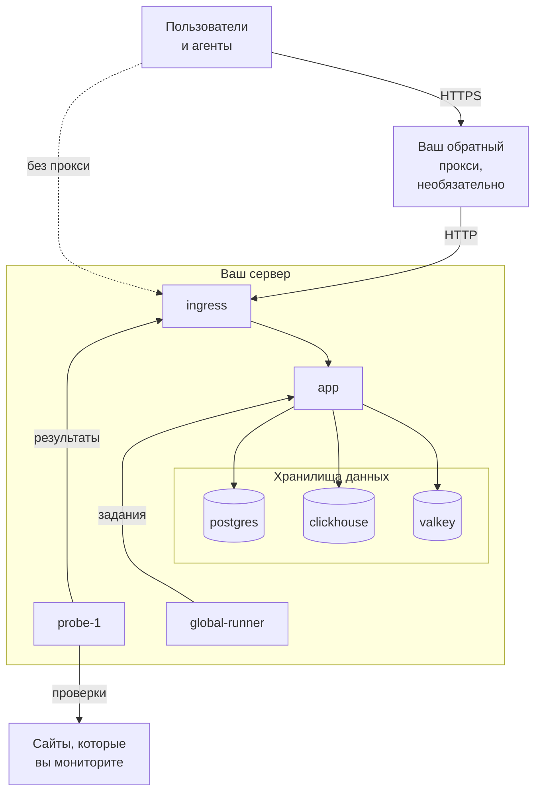

# Docker Compose

Запустите полноценный бесплатный экземпляр OneUptime на одном Linux-сервере с помощью Docker Compose. Эта страница проведёт вас от чистого сервера до работающего экземпляра, а затем расскажет об HTTPS, подготовке к продакшену, резервных копиях, обновлениях и удалении. Чтобы работать с кодом самого OneUptime, см. [Локальная разработка](/docs/installation/local-development).

:::cards
- [Установка OneUptime](#установка-oneuptime): От чистого сервера до первой учётной записи за пять шагов.
- [Настройка HTTPS](#настройка-https): Пусть OneUptime получит сертификат сам, или поставьте перед ним свой прокси.
- [Чек-лист для продакшена](#чек-лист-для-продакшена): Что решить до прихода реального трафика.
- [Обновление OneUptime](#обновление-oneuptime): Переход на последний релиз.
:::

## Как это работает

Docker Compose запускает каждую часть OneUptime в виде контейнера на вашем сервере. Весь трафик входит через контейнер `ingress`, который направляет его в `app`. Приложение хранит данные в PostgreSQL, ClickHouse и Valkey. Встроенный зонд выполняет проверки ваших мониторов и отправляет результаты обратно через ingress.



| Сервис | Образ | Что он делает |
| --- | --- | --- |
| `ingress` | `oneuptime/nginx` | Принимает весь трафик на портах 80 и 443 и направляет его в приложение. Отдаёт HTTPS, когда OneUptime управляет сертификатом. |
| `app` | `oneuptime/app` | Панель, API, страницы статуса, приём телеметрии и фоновые обработчики. |
| `probe-1` | `oneuptime/probe` | Глобальный зонд, который выполняет проверки ваших мониторов. Использует сеть хоста. |
| `global-runner` | `oneuptime/runner` | Встроенный глобальный Runner, который выполняет шаги JavaScript runbook-ов и исправления кода от OneUptime AI для всех проектов. |
| `postgres` | `postgres:15` | Конфигурация и состояние: мониторы, инциденты, пользователи. Хранится в томе `postgres`. |
| `clickhouse` | `clickhouse/clickhouse-server:26.7` | Телеметрия: логи, метрики, трассировки и исключения. Хранится в томе `clickhouse`. |
| `valkey` | `valkey/valkey:9.1-alpine` | Кэш и очереди. Ничего не хранит на диске. |

> [!NOTE]
> Сервис `valkey` запускает [Valkey](https://valkey.io), форк Redis 7.2 под лицензией BSD, который настраивается параметрами `VALKEY_*` в `config.env`. Подойдёт любой сервер с протоколом Redis — при желании направьте `VALKEY_HOST` на управляемый Redis. До 13.0.0 эти параметры назывались `REDIS_*`; старые имена по-прежнему читаются, контейнер по-прежнему отвечает на имя хоста `redis`, а `npm run update` их не переписывает, поэтому старый `config.env` не требует правок.

Для продакшена большого масштаба или когда нужна высокая доступность используйте вместо этого [Helm-чарт](https://artifacthub.io/packages/helm/oneuptime/oneuptime) в Kubernetes: Docker Compose запускает по одной копии каждого сервиса на одном сервере.

## Требования

Выбирайте размер сервера по тому, что вы будете на нём запускать. Память и диск определяет телеметрия (логи, метрики, трассировки); когда узнаете свои объёмы, загляните в [Подбор размеров и планирование ёмкости](/docs/installation/sizing).

| | Рекомендуется | Минимум для домашней лаборатории |
| --- | --- | --- |
| **Память** | 16 ГБ | 8 ГБ |
| **CPU** | 8 ядер | 4 ядра |
| **Диск** | 400 ГБ | 20 ГБ |
| **Система** | Ubuntu 22.04 или другой Linux на основе Debian, Ubuntu или RHEL | То же |
| **Архитектура** | x86-64 (`amd64`) или ARM (`arm64`) | То же |

Минимум для домашней лаборатории подходит для личного и экспериментального использования — некоторые запускают OneUptime на Raspberry Pi.

Также понадобятся:

- **Docker** с плагином **Docker Compose v2** (команда `docker compose`).
- **Git**, чтобы загрузить OneUptime.
- **Node.js и npm**, которые запускают скрипты `npm start` и `npm run update`, оборачивающие Docker Compose.
- **Свободные порты 80 и 443** на сервере. В таблице ниже перечислены все порты, которые OneUptime использует на хосте.

| Порт хоста | Кто использует | Параметр | Для чего |
| --- | --- | --- | --- |
| 80 | `ingress` | `ONEUPTIME_HTTP_PORT` | Панель, API, приём телеметрии и проверка Let's Encrypt. |
| 443 | `ingress` | `STATUS_PAGE_HTTPS_PORT` | HTTPS для вашего экземпляра, когда OneUptime управляет сертификатом, а также для страниц статуса и панелей на собственных доменах. |
| 5400 | `postgres` | `DATABASE_PUBLISHED_PORT` | Даёт `npm run backup` и `restore.sh` доступ к PostgreSQL с самого сервера. Опубликован только на `127.0.0.1`. |
| 3874 | `probe-1` | `GLOBAL_PROBE_1_PORT` | Собственный сервер зонда. Ничему за пределами сервера он не нужен. |

Есть также [видео с пошаговой установкой](https://youtu.be/j1SWmMW2oL4).

## Установка OneUptime

На новом сервере с Ubuntu, Debian или дистрибутивом на базе RHEL шаги ниже может выполнить за вас одна команда. Она устанавливает Docker, Git и Node.js, если их нет, клонирует ветку release в папку `oneuptime`, спрашивает адрес, по которому люди будут открывать OneUptime, и запускает `npm start`:

```bash
curl -fsSL https://oneuptime.com/install.sh | bash
```

:::steps
### Клонируйте ветку release

Ветка `release` содержит файлы последнего релиза.

```bash
git clone --depth 1 --single-branch --branch release https://github.com/OneUptime/oneuptime.git
cd oneuptime
```

### Создайте config.env

Все настройки OneUptime хранятся в `config.env`. Начните с примера:

```bash
cp config.example.env config.env
```

### Задайте имя хоста

Откройте `config.env` и укажите в `HOST` доменное имя или IP-адрес, по которому к OneUptime будут обращаться, без `http://`. Оставляйте `localhost`, только чтобы попробовать OneUptime на своём компьютере.

```ini title="config.env"
HOST=oneuptime.example.com
```

### Запустите OneUptime

:::tabs
@tab npm
```bash
npm start
```
@tab Docker CLI
```bash
sh Scripts/Install/WithConfig.sh docker compose up --remove-orphans -d
```
Перед первым запуском замените секреты-заглушки сами, как показано в разделе [Сгенерируйте случайные секреты](#сгенерируйте-случайные-секреты): за вас это делает только `npm start`.
:::

Сначала `npm start` проверяет сервер: Docker, память, место на диске, порты, которые использует OneUptime, и `HOST`. Он останавливается на всём, что помешало бы OneUptime работать, и говорит, что изменить. Затем он задаёт каждому секрету-заглушке в `config.env` собственное случайное значение, запускает OneUptime и ждёт, пока ответит каждая часть. Первый запуск занимает несколько минут, пока Docker скачивает образы, а OneUptime создаёт свои базы данных. В конце он выводит строку **OneUptime is up!** и адрес, который нужно открыть.

### Создайте первую учётную запись

Откройте `http://` и следом ваш `HOST` (например, `http://localhost`) и зарегистрируйтесь. Первая учётная запись нового экземпляра становится его главным администратором, который может открыть Admin Dashboard по адресу `/admin`.

Любой, кто может открыть страницу, сможет зарегистрироваться после вас. Чтобы запретить это, откройте Admin Dashboard, перейдите в **Настройки > Аутентификация** и выключите **Разрешить регистрацию**. Люди, которых вы приглашаете в проект, по-прежнему смогут создать учётную запись.
:::

### Сгенерируйте случайные секреты

В `config.example.env` каждый секрет поставляется в виде заглушки, публично доступной на GitHub. `npm start` задаёт каждому собственное случайное значение, прежде чем что-либо запустить, и называет параметры, которые заполнил:

| Параметр | Что он защищает |
| --- | --- |
| `ONEUPTIME_SECRET` | Вызовы между собственными сервисами OneUptime. |
| `ENCRYPTION_SECRET` | Секреты, которые хранит OneUptime, например токены интеграций и пароли SMTP, и выдаваемые им токены входа. |
| `DATABASE_PASSWORD`, `CLICKHOUSE_PASSWORD`, `VALKEY_PASSWORD` | Три хранилища данных. |
| `REGISTER_PROBE_KEY` | Регистрацию зондов в вашем экземпляре. |
| `GLOBAL_PROBE_1_KEY`, `GLOBAL_PROBE_2_KEY` | Глобальные зонды, которые может запускать Docker Compose (`probe-1` работает по умолчанию). |
| `GLOBAL_RUNNER_KEY` | Встроенный глобальный Runner, который выполняет шаги JavaScript и исправления кода с помощью ИИ всех проектов. |

> [!IMPORTANT]
> Не меняйте секреты после того, как OneUptime запустился. PostgreSQL принимает пароль только при создании своей базы данных, а смена `ENCRYPTION_SECRET` позже делает нечитаемым любое значение, зашифрованное старым. Поэтому `npm start` задаёт `DATABASE_PASSWORD` и `ENCRYPTION_SECRET` только при новой установке, до того как PostgreSQL создаст свою базу данных.

С Docker CLI замените заглушки сами перед первым запуском:

```bash
while grep -q "please-change-this-to-random-value" config.env; do
  sed -i "0,/please-change-this-to-random-value/{s/please-change-this-to-random-value/$(openssl rand -hex 32)/}" config.env
done
grep -c "please-change-this" config.env
```

Последняя команда выводит `0`: заглушек не осталось. Цикл использует GNU `sed`, который есть на любом Linux-сервере.

## Настройка HTTPS

OneUptime отдаёт обычный HTTP, пока вы не выберете один из двух способов добавить HTTPS:

| | OneUptime получает сертификат сам | Ваш собственный обратный прокси |
| --- | --- | --- |
| **Где завершается TLS** | В `ingress` OneUptime, с бесплатным сертификатом Let's Encrypt, который он продлевает сам | В вашем прокси: Caddy, Nginx или балансировщике нагрузки |
| **Что нужно** | Публичное доменное имя, указывающее на сервер, и порты 80 и 443, доступные из интернета | Прокси и сертификат для вашего домена |
| **Параметры** | `PROVISION_SSL=true`, `HTTP_PROTOCOL=https` | `PROVISION_SSL=false`, `HTTP_PROTOCOL=https`, `TRUSTED_PROXY_HOPS=2` |
| **Страницы статуса на собственных доменах** | Работают без дополнительной настройки | Ваш прокси должен обслуживать и эти домены |

Если вы размещаете страницы статуса или панели на собственных доменах, проще доверить TLS самому OneUptime: ingress сам заказывает и отдаёт сертификаты этих доменов.

С `HTTP_PROTOCOL=https` OneUptime строит ссылки HTTPS, держит cookie входа на HTTPS и просит браузеры открывать ваш `HOST` только по HTTPS. Браузер соблюдает это год, на любом порту этого имени, поэтому если `HOST` когда-нибудь снова должен будет отвечать по обычному HTTP, задайте `HSTS_MAX_AGE_SECONDS=0` в `config.env` заранее: браузеры забудут правило при следующем посещении.

### OneUptime получает сертификат сам

:::steps
#### Направьте домен на сервер

Создайте для домена DNS-запись `A` (или `AAAA` для IPv6) со значением — публичным IP-адресом сервера. Если есть запись `AAAA`, включите также IPv6 для OneUptime: см. [Адреса посетителей](#адреса-посетителей).

#### Включите получение сертификатов

Задайте эти значения в `config.env`:

```ini title="config.env"
HOST=oneuptime.example.com
PROVISION_SSL=true
HTTP_PROTOCOL=https
```

`HOST` должен быть доменным именем: OneUptime не может получить сертификат для IP-адреса или для `localhost`.

#### Перезапустите с новыми параметрами

```bash
npm start
```

#### Откройте экземпляр по HTTPS

Откройте `https://oneuptime.example.com`. OneUptime заказывает сертификат при запуске, затем проверяет его каждый час и продлевает, когда остаётся меньше 30 дней. Пока не придёт первый сертификат, обычно в течение нескольких минут, ingress отдаёт временный самоподписанный, и браузер вас предупреждает.
:::

### Ваш собственный обратный прокси

В этих шагах прокси работает на том же сервере, что и OneUptime. Если ваш прокси работает на другой машине, пропустите первый шаг, направьте прокси на порт 80 этого сервера и межсетевым экраном вашего облачного провайдера разрешите доступ к портам 80 и 443 только прокси: посетитель, который обращается к OneUptime в обход прокси, может выбрать адрес, по которому OneUptime его учитывает.

:::steps
#### Переведите ingress с портов 80 и 443

Прокси нужны порты 80 и 443, поэтому переведите ingress на другие порты, опубликованные только на loopback-адресе `127.0.0.1` этого сервера, чтобы посетители попадали в OneUptime только через ваш прокси:

```ini title="config.env"
ONEUPTIME_HTTP_PORT=127.0.0.1:8080
STATUS_PAGE_HTTPS_PORT=127.0.0.1:8443
```

Зонд использует сеть хоста и обращается к OneUptime через `http://localhost`. `npm start` переводит его на новый порт ingress, `http://localhost:8080`, и сообщает об этом.

#### Сообщите OneUptime, что он за прокси

```ini title="config.env"
HOST=oneuptime.example.com
HTTP_PROTOCOL=https
PROVISION_SSL=false
TRUSTED_PROXY_HOPS=2
```

`HTTP_PROTOCOL=https` заставляет ссылки, которые строит OneUptime, использовать HTTPS. `TRUSTED_PROXY_HOPS=2` учитывает ваш прокси и ingress OneUptime, чтобы для списков разрешённых IP и ограничений частоты OneUptime читал настоящий адрес посетителя. Прибавляйте по единице за каждый следующий прокси, дописывающий в `X-Forwarded-For`, например CDN или балансировщик нагрузки.

#### Перезапустите OneUptime на новых портах

```bash
npm start
```

`npm start` проверяет OneUptime на новом порту, `localhost:8080`, и завершается строкой **OneUptime is up!**

#### Настройте прокси

:::tabs
@tab Caddy
```text title="Caddyfile"
oneuptime.example.com {
	reverse_proxy localhost:8080
}
```
Caddy сам получает и продлевает сертификат, перенаправляет HTTP на HTTPS и пропускает соединения WebSocket. После изменения файла перезагрузите Caddy, например командой `sudo systemctl reload caddy`.
@tab Nginx
```nginx title="/etc/nginx/conf.d/oneuptime.conf"
map $http_upgrade $oneuptime_connection_upgrade {
    default upgrade;
    ""      close;
}

server {
    listen 80;
    server_name oneuptime.example.com;
    return 301 https://$host$request_uri;
}

server {
    listen 443 ssl;
    server_name oneuptime.example.com;

    ssl_certificate     /etc/letsencrypt/live/oneuptime.example.com/fullchain.pem;
    ssl_certificate_key /etc/letsencrypt/live/oneuptime.example.com/privkey.pem;

    # The limits OneUptime's own ingress uses.
    client_max_body_size 50M;
    proxy_read_timeout 300s;
    proxy_send_timeout 300s;

    proxy_http_version 1.1;
    proxy_set_header Host $host;
    proxy_set_header X-Forwarded-For $proxy_add_x_forwarded_for;
    proxy_set_header X-Forwarded-Proto $scheme;
    proxy_set_header Upgrade $http_upgrade;
    proxy_set_header Connection $oneuptime_connection_upgrade;

    location / {
        proxy_pass http://127.0.0.1:8080;
    }

    # MCP clients keep a stream open.
    location /mcp {
        proxy_pass http://127.0.0.1:8080;
        proxy_buffering off;
        proxy_read_timeout 86400s;
        proxy_send_timeout 86400s;
    }
}
```
Пути к сертификатам — это места, куда Certbot кладёт сертификат Let's Encrypt; если ваш сертификат получен иначе, укажите его пути. Проверьте файл и перезагрузите Nginx командой `sudo nginx -t && sudo systemctl reload nginx`.
:::

Оба отправляют `X-Forwarded-Proto`, который сообщает OneUptime, что посетитель пришёл по HTTPS. Любой другой прокси тоже должен его отправлять, иначе cookie входа страниц статуса и панелей на ваших собственных доменах не удерживаются на HTTPS.

#### Откройте экземпляр через прокси

Откройте `https://oneuptime.example.com`. Вы должны увидеть страницу входа OneUptime, отданную с сертификатом вашего прокси.
:::

> [!NOTE]
> За собственным прокси отправляйте телеметрию по OTLP/HTTP (`/otlp`). OTLP по gRPC доходит до OneUptime, только когда TLS завершает его собственный ingress (`PROVISION_SSL=true`).

## Адреса посетителей

OneUptime учитывает каждого посетителя по адресу, с которого тот подключается: его читают ограничения входа, другие ограничения по адресу и списки разрешённых IP страниц статуса и дашбордов. Двум конфигурациям нужна настройка, чтобы этот адрес был собственным адресом посетителя:

| Конфигурация | Настройка |
| --- | --- |
| Люди обращаются к OneUptime по IPv6, например через запись `AAAA` | IPv6 в сети OneUptime, в `docker-compose.override.yml` |
| Перед OneUptime стоит ваш собственный обратный прокси | `TRUSTED_PROXY_HOPS=2`, а ingress опубликован на `127.0.0.1` (см. [Ваш собственный обратный прокси](#ваш-собственный-обратный-прокси)) |

Без IPv6 в сети OneUptime Docker передаёт ему каждого посетителя, пришедшего по IPv6, с одного своего адреса, и OneUptime считает их всех одним посетителем: неудачные попытки входа одного человека могут заблокировать остальных. Для IPv6 нужен Docker Engine 27 или новее (вашу версию показывает `docker version`).

:::steps
### Включите IPv6

Создайте `docker-compose.override.yml` рядом с `docker-compose.yml` или добавьте это в уже существующий файл; `npm start` и `npm run update` читают его:

```yaml title="docker-compose.override.yml"
networks:
  oneuptime:
    enable_ipv6: true
```

### Перезапустите OneUptime

```bash
npm stop
npm start
```

OneUptime останавливается и запускается снова, уже с IPv6 в своей сети. Ваши данные сохраняются. Docker не может удалить сеть, к которой ещё подключён ваш собственный контейнер, например обратный прокси: сначала отключите его от сети OneUptime, а потом подключите снова. Если `npm start` останавливается с `has active endpoints`, отключите его и снова выполните `npm stop` и `npm start`.

### Проверьте сеть

```bash
docker network ls --quiet --filter name=_oneuptime | xargs docker network inspect | grep EnableIPv6
```

Команда выводит `"EnableIPv6": true,`.
:::

Когда несколько человек входят с одного адреса частной сети, страница **Состояние OneUptime** в Admin Dashboard сообщает об этом и называет настройку, которая это меняет.

## Чек-лист для продакшена

Docker Compose запускает по одной копии каждого сервиса на одном сервере, что подходит небольшим командам и домашним лабораториям. Прежде чем на него полагаться, пройдитесь по этому списку.

| Область | Что сделать |
| --- | --- |
| **Секреты** | Ни одно значение в `config.env` больше не является заглушкой `please-change-this-to-random-value`. См. [Сгенерируйте случайные секреты](#сгенерируйте-случайные-секреты), а для установки, запущенной с заглушкой в `DATABASE_PASSWORD`, — [Смените пароль базы данных](#смените-пароль-базы-данных). |
| **HTTPS** | К OneUptime обращаются по HTTPS, и задан `HTTP_PROTOCOL=https`. См. [Настройка HTTPS](#настройка-https). |
| **Регистрации** | Когда у команды появятся учётные записи, выключите **Разрешить регистрацию** в **Настройки > Аутентификация** в Admin Dashboard. |
| **Межсетевой экран** | В интернет открыты только порты 80 и 443 (и SSH). OneUptime публикует порт 5400 PostgreSQL только на `127.0.0.1`. Любой другой порт, который вы публикуете, закройте межсетевым экраном облачного провайдера: правила `ufw` не действуют на порты, которые публикует Docker. |
| **Адреса посетителей** | Страница **Состояние OneUptime** в Admin Dashboard не сообщает, что несколько человек входят с одного адреса. См. [Адреса посетителей](#адреса-посетителей). |
| **Резервные копии** | PostgreSQL копируется каждый день, и копии уходят с сервера. См. [Резервное копирование и восстановление](#резервное-копирование-и-восстановление). |
| **Почта** | В Admin Dashboard в **Настройки > Уведомления > Email** настроен почтовый сервер, чтобы OneUptime мог отправлять приглашения и уведомления. См. [SMTP](/docs/emails/smtp). |
| **Диск** | За свободным местом следят. ClickHouse растёт вместе с хранимой телеметрией (см. [Подбор размеров и планирование ёмкости](/docs/installation/sizing)); лог каждого контейнера ограничен 1000 МБ. |
| **Обновления** | OneUptime обновляется не реже раза в неделю. Релизы выходят часто. См. [Обновление OneUptime](#обновление-oneuptime). |
| **Высокая доступность** | Если она нужна, переходите на [Helm-чарт](https://artifacthub.io/packages/helm/oneuptime/oneuptime) в Kubernetes. |

### Смените пароль базы данных

PostgreSQL сохраняет пароль, с которым была создана база, поэтому если сменить только `DATABASE_PASSWORD` в `config.env`, OneUptime потеряет доступ к своей базе данных. Чтобы дать установке, запущенной с заглушкой, собственный пароль, смените его одновременно в PostgreSQL и в `config.env`, а затем снова запустите OneUptime:

```bash
NEW_PASSWORD=$(openssl rand -hex 32) &&
  echo "ALTER USER CURRENT_USER PASSWORD '$NEW_PASSWORD';" | sh Scripts/Install/WithConfig.sh sh -c 'docker compose exec -T postgres psql -v ON_ERROR_STOP=1 -U "$DATABASE_USERNAME" -d "$DATABASE_NAME"' &&
  sed -i "s/^DATABASE_PASSWORD=.*/DATABASE_PASSWORD=$NEW_PASSWORD/" config.env
npm start
```

Если вы задали `DATABASE_BACKUP_PASSWORD` и `DATABASE_RESTORE_PASSWORD`, дайте им тоже новое значение.

## Резервное копирование и восстановление

PostgreSQL хранит всё, что вы настраиваете: мониторы, инциденты, страницы статуса, пользователей. `npm run backup` сохраняет его дамп в файл в папке `Backups`. Enterprise Edition также умеет по расписанию создавать резервные копии PostgreSQL и ClickHouse в ваше собственное хранилище из Admin Dashboard: см. [Резервные копии](/docs/installation/backups).

:::steps
### Передайте скрипту резервного копирования пароль базы данных

В `config.env` задайте `DATABASE_BACKUP_PASSWORD` равным значению `DATABASE_PASSWORD`. Скрипт читает `config.env` как обычный текст, поэтому идущий в комплекте `${DATABASE_PASSWORD}` никогда не подставляется.

### Запустите резервное копирование

```bash
npm run backup
```

Скрипт запрашивает пароль sudo и записывает `Backups/db-<day of the month>.backup`, так что ежедневные копии заменяют копии месячной давности. Запускайте его хотя бы раз в день.

### Скопируйте резервные копии за пределы сервера

Копия на том же диске, что и база данных, не переживёт потерю этого диска.
:::

PostgreSQL доступен только с самого сервера: он отвечает на порту 5400 адреса `127.0.0.1`. Чтобы делать резервные копии с другой машины, откройте с неё SSH-туннель, а затем подключитесь к её собственному порту 5400:

```bash
ssh -N -L 5400:127.0.0.1:5400 you@oneuptime.example.com
```

:::details Опубликовать PostgreSQL на адресе частной сети
Если инструменту в вашей частной сети нужен доступ к PostgreSQL без туннеля, опубликуйте его также на адресе сервера в этой сети, на отдельном порту. Создайте `docker-compose.override.yml` рядом с `docker-compose.yml`; `npm start` и `npm run update` читают его:

```yaml title="docker-compose.override.yml"
services:
  postgres:
    ports:
      - "10.0.0.5:5401:5432"
```

Укажите собственный частный адрес сервера вместо `10.0.0.5`, никогда не публичный, и сначала задайте PostgreSQL собственный пароль (см. [Смените пароль базы данных](#смените-пароль-базы-данных)). Затем выполните `npm start`, и PostgreSQL будет отвечать и на порту 5401 этого адреса.
:::

ClickHouse хранит телеметрию в томе Docker `oneuptime_clickhouse`, и никакой скрипт его не копирует. Если эту телеметрию нужно сохранить, сделайте резервную копию тома инструментом для ClickHouse, например [clickhouse-backup](https://github.com/Altinity/clickhouse-backup), или скопируйте том, пока OneUptime остановлен.

Чтобы восстановить PostgreSQL, задайте значения `DATABASE_RESTORE_*` в `config.env`: `DATABASE_RESTORE_PASSWORD` — значением `DATABASE_PASSWORD`, как для резервного копирования, а `DATABASE_RESTORE_FILENAME` — именем восстанавливаемой копии, например `db-31.backup`. Затем выполните `bash restore.sh`. База данных, в которую идёт восстановление, должна уже существовать; в работающей установке она есть.

> [!CAUTION]
> `restore.sh` удаляет из целевой базы данных каждый объект из резервной копии перед тем, как создать его заново. Перед началом скрипт спрашивает подтверждение; проверьте имя базы данных, которое он показывает.

## Обновление OneUptime

Сначала сделайте резервную копию, затем выполните:

```bash
git checkout release
git pull
npm run update
```

`npm run update` добавляет в ваш `config.env` новые параметры из `config.example.env` (ваши значения сохраняются), скачивает новые образы и перезапускает OneUptime. Как и `npm start`, он завершается строкой **OneUptime is up!**

Переход на новую основную версию (например, с 13 на 14) может потребовать большего: прочитайте [Обновление OneUptime до новой версии](/docs/installation/upgrading), прежде чем начинать.

`APP_TAG=release` в `config.env` всегда скачивает последний релиз Community Edition. Чтобы остаться на одной версии, укажите в `APP_TAG` её номер, например `14.0.22`. Для Enterprise Edition теги — `enterprise-release` и `enterprise-14.0.22`.

## Удаление OneUptime

Остановите OneUptime и удалите его контейнеры и сеть:

```bash
npm run down
```

Ваши данные остаются в томах `oneuptime_postgres` и `oneuptime_clickhouse`, а папка `oneuptime` сохраняет `config.env` и резервные копии. Чтобы удалить и данные:

```bash
sh Scripts/Install/WithConfig.sh docker compose down --volumes --remove-orphans
```

Затем удалите папку `oneuptime`.

> [!CAUTION]
> `--volumes` навсегда удаляет все мониторы, инциденты, пользователей и всю телеметрию. Если что-то из этого может понадобиться, сначала сделайте резервную копию.

## Устранение неполадок

:::details npm start останавливается, не запустив OneUptime
Сначала `npm start` проверяет сервер и останавливается на всём, что помешало бы OneUptime работать: нет Docker или его плагина Compose, Docker не запущен или недоступен вашему пользователю, порт занят другой программой, или в `HOST` указан адрес, который не откроет ни один браузер. Каждая строка, отмеченная ✗, говорит, что изменить. Исправьте это и снова выполните `npm start`. Если проверка ошибается насчёт вашего сервера, запустите без проверок:

```bash
ONEUPTIME_SKIP_PREFLIGHT=true npm start
```
:::

:::details Docker пишет "permission denied" при запуске npm start
Ваш пользователь не может обратиться к демону Docker. Добавьте его в группу `docker`, затем выйдите из системы и войдите снова:

```bash
sudo usermod -aG docker $USER
```
:::

:::details Ingress не запускается, потому что порт 80 или 443 занят
Порт занимает другая программа на сервере, часто веб-сервер. `npm start` проверяет порты, прежде чем что-либо запустить, и называет контейнер, который занимает порт, если его запускает Docker. Остановите эту программу или переведите ingress на другие порты и поставьте программу перед OneUptime, как описано в разделе [Ваш собственный обратный прокси](#ваш-собственный-обратный-прокси).
:::

:::details npm start завершается с "Maximum retries reached"
Проверка в конце `npm start` сдалась раньше, чем OneUptime ответил. Первый запуск может длиться дольше, чем ждёт проверка, пока скачиваются образы и создаются базы данных. Посмотрите, что запущено, и прочитайте логи:

```bash
npm run ps
npm run logs
```

Когда все контейнеры запущены, повторите проверку командой `npm run status-check`. Она проверяет ingress на порту, который задаёт `ONEUPTIME_HTTP_PORT`.
:::

:::details Браузер показывает "OneUptime не настроен для этого адреса"
Вы открыли OneUptime по адресу, отличному от его `HOST`, например по IP-адресу сервера, когда в `HOST` всё ещё `localhost`. Страница показывает строку `HOST` для открытого адреса и кнопку, которая её копирует: добавьте эту строку в `config.env`, затем выполните `npm start`. Если вы открыли адрес из `HOST`, а страница говорит, что ваш прокси его не передал, настройте прокси так, чтобы он передавал имя хоста, которое запросил браузер: Caddy делает это по умолчанию, Nginx — с помощью `proxy_set_header Host $host;`, а Apache — с помощью `ProxyPreserveHost On`.
:::

:::details Часть страниц загружается, но живые обновления или загрузки файлов не работают
Открывайте OneUptime по адресу из `HOST`. Ingress направляет запросы по имени хоста: всё приложение доступно только по `HOST` и `localhost`, а любое другое имя, например IP-адрес сервера, считается доменом страницы статуса. Укажите в `HOST` имя, которым пользуются люди, и выполните `npm start`.
:::

:::details Регистрация или вход завершается ошибкой "Page not found"
Страница регистрации загружается, но регистрация завершается ошибкой `Page not found - /identity/signup`, а вход — `Page not found - /identity/login`. Запрос дошёл до OneUptime под именем хоста, отличным от `HOST`, поэтому ingress направил его как собственный домен страницы статуса, где собственные регистрация и вход OneUptime не обслуживаются. Проверьте оба пункта:

- `HOST` — это адрес, который открывают люди, вместе с портом, если он используется, например `oneuptime.example.com:8080`. После изменения выполните `npm start`.
- Прокси перед OneUptime передаёт имя хоста, которое запросил браузер. Caddy делает это по умолчанию, Nginx — с помощью `proxy_set_header Host $host;`, как в разделе [Ваш собственный обратный прокси](#ваш-собственный-обратный-прокси), а Apache — с помощью `ProxyPreserveHost On`.
:::

:::details Браузер предупреждает о сертификате после того, как вы задали PROVISION_SSL
Пока Let's Encrypt не выпустит сертификат, ingress отдаёт временный самоподписанный. Если предупреждение держится дольше нескольких минут, проверьте, что:

- `HOST` — доменное имя, а не IP-адрес и не `localhost`.
- DNS-запись домена указывает на этот сервер.
- Порт 80 доступен из интернета, чтобы Let's Encrypt мог проверить домен.

Когда заказ не удаётся, приложение пишет в лог ошибку, которая начинается с `CoreSSL:EnsurePrimaryHostCertificate`, а за ней следует причина:

```bash
sh Scripts/Install/WithConfig.sh docker compose logs app | grep -A 5 CoreSSL
```
:::

:::details Встроенный зонд показывает Отключено после смены порта ingress
Admin Dashboard показывает зонд в **Настройки > Мониторинг > Глобальные зонды**. Он обращается к OneUptime по `GLOBAL_PROBE_1_ONEUPTIME_URL`, где по умолчанию указан `http://localhost` (порт 80). `npm start` переводит этот адрес на порт ingress, пока он указывает на `localhost`. Если вы задали ему другой адрес или запустили OneUptime через Docker CLI, укажите в нём новый порт ingress, например `http://localhost:8080`, и перезапустите OneUptime.
:::

## Следующие шаги

:::cards
- [Обновление OneUptime до новой версии](/docs/installation/upgrading): Что требует от вас каждая основная версия.
- [Подбор размеров и планирование ёмкости](/docs/installation/sizing): Спланируйте память и диск под вашу телеметрию.
- [Архитектура самостоятельного размещения](/docs/self-hosted/architecture): Как устроены компоненты.
- [Редакция Enterprise](/docs/self-hosted/enterprise): Что добавляет образ Enterprise, и его лицензия.
:::
