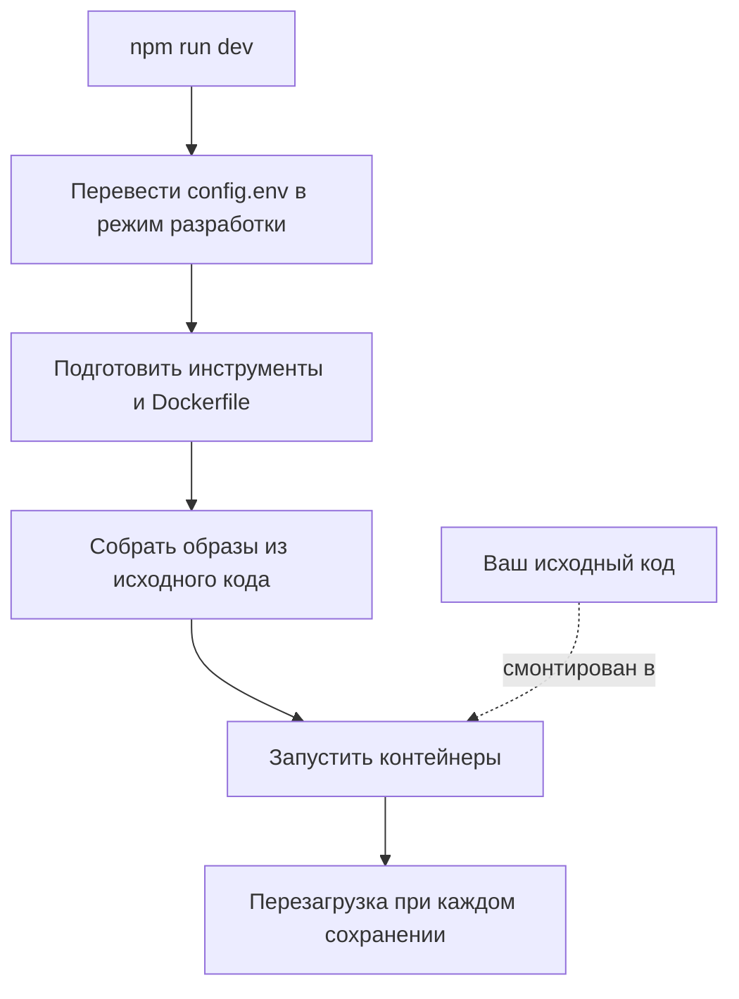

# Локальная разработка

Запустите OneUptime из исходного кода на своём компьютере, чтобы работать над ним. Стек разработки собирает каждый сервис из вашей рабочей копии, монтирует ваш исходный код в контейнеры и перезагружает их, когда вы сохраняете файл.

Чтобы запустить выпущенную версию, используйте [Docker Compose](/docs/installation/docker-compose).

## Как работает стек разработки

`npm run dev` готовит вашу рабочую копию, затем запускает стек, описанный в `Scripts/Dev/docker-compose.dev.yml`:



| Этап | Что происходит |
| --- | --- |
| Переход в режим разработки | Устанавливает `ENVIRONMENT=development` в `config.env`. |
| Подготовка | Запрашивает пароль sudo, устанавливает недостающие инструменты (Git, curl, Node.js, Docker, gomplate, ts-node), выполняет `git pull` в текущей ветке, добавляет в `config.env` новые параметры из `config.example.env` и превращает каждый `Dockerfile.tpl` в `Dockerfile`. |
| Сборка | Собирает образ каждого сервиса из исходного кода. Первая сборка занимает время. |
| Запуск | Запускает контейнеры со смонтированным в них исходным кодом. |
| Перезагрузка | App перезапускает свой API, когда меняется серверный файл, и пересобирает панели, пока вы их редактируете. |

Если в репозитории есть папка `ee/`, App загружает из неё Enterprise Edition. Установите `ONEUPTIME_EDITION=community` в `config.env`, чтобы запустить Community Edition.

## Перед началом

| Что нужно | Примечания |
| --- | --- |
| **Docker** | Docker Desktop в macOS и Windows или Docker Engine с плагином Docker Compose v2 в Linux. |
| **Node.js 26 или новее и npm** | Версия, которую требует `package.json` репозитория и которую использует CI. |
| **Git** | Чтобы клонировать репозиторий. |
| **Доступ sudo** | `npm run dev` запрашивает пароль, прежде чем что-либо устанавливать. |
| **Свободные порты 80 и 443** | Стек обслуживает OneUptime по адресу `http://localhost` (порт 80) и HTTPS на порту 443. |

## Запуск стека разработки

:::steps
### Клонируйте репозиторий

```bash
git clone https://github.com/OneUptime/oneuptime.git
cd oneuptime
```

### Создайте config.env

```bash
cp config.example.env config.env
```

Значения из примера подходят для разработки как есть. Их можно изменить, но это не обязательно.

### Запустите стек

```bash
npm run dev
```

Команда запрашивает пароль sudo, затем собирает образы и запускает контейнеры в фоне. Следите за запуском App с помощью `docker logs -f oneuptime-app-1`.

### Откройте OneUptime

Откройте `http://localhost` и зарегистрируйтесь. Первая учётная запись становится мастер-администратором, который может открыть Admin Dashboard по адресу `http://localhost/admin`.
:::

## Работа с кодом

Редактируйте файлы в `packages/` и сохраняйте их: контейнеры подхватывают изменение.

Прежде чем открывать pull request, проверьте изменение на своём компьютере, вне контейнеров. Для этого один раз установите зависимости: выполните `npm install` в корне репозитория (для ESLint и инструментов миграций), а затем `npm run install-modules`, который удаляет и заново устанавливает `node_modules` каждого пакета и занимает время.

:::steps
### Скомпилируйте изменённое

Запустите компилятор в каждом изменённом пакете, например в App:

```bash
cd packages/App
npm run compile
```

### Проверьте линтером только свои файлы

Из корня репозитория передайте изменённые файлы:

```bash
npx eslint --fix packages/App/path/to/File.ts
```

Не используйте `npm run lint` и `npm run fix-lint`: они проверяют весь репозиторий.

### Запустите тесты, покрывающие изменение

Из пакета запускайте нужные файлы тестов, а не весь набор:

```bash
cd packages/App
npx jest Tests/path/to/YourChange.test.ts
```
:::

### Миграции баз данных

| База данных | Как добавить миграцию |
| --- | --- |
| PostgreSQL | Измените модель, затем выполните `npm run generate-postgres-migration`, а не пишите миграцию вручную. Зарегистрируйте новый файл в `packages/Common/Server/Infrastructure/Postgres/SchemaMigrations/Index.ts`: он не выполняется, пока не указан там. `npm run check-postgres-schema-drift` выводит все ещё недостающие инструкции. |
| ClickHouse | Напишите миграцию вручную в `packages/App/FeatureSet/Workers/DataMigrations` по образцу существующих. |

## Справочник

### Команды

Выполняйте их из корня репозитория.

| Задача | Команда |
| --- | --- |
| Запустить стек или применить изменения `config.env` | `npm run dev` |
| Пересобрать образы после изменения зависимостей | `npm run build`, затем `npm run dev` |
| Пересобрать образы с нуля | `npm run force-build-dev`, затем `npm run dev` |
| Показать запущенные контейнеры | `docker ps` |
| Следить за журналами одного сервиса | `docker logs -f oneuptime-app-1` |
| Остановить стек и удалить его контейнеры | `npm run down` |

`npm run down` сохраняет ваши данные: тома PostgreSQL и ClickHouse остаются.

### Порты

Стек разработки публикует хранилища данных, чтобы вы могли подключаться к ним своими инструментами. Пароли находятся в `config.env`.

| Сервис | Адрес | Вход |
| --- | --- | --- |
| OneUptime | `http://localhost` | Учётная запись, которую вы создали |
| PostgreSQL | `localhost:5400` | Пользователь `postgres`, база `oneuptimedb`, пароль `DATABASE_PASSWORD` |
| ClickHouse | `localhost:8189` (HTTP), `localhost:9034` (нативный) | Пользователь `default`, база `oneuptime`, пароль `CLICKHOUSE_PASSWORD` |
| Valkey | `localhost:6310` | Пароль `VALKEY_PASSWORD` |

## Устранение неполадок

:::details npm run dev останавливается на git pull
`npm run dev` выполняет `git pull` в текущей ветке перед сборкой. Git отказывается в ветке без upstream или если pull перезапишет ваши незакоммиченные изменения. Задайте upstream ветки (например, отправив её командой `git push -u origin <branch>`) или закоммитьте работу, затем снова выполните `npm run dev`.
:::

:::details npm run dev останавливается при установке инструмента
Установите этот инструмент сами, например gomplate или ts-node, и снова выполните `npm run dev`: уже установленные инструменты он пропускает.
:::

:::details Сервис падает после изменения его зависимостей
В образах всё ещё старые зависимости. Пересоберите их командой `npm run build`, затем снова запустите стек командой `npm run dev`. Если этого мало, пересоберите с нуля командой `npm run force-build-dev`.
:::

:::details Порт 80 или 443 уже занят
Порт занимает другая программа на вашем компьютере, часто локальный веб-сервер. Остановите её, затем снова выполните `npm run dev`.
:::

## Дальнейшие шаги

:::cards
- [Архитектура самостоятельно размещённой установки](/docs/self-hosted/architecture): Как устроены сервисы, которые вы только что запустили.
- [Docker Compose](/docs/installation/docker-compose): Запуск выпущенной версии на сервере.
- [Справочник API](/docs/api-reference/api-reference): Вызов API вашего локального экземпляра.
:::
