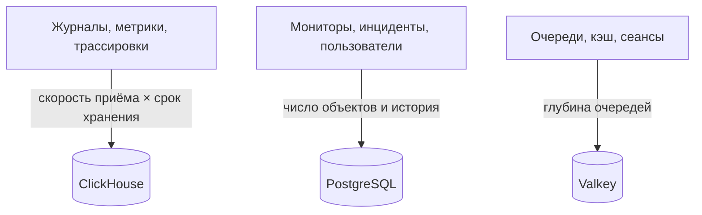

# Подбор размеров и планирование ёмкости

Спланируйте процессор, память и диск для самостоятельно размещённого OneUptime в Kubernetes с [Helm-чартом](https://artifacthub.io/packages/helm/oneuptime/oneuptime). Подбирайте размеры трёх хранилищ данных – **ClickHouse**, **PostgreSQL** и **Valkey** – и приложения по отдельности, начните с одного из уровней ниже и корректируйте, когда появятся реальные цифры.

> [!IMPORTANT]
> Значения чарта по умолчанию – не размеры для продакшена. Сервисы, которые он запускает по умолчанию, **не задают запросов и лимитов процессора и памяти**, а PostgreSQL и ClickHouse получают небольшие тома по **25 Gi**, чтобы чарт устанавливался на любой кластер. Для всего, что серьёзнее пробы, задайте ресурсы и хранилище сами по цифрам с этой страницы.

Используете вместо этого установку через Docker Compose на одном сервере? Её размеры подобрать проще: см. [требования](/docs/installation/docker-compose#требования) (рекомендуются 16 ГБ памяти, 8 ядер и 400 ГБ диска).

:::cards
- [Что заставляет расти каждое хранилище](#что-заставляет-расти-каждое-хранилище): Три хранилища, которые растут от трёх разных вещей.
- [Начальные уровни](#начальные-уровни): Малая, средняя и большая отправные точки.
- [Высокая доступность](#высокая-доступность): Реплики и переключение при сбое для каждого хранилища.
- [Срок хранения](#срок-хранения-и-его-влияние-на-хранилище): Параметр, который умножает ваш диск.
:::

## Подберите размеры установки

:::steps
1. Выясните, сколько телеметрии вы отправляете: сколько ГБ журналов, метрик и трассировок в день. По возможности измерьте это на небольшой установке.
2. Решите, сколько дней её хранить. Срок хранения умножает диск ClickHouse (см. [Срок хранения](#срок-хранения-и-его-влияние-на-хранилище)).
3. Рассчитайте диск ClickHouse по [формуле хранения](#формула-хранения), а затем PostgreSQL и Valkey по их разделам.
4. Выберите [начальный уровень](#начальные-уровни), ближайший к вашим цифрам, и задайте его процессор, память и хранилище в значениях Helm.
5. Включите [высокую доступность](#высокая-доступность) для хранилищ, которым она нужна, затем следите за реальным использованием и корректируйте.
:::

## Что заставляет расти каждое хранилище

В продакшене OneUptime нужны три хранилища данных. Каждое растёт от своего, поэтому подбирайте их размеры независимо.



| Хранилище | Что хранит | Что определяет его размер |
| --- | --- | --- |
| **ClickHouse** | Всю телеметрию – журналы, метрики, трассировки, исключения, профили | Телеметрия: **скорость приёма × срок хранения**. Это ~95 % вашего хранилища и главная статья расходов. |
| **PostgreSQL** | Конфигурацию и состояние – мониторы, инциденты, оповещения, пользователей, команды, проекты, рабочие процессы, страницы статуса, панели | **Число объектов и история**, а не объём телеметрии. Растёт медленно. |
| **Valkey** | Кэш, рабочие очереди и сеансы | **Глубина очередей и активные сеансы**. Ограничен памятью и скромен. Не является источником истины. |

OneUptime никогда не нужно объектное хранилище (S3, MinIO) для работы, и он не переносит старую телеметрию в объектное хранилище. Оно понадобится, только если вы выберете резервные копии в объектное хранилище: плагин Barman Cloud для CloudNativePG или [clickhouse-backup](https://github.com/Altinity/clickhouse-backup) для ClickHouse. Собственное резервное копирование CloudNativePG в чарте (`postgresOperator.cnpg.backup`) делает снимки томов и объектного хранилища не требует. CloudNativePG никогда не удаляет старые снимки: удаляйте их сами, иначе они будут копиться.

## ClickHouse – главный фактор

Почти всё ваше хранилище и большая часть памяти уходят ClickHouse, потому что там лежит каждая строка журнала, каждая точка метрики, каждый спан трассировки и каждое исключение.

### Формула хранения

```text
ClickHouse disk ≈ (daily raw telemetry GB ÷ compression) × retention days × replicas × 1.3 (headroom)
```

Сжатие зависит от сигнала:

| Сигнал | Типичное сжатие | От чего меняется |
| --- | --- | --- |
| Журналы | Около 5:1 | Журналы хорошо сжимаются. |
| Метрики | Около 2:1 | Высокая **кардинальность** меток раздувает диск и память быстрее, чем сырой объём. Держите кардинальность меток низкой. |
| Трассировки | Между ними | Атрибуты спанов, которые вы отправляете. |

### Пример расчёта

Парк из **10 кластеров**, в каждом около 10 узлов и 100 подов, пишущих журналы на уровне INFO, даёт примерно **50–150 ГБ сырых журналов на кластер за 30 дней** (около 1,7–5 ГБ в день на кластер). На весь парк, с метриками и трассировками и после сжатия, закладывайте примерно **5–15 ГБ сжатой телеметрии в день**.

| Срок хранения | Одна реплика | 2 реплики + 30 % запаса |
| --- | --- | --- |
| 30 дней | ~150–450 ГБ | **~0,4–1,2 ТБ** |
| 90 дней | ~0,45–1,35 ТБ | **~1,2–3,5 ТБ** |

Объём хранения растёт **линейно со сроком хранения**: окно в 90 дней стоит примерно втрое больше, чем окно в 30.

### Память и тип диска

- **Используйте NVMe или SSD.** Телеметрия даёт много записи со всплесками агрегирующих чтений; на вращающихся дисках ClickHouse не справляется.
- **Дайте ClickHouse щедрый объём памяти.** Агрегирующие запросы требуют много памяти. Как правило, выделяйте память в размере 25–50 % от *горячих* (недавно запрошенных) сжатых данных, с практическим минимумом 16 ГБ для любого настоящего продакшен-парка.
- **Следите за кардинальностью метрик.** Это самый сильный отдельный рычаг и для памяти, и для диска ClickHouse. Вводите соглашения о метках с низкой кардинальностью там, где собираете метрики, и следите за числом активных рядов.

## PostgreSQL – конфигурация и состояние

PostgreSQL хранит вашу конфигурацию и рабочее состояние, а не телеметрию, поэтому растёт медленно и остаётся небольшим рядом с ClickHouse. Даже крупные установки обычно укладываются в десятки ГБ. Тома по умолчанию на **25 Gi** хватает для небольших установок; для крупных планируйте 50–100 ГБ с запасом на историю инцидентов и оповещений.

При множестве реплик приложения, воркеров и зондов подключения к базе могут закончиться раньше, чем место. Каждый под по умолчанию открывает до 50 подключений, а встроенный PostgreSQL допускает 500. Именно для этого в чарте есть необязательный пул подключений **PgBouncer** (`pgbouncer.enabled`): включите его для установок с множеством реплик.

## Valkey – кэш, очереди и сеансы

Уровень кэша работает на [Valkey](https://valkey.io), форке Redis 7.2 под лицензией BSD, как кэш, рабочая очередь и хранилище сеансов. Его может заменить любой сервер с протоколом Redis, и размеры ниже подходят в обоих случаях. Он **ограничен памятью**, а сохранение на диск **по умолчанию выключено**: это не источник истины, и его можно восстановить. Подбирайте его размер по глубине очередей и числу одновременных сеансов; 2–8 ГБ памяти хватает большинству установок. Его политика вытеснения – `noeviction`, поэтому следите за памятью, если очереди копятся под длительной нагрузкой.

## Вычислительные ресурсы приложения

Помимо хранилищ, подберите размеры для рабочих нагрузок без состояния. Каждая работает **без запросов и лимитов ресурсов**, пока вы их не зададите, и с одной репликой, кроме telemetry writer, у которого их две.

| Рабочая нагрузка | Ключ values | Растёт с |
| --- | --- | --- |
| Приложение: панель, API и приём данных | `app` | Пользователями, вызовами API и входящей телеметрией |
| Воркеры, если они отделены от приложения | `worker` | Телеметрией и обработкой фоновых задач |
| Зонды | `probes` | Числом активных мониторов |
| Входной шлюз | `nginx` | Объёмом запросов |
| Telemetry writer, если включён | `telemetryWriter` | Не с нагрузкой: он объединяет каждую вставку телеметрии в ClickHouse, поэтому его размер подбирают под то, что выдерживает ClickHouse |

Чарт включает **KEDA**, чтобы приложение, воркеры, зонды и Runner масштабировались по отставанию своих очередей. Включите `keda.enabled` вместе с собственным `keda.enabled` каждого сервиса (например, `app.keda.enabled`). На кластере, где KEDA ещё нет, первой установке нужен дополнительный проход: см. [руководство по KEDA](https://github.com/OneUptime/oneuptime/blob/master/HelmChart/Docs/Keda.md) в чарте. Сервисы, которыми KEDA не управляет, могут вместо этого использовать автомасштабирование по процессору или памяти (`autoscaling`).

## Начальные уровни

Возьмите за отправную точку уровень, ближайший к вашей среде, затем следите за реальным использованием (`kubectl top pods`, рост дисков ClickHouse и PostgreSQL) и корректируйте.

- **Малый / PoC** – 1–3 кластера, ≤30 узлов, ≤5 ГБ/день сырой телеметрии, срок хранения 30 дней.
- **Средний / Продакшен-парк** – ~10 кластеров, ~100 узлов, 10–30 ГБ/день сырой телеметрии, срок хранения 30–90 дней.
- **Большой / Несколько парков** – 50+ кластеров, 500+ узлов, 100+ ГБ/день сырой телеметрии, срок хранения 90 дней.

| | Малый / PoC | Средний / Продакшен-парк | Большой / Несколько парков |
| --- | --- | --- | --- |
| **ClickHouse** | 4 vCPU / 16 ГБ / 200 ГБ NVMe | 8 vCPU / 32 ГБ / 1–3 ТБ NVMe | 16+ vCPU / 64–128 ГБ / 5–15 ТБ NVMe, **с шардированием** |
| **PostgreSQL** | 2 vCPU / 4 ГБ / 50 ГБ SSD | 4 vCPU / 8 ГБ / 100 ГБ SSD | 8 vCPU / 16–32 ГБ / 250 ГБ SSD (+ PgBouncer) |
| **Valkey** | 1 vCPU / 2 ГБ | 2 vCPU / 4 ГБ | 4 vCPU / 8–16 ГБ |
| **Предполагаемый срок хранения** | 30 дней | 30–90 дней | 90 дней |

Эти уровни задают размеры бэкенда OneUptime. Агент, который вы устанавливаете в каждый наблюдаемый кластер, описан на странице [Агент Kubernetes](/docs/telemetry/kubernetes-agent); там же показано, как уменьшить объём отправляемых им данных.

## Высокая доступность

Встроенные хранилища чарта по умолчанию работают как **одиночные экземпляры**. Для высокой доступности в продакшене:

| Хранилище | Для высокой доступности |
| --- | --- |
| **PostgreSQL** | Включите встроенный оператор [CloudNativePG](https://cloudnative-pg.io) (`postgresOperator.cnpg.enabled`) с **3 экземплярами** (`postgresOperator.cnpg.instances`): основной и два горячих резервных, с автоматическим переключением при сбое. |
| **ClickHouse** | Включите встроенный оператор [Altinity](https://github.com/Altinity/clickhouse-operator) (`clickhouseOperator.altinity.enabled`) с **2 и более репликами на шард** (`clickhouseOperator.altinity.cluster.replicasCount`). Его встроенный ClickHouse Keeper работает на **3 узлах** для кворума. Добавляйте шарды (`shardsCount`), когда диск или память одного узла становятся пределом. |
| **Valkey** | Чарт его не реплицирует. Направьте OneUptime на внешний управляемый Redis или Valkey с автоматическим переключением при сбое (`externalValkey`). OneUptime подключается к одному хосту и порту, поэтому используйте основную конечную точку сервиса, а не конечную точку в режиме кластера. |

> [!WARNING]
> Включение любого из операторов для существующей установки запускает новую пустую базу данных: ни один из них не копирует данные одиночной базы, которую заменяет. Перенесите данные, как описано в руководствах чарта, – для [PostgreSQL](https://github.com/OneUptime/oneuptime/blob/master/HelmChart/Docs/MigratePostgresStandaloneToOperator.md) и для [ClickHouse](https://github.com/OneUptime/oneuptime/blob/master/HelmChart/Docs/MigrateClickhouseStandaloneToOperator.md).

## Срок хранения и его влияние на хранилище

Срок хранения телеметрии – это **TTL ClickHouse в днях**. В каждой редакции есть значение проекта по умолчанию: **Настройки проекта > Телеметрия и APM > Хранение данных** (**Срок хранения по умолчанию (дни)**); если ничего не задано, это 15 дней. [Enterprise Edition](/docs/self-hosted/enterprise) добавляет переопределения: по сигналу (журналы, трассировки, метрики, профили), по важности журнала и статусу трассировки, а также для отдельного сервиса или ресурса.

Журналы и метрики удаляются по одному дню за раз, в первую полночь (по времени сервера ClickHouse) после окончания срока хранения: так ClickHouse не приходится переписывать каждый их день раз в несколько часов, пока он истекает. Незадолго до полуночи на диске ещё лежит до одного дня сверх окна хранения: рассчитывайте журналы и метрики на **дни хранения + 1**.

Поскольку срок хранения умножает объём ClickHouse, определите его до того, как подбирать диск. OneUptime **не** архивирует старую телеметрию и не переносит её в объектное хранилище. Для многолетнего хранения ради соответствия требованиям увеличьте окно хранения и подберите объём ClickHouse под него или экспортируйте данные во внешний архив по своему выбору.

## Измерьте, прежде чем принимать решение

Объём телеметрии сильно зависит от подробности журналов приложений, числа пространств имён, интервала сбора и от того, включено ли где-нибудь журналирование DEBUG. Считайте уровни выше отправными точками: **собирайте данные из своей среды не меньше четырёх недель**, измерьте фактические ГБ в день для каждого сигнала, затем подберите срок хранения и хранилище по реальным данным.

## Дальнейшие шаги

:::cards
- [Docker Compose](/docs/installation/docker-compose): Требования для установки на одном сервере.
- [Архитектура самостоятельно размещённой установки](/docs/self-hosted/architecture): Как устроены компоненты.
- [Агент Kubernetes](/docs/telemetry/kubernetes-agent): Коллектор, который отправляет телеметрию кластера.
- [Enterprise Edition](/docs/self-hosted/enterprise): Переопределения срока хранения и другие функции Enterprise.
:::
