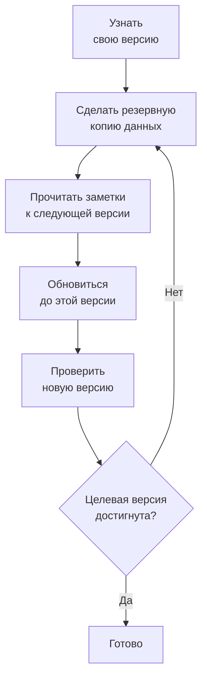

# Обновление

Обновите самостоятельно размещённую установку OneUptime – с Docker Compose или с Kubernetes и Helm – до более новой версии. Следуйте порядку действий ниже и прочитайте заметки к каждой основной версии между той, что у вас работает, и той, на которую вы переходите.

:::cards
- [Как обновиться](#как-обновиться): Порядок действий для Docker Compose и Kubernetes.
- [Заметки к каждой версии](#заметки-к-вашей-версии): Что требует каждая основная версия, коротко.
- [Образы Community Edition и Enterprise Edition](#образы-community-edition-и-enterprise-edition): Какой образ запускать начиная с 14.
- [Обновление OneUptime 13 → 14](#обновление-oneuptime-13-14): Новейшая основная версия.
:::

## Как обновиться

Три правила делают обновление безопасным:

- **Обновляйтесь на одну основную версию за раз** (например, 6 → 7 → 8). Не пропускайте ни одной основной версии.
- **Промежуточные и исправляющие выпуски можно пропускать** (например, 8.1 → 8.4), если вы следуете их заметкам к выпуску.
- **Делайте резервную копию перед каждым обновлением** и проверяйте, что можете её восстановить.



:::steps
### Узнайте свою текущую версию

Как главный администратор откройте метку редакции в заголовке панели администратора: **This installation** показывает версию, которая у вас работает. Экземпляр также сообщает её по адресу `/version`:

```bash
curl http://localhost/version
```

Замените `http://localhost` адресом своего экземпляра. Ответ – JSON вида `{"version":"14.0.22","commit":"..."}`.

### Сделайте резервную копию данных

Сделайте резервную копию PostgreSQL, а также ClickHouse, если вам нужна его телеметрия. Для Docker Compose см. [Резервное копирование и восстановление](/docs/installation/docker-compose#резервное-копирование-и-восстановление). В Kubernetes используйте свои снимки томов или резервные копии CloudNativePG из чарта.

### Прочитайте заметки к следующей основной версии

Они собраны в [таблице ниже](#заметки-к-вашей-версии). Сделайте то, что там требуется, до обновления: некоторые шаги, например переименование значений Helm, нужно выполнить заранее.

### Выполните обновление

:::tabs
@tab Docker Compose
```bash
git checkout release
git pull
npm run update
```
`npm run update` добавляет новые настройки в ваш `config.env`, не меняя ваши собственные, загружает новые образы и перезапускает OneUptime.
@tab Kubernetes
```bash
helm repo update
helm upgrade my-oneuptime oneuptime/oneuptime -f values.yaml
```
Используйте своё имя выпуска и свой файл значений. Чарт выполняет миграции базы данных в отдельном Job до того, как новые поды начнут обслуживать трафик.
:::

### Проверьте новую версию

В Docker Compose `npm run update` завершается сообщением **OneUptime is up!** В Kubernetes дождитесь, пока все поды будут в состоянии `Running` и готовы:

```bash
kubectl get pods -n <namespace>
```

Затем снова проверьте версию, как на первом шаге. Если вы ещё не достигли целевой версии, вернитесь к шагу [Сделайте резервную копию данных](#сделайте-резервную-копию-данных) и переходите к следующей основной версии.
:::

### Заметки к вашей версии

| Обновление | Что нужно сделать |
| --- | --- |
| [13 → 14](#обновление-oneuptime-13-14) | Выбрать редакцию. Установкам Docker Compose, которые задают `IS_ENTERPRISE_EDITION=true`, перейти на `APP_TAG=enterprise-release`. Активировать лицензию в Enterprise Edition. Пересохранить мониторы IPv6 типов Ping, Port и SSL. |
| [12 → 13](#обновление-oneuptime-12-13) | Обычно ничего: Redis заменяется на Valkey, а старые имена настроек продолжают работать. Запускаете Docker Compose вручную? Добавьте `--remove-orphans`. Используете собственный кэш? Прочитайте [Если вы используете собственный кэш](#если-вы-используете-собственный-кэш). |
| [11 → 12](#обновление-oneuptime-11-12) | Заново развернуть Runbook Agents как Runners. В Docker Compose задать `ONEUPTIME_RUNNER_KEY`. В Helm переименовать `aiAgent:` в `runner:`. Заново выдать разрешения Runner, которые API-ключи имели напрямую. |
| [10 → 11](#обновление-oneuptime-10-11) | SCIM и настройки соответствия команд требуют Enterprise Edition. Чтобы сохранить историю телеметрии, переименуйте старые таблицы ClickHouse до обновления. |
| [9 → 10](#обновление-oneuptime-9-10) | Ничего. |
| [8 → 9](#обновление-oneuptime-8-9) | В Helm удалить переопределения `oneuptimeIngress` из своих значений. |
| [7 → 8](#обновление-oneuptime-7-8) | В Helm перейти на новую структуру значений для Postgres, Redis и ClickHouse. Сначала сделать резервную копию. |

## Образы Community Edition и Enterprise Edition

Теперь OneUptime поставляет приложение в виде двух образов. **Community Edition** – открытый код под лицензией Apache 2.0, включающий единый вход SAML и OIDC, глобальный SSO и «Require SSO for login». **Enterprise Edition** добавляет корпоративные модули из каталога `ee/` репозитория: SCIM, соответствие команд, журналы аудита и корпоративные панели Health в панели администратора. До этого изменения обе редакции запускали один и тот же код, а `IS_ENTERPRISE_EDITION` решал, какие функции включены. Теперь это решает образ, и образ Community не содержит каталога `ee/`.

На странице [Редакция Enterprise](/docs/self-hosted/enterprise) есть полное сравнение функций, сведения о лицензии и то, что происходит при смене редакции.

### Что сделать до обновления

- **Community Edition без SCIM:** ничего. Обновляйтесь как обычно.
- **Helm с `image.type: enterprise-edition`:** ничего. Чарт уже загружает образы `enterprise-`, которые теперь содержат корпоративные модули.
- **Docker Compose с `IS_ENTERPRISE_EDITION=true`:** при обновлении перейдите на образ Enterprise, задав `APP_TAG=enterprise-release` (или `enterprise-<version>`) в `config.env`. `APP_TAG=release` – это образ Community, а `IS_ENTERPRISE_EDITION=true` больше ничего не включает. `npm run update` делает это изменение за вас, пока `IS_ENTERPRISE_EDITION=true` (`release` становится `enterprise-release`, зафиксированная `13.0.7` становится `enterprise-13.0.7`), и выводит, что изменил. Теперь приложение **отказывается запускаться**, если `IS_ENTERPRISE_EDITION=true` задан на образе Community, вместо того чтобы молча остановить подготовку учётных записей SCIM и журналирование аудита. Ошибка говорит, что задать: `APP_TAG=enterprise-<version>`, чтобы остаться на Enterprise Edition, или `IS_ENTERPRISE_EDITION=false`, чтобы запускать Community Edition.
- **Образ Community с уже настроенным SCIM:** подготовка учётных записей SCIM останавливается с этим обновлением, включая их отзыв. Чтобы её сохранить, перейдите на образ Enterprise. Иначе до обновления прочитайте [Переход с Enterprise на Community](/docs/self-hosted/enterprise#switching-from-enterprise-to-community). Там объясняется, что останавливается и кого удалить заранее. Чтобы запускать Community Edition, задайте также `IS_ENTERPRISE_EDITION=false`. Единый вход это не затрагивает: образ Community его тоже обслуживает.

Ваша конфигурация никогда не удаляется, и смена редакции ни в одну сторону не требует миграции.

### Лицензирование после обновления

Теперь Enterprise Edition проверяет свою лицензию:

- **Установка с лицензионным ключом** продолжает работать. Она проверяет лицензию у OneUptime при запуске и раз в сутки. Если срок лицензии истекает, всё продолжает работать в течение льготного периода 30 дней, после чего происходит то же, что и с установкой без лицензии.
- **Установка без лицензии**, например та, что запускала Enterprise Edition только с `IS_ENTERPRISE_EDITION=true`, получает пробный период 14 дней с первого запуска этой версии. **Если вы используете SCIM или журналирование аудита, активируйте лицензию до окончания пробного периода.** После пробного периода подготовка учётных записей SCIM останавливается, а журналирование аудита перестаёт записывать. Корпоративная конфигурация также становится доступной только для чтения, а корпоративные панели Health блокируются. Единый вход это не затрагивает. Всё возобновляется, без перезапуска, как только вы активируете лицензию. Пробный период предназначен для оценки: использование Enterprise Edition в продакшене требует подписки OneUptime Enterprise. См. [Когда лицензия истекла или отсутствует](/docs/self-hosted/enterprise#when-a-license-expires-or-is-missing).
- **Изолированные от сети установки** могут активироваться подписанным лицензионным токеном вместо ключа. См. [Активация без подключения к сети](/docs/self-hosted/enterprise#offline-activation-air-gapped-installs).

### Клиенты OneUptime Cloud

Для вас ничего не меняется. OneUptime Cloud работает на Enterprise Edition, и ваш тарифный план по-прежнему определяет, какие функции вы получаете: SSO, OIDC, SCIM и соответствие команд начиная с плана Scale, а журналы аудита – в плане Enterprise. Проекты на плане Scale теперь видят настройки SSO, OIDC, SCIM и соответствия команд, где раньше показывалось предложение перейти на более высокий план.

### Изменения API и конечных точек

- `GET /api/global-config/license` возвращает лицензионный ключ, лицензионный токен, список экземпляров, идентификатор экземпляра и сведения о версии только главным администраторам. Остальные вызывающие получают редакцию и состояние лицензии.
- Самостоятельно размещённые установки больше не обслуживают конечные точки сервера лицензий под `/api/enterprise-license/`. Их использует только oneuptime.com.
- Конечные точки SCIM сохраняют в Enterprise Edition точно те же пути, поэтому конфигурация поставщика удостоверений не меняется. В Community Edition они возвращают `404`. В Enterprise Edition они отклоняют запросы, пока лицензия просрочена (после пробного или льготного периода), и снова отвечают, как только лицензия активирована.
- Конечные точки SSO и OIDC (URL входа и ACS для SAML, URI перенаправления OIDC и конечные точки глобального SSO) сохраняют точно те же пути и обслуживаются обеими редакциями при любом состоянии лицензии.

## Обновление OneUptime 13 → 14

OneUptime 14 разделяет приложение на две редакции, и то, какую вы запускаете, определяет загружаемый образ. **Community Edition** (Apache-2.0, теги `release` и `<version>`) включает SAML SSO, OpenID Connect, глобальный SSO и «Require SSO for login». В ней нет каталога `ee/` репозитория, поэтому подготовки учётных записей SCIM, настроек соответствия команд, журналов аудита, панелей **Health** в панели администратора и **Query Console** в панели администратора в этом образе нет вовсе. **Enterprise Edition** (теги `enterprise-release` и `enterprise-<version>`) их содержит и во время работы проверяет лицензию Enterprise, чего OneUptime 13 никогда не делал. Единый вход от этой лицензии не зависит.

Раздел [Образы Community Edition и Enterprise Edition](#образы-community-edition-и-enterprise-edition) выше – справка по этому изменению: что содержит каждая редакция, что задать для каждого способа развёртывания и что делает лицензия. Этот раздел – само обновление. Обновляйтесь с 13 – если вы ещё на 12, сначала выполните 12 → 13.

Ничего не удаляется ни в одной из редакций. Единый вход работает в обеих одинаково: ваша конфигурация SSO и OIDC и ваши настройки «Require SSO for login» сохраняются как есть. Ваша конфигурация SCIM и уже записанные журналы аудита остаются в базе данных. Community Edition просто их не обслуживает, и смена редакции ни в одну сторону не требует миграции.

### Что нужно сделать

1. **Решите, какую редакцию запускает эта установка.** Если вы используете подготовку учётных записей SCIM, настройки соответствия команд или журналы аудита либо хотите панели **Health** в панели администратора, это Enterprise Edition. Иначе решать нечего: Community Edition – это то, что у вас уже есть, и она включает SAML SSO и OpenID Connect.
2. **В Helm укажите редакцию в своём файле значений:** `image.type: enterprise-edition` (по умолчанию `community-edition`). Не трогайте `image.tag` – чарт сам добавляет префикс `enterprise-`, поэтому `image.tag: release` загружает `oneuptime/app:enterprise-release`. Это значение не новое. Если вы уже используете `enterprise-edition`, менять ничего не нужно: тег, который вы уже загружаете, теперь содержит `ee/`.
3. **В Docker Compose задайте `APP_TAG=enterprise-release`** (или `enterprise-<version>`, чтобы зафиксировать версию) в `config.env`. `APP_TAG=release` – это образ Community. Это единственное, что останавливает установку на 13: на 13 установка Enterprise с Compose была `APP_TAG=release` плюс `IS_ENTERPRISE_EDITION=true`, и теперь эта комбинация **отказывается запускаться** вместо того, чтобы подняться как Community Edition с молча остановленными подготовкой учётных записей SCIM и журналированием аудита. `npm run update` переписывает `APP_TAG` за вас, пока `IS_ENTERPRISE_EDITION=true` (`release` становится `enterprise-release`, зафиксированная `13.0.8` становится `enterprise-13.0.8`), и выводит, что изменил. Если вместо этого вы загружаете образы вручную, сначала задайте `APP_TAG` сами.
4. **В Enterprise Edition активируйте лицензию.** Установка без лицензии получает пробный период 14 дней, отсчитываемый от её первого запуска Enterprise Edition, – при обновлении это день, когда вы обновляетесь, а не день, когда вы впервые установили OneUptime. Главный администратор активирует её через метку редакции в заголовке панели администратора; изолированные от сети установки вместо этого активируются подписанным токеном. См. [Лицензирование](/docs/self-hosted/enterprise#licensing).
5. **Если эта установка будет работать на Community Edition, а ваш поставщик удостоверений отзывает пользователей через SCIM, проверьте, у кого есть доступ, до обновления.** Отзыв учётных записей через SCIM останавливается, поэтому люди, которых вы удаляете в поставщике удостоверений, сохраняют свои учётные записи OneUptime, и, если на них не распространяется «Require SSO for login», любой, у кого ещё есть доступ к почтовому ящику такой учётной записи, может задать пароль через «Забыли пароль» и войти. Сначала удалите этих пользователей: [Переход с Enterprise на Community](/docs/self-hosted/enterprise#switching-from-enterprise-to-community).
6. **Если вы наблюдаете за адресами IPv6 мониторами Ping, Port или SSL, пересохраните эти мониторы после обновления.** Цели, сохранённые до 14, могли быть записаны обрезанными – см. [Мониторы IPv6 типов Ping, Port и SSL](#мониторы-ipv6-типов-ping-port-и-ssl).

### Редакции: что изменилось и что нет

| | До 13 включительно | С 14 |
| --- | --- | --- |
| Корпоративный код | в каждом образе; `IS_ENTERPRISE_EDITION=true` включал его | в `ee/` и только в образах `enterprise-` |
| Переключатель в Helm | `image.type` | `image.type` – не изменился, но образы теперь разные |
| Переключатель в Compose | `IS_ENTERPRISE_EDITION=true` | `APP_TAG=enterprise-release` |
| Лицензия Enterprise | никогда не проверялась во время работы | проверяется при запуске и раз в сутки |
| Конечные точки SSO и OIDC | одни и те же пути в обеих редакциях | одни и те же пути в обеих редакциях, при любом состоянии лицензии |
| Конечные точки SCIM | одни и те же пути в обеих редакциях | те же пути в Enterprise; `404` в Community |
| Ваша корпоративная конфигурация | хранится, применяется | хранится в обоих случаях, применяется в Enterprise |

Выполняется одна миграция: столбец `enterpriseEditionFirstSeenAt`, допускающий пустое значение, в таблице `GlobalConfig`, в которой одна строка, поэтому она мгновенна. Миграции ClickHouse нет, ничего не удаляется, и смена редакции ни в одну сторону не требует миграции.

### Ход лицензии в Enterprise Edition

- **Установка без лицензии** работает в пробном периоде 14 дней, отсчитываемом от первого запуска Enterprise Edition. В пробный период работают все корпоративные функции, а метка редакции предупреждает до его окончания. Пробный период предназначен для оценки: использование Enterprise Edition в продакшене требует подписки на условиях OneUptime Enterprise License.
- **Лицензия, срок которой истекает,** получает льготный период 30 дней с даты окончания, в течение которого работают все корпоративные функции, а метка редакции предупреждает.
- **После пробного периода или после этого льготного периода**, и пока лицензия не активирована: запросы SCIM от вашего поставщика удостоверений отклоняются, а журналирование аудита перестаёт записывать. Корпоративная конфигурация становится доступной только для чтения – вы по-прежнему можете просматривать и удалять её и сбрасывать токен носителя SCIM, а это и нужно во время инцидента, – а панели Health и Query Console в панели администратора блокируются.
- **Ничего не удаляется, и основной мониторинг никогда не затрагивается.** Мониторы, оповещения, инциденты, дежурства, страницы статуса и телеметрия находятся вне лицензии, как и вход в систему: вход через SSO и OIDC, «Require SSO for login» и вход по паролю для любого пользователя, включая главных администраторов, работают одинаково при любом состоянии лицензии. Активация лицензии восстанавливает подготовку учётных записей SCIM и журналирование аудита с той конфигурацией, что у вас уже есть, без перезапуска.
- **Лицензионный ключ, который у вас уже есть, принимается** как лицензия «unverified»: её дата окончания и лимит мест берутся из того, что сервер лицензий уже сообщил этой установке, и она получает тот же льготный период 30 дней после этой даты. Лицензии, выдаваемые с этого момента, подписаны и проверяются самим приложением. Новый ключ для этого обновления не нужен.
- **Ключ, дату окончания которого эта установка так и не записала,** продолжает работать в пробный период, а не останавливается. Сервер лицензий записывает ключ и дату окончания отдельно, поэтому у установки может быть ключ, о дате окончания которого ей так и не сообщили. Такая установка обрабатывается точно так же, как установка без лицензии: все корпоративные функции работают в пробный период 14 дней, отсчитываемый от первого запуска Enterprise Edition, а после пробного периода останавливается то же, что описано выше. Лимит мест не применяется, пока лицензия в этом состоянии, потому что запись о лицензии в установке и так неполная. Главный администратор, повторно активирующий лицензию через метку редакции, или ежедневная синхронизация лицензий, получающая дату окончания с oneuptime.com, восстанавливает её без перезапуска.

Полная таблица состояний – в разделе [Когда лицензия истекла или отсутствует](/docs/self-hosted/enterprise#when-a-license-expires-or-is-missing).

### Docker Compose: выбор тега образа

```bash
git checkout release # Please make sure you're on release branch.
git pull
npm run update
```

- **`npm run update` переводит `APP_TAG`, пока `IS_ENTERPRISE_EDITION=true`**, на образ Enterprise той же версии и выводит, что изменил. Он сохраняет ваши комментарии и кавычки, не трогает `APP_TAG`, который уже является тегом `enterprise-`, и при повторном запуске ничего не меняет.
- **При загрузке образов вручную этот шаг пропускается**, и тогда приложение завершается при запуске с ошибкой, в которой точно сказано, что задать: `APP_TAG=enterprise-<version>`, чтобы остаться на Enterprise Edition, или `IS_ENTERPRISE_EDITION=false`, чтобы запускать Community Edition.
- **Чтобы намеренно перейти на Community Edition**, задайте `APP_TAG=release` и `IS_ENTERPRISE_EDITION=false`. Сначала прочитайте пункт 5 выше, если ваш поставщик удостоверений отзывает пользователей через SCIM.
- Больше ничего в `config.env` для этого выпуска менять не нужно.

### Helm: выбор типа образа

```bash
helm repo update
helm upgrade my-oneuptime oneuptime/oneuptime -f values.yaml
```

- **Установке, которая уже на `image.type: enterprise-edition`, не нужно менять никаких значений.** Чарт давно добавляет префикс к тегу; новое лишь то, что образы `enterprise-` содержат `ee/`. Лицензия применяется к ней начиная с этого выпуска, по описанному выше ходу.
- **`image.tag: release` – значение по умолчанию**, поэтому чарт, оставшийся на плавающем теге, переходит на 14 при следующем обновлении без каких-либо изменений значений. Если в этой установке SCIM настроен на `community-edition`, задайте `image.type: enterprise-edition` в том же обновлении.
- **`IS_ENTERPRISE_EDITION` по-прежнему выставляется чартом**, выводится из `image.type`, чтобы они никогда не расходились. Он ничем не управляет. Принудительное значение `true` через `extraEnv` на образе Community лишь заставит приложение отказаться запускаться. Никогда не задавайте `ONEUPTIME_EDITION` через чарт.
- **Пробы чарта снова учитывают `probes.<key>.allowPrivateNetworkMonitors`** ([#3879](https://github.com/OneUptime/oneuptime/issues/3879)). Ничего не меняется, пока вы его не зададите, – по умолчанию остаётся `false` – и он действует на мониторы всех проектов экземпляра, потому что пробы чарта – глобальные пробы. Loopback, link-local и `169.254.169.254` остаются заблокированными при любом значении.

### Другие изменения в 14

Эти изменения меняют поведение OneUptime после обновления, и большинство из них ничего от вас не требует. Прочитайте их, если вы используете пользовательские роли или API-ключи из отдельных разрешений, собственные состояния инцидентов, оповещений или обслуживания, Terraform или API, SSO либо приложения Slack и Microsoft Teams.

:::details Прочитайте остальные изменения в 14
- **Приём OTLP подтверждает пакет только после того, как очередь его приняла.** 13 сначала отвечал `200`, а ставил в очередь потом, поэтому пакет, отклонённый очередью, молча терялся. 14 вместо этого отвечает `503` с `Telemetry queue unavailable. Please retry.`, а конечная точка gRPC возвращает `UNAVAILABLE`; оба ответа допускают повтор, и экспортёры повторяют. Это касается журналов, метрик, трассировок и профилей. Делать ничего не нужно, но повторы экспортёров и противодавление очереди теперь видны там, где раньше данные пропадали, – это стоит знать, если вы рассчитываете ёмкость приёма.
- **Панели Health и Query Console в панели администратора требуют Enterprise Edition**, вместе с оповещениями о состоянии PostgreSQL и Valkey. В 13 они включались одним `IS_ENTERPRISE_EDITION=true`, так что для установки Community, которая ими пользовалась, это заметная потеря. Мониторинг ёмкости ClickHouse и его очистка, состояние миграций, глобальные пробы и пакет поддержки есть в обеих редакциях.
- **Мониторы HTTPS, которые обращаются к IP-адресу через прокси пробы, снова работают.** Проба отправляла IP-адрес как имя сервера TLS, а это недопустимое имя сервера, которое Node безоговорочно отвергает, поэтому монитор `https://<private IP>` с глобальной пробы с `PROBE_ALLOW_PRIVATE_NETWORK_MONITORS` проваливал рукопожатие. Теперь для цели-IP проба не передаёт имя сервера и проверяет сертификат по самому IP-адресу. Цели по имени хоста не меняются.
- **CLI `oneuptime` сообщает свою настоящую версию** по `--version` вместо заглушки.
- **Новое оповещение или эпизод начинается в состоянии, которое указано при его создании.** API, Terraform (`current_alert_state_id`, `current_incident_state_id`) и рабочие процессы могут указать состояние, в котором начинается оповещение, эпизод оповещений или эпизод инцидентов, как это делает поле **Начальное состояние** в панели управления. Раньше это состояние заменялось состоянием создания проекта; конфигурация Terraform, которая его задавала, получала не то значение, что было запланировано. Создание без указания состояния по-прежнему начинается в состоянии создания, а состояние из другого проекта отклоняется. См. [Состояние, в котором начинается новая запись](/docs/api-reference/api-reference).
- **Запись, созданная уже подтверждённой или устранённой, никого не вызывает.** Инцидент, оповещение или эпизод, созданные в более позднем состоянии – через **Начальное состояние**, начальное состояние шаблона, API, Terraform или рабочий процесс, – больше не запускают свои политики дежурства; вместо этого об этом сообщает их лента. Запись, созданная устранённой, также больше не группируется в эпизод, не исправляется, не расследуется OneUptime AI и не получает канал в Slack или Microsoft Teams, а инцидент, созданный устранённым, не трогает статус и наблюдение своих мониторов и не запускает SLA. Запись, созданная подтверждённой, запускает свой SLA уже как отвеченный. Записи, созданные в состоянии создания, как все записи, которые открывает монитор, не меняются. См. [Объявлен уже подтверждённым или устранённым](/docs/incidents/declaring-incidents#объявлен-уже-подтверждённым-или-устранённым).
- **Состояние после вашего состояния устранения везде считается устранённым.** Инцидент, оповещение или эпизод в состоянии, которое вы поставили после состояния устранения, – например, состояние **Closed** ниже **Устранён** – в одних местах считались устранёнными, а в других открытыми. Теперь все они следуют одному правилу: состояние устранения проекта и любое состояние после него считаются устранёнными. Записи в таком состоянии пропадают из списков **Активные инциденты** и **Активные оповещения** и их счётчиков в боковом меню, из списков инцидентов и оповещений на панелях, из активных эпизодов и из списков открытых записей мобильного приложения; сводки в Slack и Microsoft Teams считают их устранёнными, а хронологии страниц статуса показывают такую строку как устранённую. Монитор или правило скорости сгорания SLO, чей инцидент или оповещение находится в таком состоянии, при следующем срабатывании открывают новый, тогда как раньше считали старый всё ещё открытым. Перевод инцидента сразу в такое состояние устраняет его так же, как **Устранён**, а перевод дальше **Устранён** больше не открывает эпизод повторно и не запускает новый SLA для инцидента. Проекты, у которых все собственные состояния стоят выше состояния устранения, разницы не заметят. См. [Список активных инцидентов](/docs/incidents/states-and-severities#список-активные-инциденты).
- **Состояние после вашего состояния подтверждения везде считается подтверждённым.** Инцидент, оповещение или эпизод в состоянии, которое вы поставили между состояниями подтверждения и устранения, – например, состояние **Investigating** ниже **Подтверждён** – уже останавливали вызовы дежурных, но мобильное приложение и Microsoft Teams всё ещё предлагали для них **Acknowledge**, а подтверждение оповещения или эпизода в этом состоянии (из Teams, Slack или страницы дежурства) возвращало их в **Подтверждён**. Теперь все они следуют одному правилу: состояние подтверждения проекта, любое состояние после него и состояние устранения считаются подтверждёнными. **Acknowledge** больше нигде не предлагается для такой записи, а её подтверждение отклоняется ("... is already acknowledged.") вместо возврата назад; дежурный, подтверждающий собственный вызов по ней, просто завершает вызов. Перевод записи сразу в такое состояние теперь отмечает SLA инцидента как отвеченный – тогда как раньше он оставался без ответа до устранения инцидента, что могло нарушить цель по времени ответа, – и считается её подтверждением во времени до подтверждения в обзоре, в метрике **Time to Acknowledge**, в измерениях и в MTTA сводок Slack и Microsoft Teams. Запись, устранённая без подтверждения, теперь считается подтверждённой в момент устранения, как уже показывал обзор. Фильтры списков **Подтверждён** тоже показывают записи в этих состояниях, а атрибут `isAcknowledgedState` метрики **Time in State** для них равен `true`. Проекты, у которых все собственные состояния стоят выше состояния подтверждения, разницы не заметят. См. [Что делает подтверждение](/docs/incidents/states-and-severities#что-делает-подтверждение).
- **Эпизоды проходят свои состояния по правилу, которому следуют инциденты и оповещения.** Эпизод инцидентов или оповещений можно было вернуть выше по списку состояний – например, устранённый эпизод обратно в **Подтверждён** – из хронологии состояний в панели управления, из Slack, Microsoft Teams, API или Terraform, и этот переход передавался его инцидентам или оповещениям. Теперь переход в состояние, которое по порядку идёт раньше текущего состояния эпизода, отклоняется с той же ошибкой, что получает инцидент ("Episode cannot transition to Acknowledged state from Resolved state because Acknowledged is before Resolved in the order of incident states."), и ничего не меняется. Параметр **Повторно открывать недавно устранённые эпизоды** правила группировки по-прежнему открывает эпизод повторно – как собственный переход OneUptime. Чтобы исправить ошибочно заданное состояние, удалите его строку из хронологии состояний эпизода, как у инцидента; эпизод вернётся в состояние своей последней оставшейся строки, а удаление строки, которая его устранила, очищает время устранения. Эпизод переводит каждый свой инцидент или оповещение только туда, куда пошло бы их собственное состояние: тот, что уже в этом состоянии или дальше, остаётся на месте.
- **Запись текущего состояния записи следует тому же правилу.** Обновление текущего состояния инцидента, оповещения, эпизода или события планового обслуживания через API или Terraform (`currentIncidentStateId`, `currentAlertStateId`, `currentScheduledMaintenanceStateId`) отклоняется до сохранения чего-либо, если оно возвращает запись выше по списку, с той же ошибкой. Раньше запись доходила до записи, а хронология состояний потом её отклоняла, оставляя запись в состоянии, которого в её хронологии никогда не было. Запись состояния эпизода инцидентов теперь заносит его в хронологию состояний эпизода и переводит его инциденты, как уже делала запись состояния эпизода оповещений. План Terraform, задающий более раннее состояние, завершается ошибкой при apply; задавайте состояния по порядку или меняйте состояние строкой хронологии состояний.
- **Change State в Slack и Microsoft Teams предлагает только состояния, в которые запись может перейти дальше.** Запись в последнем достижимом для неё состоянии получает ответ "There is no later state to move this incident to." вместо формы, где любой выбор был бы отклонён. Меню **Change state to** в заголовке панели управления следует тому же правилу.
- **Ошибка для события планового обслуживания, возвращаемого выше по списку, читается так же, как остальные:** "Scheduled Maintenance cannot transition to Scheduled state from Ongoing state because Scheduled is before Ongoing in the order of scheduled maintenance states." (раньше в ней было `ScheduledMaintenance` и `scheduledMaintenance states`). Скрипту, который сравнивал старый текст, нужен новый. См. [Порядок – настоящее ограничение](/docs/incidents/states-and-severities#порядок-это-настоящее-ограничение-а-не-настройка-отображения).
- **Устранение инцидента возвращает только те мониторы, которые он удерживает.** Теперь OneUptime записывает, удерживает ли инцидент статус своих мониторов. Инцидент, который уже был устранён и затем открыт повторно, больше не возвращает свои мониторы в рабочее состояние при повторном устранении, поэтому статус, полученный ими за это время – от своих проб, от обслуживания или заданный вручную, – сохраняется; изменение его мониторов или статуса, в который он их переводит, пока он открыт, заставляет его снова их удерживать. Инциденты, созданные до обновления, возвращают свои мониторы при следующем устранении, как всегда. См. [Что делает устранение](/docs/incidents/states-and-severities#что-делает-устранение).
- **Эпизод инцидента или оповещения задаётся только через участников эпизода.** `incidentEpisodeId` и `alertEpisodeId` (и связи `incidentEpisode` и `alertEpisode`) доступны только для чтения. API, Terraform (`incident_episode_id`, `alert_episode_id`), инструменты MCP и рабочие процессы могли записывать их, не добавляя запись в эпизод: обзор эпизода тогда показывал инцидент или оповещение, которых не было на его странице **Участники**, а запись, созданная с заданным эпизодом, никогда не группировалась. Создание или обновление, передающее одно из этих полей, теперь отклоняется с сообщением, отсылающим к участникам эпизода: добавьте запись через `POST /api/incident-episode-member` (или `/api/alert-episode-member`) и удалите этого участника, чтобы её убрать, а ссылка на эпизод последует за этим. Чтение не меняется. Конфигурация Terraform, задающая `incident_episode_id` или `alert_episode_id`, должна убрать его, как только вы обновите провайдер, который теперь только читает эти поля; членством управляют ресурсы `oneuptime_incident_episode_member` и `oneuptime_alert_episode_member`. См. [Эпизод, в котором находится инцидент или оповещение](/docs/api-reference/api-reference).
- **Новые правила эскалации входящих вызовов звонят 20 секунд, а не 30.** Многие телефоны отправляют неотвеченный вызов на голосовую почту в течение 30 секунд, а ответившая голосовая почта завершает вызов на этом, вместо того чтобы передать его следующему правилу. Поле **Длительность вызова (в секундах)** в панели управления, API (`escalateAfterSeconds`) и провайдер Terraform (`escalate_after_seconds`) теперь начинают новое правило с 20. Существующие правила сохраняют свою длительность вызова: обновление меняет только значение столбца по умолчанию. Конфигурация Terraform без `escalate_after_seconds` запланирует `30 -> 20` для управляемых ею правил, как только вы обновите провайдер; задайте `escalate_after_seconds = 30`, чтобы сохранить 30. См. [Политика входящих вызовов](/docs/on-call/incoming-call-policy).
- **Сводки в Slack и Microsoft Teams сохраняют своё время суток при переводе часов.** Теперь у сводки есть часовой пояс, и её расписание читается по этим часам. До сих пор оно читалось в UTC, поэтому сводка, назначенная на 09:00 в Берлине, приходила туда в 08:00, когда возвращалось зимнее время. Обновление даёт каждой существующей сводке часовой пояс из профиля её создателя – те часы, по которым её показывала панель управления, – или UTC, если у неё нет создателя с часовым поясом (её создал API-ключ), то есть то, в чём она читалась до сих пор. Ни одна следующая отправка во время обновления не сдвигается; с её следующей отправки сводка, сдвинувшаяся на час, возвращается ко времени суток своей первой сводки, а ежемесячная сводка с 29-го по 31-е число больше не съезжает на 28-е. API и Terraform (`timezone`) принимают имя часового пояса IANA; сводка, созданная без него, получает часовой пояс из профиля создателя или UTC, если её создаёт API-ключ, а имя, не являющееся часовым поясом, отклоняется. См. [Сводки](/docs/workspace-connections/slack#сводки).
- **Запись «обновлено» в ленте инцидента или оповещения фиксирует только то, что изменилось.** Сохранение карточки **Сведения об инциденте** после изменения одного лишь заголовка или клиент API, рабочий процесс или скрипт, которые записывали инцидент или оповещение обратно без изменений, добавляли запись, повторявшую заголовок, описание, первопричину, заметки об исправлении и метки, которые у него были, – она публиковалась также в каналах инцидента или оповещения в Slack и Microsoft Teams, – а каждая запись с метками или переключателем **Отправлять напоминания** перезапускала интервал напоминаний, даже когда ничего не менялось, поэтому часто редактируемый инцидент всё откладывал свои напоминания. Теперь каждая строка пишется для изменившегося значения, а при сохранении, которое ничего не изменило, не пишется ничего; правило напоминаний применяется заново, и интервал перезапускается, только когда меняются серьёзность или метки либо переключается **Отправлять напоминания**. Текст, который читается так же, считается тем же (без учёта переводов строк и пробелов вокруг), а метки – тем же набором в любом порядке. Оповещения теперь также фиксируют изменённую на их странице первопричину, которую раньше теряли, если вместе с ней не менялся заголовок, а также очищенные описание, первопричину или заметки об исправлении. Удаление всех меток фиксируется как "All labels removed.". См. [Что фиксирует лента](/docs/incidents/notes-owners-and-feed#что-записывает-лента).
- **Запись «обновлено» в ленте события планового обслуживания или монитора тоже фиксирует только то, что изменилось.** Сохранение карточки события **Maintenance Details** или **Затронутые ресурсы** либо сведений монитора без каких-либо изменений или клиент API, рабочий процесс, Terraform или скрипт, которые записывали событие или монитор обратно без изменений, добавляли запись, повторявшую заголовок (имя монитора), окно, описание, напоминания, страницы статуса, затронутые ресурсы и метки, которые у него были, – она публиковалась также в его каналах Slack и Microsoft Teams, – а каждая запись с метками события или его переключателем **Отправлять напоминания** перезапускала интервал его напоминаний. Теперь каждая строка пишется для изменившегося значения, а при сохранении, которое ничего не изменило, не пишется ничего; правило напоминаний события применяется заново, только когда меняются его метки или переключается **Отправлять напоминания**. Время считается тем же, если обозначает тот же момент, как бы оно ни было записано, а напоминания, страницы статуса, затронутые ресурсы и метки – тем же набором в любом порядке. Очистка описания, напоминаний, страниц статуса или меток события либо описания или меток монитора теперь фиксируется, а имя, описание и имена меток монитора показываются так, как были введены, а не читаются как Markdown. Событие, переведённое из **Запланировано** сразу в собственное состояние между **Продолжается** и **Закончено**, теперь начинается так же, как в **Продолжается**: его мониторы переходят в статус из его поля **Изменить статус монитора на**, тогда как до сих пор оставались как были. См. [События планового обслуживания](/docs/status-pages/subscribers).
- **Событие обслуживания в собственном состоянии до «Продолжается» начинается в своё время и показывается как предстоящее.** Событие планового обслуживания, переведённое из **Запланировано** в собственное состояние выше **Продолжается** – например, этап "Confirmed", – никогда не запускалось в момент **Начинается**: его мониторы не переводились в обслуживание, а его владельцы и подписчики не получали уведомлений, пока кто-нибудь не переводил его вручную. Оно также пропадало из предстоящих событий своих страниц статуса и их лент RSS и Atom, из планового обслуживания в приложении Microsoft Teams, а напоминания его подписчикам перед событием отбрасывались. Теперь оно начинается в своё время, как событие, оставленное в **Запланировано**, а до тех пор показывается и напоминается как предстоящее. Событие в таком состоянии, начало которого уже прошло, запускается в течение минуты после обновления – и завершается минутой позже, если его **Заканчивается** тоже прошло, – с уведомлением владельцев и подписчиков, как при любом начале и окончании; поэтому до обновления продвиньте дальше или удалите каждое такое отставшее событие. Собственное состояние до **Запланировано** – черновик или этап утверждения – по-прежнему остаётся за человеком, как и раньше. Вместе с этим приходят четыре небольших изменения. Каждая смена состояния события сразу пересчитывает статус сетевых площадок, которые оно охватывает, даже когда событие возвращается назад, потому что запись его текущего состояния удалена из его **Хронология состояний**, тогда как до сих пор шаг назад ждал пятиминутного сканирования. Событие завершено в **Завершено** и в любом собственном состоянии после него – "Archived": напоминания его владельцам больше не перепланируются для него после изменения правила напоминаний, Microsoft Teams считает его закрытым, когда ищет реакции, чтобы превратить их в заметки, а его лента и хронология страницы статуса отмечают его как завершённое. Карточка события **Измерения** считает событие в собственном состоянии после **Закончено** законченным, как и его заголовок, а «вход в состояние окончания» и «вход в состояние завершения» – это переходы в состояние, в котором событие закончено или завершено, поэтому событие, завершённое сразу из **Продолжается**, фиксирует там своё окончание. А состояние, несущее больше одного из четырёх встроенных флагов, теперь читается одинаково в заголовке события и на сервере. Проекты без собственных состояний увидят только изменения для сетевых площадок и измерений. См. [События планового обслуживания](/docs/status-pages/subscribers).
- **Событие обслуживания в собственном состоянии после «Продолжается» везде считается продолжающимся.** Событие планового обслуживания, переведённое из **Продолжается** в собственное состояние выше **Закончено** – например, этап "Verifying", – держало свои мониторы в обслуживании, но больше ничто не считало его продолжающимся: обзор его страниц статуса полностью его опускал, охватываемые им сетевые площадки и ряды телеметрии больше не заглушались, оповещения о скорости сгорания SLO по его мониторам срабатывали, списки **Продолжается** в разделах **Плановое обслуживание** и **Главная**, их значки в меню и плитка **Текущее обслуживание** его опускали, приложение Microsoft Teams его не показывало, и ничто не завершало его в момент **Заканчивается**: оно оставалось в этом состоянии, с мониторами в обслуживании, пока кто-нибудь его не переводил. Теперь все они следуют одному правилу: событие продолжается в состоянии «продолжается» и в любом собственном состоянии между **Продолжается** и **Закончено**. Такое событие завершается в момент **Заканчивается**, как продолжающееся, и уведомляет подписчиков, если включено **Когда событие заканчивается**, поэтому событие, оставшееся в "Verifying" после своего окончания, завершается в течение минуты после обновления. Собственное состояние после **Закончено** – "Reviewing" – законченное: перевод события туда из **Продолжается** или из "Verifying" теперь завершает его так же, как **Закончено**, тогда как до сих пор его мониторы навсегда оставались в обслуживании, а заголовок события больше не предлагает для него **Отметить как «Закончено»**. Состояние до **Продолжается** по-прежнему ждёт начала. Ручной перевод события в собственное состояние, которое его начинает или завершает, запускает **Уведомить подписчиков страницы статуса** так же, как **Отметить как «Продолжается»** или **Отметить как «Закончено»**. Страница запланированных событий страницы статуса и её ленты RSS и Atom также показывают продолжающееся событие, начавшееся до окна истории страницы. Проекты, у которых все собственные состояния стоят до **Продолжается**, разницы не заметят. Вместе с этим приходят три небольших исправления: перенос **Начинается** события переносит вместе с ним его первое напоминание, если правило напоминаний ждёт начала; удаление его последнего затронутого ресурса, кроме мониторов, фиксируется в его ленте как "No other affected resources."; а **Начинается** или **Заканчивается**, записанные без часового пояса, сравниваются как UTC, как они и хранятся, поэтому сервер, работающий не в UTC, больше не фиксирует перенос, которого не было. См. [События планового обслуживания](/docs/status-pages/subscribers).
- **Повторное сохранение секрета без изменений ничего не меняет.** Секрет монитора, переменная рабочего процесса, секрет или учётные данные сценария, API-ключ провайдера LLM, клиентский секрет OIDC и другие значения, которые OneUptime хранит в зашифрованном виде, шифруются заново при каждом сохранении, поэтому сохранение, возвращавшее одно из них без изменений, выглядело как изменение: оно запускало рабочие процессы **On Update** записи, отправляло запись в открытые панели и добавляло запись в журнал аудита. Значение, записанное обратно без изменений, теперь считается неизменённым; новое значение по-прежнему делает все три вещи и остаётся храниться в зашифрованном виде.
- **В OneUptime Cloud API-ключи перестают работать ниже своего тарифного плана, а SCIM только удаляет людей.** API-ключам проекта нужен **Growth**, а его подключениям SCIM – проекта и его страниц статуса – нужен **Scale**. До сих пор они продолжали работать после окончания пробного периода или перехода проекта на более низкий план. Теперь каждый запрос с одним из API-ключей проекта – REST API, Terraform, CLI, клиенты MCP, подключённые с API-ключом, – отклоняется с `402` и сообщением, называющим план, а каждый запрос SCIM, который добавил бы или изменил людей или группы, отклоняется с `402` в формате ошибок SCIM. SCIM по-прежнему деактивирует, удаляет и исключает людей на любом плане, поэтому уходящие всё равно теряют доступ. Ничего не удаляется: они снова полностью работают в прежнем виде, как только проект возвращается на план, в течение минуты. Владельцы проекта получают письмо, когда смена плана их останавливает, а владельцы проектов, которые уже были ниже этих планов, получают после этого обновления одно письмо о том, что остановилось и как это снова включить. **Настройки проекта** > **Биллинг** показывает, сколько из них более низкий план останавливает или ограничивает. Люди, которые входят в систему, клиенты MCP, подключённые через вход, ключи приёма телеметрии, ключи проб и ключи агентов не затрагиваются, а самостоятельно размещённые установки (без планов) разницы не заметят. См. [API-ключи и SCIM ниже своего плана](/docs/api-reference/api-reference).
- **Переключатель, записанный как текст, – это переключатель, который сохраняется, а сохранение, которое ничего не меняет, ничего не запускает.** API, Terraform и рабочие процессы могут передавать поле «вкл/выкл» как текст или как число: `"true"`, `"yes"`, `"on"`, `"1"` или `1` для «вкл», `"false"`, `"no"`, `"off"`, `"0"` или `0` для «выкл». База данных всегда хранила их как «вкл» или «выкл», но сам OneUptime читал текст: событие планового обслуживания, переданное с `"isVisibleOnStatusPage": "true"`, появлялось на своей странице статуса с оставшимися закрытыми изображениями, поэтому они там не загружались, а монитор, переданный с `"isArchived": "false"`, оставался неархивированным, но помечался тем, кто и когда его архивировал. Теперь каждое из этих значений – это то «вкл» или «выкл», которое хранит база данных, везде, где OneUptime его читает. Значение, которое база данных хранить не может, например `"maybe"`, `""` или `2`, отклоняется с `400` и сообщением, называющим поле (`isEnabled must be true or false.`), а не ошибкой сервера; это касается и `""` для параметров оповещения и инцидента в правиле скорости сгорания SLO, которое раньше читалось как их значение по умолчанию. Запись объекта обратно с уже имеющимися значениями – выключенный переключатель, переданный как выключенный, счётчик 0 как 0, те же метки в другом порядке – больше не запускает его рабочие процессы **On Update**, не отправляет обновление в реальном времени и не добавляет запись в журнал аудита, а запись о настоящем изменении перечисляет только изменённые поля. **Listen on** рабочего процесса теперь слышит только поля, которые меняет обновление, и слышит каждое их изменение: процесс, слушающий переключатель, запускается и тогда, когда переключатель выключают, что раньше он пропускал. См. [Переключатели](/docs/api-reference/api-reference).
- **Runners переехали из настроек проекта в сборники инструкций.** Runners теперь находятся в **Сборники инструкций → Агенты runbook-ов** (`…/runbooks/runners`), а учётные данные Runner – в **Сборники инструкций → Агенты runbook-ов → Учётные данные** (`…/runbooks/runner-credentials`), рядом со сценариями, шаги которых они выполняют. Старые URL `…/settings/runners` и `…/settings/runner-credentials` перенаправляют, поэтому закладки продолжают работать. Больше ничего не меняется: Runners сохраняют свои идентификаторы, ключи, возможности и разрешения и по-прежнему выполняют ИИ-исправления кода и ИИ-команды устранения. Образ Runner старше этого выпуска всё ещё пишет "Project Settings > Runners" в своих сообщениях журнала; читайте это как Сборники инструкций → Агенты runbook-ов.
- **Обновления в реальном времени заканчиваются вместе со входом, который их открыл, и требуют того же, что и любой запрос.** Обновления в реальном времени открытой страницы – счётчики в заголовке, живые журналы, ИИ-чат – теперь останавливаются, когда заканчивается её вход: при выходе, смене пароля, блокировке или истечении 15-минутного токена доступа. За минуту до истечения токена страница продлевает свой вход и сама переподключается, поэтому её обновления в реальном времени продолжаются; вход, который нельзя продлить, отправляет человека на страницу входа, как и раньше. Проект, требующий SSO, или экземпляр, который его требует, дают обновления в реальном времени только страницам со входом через SSO и отправляют страницу без такого входа войти через SSO, как уже делали её запросы, – включая страницы, уже открытые в момент включения требования. Изменение чьих-то разрешений, блокировка или потеря роли главного администратора сразу доходит до его открытых страниц на каждом сервере приложений, а не только на том, где было сделано изменение: каждый сервер приложений держит одно дополнительное подключение к Valkey, подписанное на канал `oneuptime:realtime:access-changes`. Когда этот канал недоступен, сервер догоняет разрешения в течение 30 секунд, блокировку – в течение минуты, а сессию или только что потребованный вход через SSO – в пределах 15 минут токена доступа. См. [Пользователи, команды и разрешения](/docs/permissions/index).
- **Выключение поставщика SSO проекта или его удаление завершает выданные им входы.** Там, где требуется SSO, люди, вошедшие через поставщика SAML или OIDC, которого выключили или удалили, должны снова войти через SSO при следующем запросе, их открытые страницы перестают получать обновления в реальном времени, а клиенты MCP, подключённые ими с этим входом, нужно подключить заново. Повторное включение поставщика не возвращает эти входы, а поставщик, выключенный уже на момент обновления, считается выключенным при обновлении. Новый сертификат или клиентский секрет оставляет всех в системе. Пока проект требует SSO, его последнего поставщика и требуемого им поставщика нельзя выключить или удалить, пока не выключено "Require SSO for Login"; когда SSO требует весь сервер, последнего поставщика проекта нельзя выключить или удалить, пока не включён другой. См. [SSO](/docs/identity/sso#выключение-или-удаление-поставщика).
- **Глобальные поставщики SSO и поставщики страниц статуса завершают свои входы так же, а включение "Require SSO for Login" требует поставщика.** Выключение глобального поставщика SAML или OIDC или его удаление завершает выданные им входы, как и у поставщика проекта, а повторное включение их не возвращает; глобальный поставщик, выключенный уже на момент обновления, считается выключенным при обновлении. Изменение глобального поставщика или связанных с ним проектов, которое оставило бы проект, требующий SSO, – сам по себе или потому что этого требует весь сервер, – без поставщика для входа, отклоняется с перечнем проектов. Включение "Require SSO for Login" для проекта или для всего сервера отклоняется, пока ни один поставщик не стал бы впускать туда людей; сообщение говорит, что настроить сначала. Выключение поставщика SSO или OIDC страницы статуса или его удаление выводит из системы закрытых пользователей, которых он впустил, а страница статуса, требующая SSO, больше не держит открытыми сеансы, начатые с паролем. Закрытые пользователи, которых когда-либо впускал только SSO, после обновления входят ещё один раз. См. [Глобальный SSO](/docs/identity/global-sso#выключение-или-удаление-поставщика) и [Страницы статуса](/docs/status-pages/index).
- **Создание проекта тоже следует правилам SSO, а изменения, позволяющие людям входить, сразу доходят до каждого сервера приложений.** Пока весь сервер требует SSO для входа, создание проекта требует включённого глобального поставщика SSO, который впускает людей во все проекты, поскольку у нового проекта ещё нет собственного поставщика; без него создание проекта отклоняется, а сообщение просит администратора сервера включить такого поставщика. Главные администраторы по-прежнему могут создавать проекты. Проект, созданный с уже включённым "Require SSO for Login", требует того же. Включение поставщика или связи глобального поставщика, снятие ограничения глобального поставщика его связанными проектами и выключение "Require SSO for Login" для проекта или для всего сервера теперь сразу доходят до каждого сервера приложений, как уже доходили изменения, завершающие входы, а не тогда, когда минутой позже истекает кэшированный ответ другого сервера. Только если два изменения одной и той же настройки сохраняются ровно в один момент, серверу приложений всё ещё может понадобиться до минуты, чтобы догнать. См. [SSO](/docs/identity/sso#обязательный-sso-для-проекта) и [Глобальный SSO](/docs/identity/global-sso#обязательный-sso).
- **Повторное сохранение включённого "Require SSO for Login" проверяется так же, как его включение.** Сохранение, передающее включённое "Require SSO for Login" – для проекта или для всего сервера – или указывающее требуемого поставщика проекта, теперь проверяется и тогда, когда у настройки уже это значение, как это делают API, Terraform и другие инструменты, передающие каждую настройку при каждом сохранении. Пока ни один поставщик не стал бы впускать туда людей или требуемый поставщик проекта выключен, такое сохранение отклоняется с тем же сообщением, что даёт включение, что бы ещё ни менялось: сначала включите поставщика или выключите настройку. Её выключение и очистка требуемого поставщика никогда не отклоняются. См. [SSO](/docs/identity/sso#обязательный-sso-для-проекта).
- **Запись, которую вам нельзя читать, больше нельзя изменить или удалить, а изменение по ID, которое ничего не достигает, сообщает об этом.** Изменение или удаление – из панели управления, API, Terraform, инструментов MCP или рабочего процесса – теперь достигает только записей, которые вызывающему можно читать, а запись, читаемая через другую, – только через запись, которую вызывающему можно читать. Роли, которые поставляет OneUptime, работают как раньше: каждая роль, которой можно изменять или удалять какой-то тип записей, может его читать, роли оповещений по-прежнему видят, с какими инцидентами связаны их оповещения, роли телеметрии по-прежнему читают правила конвейеров метрик и карты исходного кода, и все по-прежнему читают журнал отправленных им уведомлений. Изменения касаются пользовательских ролей и API-ключей из отдельных разрешений:
  - Разрешению изменять или удалять тип записей нужно разрешение на его чтение: `EditProjectIncident` без разрешения читать инциденты не изменяет ни одного инцидента. Роль, чтение которой ограничено некоторыми метками или некоторыми владельцами, изменяет и удаляет только эти записи, какими бы широкими ни были её разрешения на изменение или удаление, а блокировка чтения отнимает и изменение, и удаление.
  - Записи, читаемой через другую, – заметкам инцидента или оповещения, объявлениям и доменам страницы статуса, правилам эскалации политики дежурства и тому подобному – нужно разрешение читать эту другую запись: `ReadIncidentInternalNote` без разрешения читать инциденты теперь не достигает ни одной заметки, тогда как раньше достигал заметок любого инцидента. Блокировка с метками на чтение инцидентов исключает заметки инцидентов с этими метками.
  - Изменение или удаление записи по её ID (`PUT` или `DELETE /api/<resource>/<id>` и маршруты `update-item` и `delete-item`) отвечает `404`, когда записи нет или вызывающему нельзя её читать, и `422`, когда вызывающему можно её читать, но нельзя изменять. Удаление раньше отвечало `200`, ничего не удаляя, а обновление – `422` в обоих случаях. Terraform воспринимает `404` при destroy как уже удалённое.

  Давайте пользовательской роли или API-ключу разрешение на чтение рядом с каждым разрешением на изменение или удаление, а разрешение на чтение родителя – рядом с разрешением на заметку или объявление. API-ключ с Project Admin теперь также читает поставщиков SSO и OIDC проекта, которых уже мог изменять. См. [Изменение или удаление записи, которую вам нельзя читать](/docs/api-reference/api-reference) и [Пользователи, команды и разрешения](/docs/permissions/index).
- **Запись, читаемая через другую, создаётся только под записью, которую её создателю можно читать.** Заметки, хронология состояний и лента инцидента, оповещения, эпизода или события планового обслуживания, объявления, домены, группы и владельцы страницы статуса, правила эскалации политики дежурства и другие записи, читаемые через другую, создаются – из панели управления, API, Terraform или инструментов MCP – только под той, которую вызывающему можно читать, по правилу, которому следует его чтение: метки или владельцы, которых достигает разрешение вызывающего на чтение, за вычетом того, что отнимает блокировка с метками на его чтение. Запись, которую вызывающему нельзя читать, отклоняется так, будто её нет, с `400`, называющим поле и ID, и ничего не записывается. Закрытый инцидент, оповещение или эпизод принимают их только от своих владельцев, напрямую или через команду, и от владельцев и администраторов проекта. Объявление создаётся только на страницах статуса, которые вызывающему можно читать, на каждой из них, а вызывающий, чьё разрешение читать страницы статуса достигает лишь некоторых из них, указывает хотя бы одну. Роли, которые поставляет OneUptime, работают как раньше, как и пользовательская роль или API-ключ, читающие во всём проекте записи, под которыми создают. Изменения касаются ролей из отдельных разрешений: `CreateIncidentInternalNote` без разрешения читать инциденты теперь не создаёт ни одной заметки, тогда как раньше мог добавить её к любому инциденту, а с `ReadProjectIncident`, ограниченным некоторыми метками или областью **В собственности**, добавляет заметки только к этим инцидентам. Хронология статусов монитора следует тому же правилу: инцидент, который кто-то объявляет или изменяет, меняет статус мониторов, которые этому человеку можно читать, а остальные оставляет как есть. Давайте пользовательской роли или API-ключу разрешение на чтение записи, под которой они создают, рядом с каждым из этих разрешений на создание. См. [Записи, которые указывает запрос](/docs/api-reference/api-reference) и [Пользователи, команды и разрешения](/docs/permissions/index).
- **Запись, которую перемещают под другую или которой добавляют записи в список, получает только записи, которые может читать тот, кто её изменяет, а разрешение на создание, ограниченное метками или областью «В собственности», распространяется и на создаваемую запись.** Изменение, перемещающее запись, читаемую через другую, – объявление, размещаемое на большем числе страниц статуса, правило, переносимое в другую службу, – следует правилу, которому следует создание: каждая запись, которую оно добавляет как родителя, должна быть той, которую вызывающему можно читать, иначе изменение отклоняется с `400`, называющим поле и ID, и ничего не записывается. Записи, которые перечисляет создание или изменение, – мониторы инцидента, службы оповещения, страницы статуса события планового обслуживания – ограничиваются разрешением вызывающего читать такой тип записей, если оно у него есть, и в любом случае блокировкой с метками на его чтение. То, что изменение оставляет на месте – как родителя или в списке, – повторно не проверяется. Разрешение на создание, ограниченное метками, создаёт только записи с одной из своих меток – для записи без собственных меток: записи под той, у которой такая метка есть, – если только другое разрешение на создание такого типа записей не достигает всего проекта, а блокировка с метками на разрешение на создание отклоняет запись с одной из своих меток; оба случая отклоняются с `422`, называющим метки. Разрешение на создание с областью **В собственности** создаёт монитор, страницу статуса или другую запись с собственными владельцами только для человека, который становится её владельцем, а заметку – только у инцидента, которым владеет этот человек или одна из его команд. Роли и API-ключи, чьи разрешения достигают всего проекта, работают как раньше; давайте роли, ограниченной метками, одну из этих меток на каждой создаваемой ею записи. Владельцы, выбранные при создании монитора, инцидента, оповещения, события планового обслуживания, страницы статуса или шаблона, и первое правило эскалации, выбранное при создании политики дежурства, добавляются от имени их создателя, даже если его чтение не достигает новой записи. Выбор, которого не достигает его разрешение на добавление, – например, ограниченное метками, которых у новой записи нет, – приводит к отклонению создания, и ничего не сохраняется. См. [Записи, которые указывает запрос](/docs/api-reference/api-reference) и [Пользователи, команды и разрешения](/docs/permissions/index).
- **Одна запись, которую указывает операция записи, и изменение меток записи тоже ограничены разрешениями вызывающего.** Одна запись, которую создание или изменение указывает в собственном поле, – монитор оповещения, монитор, который показывает ресурс страницы статуса, служба бюджета затрат, инцидент, с которым связан запуск сценария, – следует правилу, которому следуют записи, перечисляемые операцией записи, под любым из двух своих имён: запись вне разрешения вызывающего читать такой тип записей или с меткой, которую отнимает блокировка на её чтение, отклоняется с `400`, называющим поле и ID, и ничего не записывается. Изменение проверяет это, только когда указывает другую запись. Глобальные пробы и ИИ-агенты OneUptime остаются открытыми для всех проектов. Записи, которые служба заполняет за своего вызывающего, – мониторы, страницы статуса и политики дежурства, которые шаблон инцидента добавляет к объявленному по нему инциденту, – проверяются так же, до сохранения чего-либо и до того, как инцидент получит свой номер. Изменение меток записи удерживает её в пределах разрешения вызывающего на её изменение: если это разрешение ограничено метками, запись сохраняет одну из них, а блокировка с метками на её изменение не позволяет дать ей одну из своих меток; оба случая отклоняются с `422`, называющим метки. Создатель, чьё разрешение на создание достигает только того, чем он владеет, становится владельцем сразу после сохранения, до того как с записью произойдёт что-либо ещё, а если это не удаётся, запись снова удаляется, а создание отклоняется с `500`. Владельцы мониторов, инцидентов, оповещений, событий планового обслуживания и их шаблонов теперь читаются через запись, которой они владеют, как владельцы страницы статуса и службы. Роли и API-ключи, чьи разрешения достигают всего проекта, работают как раньше; давайте пользовательской роли или API-ключу, ограниченным метками, чтение записей, которые они указывают. См. [Записи, которые указывает запрос](/docs/api-reference/api-reference) и [Пользователи, команды и разрешения](/docs/permissions/index).
- **То, чего достигают подписка, Run Now правила, список провайдеров LLM и утверждение плана ИИ-команд, остаётся в пределах того, что им позволено.**
  - Подписка на страницу статуса указывает только ресурсы своей страницы статуса. Регистрация или изменение на странице статуса указывает только ресурсы, которые показывает страница, то есть не ресурс с архивированным монитором, а создание или изменение командой, API-ключом или рабочим процессом указывает только ресурсы страницы подписчика; любой другой ресурс отклоняется с `400`, называющим поле и ID, как и несуществующий. Изменение спрашивает только о ресурсах, которые оно добавляет, поэтому подписка сохраняет то, что уже указывает. Подписка, сохранённая до этого изменения и указывающая ресурс другой страницы, остаётся как есть: она узнаёт о событиях только через ресурсы своей страницы, как и всегда.
  - **Run Now** для правил назначения площадок, меток устройств и автоимпорта сети требует разрешений, достигающих всего проекта, как и **Run Now** любого другого правила: редактирование правила и `EditNetworkDevice` – или, для правила автоимпорта, `CreateNetworkDevice`, а также `CreateProjectMonitor`, если у правила есть шаблон монитора. Разрешение, ограниченное метками или ресурсами в собственности, отклоняется с `422`, как и блокировка команды с метками на ресурсы, которые меняет запуск, для **Run Now** любого правила: запуск изменил бы и ресурсы с этими метками. Давайте роли или API-ключу, которые запускают правила, эти разрешения с областью на все ресурсы проекта.
  - Провайдеров LLM читают только участники проекта, которым можно читать его настройки (`ProjectOwner`, `ProjectAdmin`, `ProjectMember`, `Viewer`, `SettingsAdmin`, `SettingsMember`, `SettingsViewer` и `ReadProjectLlm`); запрос без входа получает `401`. Список глобальных провайдеров LLM на странице **Настройки проекта → ИИ → Провайдеры LLM** показывает их имя, описание и цену любому, кто вошёл в систему.
  - Утверждение плана ИИ-команд с командой SSH требует разрешения читать учётные данные сценариев (`ReadRunbookCredential`, либо `ProjectOwner` или `ProjectAdmin`), как и указание учётных данных в шаге сценария; без него утверждение отклоняется с `422`, и ничего не выполняется. Сохранение правила автоисправления, позволяющего OneUptime AI выполнять свои команды без вопросов, – OneUptime AI, составляющий команды, **Исправлять, не спрашивая** и список разрешённых команд – требует того же разрешения, когда сохранение это включает (включая включение такого правила) или добавляет шаблоны в список разрешённых команд либо Runners. Правила, уже работающие так, продолжают работать, а их сужение или отключение этого больше ничего не требует. Включение **Выполняет ИИ-команды устранения** для Runner с учётными данными SSH требует того же разрешения; Runner, который их уже выполняет, продолжает это делать. `ProjectMember` и роли сценариев утверждают такие планы, как только `ReadRunbookCredential` добавлено их команде.
  См. [Как дать подписчикам выбирать ресурсы и типы событий](/docs/status-pages/subscribers), [Запуск правил на существующих ресурсах](/docs/configuration/run-rules-now#перед-началом-работы) и [Пользователи, команды и разрешения](/docs/permissions/index).
- **Владельцев ресурса и настройку с учётными данными указывает только тот, кому можно их читать.** Владельцы любого ресурса – политик и расписаний дежурства, групп мониторов, панелей, политик входящих вызовов, рабочих процессов, сценариев, проб, хостов и кластеров, SLO и всего остального – теперь перечисляются, читаются, добавляются и удаляются через ресурс, которым владеют, как владельцы монитора, страницы статуса и службы: роль или API-ключ, ограниченные метками, достигают владельцев ресурсов со своими метками, блокировка с метками на чтение ресурса исключает его владельцев, а разрешение только на владельцев не достигает никого. Владельцы политик входящих вызовов теперь следуют собственным ролям политики (`SettingsAdmin`, `SettingsMember`, `SettingsViewer`) вместо ролей дежурства. Создание или изменение, указывающее сервер SMTP, провайдера звонков и SMS, учётные данные сценария, учётные данные SNMP, подключение видеозвонков или API-ключ – сервер SMTP или провайдера звонков и SMS страницы статуса, провайдера политики входящих вызовов, учётные данные, которые кластер Kubernetes даёт OneUptime AI, учётные данные SNMP сетевого устройства или площадки, подключение видеозвонка, ключ разрешения API-ключа, учётные данные шагов SSH и Kubernetes сценария, – требует разрешения читать такой тип настроек, иначе отклоняется с `400`, называющим поле и ID; изменение, сохраняющее настройку, которую запись уже указывает, не проверяется. Роль, которая редактирует страницы статуса, но не может читать серверы SMTP или провайдеров звонков и SMS проекта, например `StatusPageAdmin`, больше не выбирает их для страницы статуса; автору сценариев нужно `ReadRunbookCredential`, чтобы указать учётные данные в шаге. Поиск номеров для покупки и перечисление номеров, которыми владеет провайдер звонков и SMS, требуют того же чтения указанного провайдера. Где был куплен проект – его реселлер, тарифный план реселлера и его лицензия – задаёт только OneUptime: создание проекта, передающее `resellerId`, `resellerPlanId`, `resellerLicenseId` или их связи, отклоняется с `400`, называющим поле, как уже отклонялось их изменение. См. [Записи, которые указывает запрос](/docs/api-reference/api-reference) и [Пользователи, команды и разрешения](/docs/permissions/index).
- **Каждое предоставление и каждая область сужают то, чего достигают, а чтение по ID записи, которую вам нельзя читать, отвечает `404`.** То же правило теперь действует там, куда оно ещё не доходило:
  - Чтение одной записи по её ID (`POST /api/<resource>/<id>/get-item`) отвечает `404`, когда записи нет, она находится в другом проекте или вызывающему нельзя её читать, – один и тот же ответ в каждом случае, как уже отвечают изменение или удаление по ID. Раньше оно отвечало `200` с пустым телом. Панель управления показывает такую запись как не найденную, как и раньше. Инструменты MCP отвечают ошибкой «не найдено», которая отсылает к инструменту списка, а CLI завершается с кодом `3`. Провайдер Terraform при обновлении удаляет из своего состояния ресурс, который больше не может прочитать, а следующий план создаёт его заново: дайте API-ключу, который использует Terraform, разрешения и метки для чтения каждого управляемого им ресурса (см. [Устранение неполадок](/docs/terraform/troubleshooting#a-resource-leaves-the-state-and-the-next-apply-creates-it-again)).
  - Разрешение **All Operational Resources**, ограниченное метками (`ReadAllOperationalResources`, `EditAllOperationalResources`, `DeleteAllOperationalResources`), достигало каждого монитора, инцидента, страницы статуса и другого операционного ресурса проекта независимо от их меток. Теперь оно достигает тех, у которых есть одна из его меток, как собственное разрешение каждого ресурса, ограниченное теми же метками, а блокировка с метками на нём убирает из того, что оно предоставляет, ресурсы с этими метками. Команда или API-ключ, которым нужен каждый ресурс, держат это разрешение с областью **Все**.
  - Когда роль может читать инциденты только с областью **В собственности**, записи, читаемые через инцидент, – его заметки, хронология состояний, лента и тому подобное – это записи инцидентов, которыми владеют её люди или их команды, как для чтения, так и для изменения и удаления, какой бы ни была область разрешения на сами эти записи. То же относится к оповещениям, эпизодам, плановому обслуживанию, мониторам, политикам дежурства, страницам статуса и любой другой записи, через которую читаются другие: заметки эпизода или объявления страницы статуса раньше достигали записей любого эпизода или страницы статуса.
  - Удаление телеметрии – журналов, трассировок, метрик, исключений, профилей и записей сеансов – ограничивается ресурсами, телеметрию которых вызывающему можно и читать, и удалять, за вычетом тех, что отнимает блокировка с метками, и выполняется в одном проекте за раз: запрос по всем проектам вызывающего отклоняется. Удаление одной строки по её ID, которое ничего не достигает, отвечает `404`, или `422`, когда вызывающему можно читать строку, но нельзя её удалять.
  - Поставщиков входа SAML и OIDC страницы статуса читают `ProjectOwner`, `ProjectAdmin`, `ProjectMember`, `Viewer` и разрешения **Read Status Page SSO** и **Read Status Page OIDC**, и больше не каждый участник, которому можно читать страницу статуса. Собственная страница входа страницы статуса не затрагивается.

  См. [Чтение одной записи по её ID](/docs/api-reference/api-reference) и [Пользователи, команды и разрешения](/docs/permissions/index).
- **Runbook Member запускает сценарии и не создаёт их.** `RunbookMember` мог создавать и удалять сценарии, Runners и их владельцев, хотя и не редактировать их. Теперь он открывает сценарии и их запуски и запускает их – начинает запуск, выполняет или пропускает его шаги, отменяет его – и не создаёт, не изменяет и не удаляет ни одного из них: давайте `RunbookAdmin` людям, которые создают сценарии. Роль также запускает только сценарии, которых достигают её метки и её область ресурсов в собственности, прочитанные по собственному предоставлению этой роли: раньше `RunbookMember`, ограниченный некоторыми метками, мог запустить любой сценарий проекта со страницы сценария, через его API или утвердив предложение по исправлению. **Run Now** заблокирован, с причиной во всплывающей подсказке, для того, кто не может запускать сценарии. `WorkflowMember` больше не добавляет и не удаляет владельцев рабочего процесса. См. [Разрешения](/docs/runbooks/configuration#разрешения).
- **Роли биллинга делают то, что заявлено.** `BillingViewer` читает страницы и записи биллинга проекта – тарифный план и подписку, счета, использование, балансы, ИИ-кредиты, способы оплаты и контактные данные для выставления счетов – и ничего не меняет. `BillingMember` также скачивает счета и меняет контактные данные для выставления счетов, а `BillingAdmin` делает то же, что `BillingMember`, и включает или выключает SMS, телефонные звонки, WhatsApp и Telegram. Раньше команда или API-ключ только с `BillingViewer` или `BillingMember` не могли прочитать ничего из этого, а страница биллинга не работала ни у кого, кроме владельцев. **Manage Billing** теперь также читает и оплачивает счета. Смена тарифного плана, способов оплаты или балансов и оплата счетов по-прежнему требуют `ProjectOwner` или **Manage Billing**: эти кнопки заблокированы для всех остальных и сообщают, кому это можно.
- **Письма владельцам следуют блокировкам команд.** Письма, которые получают владельцы проекта, – смена тарифного плана, отключение по тарифному плану, лимиты и кредиты ИИ, низкие балансы – приходят участникам с `ProjectOwner` и больше не приходят тому, кому команда это блокирует. Ожидающее приглашение – не членство.
- **Описание каждой роли говорит, что роль делает.** Описания в средстве выбора ролей сверены с разрешениями каждой роли. Те, что обещали больше, чем роль делает, – API-ключи, команды, метки, SSO и домены у `SettingsAdmin`, конвейеры и ключи приёма у `TelemetryAdmin`, пробы и секреты у `MonitorAdmin`, SSO у `StatusPageAdmin` – теперь говорят, что она делает, а те, что говорили слишком мало, например «can view most resources» у `ProjectMember`, говорят, что она меняет. Ни одна другая роль не потеряла ничего из того, что могла: только `RunbookMember` и `WorkflowMember` выше. **Create Team** больше не предлагается `ProjectMember`, `SettingsAdmin` и `SettingsMember`: имя команды требует `ProjectAdmin` или **Create Team**, поэтому они всё равно никогда не могли создать команду.
- **Подключение Slack, Microsoft Teams или GitHub, которое не завершилось, сообщает причину на странице, с которой оно началось.** Подключение, которое сорвалось на завершении, – обмен токена, отклонённый Slack, неудавшееся чтение или запись – могло оставить браузер в ожидании без всякого ответа; отклонённое подключение Slack или GitHub заканчивалось на голой странице ошибки, а подключения Microsoft Teams и GitHub могли показать то, что ответили Microsoft или GitHub. Теперь браузер всегда возвращается на страницу, с которой началось подключение, – Slack или Microsoft Teams в настройках проекта или в ваших собственных настройках пользователя, GitHub в разделе репозиториев кода, – и она на вашем языке сообщает, что подключение не выполнено и почему, с кнопкой подключения прямо там. Ответ провайдера есть только в журнале сервера. Ссылка, которой больше нельзя воспользоваться, ведёт на `/dashboard/connect-return`, где открывается страница провайдера в проекте, который у вас открыт. Настраивать ничего не нужно: URL перенаправления приложения Slack, регистрации приложения Microsoft и GitHub App остаются прежними. См. [Slack](/docs/self-hosted/slack-integration#устранение-неполадок), [Microsoft Teams](/docs/self-hosted/microsoft-teams-integration#подключение-не-завершилось) и [GitHub](/docs/self-hosted/github-integration#устранение-неполадок).
- **Администратор сервера внутри проекта не ограничен никаким тарифным планом.** Там, где биллинг включён, запрос, который администратор сервера делал в проекте через собственные маршруты API, – тестовое уведомление, запуск подключения GitHub – ограничивался тарифным планом проекта, тогда как создание записей никогда не ограничивалось. Теперь везде действует одно правило: администратор сервера, действующий в проекте, не ограничен никаким планом, а все остальные – планом проекта. Установки с выключенным биллингом, то есть самостоятельно размещённые по умолчанию, разницы не заметят.
- **Смена состояния требует разрешения хронологии состояний и ничего больше.** Инцидент, оповещение, эпизод или событие планового обслуживания меняют состояние, а монитор – статус, новой строкой в своей хронологии состояний, после чего запись принимает новое состояние. Эта вторая запись выполнялась с вашими собственными разрешениями, поэтому у пользовательской роли с **Create Incident State Timeline**, но без **Edit Incident** – или у команды с блокировкой на **Edit Incident** – изменение фиксировалось в хронологии и отклонялось на инциденте, который сохранял старое состояние. Теперь OneUptime сам записывает состояние записи, как только строка хронологии разрешена, поэтому эти роли меняют состояния. Если вы использовали блокировку на редактирование, чтобы не давать команде менять состояния, заблокируйте вместо этого разрешение на создание в хронологии состояний. Заметка, публикуемая вместе с изменением, по-прежнему требует собственного разрешения заметки. Смена состояния, которая сорвалась после начала, тоже больше не задерживает следующее изменение той же записи: следующее проходит сразу, тогда как раньше ждало около десяти секунд, а потом проходило без блокировки, не дающей двум изменениям пересечься. См. [Смена состояния](/docs/permissions/index#изменение-состояния).
- **Подтверждение оповещений при объявлении инцидента требует того же, что и их подтверждение в любом другом месте.** Объявление инцидента из оповещений с отмеченным флажком их подтверждения – `acknowledgeAlertsToLink` в API – требовало **Edit Alert** вдобавок к **Create Alert State Timeline** для каждого подтверждаемого оповещения, то есть больше, чем подтверждение тех же оповещений по одному на их собственных страницах. Теперь оно требует только **Create Alert State Timeline**, суженного вашими метками, владельцами и приватностью каждого оповещения, как на странице оповещения, поэтому пользовательская роль с этим разрешением, но без **Edit Alert** – или команда с блокировкой на **Edit Alert** – подтверждает оповещения при объявлении. Блокировка на **Create Alert State Timeline** по-прежнему не даёт команде этого делать, а встроенные роли разницы не заметят. Флажок в панели управления требует того же, а Terraform не объявляет инциденты из оповещений, поэтому там ничего не меняется. См. [Подтверждение оповещений при объявлении](/docs/incidents/linked-alerts#подтверждение-оповещений-при-объявлении).
- **Телефонные номера политики входящих вызовов следуют ролям политики.** Поиск номеров – `POST /api/notification/phone-number/search` и `/list-owned` – требует разрешения читать политики входящих вызовов и читать конфигурации звонков и SMS, поэтому **Viewer** и роли **Settings** теперь могут искать номера, а пользовательская роль только с **Read Incoming Call Policy**, которую пускали, а затем сообщали, что конфигурация не найдена, отклоняется с "Looking up phone numbers needs permission to read incoming call policies and call and SMS settings." Покупка, привязка и освобождение номера – `/purchase`, `/assign-existing` и `/release` – требуют разрешения редактировать политики входящих вызовов, которое у **Settings Admin** и **Settings Member** теперь есть и здесь, как и на самой политике. Блокировка команды без меток на любом из этих разрешений отнимает его, тогда как раньше она игнорировалась. Кнопки **Add Phone Number** и **Освободить** в панели управления остаются на экране, заблокированные, для любого, кому отказал бы API. Покупка номера по-прежнему списывается с вашей собственной учётной записи Twilio и не требует разрешения на биллинг. Terraform не управляет телефонными номерами, поэтому там ничего не меняется. См. [Кто может добавлять и освобождать телефонные номера](/docs/on-call/incoming-call-policy#кто-может-добавлять-и-освобождать-номера-телефонов).
- **Формы Slack и Microsoft Teams действуют от имени участника OneUptime, который ими пользуется.** `/incident` и `/maintenance` в Slack, карточки `create incident` и `create maintenance` в Microsoft Teams и средства выбора **Execute On-Call Policy** перечисляли все серьёзности, мониторы, статусы мониторов, политики дежурства и метки проекта, а `/incident` в Slack был открыт любому в рабочей области, подключённому или нет. Теперь того, чья учётная запись чата не подключена к OneUptime, просят её подключить, тому, кому нельзя объявить инцидент, создать событие или выполнить политику, сообщают об этом до открытия какой-либо формы, каждый список содержит только то, что этому участнику можно читать, а отправка выполняется с собственными разрешениями участника: запись, которую ему нельзя читать, или запись другого проекта отклоняется как запись, которой в проекте нет, и ничего не создаётся. Представления мониторов и политик дежурства в Teams тоже читают от имени участника, а эскалация политики с карточки требует разрешения на её выполнение. Никакая настройка проекта не возвращает объявление из Slack без подключённой учётной записи. REST API и Terraform не меняются. См. [Slack](/docs/workspace-connections/slack#создание-инцидентов-и-обслуживания-из-slack) и [Microsoft Teams](/docs/workspace-connections/microsoft-teams#создание-инцидентов-и-обслуживания-из-microsoft-teams).
- **Кнопки Slack и Microsoft Teams действуют от имени участника OneUptime, который их нажимает.** **Acknowledge**, **Resolve**, **Change State**, **Mark as Ongoing**, **Mark as Complete**, **Add Note** и **Execute On-Call Policy** на инцидентах, оповещениях, эпизодах и событиях планового обслуживания, а также заметки, сохранённые из сообщения с реакцией, теперь вносят то изменение, которое вносит панель управления для того же действия, с собственными разрешениями участника и записывают его на этого участника. Участник, которому нельзя внести это изменение в OneUptime, запись вне его меток или из другого проекта и изменение, которое не входит в тарифный план проекта, отклоняются, и ничего не меняется. **Acknowledge** и **Resolve** в Microsoft Teams требовали разрешения редактировать инцидент или оповещение; как и панель состояний в панели управления, теперь они требуют разрешения менять его состояние (**Create Incident State Timeline**, **Create Alert State Timeline**), поэтому проверьте пользовательские роли, у которых есть одно из этих двух разрешений, но нет другого. **Change State** перечисляет только состояния, которые участнику можно читать. **Escalate** в Teams выполняет свою политику для инцидента, оповещения или эпизода, к которым относится его карточка, а на карточку, не относящуюся ни к одному из них, приходит ответ. Выполнение архивированной политики дежурства, в том числе через **Выполнить политику дежурства** записи или через API, никого не вызывает, а её журнал выполнения сообщает причину, как уже было при объявлении инцидента с такой политикой. См. [Slack](/docs/workspace-connections/slack#действия-с-инцидентами-оповещениями-и-событиями-из-slack) и [Microsoft Teams](/docs/workspace-connections/microsoft-teams#действия-с-инцидентами-оповещениями-и-событиями-из-microsoft-teams).
- **Действия Ask AI выполняются от имени того, кто спросил.** Подтверждение или устранение инцидента или оповещения, вызов по политике дежурства, запуск сценария, изменение серьёзности инцидента, начало ИИ-расследования и запись кода в репозиторий из Ask AI теперь вносят то изменение, которое вносит панель управления для того же действия, с собственными разрешениями, метками и владельцами спрашивающего и записывают его на этого человека. Подтверждение и устранение требовали разрешения редактировать инцидент или оповещение; как и панель состояний в панели управления, теперь они требуют разрешения менять его состояние (**Create Incident State Timeline**, **Create Alert State Timeline**). Вызов требовал разрешения редактировать инциденты, а теперь требует разрешения выполнять политики дежурства (**Create On-Call Duty Policy Execution Log**), а запуск сценария требовал разрешения редактировать сценарии, а теперь требует разрешения начинать выполнения сценариев (**Create Runbook Execution**), поэтому проверьте пользовательские роли, у которых есть старое разрешение, но нет нового. Отклонённое действие ничего не меняет, и Ask AI сообщает причину. Ответы ИИ в Slack и Microsoft Teams и автономные ИИ-расследования не выполняют ни одного из этих действий. См. [Ask AI](/docs/ai/ask-ai#actions-are-made-as-you).
- **Учётные данные SSH доходят до Runner, выполняющего команды OneUptime AI, только через того, кому можно читать учётные данные сценариев.** Создание учётных данных SSH сценария с Runner, у которого включено **Выполняет ИИ-команды устранения**, или добавление такого Runner к учётным данным теперь требует разрешения читать учётные данные сценариев (`ReadRunbookCredential`, либо `ProjectOwner` или `ProjectAdmin`), как уже требует включение этого переключателя для Runner с учётными данными SSH; без него сохранение отклоняется с `422`, называющим Runner. Учётные данные сохраняют Runners, назначенные им до обновления, а удаление Runners, сохранение учётных данных с уже имеющимися у них Runners и учётные данные Kubernetes больше ничего не требуют. Создание таких учётных данных и включение переключателя тем, у кого нет этого разрешения, сохраняются в проекте по одному: такое сохранение, которое слишком долго ждёт другого или не может достучаться до Valkey, отклоняется с `400` с просьбой повторить попытку через мгновение. Сохранение Runner без изменения его переключателя – например, при правке его описания – никогда не ждёт и не требует Valkey, кто бы его ни сохранял. Шаги рабочего процесса действуют как Project Admin, но никогда не получают взаймы чтение учётных данных сценариев или любой другой настройки с учётными данными: шаг, который позволил бы командам OneUptime AI использовать учётные данные сценария, или который указывает сервер SMTP, провайдера звонков и SMS, учётные данные SNMP, подключение видеозвонков, API-ключ или учётные данные сценария, отклоняется, а его журнал выполнения сообщает, что это изменение должен внести человек, которому можно их читать. Обновление с 14.0.26 по 14.0.31: эти выпуски вместо этого спрашивали о человеке, который последним сохранил шаги рабочего процесса, записанном в доступном только для чтения столбце `lastSavedByUserId` рабочих процессов. Этот столбец удаляется при запуске, API и Terraform больше его не возвращают, а шаг отклоняется, кто бы ни сохранил рабочий процесс. См. [Runners, выполняющие команды OneUptime AI](/docs/runbooks/credentials#runner-ы-выполняющие-команды-oneuptime-ai) и [Что могут делать шаги рабочего процесса](/docs/workflows/configuration#что-могут-делать-шаги-рабочего-процесса).
- **Дополнительные параметры провайдера LLM читаются как его API-ключ, а его базовый URL меняют только те, кому можно их читать.** **Дополнительные параметры** провайдера отправляются ему с каждым запросом и могут содержать токен или заголовок, поэтому теперь их читают только владельцы и администраторы проекта (`ProjectOwner`, `ProjectAdmin`), как уже было с полем **API-ключ**. Другие участники и API-ключи с их ролями получают `422`, когда запрашивают `additionalParams`; вместо этого они могут читать новое поле только для чтения `hasAdditionalParams`, которое сообщает, сохранены ли какие-либо параметры, и вычисляется из них при каждом чтении. Участники, которым можно редактировать провайдера, по-прежнему могут заменить его API-ключ и параметры. API-ключ и параметры отправляются на **Базовый URL** провайдера, поэтому изменение `baseUrl` теперь тоже требует `ProjectOwner` или `ProjectAdmin`; все остальные получают `422`, называющий, кто может его изменить. Провайдер Terraform и сервер MCP не включают то, что API-ключу нельзя читать, поэтому API-ключу Terraform, который управляет `additional_params` или `base_url`, нужно `ProjectOwner` или `ProjectAdmin`. Все, кто читает провайдера, читают его **Базовый URL**, поэтому не держите в нём ключи и токены. См. [Кто может видеть провайдера](/docs/ai/llm-provider#настройка-llm-провайдера).
- **Пробы и ИИ-агентов читают только участники их проекта.** Чтение проб или ИИ-агентов проекта требует роли, которой можно их читать, например **Viewer**, **Settings Viewer**, **Read Probe** или **Read AI Agent** (и ролей мониторов – для проб), а на запрос без вошедшего пользователя или API-ключа приходит ответ `401`. Тот, кому можно читать, создавать или редактировать мониторы, пробы монитора, сетевые устройства, их сканирования обнаружения или сетевые площадки, читает то, что средство выбора проб показывает о пробах проекта, – имя, описание, значок, статус и то, начинают ли с ней новые мониторы, – но не ключ, версию, метки или отчёт о захвате пакетов пробы. Ключ пробы остаётся у владельцев и администраторов проекта. Списки глобальных проб и глобальных ИИ-агентов отвечают только вошедшим пользователям.
- **Обновление или удаление указывает свой проект.** Обновление или удаление записей проекта вошедшим пользователем, которое не указывает никакого проекта (нет заголовка `tenantid`) или запрашивает по всем его проектам (заголовок `is-multi-tenant-query`), отклоняется с `400`, которое просит передать ID проекта. Раньше такой запрос завершался ошибкой `500`. API-ключи действуют в своём собственном проекте, а Dashboard и мобильное приложение всегда передают проект вместе с изменением, поэтому ни то, ни другое не затрагивается. См. [Изменения вносятся в одном проекте за раз](/docs/api-reference/api-reference).
- **Оператор базы данных, которого приложение перестаёт ждать, отменяется.** Когда оператор выполняется дольше `DATABASE_QUERY_TIMEOUT_MS` (по умолчанию 35 секунд), приложение теперь отменяет его в базе данных и закрывает подключение, на котором он выполнялся, вместо того чтобы просто от него отказаться. За PgBouncer такой оператор продолжал выполняться, и создание, частью которого он был, могло быть зафиксировано следующим запросом, использовавшим это подключение, уже после того, как первому сообщили о неудаче. Запрос, чей оператор выполняется так долго, теперь ждёт ещё до 5 секунд, пока база данных подтвердит отмену, а затем завершается ошибкой, как и раньше. PgBouncer из чарта теперь отклоняет оператор, который прождал 30 секунд в своей очереди свободного подключения к серверу (`pgbouncer.queryWaitTimeoutSeconds`; собственное значение PgBouncer по умолчанию – 120 секунд), поэтому тот никогда не начинается после того, как приложение от него отказалось. Если вы используете собственный PgBouncer или управляемую конечную точку с пулом, задайте его `query_wait_timeout` ниже `DATABASE_QUERY_TIMEOUT_MS` и оставьте `statement_timeout` заданным для роли базы данных приложения: он по-прежнему завершает оператор, отмена которого не может дойти до базы данных. Изменение настроек входа через SSO или Runners и учётных данных, которые может использовать OneUptime AI, чья запись была отменена, теперь сразу отдаёт свою блокировку, вместо того чтобы задерживать другие такие изменения до минуты.
- Изменённые или ужесточённые конечные точки, включая `GET /api/global-config/license` и конечные точки сервера лицензий, которые самостоятельно размещённые установки больше не обслуживают, описаны выше в разделе [Изменения API и конечных точек](#изменения-api-и-конечных-точек).
:::

### Шаги рабочих процессов действуют как Project Admin

Шаги Find, Create, Update и Delete рабочего процесса и его триггеры On Create, On Update и On Delete действовали до сих пор как сам OneUptime: к ним не применялись никакие проверки разрешений, столбцов или тарифного плана. Теперь они действуют как **Project Admin** проекта рабочего процесса, на тарифном плане проекта. См. [Что могут делать шаги рабочего процесса](/docs/workflows/configuration#что-могут-делать-шаги-рабочего-процесса).

Что меняется для существующего рабочего процесса:

- Шаг, который выдавал команде или API-ключу разрешение, которого нет у Project Admin, – **Project Owner**, биллинг или удаление проекта либо любое разрешение за пределами разрешений Project Admin, – отклоняется, как и шаг, который добавляет кого-либо в команду с бо́льшими разрешениями, чем у Project Admin, например в команду владельцев.
- Шаг, который редактировал или удалял запись ленты, писал журнал уведомлений, задавал значение, которое OneUptime ведёт сам (подтверждённую запись CNAME, переключатели защиты команды, основную роль инцидента, поля уведомлений и напоминаний, кто сейчас дежурит, результаты SLO, токен сброса пароля закрытого пользователя…), или переносил запись к другому родителю, отклоняется. Список приведён на той странице.
- Шаг **Create One Incident**, который объявлял инцидент из шаблона, передавая `createdIncidentTemplateId`, отклоняется. Вместо этого выберите шаблон в настройке шага **Incident Template** и уберите `createdIncidentTemplateId` из его **JSON Object**. Тогда шаг объявляет инцидент из шаблона так же, как панель управления, – всё, что задаёт шаг, имеет приоритет, включая состояние, – добавляет владельцев шаблона и записывает шаблон. Журнал выполнения шага, который всё ещё передаёт этот столбец, отсылает к настройке. См. [Объявление инцидента из шаблона](/docs/workflows/components#объявление-инцидента-по-шаблону).
- Шаг, который выбирает, кто создал пробу или ИИ-агента, отклоняется.
- Шаг, который указывает сервер SMTP, провайдера звонков и SMS, учётные данные SNMP, подключение видеозвонков, API-ключ или учётные данные сценария, отклоняется – например, шаг, задающий сервер SMTP страницы статуса или выдающий разрешение API-ключу. Шагу никогда не дают взаймы чтение настроек с учётными данными: это изменение должен внести человек, которому можно их читать. Шаг, который сохраняет то, что запись уже указывает, или очищает это, не отклоняется.
- В OneUptime Cloud шаг, который создаёт или изменяет то, что не входит в тарифный план проекта, отклоняется с указанием нужного плана, как и панель управления.
- Шаг Update больше не записывает проект: запись остаётся в своём проекте, как и раньше.

Отклонённый шаг переходит на свой выход **Error**, не внося отклонённое изменение, а его журнал выполнения называет шаг и причину (шаг Create Many останавливается на отклонённой записи, сохраняя созданные до неё). После обновления просмотрите **Запуски** своих рабочих процессов на предмет отклонённых шагов.

Что не меняется: API, Terraform и сервер MCP уже подчиняли своих вызывающих этим проверкам и продолжают это делать, поэтому для них ничего не меняется. Шаги рабочих процессов, которые обращаются к другим системам (API, электронная почта, чат, Custom Code, ИИ), не затрагиваются. Кто может редактировать или запускать рабочий процесс, не меняется.

Журнал аудита теперь фиксирует изменения, которые вносят шаги рабочего процесса, и называет рабочий процесс по имени, которое было у него в тот момент. Раньше это были системные события, которые записывались, только когда было включено **Хранить системные события**. Два новых столбца журнала аудита, `workflowId` и `workflowName`, добавляются при запуске; записи, сделанные до обновления, читаются как раньше.

Действия Slack и Microsoft Teams тоже подчиняются тарифному плану проекта: вызов по политике дежурства из чата на плане, который не включает дежурства, отклоняется с указанием нужного плана, как и в панели управления.

### Мониторы IPv6 типов Ping, Port и SSL

Цель Ping или Port, вставленная с пробелами вокруг – а именно так получается, если скопировать адрес из looking glass или конфигурации маршрутизатора, – сохранялась обрезанной: `2001:518:2800:9::2 ` превращалась в хост `2001` с портом `518`. Обе половины допустимы, поэтому ничего не падало и ошибка не показывалась; монитор просто следил за хостом, которого никто не вводил. Адреса IPv4 это никогда не затрагивало, потому что в них нет двоеточия, по которому можно разделить. 14 исправляет разбор, а вместе с ним мониторы Ping IPv6 на пробах macOS и FreeBSD, которые сразу и постоянно падали (и сообщались как настоящие сбои), и мониторы SSL IPv6, которые падали с `ENOTFOUND`.

Для уже сохранённых целей миграции нет, поэтому **после обновления откройте каждый монитор IPv6 типов Ping, Port и SSL и сохраните его снова** и проверьте цель, которую он показывает. Ожидайте, что мониторы, которые постоянно падали на пробах macOS или FreeBSD, начнут сообщать правду, а это может устранить инциденты или поднять новые.

### Чарт агента Kubernetes: ИИ-агент Kubernetes

Чарт `kubernetes-agent` теперь по умолчанию запускает **ИИ-агент Kubernetes**: один небольшой под только для чтения (`component=ai-agent`, образ `oneuptime/kubernetes-ai-agent`), который позволяет OneUptime AI выполнять `kubectl`, пока он расследует инцидент или оповещение в этом кластере. Он заменяет внутрикластерный Runner, который устанавливал `aiAccess.enabled=true`. Он не имеет отношения к AI Agent, выведенному из обращения в OneUptime 12 ([Если вы запускали отдельный AI Agent](#если-вы-запускали-отдельный-ai-agent)).

- **Обновите сервер OneUptime раньше чарта.** ИИ-агенту нужен API, которого нет у старых серверов. С таким сервером он пишет в журнал "This OneUptime server does not have the Kubernetes AI agent API" и повторяет попытку каждые 5 минут – а обновление чарта уже удалило старый внутрикластерный Runner. Пока вы не можете обновить сервер, устанавливайте соответствующую ему версию чарта (`--version <your OneUptime version>`).
- **Зеркалируйте образ или откажитесь от агента, если ваши обновления ждут.** Обновление чарта добавляет под, который загружает `docker.io/oneuptime/kubernetes-ai-agent`. Если ваши узлы загружают образы через зеркало или список разрешённых образов, а вы обновляетесь с `--wait` или `--atomic`, через Terraform или через Flux, зеркалируйте образ и задайте `aiAgent.image.repository` (и `aiAgent.imagePullSecrets` для закрытого реестра) или передайте `--set aiAgent.enabled=false`. Иначе под так и не станет готовым, обновление завершится по тайм-ауту, а `--atomic` откатит весь выпуск.
- **Настройки `aiAccess` переносятся.** Доступ на запись, список пространств имён, переключатель операций с узлами и `aiAccess.extraEnv` продолжают действовать, пока вы не зададите соответствующее значение `aiAgent.*`, которое всегда имеет приоритет. `aiAccess.enabled=false` не выключает ИИ-агента – это делает `--set aiAgent.enabled=false`, – а `aiAccess.image` и `aiAccess.resources` не переносятся.
- **ИИ-настройки кластеров сохраняются**, с двумя изменениями, которые вносит обновление сервера: кластер, у которого кто-то отвязал или удалил Runner (внутрикластерный или любой другой), начинает с выключенным доступом kubectl, а **Автоматически** или **Без подтверждения** на кластере, проект которого так и не включил **Enable AI Command Execution**, превращается в **Запрашивать подтверждение**.
- **Чтобы откатить чарт, используйте `helm rollback`**, а не `helm upgrade --version <older version>`: схема более старого чарта отвергает значения `aiAgent`, сохранённые в выпуске. В течение недели после обновления откат возвращает внутрикластерный Runner, и он сам переподключается, как только ИИ-агент остановится. После этого OneUptime мог уже удалить старый Runner, и откаченный не используется, пока вы снова не привяжете его к кластеру через API или Terraform (**AI Access Runner** кластера; это может сделать Project Owner, Project Admin или **Edit Auto Remediation Rule**) или снова не обновите чарт.

```bash
helm repo update
helm upgrade kubernetes-agent oneuptime/kubernetes-agent \
  --namespace oneuptime-agent --reset-then-reuse-values \
  --set aiAgent.enabled=true
```

Если ваши имя выпуска и пространство имён отличаются, используйте свои. Подробности – в разделе [Обновление агента](/docs/telemetry/kubernetes-agent#обновление-агента) на странице агента Kubernetes, а [AI SRE – доступ к кластеру](/docs/ai/ai-sre#cluster-access-let-oneuptime-ai-run-kubectl) объясняет, что может делать агент и как разрешить ему исправлять найденное.

### Что может делать ИИ, задаётся на ИИ-агенте

Расследование и исправления на кластере Kubernetes или ресурсе инфраструктуры теперь являются собственными настройками ИИ-агента – `aiAgent.investigation` и `aiAgent.fixes` чарта или `ONEUPTIME_AI_INVESTIGATION` и `ONEUPTIME_AI_FIXES` там, где работает ИИ-агент ресурса. Агент сообщает их, OneUptime их применяет, а страница ИИ-агента показывает их только для чтения: **Изменить** показывает команду для каждого варианта, а не сохраняет что-либо.

- **Выбранные вами настройки остаются.** Кластер или ресурс, ИИ-настройки которого кто-то выбрал на странице его ИИ-агента, сохраняет их, пока их не укажет конфигурация его агента. Агент или чарт старше этого выпуска ничего не сообщает, и страница задаёт их как раньше.
- **Конфигурация, которая их указывает, имеет приоритет.** Тогда OneUptime отклоняет изменение, внесённое где-либо ещё, – на странице ИИ-агента, через API, Terraform, – пока конфигурация не перестанет их указывать. Список разрешённых команд остаётся на странице.
- **Ничего ещё не выбрано: значения агента по умолчанию.** Расследование включено, а исправления – **Запрашивать подтверждение**, когда у агента есть доступ на запись, иначе **Выключено**.
- Кластер, ИИ-команды которого идут через привязанный вами Runner, сохраняет свои настройки на странице.

Команды приведены в [AI SRE – доступ к кластеру](/docs/ai/ai-sre#cluster-access-let-oneuptime-ai-run-kubectl) и [ИИ-агенты инфраструктуры](/docs/ai/infrastructure-ai-agents#what-ai-may-do-set-by-the-agent).

### Включить ИИ – единственный переключатель ИИ

У **Настройки проекта → AI Features** было три переключателя. **Enable Auto-Remediation** и **Enable AI Command Execution (for Runners)** исчезли: автоисправление и ИИ-команды на Runners работают, когда включено **Включить ИИ**. Выключение **Включить ИИ** останавливает их вместе со всеми другими функциями ИИ, включая правила автоисправления, которые запускают сценарий без ИИ. Поэтому проект, в котором **Включить ИИ** уже выключено, после обновления перестаёт выполнять эти правила; включите **Включить ИИ**, чтобы их сохранить.

Два этих переключателя сдерживали некоторые исправления. Чтобы с их исчезновением ничто не начало менять ваши системы без участия человека, обновление сервера переводит такие исправления на предварительный запрос:

- В проекте, который выключал **Enable Auto-Remediation**, правила **Full Auto** становятся **Suggest**, а кластеры и ресурсы с режимом **Автоматически** или **Без подтверждения** переходят в **Запрашивать подтверждение**.
- В проекте, который так и не включил **Enable AI Command Execution**, правила **Full Auto**, позволяющие ИИ составлять команды, становятся **Suggest**. Кластер Kubernetes, к которому ИИ обращается через привязанный к нему вами Runner (с учётными данными Kubernetes), переходит из **Автоматически** или **Без подтверждения** в **Запрашивать подтверждение**. Кластеры, к которым обращаются через ИИ-агент Kubernetes, сохраняют свой режим, как и ресурсы: им этот переключатель никогда не был нужен.

Ничего не выключается. Правила, кластеры и ресурсы, которые один из переключателей держал в тишине, начинают предлагать исправления, и каждое исправление по-прежнему ждёт человека. Чтобы не допускать автоисправления в проекте, выключите **Включить ИИ** или выключите **Автоматически исправлять новые инциденты** и **Автоматически исправлять новые оповещения** (Инциденты или Оповещения → ИИ → Настройки; см. [У исправления новых инцидентов и оповещений есть собственный переключатель](#у-исправления-новых-инцидентов-и-оповещений-есть-собственный-переключатель)). Клиентам API и конфигурациям Terraform, которые задают `enableAutoRemediation` или `enableAiCommandExecution` (`enable_auto_remediation` или `enable_ai_command_execution` в Terraform), следует перестать их задавать.

### Новые проекты начинают со всеми включёнными функциями ИИ

Проект, созданный после обновления, начинает со всеми включёнными функциями ИИ, а не только с автоматическим расследованием инцидентов и оповещений: черновики разборов (Инциденты → ИИ → Настройки) и AI Insights с его запросами на слияние с исправлениями и автоархивированием исключений ожидаемых отказов (ИИ → Аналитика → Настройки). Запросы на слияние, которые OneUptime AI открывает для инцидентов и оповещений, относятся к исправлению, которое начинается выключенным; см. [Переключатели запросов на слияние относятся к исправлению](#переключатели-запросов-на-слияние-относятся-к-исправлению).

Уже существующие проекты сохраняют свои настройки; обновление ничего не включает. «Включено» не значит и «работает»: каждой функции по-прежнему нужен провайдер LLM (и ИИ-кредиты в OneUptime Cloud), а тем, что открывают запросы на слияние, – подключённый репозиторий и Runner с возможностью исправления кода. Выключите любую из них на её странице настроек или все сразу через **Включить ИИ**.

Проект, созданный через API, который задаёт одному из этих полей `false`, оставляет его выключенным. Значение по умолчанию провайдера Terraform для этих атрибутов по-прежнему `false`, поэтому проект, созданный через Terraform, начинает с выключенными функциями, если его конфигурация не задаёт им `true`.

### У ИИ по умолчанию нет ограничений

Любое ограничение работы, которую ИИ выполняет сам, теперь включается по желанию, а ограничение, которое никто не задал, не действует. Там, где существующий проект оставил одну из этих настроек пустой, он раньше получал значение по умолчанию, а теперь не получает никакого ограничения:

| Настройка | Раньше | Теперь |
| --- | --- | --- |
| **Minimum Severity To Investigate** (оповещения) | Два верхних уровня серьёзности проекта | Любая серьёзность |
| **Re-investigation Cooldown (Minutes)** (инциденты и оповещения) | 30 минут | Без паузы: расследуется каждый инцидент и каждое оповещение |
| **Max Concurrent Incident Investigations**, **Max Concurrent Alert Investigations** | 3, а заданное вами значение ограничивалось диапазоном 1–25 | Без ограничения: каждое расследование начинается сразу |
| **Daily Incident AI Fix Task Limit**, **Daily Alert AI Fix Task Limit** | 25 за сутки UTC | Без ограничения |
| Работа ИИ вне инцидентов и оповещений: сортировка аналитики и задачи исправления для исключений, аналитики и производительности | 3 запуска одновременно, 25 задач исправления за сутки UTC | Без ограничения |
| **Max Open Fix Pull Requests** (страница **Настройки** репозитория) | 5 | Без потолка |

Значения, которые проект уже задал, сохраняются в точности, и ничего не мигрирует. Они работают как раньше, кроме того, что потолок параллельности больше не ограничен 25: он может быть любым числом от 1. Расследования встают в очередь за свободным местом только в полосе, у которой есть потолок, а расследование в очереди по-прежнему истекает через 30 минут. 0 по-прежнему ставит на паузу там, где ставил: дневной лимит задач исправления, равный 0, ставит на паузу задачи исправления этой полосы, а **Max Open Fix Pull Requests**, равный 0, блокирует ИИ-запросы на слияние с исправлениями в этом репозитории. Пауза по-прежнему ограничена максимум 1440 минутами (сутки).

Чтобы сохранить старые ограничения, задайте их сами: **Minimum Severity To Investigate**, паузу, потолки параллельности и дневные лимиты задач исправления на страницах **Инциденты → ИИ → Настройки** и **Оповещения → ИИ → Настройки**, а **Max Open Fix Pull Requests** – на странице **Настройки** каждого репозитория. У работы ИИ вне инцидентов и оповещений настройки нет, поэтому она выполняется без этих ограничений. Ничего не меняется для **Daily Incident AI Token Limit** и **Daily Alert AI Token Limit** (0 по-прежнему ставит эту полосу на паузу) или для ограничения времени расследования: они и так по умолчанию не заданы, что означает отсутствие ограничения.

Страницы ИИ также изменились в боковых меню Инцидентов и Оповещений. Раздел **ИИ** каждого меню, сразу после **Эпизоды** и свёрнутый, пока вы его не откроете, содержит всё, что OneUptime AI делает для этого типа сигналов: **Аналитика** и **Журналы**, которые новые, затем **Настройки** – страница, которая называлась **Расследование**, – и **Правила автоисправления** – страница, которая называлась **Исправление**. Их адреса переехали с `…/settings/ai` и `…/settings/auto-remediation-rules` на `…/ai/settings` и `…/ai/auto-remediation-rules`. Старые адреса открывают новые страницы, поэтому закладки продолжают работать.

### Журналы AI Logs получают индекс для дневных ограничений ИИ

Дневные ограничения ИИ проекта (**Настройки проекта → AI Features → Дополнительные настройки**) и дневные лимиты токенов инцидентов и оповещений суммируют AI Logs за день перед каждым вызовом ИИ. До сих пор это читало каждую запись AI Logs, которую проект когда-либо записал, а самостоятельно размещённая установка хранит их все. Обновление добавляет индекс в AI Logs (`LlmLog`) по проекту и времени каждого вызова, поэтому каждая проверка читает только записи за этот день. Страница AI Logs тоже быстрее показывает журналы проекта.

Делать ничего не нужно: индекс строится в фоновом режиме во время обновления (`CREATE INDEX CONCURRENTLY`), а вызовы ИИ продолжают работать, пока он строится. Для большой таблицы AI Logs это занимает несколько минут. Построение ждёт не более двух минут за одной долгой транзакцией, например резервным копированием, и выполняется не более пятнадцати. Если оно не может завершиться, обновление всё равно завершается, ограничения продолжают работать без индекса, а журнал сообщает об этом и о том, как его построить. Выполните это в базе данных OneUptime, вне транзакции, в любое время:

```sql
CREATE INDEX CONCURRENTLY IF NOT EXISTS "IDX_LLM_LOG_PROJECT_CREATED_AT"
  ON "LlmLog" ("projectId", "createdAt");
```

Если журнал сообщает, что осталась незавершённая (INVALID) копия, сначала удалите её через `DROP INDEX CONCURRENTLY IF EXISTS "IDX_LLM_LOG_PROJECT_CREATED_AT";`. Так бывает, когда во время обновления выполняется резервное копирование: оно удерживает таблицу, пока не закончится. Индекс, построенный так до обновления, сохраняется как есть.

В Helm с `migrate.hook: true` команда `helm upgrade` ждёт миграций, по умолчанию 5 минут. Если ваша таблица AI Logs очень большая, выполняйте это обновление с `--timeout 20m`.

### У исправления новых инцидентов и оповещений есть собственный переключатель

На страницах **Инциденты → ИИ → Настройки** и **Оповещения → ИИ → Настройки** появилось по новому переключателю – **Автоматически исправлять новые инциденты** и **Автоматически исправлять новые оповещения**. Пока он выключен, ничего нового этого вида не исправляется: ни исправлений кластера Kubernetes или хоста, ни правил автоисправления. Он начинает выключенным, в том числе для новых проектов, потому что позволяет OneUptime AI менять вашу инфраструктуру. **Включить ИИ** по-прежнему выключает весь ИИ сразу.

Обновление сохраняет для каждого проекта исправление того, что он исправлял раньше:

- Переключатель включён для инцидентов (или оповещений) в проекте, у которого было включённое правило автоисправления для них или включённые исправления для любого из его кластеров Kubernetes или хостов. Везде в остальных случаях он выключен.
- При настроенных правилах теперь исправляются только инциденты, соответствующие одному из них. До сих пор OneUptime AI исправлял каждый инцидент на кластерах и хостах, к которым был привязан, что бы ни говорили правила, поэтому проект с включёнными правилами и включёнными исправлениями для кластера или хоста получает ещё одно правило, **Fix every incident with OneUptime AI** (или **Fix every alert with OneUptime AI**), которое соответствует каждому и позволяет OneUptime AI его исправить. Удалите его, чтобы исправлять только то, чему соответствуют ваши другие правила.
- Правило автоисправления теперь задаёт три вопроса: какие инциденты (его условия), **Чем исправлять** (**OneUptime AI** или **Сборники инструкций**) и **Подтверждение** (**Спрашивать перед исправлением** или **Исправлять, не спрашивая**). Существующее правило без настройки ИИ – это правило **Сборники инструкций**, и оно выполняет свои сценарии как раньше; правило, которое позволяло ИИ составлять команды или выбирать сценарий, продолжает это делать. Их прочие настройки (список разрешённых команд, Runners для команд, окно проверки и автоустранение) сохраняются и задаются через API или Terraform: панель управления их больше не показывает.
- Правила переехали со своей отдельной страницы в **Дополнительные настройки** на странице настроек ИИ, рядом с новыми **Правила расследования**, которые сужают, какие инциденты (или оповещения) расследуются; если их нет, расследуются все. `…/ai/auto-remediation-rules` и `…/settings/auto-remediation-rules` открывают страницу настроек ИИ.

Клиенты API и конфигурации Terraform могут включить исправление через `enableAutomaticIncidentRemediation` и `enableAutomaticAlertRemediation` проекта (`enable_automatic_incident_remediation` и `enable_automatic_alert_remediation` в Terraform) и указать, чем исправляет правило, в его `remediationAction` (`OneUptimeAI` или `Runbooks`). Правило, созданное без него, со сценариями и без настройки ИИ, – это правило **Сборники инструкций**, как оно и работало бы раньше.

### Переключатели запросов на слияние относятся к исправлению

**Открывать запрос на слияние с исправлением, когда расследование находит изменение в коде** и **Открывать запрос на слияние, который добавляет недостающую телеметрию** (Инциденты или Оповещения → ИИ → Настройки) теперь находятся под **Автоматически исправлять новые инциденты** (или **Автоматически исправлять новые оповещения**). Они показываются, только пока исправление включено; включение исправления включает оба, а его выключение выключает оба. Пока исправление включено, каждый из них можно выключить отдельно.

Что меняется после обновления:

- Запрос на слияние открывается сам, только пока помимо его собственного переключателя включено и исправление. Проект, у которого был включён переключатель запросов на слияние, а исправление выключено, перестаёт сам открывать эти запросы. Включите исправление, чтобы вернуть их. Чтобы OneUptime AI не менял ваши кластеры или хосты, оставьте **Исправления** выключенными на их страницах **ИИ-агент** (так по умолчанию) и не добавляйте правил автоисправления.
- Обновление не меняет ни одной сохранённой настройки. Переключатель запросов на слияние, который был включён при выключенном исправлении, остаётся включённым и ждёт; страница настроек покажет его, как только исправление включат, а включение исправления в любом случае его включает.
- Новый проект начинает с выключенными переключателями запросов на слияние, как и исправление. Расследования, черновики разборов и AI Insights по-прежнему начинают включёнными.
- **Open Fix PR from this analysis** в расследовании не меняется: ему не нужен ни один из переключателей.

Клиенты API и конфигурации Terraform сохраняют свои поля (`enableAutomaticIncidentCodeFixes`, `enableIncidentInstrumentationFixTasks`, `enableAutomaticAlertCodeFixes`, `enableAlertInstrumentationFixTasks` или `enable_automatic_incident_code_fixes` и остальные в Terraform). Сервер сохраняет то, что они записывают, и не включает и не выключает поля запросов на слияние вместе с `enableAutomaticIncidentRemediation` (или полем оповещений): задайте все три в одном запросе, чтобы включить исправление вместе с его запросами на слияние.

### Проверка редакции и лицензии

- **Метка редакции в заголовке панели администратора** называет работающую редакцию, а в Enterprise Edition – вместе с ней и состояние лицензии.
- **Compose:** `docker compose images` перечисляет запущенные теги – в Enterprise Edition каждый образ OneUptime несёт префикс `enterprise-`.
- **Helm:** `kubectl get pods -n <namespace> -o jsonpath='{..image}'` выводит образы, которые запускают поды; действует то же правило префикса.
- Конечные точки SCIM различают эти два случая: `404` означает, что в этом образе нет `ee/` (Community Edition), а `402` или `403` – что Enterprise Edition работает с лицензией, требующей внимания.

### Откат на 13

- Обе редакции и оба выпуска читают одни и те же данные, а единственное изменение схемы – столбец, допускающий пустое значение, который 13 игнорирует, поэтому откат образов не требует никакой работы с базой данных.
- **Docker Compose:** верните `APP_TAG` к тегу 13, который у вас был (`13.0.8` или `enterprise-13.0.8`), и выполните `npm run update`. В 13 корпоративные функции включает именно `IS_ENTERPRISE_EDITION=true`, поэтому верните его, если он у вас был.
- **Helm:** `helm rollback my-oneuptime` или зафиксируйте `image.tag` на `13.0.8`.
- Работа 14 не трогает вашу корпоративную конфигурацию, поэтому откат найдёт её такой, какой она была.

> [!TIP]
> В Enterprise Edition активируйте лицензию в день обновления, а не в конце пробного периода. Именно активация поддерживает работу подготовки учётных записей SCIM и журналирования аудита, а пробный период отсчитывается от этого обновления, а не от даты исходной установки.

## Обновление OneUptime 12 → 13

OneUptime 13 заменяет Redis на [Valkey](https://valkey.io) в качестве встроенного движка кэша и очередей. Redis 7.4 отказался от лицензии BSD, а большинство исходных разработчиков Redis перешли в Valkey – форк Redis 7.2, говорящий на том же протоколе. Над сокетом ничего не изменилось – и вы по-прежнему можете направить OneUptime на настоящий Redis или на управляемый Redis-совместимый сервис, если вам так удобнее.

Всё, что вы настраиваете, теперь названо по нему: настройки – `VALKEY_*`, значения Helm – `valkey:` / `externalValkey:`, а объекты Kubernetes – `<release>-valkey*`. **Все старые имена по-прежнему работают**, поэтому нетронутые `config.env` или `values.yaml` обновляются и продолжают работать. Нет конфигурации, которую вы обязаны править, и нет данных для миграции – кэш не является источником истины, а Postgres и ClickHouse не затрагиваются.

Что нужно сделать, зависит от способа развёртывания:

- **Docker Compose:** обновитесь как обычно, с одним важным флагом – см. [Обновления с Docker Compose](#обновления-с-docker-compose).
- **Helm:** значения менять не нужно, но под кэша пересоздаётся и возвращается пустым – см. [Обновления с Helm](#обновления-с-helm).
- **Вы направляете OneUptime на кэш, которым управляете сами** (управляемый Redis, ElastiCache, Memorystore, собственный Valkey): прочитайте [Если вы используете собственный кэш](#если-вы-используете-собственный-кэш). Это единственная конфигурация, которая может молча перестать достигать вашего сервера.
- **У вас есть панели, оповещения, сетевые политики или скрипты, завязанные на имена объектов Kubernetes:** эти имена меняются – см. [Обновления с Helm](#обновления-с-helm).

### Что изменилось, а что нет

| | До 12 включительно | С 13 |
| --- | --- | --- |
| Движок | `redis:7.0.12` | `valkey/valkey:9.1-alpine` |
| Настройки | `REDIS_*` | `VALKEY_*` – `REDIS_*` по-прежнему читаются |
| Служба Compose | `redis` | `valkey` – по-прежнему отвечает на имя хоста `redis` |
| Значения Helm | `redis:`, `externalRedis:` | `valkey:`, `externalValkey:` – старые ключи по-прежнему применяются |
| Объекты Kubernetes | `<release>-redis`, `<release>-redis-master` | `<release>-valkey`, `<release>-valkey-master` |
| Создаваемый Secret | `redis-password` в `<release>-redis` | `valkey-password` в `<release>-valkey` |
| Secret внешнего кэша | `<release>-external-redis` | `<release>-external-valkey` |

Переименованы десять настроек: `VALKEY_HOST`, `VALKEY_PORT`, `VALKEY_DB`, `VALKEY_USERNAME`, `VALKEY_PASSWORD`, `VALKEY_IP_FAMILY`, `VALKEY_TLS_CA`, `VALKEY_TLS_CERT`, `VALKEY_TLS_KEY` и `VALKEY_TLS_SENTINEL_MODE`. Если настройка задана в обоих написаниях, приложение предпочитает вариант `VALKEY_*`. Чарт Helm разрешает конфликт наоборот: старый ключ `redis:` имеет приоритет над новым значением по умолчанию, поэтому файл значений, который вы не трогали, ведёт себя в точности как раньше.

**Кэш перезапускается один раз** при обоих способах развёртывания, потому что контейнер заменяется. Он ничего не хранит на диске (`appendonly no`, `save ""`), поэтому возвращается холодным: закэшированные значения пропадают, а задания BullMQ, которые ждали, были отложены или находились в backoff, теряются. Повторяющиеся задания и задания cron сами регистрируются заново при переподключении. Обновляйтесь в спокойный момент, если для вас важны телеметрия в пути или повторы рабочих процессов.

### Обновления с Docker Compose

Достаточно обычного обновления:

```bash
git checkout release # Please make sure you're on release branch.
git pull
npm run update
```

- **Используйте `--remove-orphans`, если запускаете compose вручную.** `npm run update` и `npm run start` уже передают его, и именно он удаляет старый контейнер `redis`. Если оставить этот контейнер работать, на имя хоста `redis` будут отвечать два контейнера – подключения будут случайно попадать на устаревший.
- **Ваш `config.env` не переписывается.** `npm run update` обычно дописывает каждую настройку, которую находит в `config.example.env` и которой нет в вашем файле, но распознаёт эти десять как переименования и оставляет ваши значения – включая ваш `REDIS_PASSWORD` – ровно там, где они есть. Он выводит, какие сохранил.
- Переименовывать свои ключи в `VALKEY_*` не обязательно, и это можно безопасно сделать позже. Задавайте только одно написание для каждой настройки.
- **Если вы задаёте переменные кэша в `docker-compose.override.yml`, переименуйте их в `VALKEY_*`.** Базовый файл теперь задаёт `VALKEY_HOST` из вашего `REDIS_HOST`, а приложение сначала читает `VALKEY_HOST`, поэтому переопределение, которое задаёт только `REDIS_HOST`, больше не имеет приоритета.

### Обновления с Helm

```bash
helm repo update
helm upgrade my-oneuptime oneuptime/oneuptime -f values.yaml
```

- **Менять значения не нужно.** `redis:` и `externalRedis:` по-прежнему работают – заданное в них накладывается поверх новых значений по умолчанию `valkey:` / `externalValkey:`, – а `helm upgrade` выводит уведомление `DEPRECATED VALUES` со списком найденных старых ключей. Переименуйте их, когда будет удобно.
- **Ничего не меняется местами.** Чарт читает пароль из вашего существующего Secret `<release>-redis` и переносит его в `<release>-valkey`, а не создаёт новый.
- **Оба старых Secret сохраняются.** `<release>-redis` и, если вы используете собственный кэш, `<release>-external-redis` помечены аннотацией `helm.sh/resource-policy: keep`, поэтому остаются на месте с теперь неиспользуемыми копиями. Удалите их, когда обновление устоится, – но сначала прочитайте [Откат](#откат-на-12).
- **Имена объектов меняются.** Обновите всё, что завязано на `<release>-redis` или `<release>-redis-master`: панели Grafana, правила оповещений, NetworkPolicies, ServiceMonitors, задания резервного копирования.
- Service также публикуется под своим старым именем `<release>-redis-master`, чтобы ещё не перезапущенные поды сами переподключились, а не оставались без разрешения имени на всё время развёртывания. Задайте `valkey.legacyServiceAlias: false`, чтобы убрать его, когда все рабочие нагрузки перезапущены.
- **Если у вас было `persistence.enabled: true`**, новый StatefulSet запрашивает новый том `data-<release>-valkey-0`. Старый `data-<release>-redis-0` никогда ничего не хранил, поэтому удалите его, чтобы перестать за него платить.

### Если вы используете собственный кэш

Направлять OneUptime на кэш, которым он сам не управляет, по-прежнему полностью поддерживается, и сервером на другой стороне может быть Valkey, Redis или управляемый Redis-совместимый сервис. Меняется имя блока, который его настраивает.

- Переименуйте `externalRedis:` в `externalValkey:` в своём файле значений. Это не обязательно – старый ключ по-прежнему применяется, – но именно это теперь документирует чарт.
- Чарт заново формирует Secret под новым именем `<release>-external-valkey`. Старый `<release>-external-redis` сохраняется и больше не обновляется, поэтому, если какие-то ваши манифесты ссылаются на него по имени, перенаправьте их.
- **Переопределения через `extraEnv` перестают достигать кэша – и это происходит молча.** Если вы направляете OneUptime на управляемый кэш через `extraEnv: [{name: REDIS_HOST, ...}]`, а не через блок `externalValkey:`, ваша запись по-прежнему занимает место `REDIS_HOST`, но приложение теперь сначала читает `VALKEY_HOST` – а чарт задаёт его на собственный внутрикластерный кэш. Ваше переопределение есть в спецификации пода, но игнорируется. Переименуйте эти записи в `VALKEY_*` или перенесите настройки в `externalValkey:` – это поддерживаемый способ. `helm upgrade` предупреждает о записях `extraEnv` на уровне всего чарта; списков `<service>.extraEnv` отдельных служб он не видит, поэтому проверьте их сами. Аналог в Compose – файл переопределения, который задаёт только `REDIS_HOST`.

### Проверка обновления

- **Панель администратора → Состояние OneUptime → Valkey** должна показывать «Connected» с показателем памяти. Это та же проверка доступности, которую используют письма с предупреждениями о состоянии.
- **Compose:** `docker compose ps` показывает службу `valkey` и ни одного контейнера `redis`.
- **Helm:** `kubectl get pods,svc -n <namespace>` показывает `<release>-valkey-0` в состоянии Running и Service `<release>-valkey-master`. Выполните `helm get notes my-oneuptime`, чтобы снова увидеть уведомления об устаревании, которые вывело обновление.
- Для более глубокой проверки `HelmChart/Public/diagnose.sh` сообщает о памяти кэша, вытеснениях и подключении и понимает как старые, так и новые имена объектов.

### Откат на 12

- **Helm:** `helm rollback` работает, потому что чарт 12 находит созданный им Secret `<release>-redis` на месте и повторно использует его пароль. Именно поэтому старые Secret сохраняются – не удаляйте их, пока не будете уверены, что остаётесь на 13.
- **Docker Compose:** сохраняйте написание `REDIS_*` в `config.env`, пока не будете уверены. OneUptime 12 читает только `REDIS_*`, поэтому откат с `config.env`, ключи которого вы переименовали, оставит кэш без заданного пароля, и он запустится полностью открытым в сети compose, а приложение не сможет пройти аутентификацию. Сохранение обоих написаний с одинаковыми значениями тоже работает.
- Откат снова перезапускает кэш, с той же ценой холодного старта.

### Имена, которые намеренно остались Redis

Это не недосмотры, и ни одно из них не требует действий:

- **API сохраняет свою форму.** `components.redis` и `summary.redis` в данных о состоянии экземпляра, маршрут `/api/admin/health/redis` и значение движка `redis` в Query Console администратора – это ключи протокола, а не отображаемый текст. Всё, что вы написали поверх них в скриптах, продолжает работать.
- **Словарь протокола Redis:** `redis-cli`, поле `redis_version` в `INFO` и сохранённый ключ базового уровня памяти, с которым сравнивают уведомления о состоянии. Переименование этого ключа выбросило бы историю каждого экземпляра.
- **Имя хоста по умолчанию по-прежнему `redis`**, для написанных вручную манифестов и конфигураций с голым `docker run`. Оно используется, только когда не задан ни `VALKEY_HOST`, ни `REDIS_HOST`, а в наших собственных Compose и Helm так никогда не бывает.
- Внутренние имена классов и имена столбцов Postgres, которых не видит ни один читатель и переименование которых стоило бы миграции.

## Обновление OneUptime 11 → 12

OneUptime 12 объединяет два компонента в один. **Runbook Agent** (контейнер, который вы устанавливали на своих хостах для выполнения шагов сценариев) и **AI Agent** (служба, которая работала над ИИ-исправлениями кода) теперь стали единым компонентом – **OneUptime Runner**, который поставляется как образ Docker `oneuptime/runner`. Старые образы `oneuptime/runbook-agent` и `oneuptime/ai-agent` больше не собираются и не публикуются – существующие теги по-прежнему можно загрузить, но они никогда больше не получат обновлений.

Runner – это один установленный контейнер, который может иметь несколько **возможностей**, включаемых для каждого Runner в панели управления: **Выполняет сценарии** (включено по умолчанию), **Выполняет ИИ-исправления кода** (выключено по умолчанию) и **Выполняет ИИ-команды устранения** (выключено по умолчанию). Изменения возможностей подхватываются при следующем heartbeat Runner – перезапуск не нужен. О том, как компонент работает изо дня в день, см. [Runners](/docs/runbooks/agents).

Что нужно сделать, зависит от способа развёртывания:

- **Всем:** прочитайте [Что происходит автоматически](#что-происходит-автоматически) и [Страницы панели управления переехали](#страницы-панели-управления-переехали).
- **Вы устанавливали Runbook Agents на свои хосты:** разверните их заново на новом образе – см. [Разверните заново свои Runbook Agents](#разверните-заново-свои-runbook-agents).
- **Docker Compose:** переименования переменных окружения плюс **один важный для безопасности шаг** – см. [Развёртывания с Docker Compose](#развёртывания-с-docker-compose).
- **Helm:** переименование в файле значений, без которого не проходит проверка, – см. [Развёртывания с Helm](#развёртывания-с-helm).
- **API-ключи, которым разрешения агентов выдавались напрямую:** выдайте их заново – см. [Разрешения: команды мигрируют, API-ключи нет](#разрешения-команды-мигрируют-api-ключи-нет).

### Что происходит автоматически

Никакой ручной работы с базой данных. При первом запуске v12 выполняет миграцию, которая:

- Переименовывает таблицы и столбцы Postgres (`RunbookAgent` → `Runner`, `RunbookAgentJob` → `RunnerJob`, а также соответствующие таблицы владельцев, меток и связей). Идентификаторы, ключи и история заданий Runners не затрагиваются – это переименование, а не повторная регистрация.
- Переносит каждое предоставление разрешений **командам** со старых имён разрешений `…RunbookAgent…` на новые имена `…Runner…`, поэтому роли команд продолжают работать без повторного назначения. (Исключение – прямые предоставления API-ключам, см. ниже.)

API также остаётся совместимым:

- Запросы к `/api/runbook-agent`, `/api/runbook-agent-job`, `/api/runbook-agent-owner-team` и `/api/runbook-agent-owner-user` переписываются на сервере на их аналоги `/runner…`, поэтому существующие скрипты продолжают работать.
- Путь приёма для агентов `/runbook-agent-ingest` по-прежнему обслуживается рядом с новым `/runner-ingest`, поэтому **контейнеры Runbook Agent, которые вы ещё не развернули заново, продолжают отправлять heartbeat и выполнять шаги Bash и JavaScript** на сервере v12. Каждый из них пишет на сервере предупреждение об устаревании с именем агента, которого нужно развернуть заново.

### Разверните заново свои Runbook Agents

Ваши существующие агенты продолжают выполнять шаги Bash и JavaScript без изменений, поэтому это не блокирует обновление – но сделайте это вскоре после него:

- **Шаги SSH и Kubernetes (новые в v12) не работают на старых агентах.** Сервер не мешает старым агентам их забирать: агент, всё ещё работающий на образе `runbook-agent`, заберёт задание SSH или Kubernetes и провалит его с `Unsupported step type` – обычно посреди инцидента, когда запускается сценарий. Разверните агента заново **до того**, как писать нацеленные на него шаги SSH или Kubernetes.
- Старый образ больше не получает никаких обновлений.

Развернуть заново – значит снова выполнить команду установки с новым образом и новыми именами переменных. Идентификатор и ключ агента **не меняются** (та же строка в базе данных) – замените имена, сохраните значения:

```bash
docker rm -f oneuptime-runbook-agent

docker run --name oneuptime-runner --restart unless-stopped \
  -e ONEUPTIME_RUNNER_ID=<agent-id> \
  -e ONEUPTIME_RUNNER_KEY=<agent-key> \
  -e ONEUPTIME_URL=https://oneuptime.yourdomain.com \
  -d oneuptime/runner:release
```

(Или откройте Runner в **Сборники инструкций → Агенты runbook-ов** и воспользуйтесь **Показать инструкции по настройке**, чтобы получить заполненную команду.)

Если вы настраивали агента переменными окружения, переименуйте их – старые имена новый образ **молча игнорирует**:

| Старое (Runbook Agent) | Новое (Runner) |
| --- | --- |
| `RUNBOOK_AGENT_ID` | `ONEUPTIME_RUNNER_ID` |
| `RUNBOOK_AGENT_KEY` | `ONEUPTIME_RUNNER_KEY` |
| `RUNBOOK_AGENT_POLL_INTERVAL_MS` | `ONEUPTIME_RUNNER_POLL_INTERVAL_MS` |
| `RUNBOOK_AGENT_HEARTBEAT_INTERVAL_MS` | `ONEUPTIME_RUNNER_HEARTBEAT_INTERVAL_MS` |
| `RUNBOOK_AGENT_JOB_HEARTBEAT_INTERVAL_MS` | `ONEUPTIME_RUNNER_JOB_HEARTBEAT_INTERVAL_MS` |
| `RUNBOOK_AGENT_CONCURRENCY` | `ONEUPTIME_RUNNER_CONCURRENCY` |

### Если вы запускали отдельный AI Agent

Страницы **Настройки → ИИ → Агенты ИИ** больше нет, а образ `oneuptime/ai-agent` больше не собирается. Если вы сами устанавливали контейнер AI Agent, замените его на Runner:

:::steps
1. Создайте Runner в **Сборники инструкций → Агенты runbook-ов** и установите его командой, которую даёт **Показать инструкции по настройке**.
2. Включите на нём **Выполняет ИИ-исправления кода**. Изменение подхватывается при следующем heartbeat.
:::

Старые учётные данные AI Agent по-прежнему запускают новый образ `oneuptime/runner` через устаревший резервный путь (только исправления кода, с записью в журнал предупреждения, что нужно создать настоящий Runner) – считайте это мостом на время миграции, а не конечной точкой.

### Развёртывания с Docker Compose

Служба compose `ai-agent` теперь называется `runner`. Если вы обновляетесь обычным способом через `npm run update`, новые переменные автоматически дописываются в ваш `config.env`, и стек запускается – но прочитайте предупреждение о ключе ниже. Переименования, если вы ведёте `config.env` или переопределения вручную:

| Старое | Новое |
| --- | --- |
| `AI_AGENT_KEY` | `ONEUPTIME_RUNNER_KEY` |
| `AI_AGENT_ONEUPTIME_URL` | `ONEUPTIME_RUNNER_ONEUPTIME_URL` |
| `AI_AGENT_PORT` | `ONEUPTIME_RUNNER_PORT` |
| `DISABLE_TELEMETRY_FOR_AI_AGENT` | `DISABLE_TELEMETRY_FOR_RUNNER` |
| `ENABLE_PROFILING_FOR_AI_AGENT` | `ENABLE_PROFILING_FOR_RUNNER` |

Старые строки `AI_AGENT_*` можно оставить в `config.env`; их больше ничто не читает.

**Важно – задайте `ONEUPTIME_RUNNER_KEY` случайное значение.** Слияние шаблона дописывает его с буквальной заглушкой `please-change-this-to-random-value`; ваше старое значение `AI_AGENT_KEY` **не** переносится. Этот ключ регистрирует Runner всего экземпляра и аутентифицирует протокол ИИ-исправлений кода – включая выпуск токенов доступа к репозиториям, – поэтому оставлять общеизвестную заглушку – это дыра в безопасности. Перед запуском v12 задайте ему длинное случайное значение (повторно использовать старое значение `AI_AGENT_KEY` допустимо).

**Удалите осиротевший контейнер `ai-agent`.** `npm start` запускает compose с `--remove-orphans` и убирает его. Если вы запускаете `docker compose up -d` вручную, добавьте `--remove-orphans` (или удалите старый контейнер через `docker rm -f`) – иначе старый AI Agent продолжит работать и забирать работу по исправлению кода наравне с новым Runner.

### Развёртывания с Helm

- Переименуйте блок `aiAgent:` в своих переопределениях значений в `runner:`. Все подключи (`enabled`, `replicaCount`, `resources`, `keda` и так далее) не меняются. Это жёсткий разрыв: схема чарта отвергает неизвестные ключи, поэтому `helm upgrade` **не проходит проверку**, пока остаётся блок `aiAgent:`.
- Имена рабочих нагрузок меняются с `<release>-ai-agent` на `<release>-runner` – обновите всё, что завязано на старые имена (панели, оповещения, сетевые политики).
- Ключ в секрете выпуска меняется с `ai-agent-key` на `runner-key`. При обновлении создаётся новый ключ, а внутрикластерный Runner автоматически регистрируется заново, поэтому делать ничего не нужно, если только что-то внешнее не ссылалось на старое значение секрета.
- Намеренно не изменено: метрика масштабирования KEDA по-прежнему называется `oneuptime_ai_agent_queue_size` – не переименовывайте её в своих масштабировщиках.

### Разрешения: команды мигрируют, API-ключи нет

Переименованы двенадцать разрешений (`CreateRunbookAgent` → `CreateRunner`, `EditRunbookAgent` → `EditRunner`, `DeleteRunbookAgent` → `DeleteRunner`, `ReadRunbookAgent` → `ReadRunner`, и те же четыре глагола для `…RunbookAgentOwnerTeam` → `…RunnerOwnerTeam` и `…RunbookAgentOwnerUser` → `…RunnerOwnerUser`). Предоставления через **команды** переносятся автоматически. Предоставления, привязанные **напрямую к API-ключу**, – нет: ключ, у которого было одно из этих двенадцати разрешений, после обновления теряет этот доступ. Выдайте этим ключам новые разрешения `…Runner…` заново в панели управления. Семейства разрешений `RunbookSecret`, `RunbookCredential` и `RunbookExecution` сохранили свои имена.

Кроме того, v12 закрывает брешь: запуск выполнения сценария теперь требует аутентифицированного вызывающего с `ProjectOwner`, `ProjectAdmin`, `ProjectMember`, `CreateRunbookExecution`, `RunbookAdmin` или `RunbookMember` – продвижение или отмена выполнения также принимает `EditRunbookExecution`. Запуск без аутентификации больше не работает, а роли только для чтения (например, `RunbookViewer`) больше не могут начинать запуски – автоматизации через API, которая запускает сценарии, нужно `CreateRunbookExecution`.

### Страницы панели управления переехали

Перенаправлений со старых URL нет – обновите закладки и ссылки во внутренних вики:

| Страница | Старое расположение | Новое расположение |
| --- | --- | --- |
| Runners (ранее «Agents») | Сборники инструкций → Настройки → Agents (`…/runbooks/settings/agents`) | Настройки → Runners (`…/settings/runners`) |
| Учётные данные Runner | Сборники инструкций → Настройки → Учётные данные (`…/runbooks/settings/credentials`) | Настройки → Учётные данные Runner (`…/settings/runner-credentials`) |
| Агенты ИИ | Настройки → ИИ → Агенты ИИ (`…/settings/ai-agents`) | Удалена – её заменяют Runners с возможностью **Выполняет ИИ-исправления кода** |

Секреты сценариев остались на месте, в разделе Сборники инструкций → Настройки → Секреты.

Так страницы были расположены в 12 и 13. В 14 обе страницы Runner снова переехали – в **Сборники инструкций → Агенты runbook-ов** (`…/runbooks/runners`) и **Сборники инструкций → Агенты runbook-ов → Учётные данные** (`…/runbooks/runner-credentials`); URL из 12 и 13 в таблице перенаправляют туда. См. [Другие изменения в 14](#другие-изменения-в-14).

### Новое в 12, ничего не включится случайно

v12 добавляет команды исправления, составленные ИИ: ИИ может предложить план команд и передать его Runner для выполнения. Всё это выключено по умолчанию и остаётся выключенным, пока вы дважды не дадите согласие: и настройка уровня проекта **AI command execution**, и возможность Runner **Выполняет ИИ-команды устранения** должны быть включены, а участвуют только сценарии и правила, которые вы для этого настроите. Обновление здесь ничего не меняет.

> [!TIP]
> Как и при любом обновлении основной версии, сделайте резервную копию Postgres перед обновлением (откат на v11 означает восстановление этой копии), сначала проверьте всё на тестовом стенде и обновляйтесь пошагово – 11 → 12, не перескакивая со старых основных версий.

## Обновление OneUptime 10 → 11

В OneUptime 11 есть два изменения, которым нужно ваше внимание до обновления:

1. **Подготовка учётных записей SCIM и настройки соответствия команд перешли в Enterprise Edition** – если вы используете их в самостоятельно размещённой сборке Community, сначала прочитайте это.
2. **Хранилище телеметрии ClickHouse перестроено** – это важно, если вы хотите перенести историю телеметрии.

На этой странице объясняется и то, и другое – что меняется, кому нужно действовать и (для перестройки телеметрии) каждый запрос, нужный для миграции истории.

### SCIM и настройки соответствия команд теперь требуют Enterprise Edition

В v11 следующие функции управления доступом перешли в **OneUptime Enterprise Edition** и больше не входят в бесплатную сборку с открытым кодом (Community):

- **Подготовка учётных записей пользователей SCIM** – для проекта и страницы статуса
- **Настройки соответствия команд**

SAML SSO, OpenID Connect (OIDC) и глобальный SSO (на весь экземпляр) – как для входа в проекты, так и для входа на страницы статуса – входят в Community Edition; см. [Образы Community Edition и Enterprise Edition](#образы-community-edition-и-enterprise-edition).

**Что вы увидите после обновления:** если вы настроили SCIM или настройки соответствия команд в сборке Community Edition, страницы настроек показывают предложение перейти на более высокий план вместо формы конфигурации, а конфигурацию больше нельзя изменить. Ваша существующая конфигурация **сохраняется в базе данных** – ничего не удаляется – и снова начинает работать, как только экземпляр запускает Enterprise Edition.

**Доступность:**

- **Самостоятельное размещение:** требуется сборка **Enterprise Edition**.
- **OneUptime Cloud:** требуется план **Scale** (или выше).

**Если вы полагаетесь на SCIM и размещаете OneUptime сами**, напишите на [support@oneuptime.com](mailto:support@oneuptime.com), чтобы получить лицензию Enterprise Edition, упомяните, что обновились с v10 на v11, и мы поможем вернуть всё в работу. Если ваша команда в середине обновления и это блокирует подготовку учётных записей, свяжитесь с нами до обновления продакшена, чтобы мы спланировали его вместе с вами.

### Что меняется в v11 (хранилище телеметрии)

Телеметрия (журналы, трассировки, метрики, исключения, профили, журналы мониторов, журналы аудита) переезжает в новые таблицы ClickHouse с секционированием по времени, кодеками сжатия для каждого столбца и новыми столбцами модели сущностей:

| Старая таблица | Новая таблица |
| --- | --- |
| `LogItemV2` | `LogItemV3` |
| `MetricItemV2` | `MetricItemV3` |
| `SpanItemV2` | `SpanItemV3` |
| `ExceptionItemV2` | `ExceptionItemV3` |
| `ProfileItemV2` | `ProfileItemV3` |
| `ProfileSampleItemV2` | `ProfileSampleItemV3` |
| `MonitorLogV2` | `MonitorLogV3` |
| `AuditLogV1` | `AuditLogV2` |

В каждой таблице телеметрии переименованы два столбца: `serviceId` → `primaryEntityId` и `serviceType` → `primaryEntityType`. Это жёсткое переименование – **если вы напрямую обращаетесь к аналитическому API OneUptime с фильтрами `serviceId`/`serviceType`, обновите их на новые имена.** Панели, мониторы и оповещения внутри OneUptime мигрируют автоматически.

Переход **только вперёд**: новые таблицы начинают пустыми, вся телеметрия, принятая после обновления, сразу попадает в них, а история естественным образом заполняется со временем. Старые таблицы **удаляются автоматически** во время обновления, чтобы освободить их место на диске, – если вы хотите сохранить возможность перенести историю, переименуйте их **до** обновления ([Перед обновлением переименуйте старые таблицы](#перед-обновлением-переименуйте-старые-таблицы)).

> [!IMPORTANT]
> **Уже на 11.0.0 или 11.0.1?** Эти выпуски сохраняли старые таблицы (они очищались по TTL, а копирование можно было запустить «в любое время после обновления»). Любое последующее обновление **удаляет их при запуске**. Если вам всё ещё нужна копия истории и вы её ещё не сделали, переименуйте старые таблицы ([Перед обновлением переименуйте старые таблицы](#перед-обновлением-переименуйте-старые-таблицы)) до применения обновления.

### Кому нужно что-то делать

- **Новые установки:** ничего делать не нужно.
- **Обновления, которым не нужна телеметрия до обновления в интерфейсе:** ничего делать не нужно. Страницы телеметрии просто показывают данные с момента обновления; старые таблицы удаляются во время обновления.
- **Обновления, которым нужно видеть телеметрию до обновления:** переименуйте старые таблицы **до** обновления ([Перед обновлением переименуйте старые таблицы](#перед-обновлением-переименуйте-старые-таблицы)), а затем в любое время запустите ручное копирование.

Как всегда: обновляйте основные версии пошагово (10 → 11, без пропусков) и делайте резервные копии Postgres и ClickHouse перед обновлением.

### Необязательно: перенос истории телеметрии

Первый шаг выполняется **до обновления**; каждый следующий шаг – **после того, как обновление полностью запустилось** (новые таблицы и их материализованные представления должны существовать). Подключайтесь напрямую на хосте ClickHouse – у нативного протокола нет тайм-аутов HTTP, поэтому операторы на несколько часов – не проблема:

```bash
clickhouse-client --database oneuptime
```

Полезно знать до начала:

- Копирование можно безопасно выполнять, пока OneUptime работает. Новая телеметрия независимо пишется в новые таблицы; скопированная история заполняется позади неё.
- В больших масштабах рассчитывайте на часы (сотни ГБ).
- Каждый оператор ниже несёт `insert_deduplication_token`, а у новых таблиц есть окно дедупликации – поэтому **повторный запуск оператора, упавшего на полпути, безопасен** (уже вставленные блоки пропускаются, в том числе в сводках метрик), если вы повторите его достаточно скоро. При интенсивном живом приёме окно (последние 10 000 блоков вставки на таблицу) со временем вытесняет старые токены.
- Копирование метрик также автоматически перестраивает предварительно агрегированные сводки панелей (каждая скопированная строка снова питает материализованные представления сводок) – из-за этого копирование метрик медленнее остальных; выполняйте его последним.

:::details Копирование, шаг за шагом
:::steps
#### Перед обновлением переименуйте старые таблицы

Обновление удаляет старые таблицы при запуске, поэтому сначала уберите из-под его действия те, из которых хотите копировать. Остановите OneUptime (уменьшите развёртывание до нуля), чтобы ничто не могло в них писать или пересоздать их, а затем переименуйте – `RENAME TABLE` – мгновенная операция с метаданными, а `IF EXISTS` позволяет пакету пропустить таблицы, которых в вашей установке никогда не было (в развёртываниях старше середины 10.0.x может вовсе не быть `AuditLogV1` или некоторых таблиц `…V2` – тогда истории этого типа для копирования нет):

```sql
RENAME TABLE IF EXISTS LogItemV2 TO LogItemV2_backup;
RENAME TABLE IF EXISTS MetricItemV2 TO MetricItemV2_backup;
RENAME TABLE IF EXISTS SpanItemV2 TO SpanItemV2_backup;
RENAME TABLE IF EXISTS ExceptionItemV2 TO ExceptionItemV2_backup;
RENAME TABLE IF EXISTS ProfileItemV2 TO ProfileItemV2_backup;
RENAME TABLE IF EXISTS ProfileSampleItemV2 TO ProfileSampleItemV2_backup;
RENAME TABLE IF EXISTS MonitorLogV2 TO MonitorLogV2_backup;
RENAME TABLE IF EXISTS AuditLogV1 TO AuditLogV1_backup;
RENAME TABLE IF EXISTS MetricItemAggMV1mByHost TO MetricItemAggMV1mByHost_backup;
```

Затем выполните обновление и дайте OneUptime полностью запуститься, прежде чем продолжать.

> [!WARNING]
> Если после переименования вы откатитесь на v10 (v10 при запуске пересоздаёт пустые таблицы со старыми именами), переименуйте таблицы `_backup` обратно в исходные имена до перезапуска v10 – иначе телеметрия, принятая во время отката, попадёт в пересозданные таблицы и будет удалена при последующем обновлении.

#### Перечислите исходные секции

У каждой старой таблицы не более 16 секций. Для каждой исходной таблицы:

```sql
SELECT DISTINCT _partition_id FROM LogItemV2_backup ORDER BY _partition_id;
```

#### Сгенерируйте оператор копирования

Наборы столбцов в разных установках могут немного различаться (в старых развёртываниях может не быть недавно добавленных столбцов), поэтому генерируйте оператор по своей живой схеме, а не копируйте фиксированный. Задайте `src` и `dst` в предложении `WITH` равными одной из пар таблиц из таблицы выше (у источника суффикс `_backup` из первого шага) и выполните:

```sql
WITH 'LogItemV2_backup' AS src, 'LogItemV3' AS dst
SELECT concat(
  'INSERT INTO ', dst, ' (`', arrayStringConcat(groupArray(name), '`, `'), '`)',
  ' SELECT ', arrayStringConcat(groupArray(selectExpr), ', '),
  ' FROM ', src,
  ' WHERE _partition_id = ''{PARTITION}''',
  ' ORDER BY ', (SELECT sorting_key FROM system.tables WHERE database = currentDatabase() AND name = dst), ', _id',
  ' SETTINGS max_execution_time = 0, max_partitions_per_insert_block = 0, insert_deduplication_token = ''v3copy:', dst, ':{PARTITION}'', deduplicate_blocks_in_dependent_materialized_views = 1'
) AS copy_sql
FROM (
  SELECT name,
    multiIf(name = 'primaryEntityId', 'serviceId', name = 'primaryEntityType', 'serviceType', name) AS srcName,
    if(srcName = name, concat('`', name, '`'), concat('`', srcName, '` AS `', name, '`')) AS selectExpr,
    position
  FROM system.columns
  WHERE database = currentDatabase() AND table = dst
    AND srcName IN (SELECT name FROM system.columns WHERE database = currentDatabase() AND table = src)
  ORDER BY position
);
```

Сгенерированный оператор копирует только общие для обеих таблиц столбцы (новые столбцы получают значения по умолчанию), на лету переименовывает `serviceId`/`serviceType`, детерминированно упорядочивает строки, чтобы повторная попытка дала идентичные, поддающиеся дедупликации блоки, и снимает ограничения на время выполнения и число секций, которые нужно снять для оператора такого размера.

#### Выполните его, по одной секции за раз

Возьмите сгенерированный оператор и замените `{PARTITION}` (он встречается дважды – в `WHERE` и в токене) на каждый перечисленный вами идентификатор секции. Выполняйте операторы по одному, а затем перечисляйте, генерируйте и выполняйте снова для каждой пары таблиц.

> [!NOTE]
> Если исходной таблицы в вашей установке не было, первый шаг её пропустил, и перечисление её секций завершается ошибкой `UNKNOWN_TABLE` – просто пропустите эту пару; истории этого типа для копирования нет.

Если оператор упал на полпути, побыстрее выполните **тот же** оператор снова – уже зафиксированные блоки дедуплицируются. Если повторяете его намного позже, сначала сравните количество строк ([Проверьте копию](#проверьте-копию)).

#### Необязательно: скопируйте сводки метрик по хостам

Скопированные сырые строки метрик автоматически перестраивают сводки на уровне служб, но не сводку **по хостам** (у старых строк нет ключа сущности хоста). Старая таблица сводок, которую вы переименовали на первом шаге, – единственный источник этой истории; перенесите её, вычислив новый ключ по имени хоста:

```sql
INSERT INTO MetricItemAggMV1mByHostV2 (projectId, name, hostEntityKey, bucketTime, valueSumState, valueCountState, valueMinState, valueMaxState, retentionDate)
SELECT
  projectId,
  name,
  substring(lower(hex(SHA256(concat(projectId, '|host|host.name=', lower(trimBoth(hostIdentifier)))))), 1, 16) AS hostEntityKey,
  bucketTime,
  valueSumState,
  valueCountState,
  valueMinState,
  valueMaxState,
  retentionDate
FROM MetricItemAggMV1mByHost_backup
ORDER BY projectId, name, hostIdentifier, bucketTime, _id
SETTINGS max_execution_time = 0, insert_deduplication_token = 'v3copy:MetricItemAggMV1mByHostV2:all';
```

`ORDER BY` важен: он заставляет повторный запуск давать идентичные блоки вставки, чтобы токен дедупликации мог их распознать. Без него повторная попытка могла бы молча пропуститься или засчитаться дважды. (Пограничный случай: имена хостов, содержащие `\`, `|` или `=` – недопустимые по RFC-1123 символы имён хостов, – дали бы ключ, отличный от ключа приложения; не обращайте внимания, если не знаете, что у вас есть такие хосты.)

#### Проверьте копию

Сравните итоги по каждой паре таблиц (новая таблица содержит и строки после обновления, поэтому должна быть больше или равна старой):

```sql
SELECT
  (SELECT count() FROM LogItemV2_backup) AS old_rows,
  (SELECT count() FROM LogItemV3) AS new_rows;
```

#### Удалите резервные копии

Переименованные таблицы сохраняют свой TTL хранения, поэтому сами очищаются и уменьшаются, – но когда копия вас устроит, удалите их, чтобы сразу освободить место на диске:

```sql
DROP TABLE IF EXISTS LogItemV2_backup SETTINGS max_table_size_to_drop = 0;
DROP TABLE IF EXISTS MetricItemV2_backup SETTINGS max_table_size_to_drop = 0;
DROP TABLE IF EXISTS SpanItemV2_backup SETTINGS max_table_size_to_drop = 0;
DROP TABLE IF EXISTS ExceptionItemV2_backup SETTINGS max_table_size_to_drop = 0;
DROP TABLE IF EXISTS ProfileItemV2_backup SETTINGS max_table_size_to_drop = 0;
DROP TABLE IF EXISTS ProfileSampleItemV2_backup SETTINGS max_table_size_to_drop = 0;
DROP TABLE IF EXISTS MonitorLogV2_backup SETTINGS max_table_size_to_drop = 0;
DROP TABLE IF EXISTS AuditLogV1_backup SETTINGS max_table_size_to_drop = 0;
DROP TABLE IF EXISTS MetricItemAggMV1mByHost_backup SETTINGS max_table_size_to_drop = 0;
```

(`max_table_size_to_drop = 0` снимает защиту сервера от удаления таблиц больше 50 ГБ для этого одного оператора.)
:::
:::

> [!TIP]
> Как и при любом обновлении основной версии, сначала проверьте всё на тестовом стенде и убедитесь, что телеметрия поступает в новые таблицы, прежде чем полагаться на копию в продакшене.

## Обновление OneUptime 9 → 10

Изменений, требующих ручных действий, нет: следуйте разделу [Как обновиться](#как-обновиться).

## Обновление OneUptime 8 → 9

Чарт Helm больше не создаёт ресурс Ingress Kubernetes. OneUptime поставляет контейнер входного шлюза, который уже завершает TLS, управляет доменами страниц статуса и маршрутизирует трафик платформы, поэтому контроллер ingress в кластере больше не нужен.

- До обновления удалите все переопределения `oneuptimeIngress` из своих файлов `values.yaml`. Эти ключи теперь игнорируются и вызовут ошибки проверки, если их оставить.
- Убедитесь, что `nginx.service.type` соответствует тому, как вы хотите открыть встроенный входной шлюз (например, `LoadBalancer`, `NodePort` или `ClusterIP` с внешним балансировщиком нагрузки).
- Проверьте, что записи DNS для страниц статуса или основных хостов по-прежнему указывают на Service или балансировщик нагрузки перед входным шлюзом OneUptime.
- После обновления убедитесь, что сертификаты TLS продолжают обновляться через встроенный шлюз, а домены страниц статуса разрешаются правильно.

## Обновление OneUptime 7 → 8

Если вы работаете в Kubernetes, есть важные несовместимые изменения:

- Мы больше не используем чарты Bitnami для Postgres, Redis и ClickHouse из-за [изменений лицензии Bitnami](https://github.com/bitnami/charts/issues/35164)
- Эти изменения не совместимы с предыдущими версиями. Нужно следовать новой структуре `values.yaml` в чарте Helm.
- До обновления сделайте резервную копию данных (Postgres, ClickHouse и любых постоянных томов).

> [!TIP]
> Сначала проверьте обновление на тестовом стенде. Убедитесь, что рабочие нагрузки исправны, а данные целы, прежде чем обновлять продакшен.

## Дальнейшие шаги

:::cards
- [Docker Compose](/docs/installation/docker-compose): Установка, резервное копирование и обновление экземпляра на одном сервере.
- [Редакция Enterprise](/docs/self-hosted/enterprise): Редакции, лицензия и переход между ними.
- [Подбор размеров и планирование ёмкости](/docs/installation/sizing): Планируйте ресурсы до того, как ваша установка вырастет.
- [Архитектура](/docs/self-hosted/architecture): Как компоненты сочетаются друг с другом.
:::
